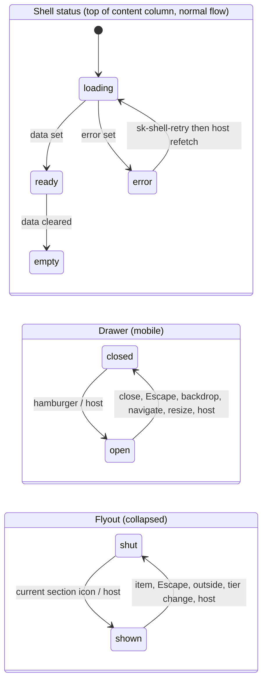

# Data model: App shell

Types live in `packages/mission-ui/src/shell-types.ts`, exported from `src/index.ts`. Synthetic fixtures only.

| Type | Definition | Notes |
|---|---|---|
| `ShellLayout` | `'project' \| 'mission'` | which regions render |
| `ShellTier` | `'expanded' \| 'collapsed' \| 'mobile'` | output only, from window width via one private `readTier()` |
| `ShellIcon` | `'missions' \| 'drift' \| 'ops' \| 'projects' \| 'pipeline' \| 'work-packages' \| 'artifacts' \| 'file' \| 'folder' \| 'menu' \| 'close' \| 'back'` | drawn by `shell-icons.ts` |
| `ShellNavItem` | `{ id: string; label: string; href: string; icon: ShellIcon; pinned?: boolean }` | `id` unique across rail, navigation, footer, back link; `pinned` puts a rail item in the bottom group |
| `CurrentMark` | `'page' \| 'true' \| ''` | `aria-current` value of a nav item or tree row |
| `ShellTag` | `{ label: string; tone: 'neutral' \| 'info' \| 'success' \| 'attention' \| 'danger' }` | `sk-pill-tag status` |
| `ShellProject` | `{ eyebrow: string; name: string; detail?: string }` | project sidebar head |
| `ShellMission` | `{ title: string; id: string; tags: ShellTag[]; backItem?: ShellNavItem; progress?: { done: number; total: number } }` | mission head, footer text |
| `TreeNode` | `{ id: string; label: string; href?: string; kind: 'leaf' \| 'folder'; prefix?: string; icon?: ShellIcon; meta?: string; unavailable?: boolean; expanded?: boolean; children?: TreeNode[] }` | folders have `children` and no `href` |
| `ShellStatus` | `ViewState` | `loading \| error \| empty \| ready` |
| `DrawerReason` | `'hamburger' \| 'close' \| 'escape' \| 'backdrop' \| 'navigate' \| 'resize' \| 'host'` | |
| `FlyoutReason` | `'activate' \| 'escape' \| 'outside' \| 'navigate' \| 'tier'` | |

Rules and invariants
- Layout, tier, navigation item, sidebar section, shell status are the spec's Key Entities; a sidebar section is the head
  (from `project` or `mission`) plus the slotted `sk-shell-tree` sections.
- Current marking (FR-018): `current` marks a sidebar item, `railCurrent` marks a rail item. Only the deepest marked item
  (selected tree leaf, else the sidebar item) carries `aria-current="page"`; shell ancestors carry `"true"`. At most one
  `"page"` in the shell.
- Ids are unique across all lists; a folder has `children` and no `href`; `tier` is derived, never accepted from a host
  (re-asserted in `willUpdate`); `drawerOpen` is forced `false` outside mobile; `flyoutOpen` outside collapsed.

State

Drawer and flyout requests dispatch a cancelable event first and apply only if not prevented. Folder toggle: `
`
`toggle` emits `sk-tree-toggle { id, expanded }`; a new `items` array resets the state.

Events: `sk-navigate {id, href}`; `sk-tree-toggle {id, expanded}`; `sk-toggle-drawer {open, reason: DrawerReason}`
(cancelable); `sk-toggle-flyout {open, reason: FlyoutReason}` (cancelable); `sk-shell-retry {}`. All `bubbles`, `composed`.
