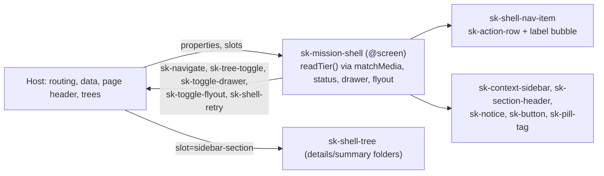

# Implementation Plan: App shell with all its states

**Branch**: `feat/app-shell` (current, planning base and merge target; `branch_matches_target: true`) | **Date**: 2026-10-01 | **Spec**: `kitty-specs/app-shell-01M3V82X/spec.md`
**Input**: Feature specification `kitty-specs/app-shell-01M3V82X/spec.md`, GitHub issue #2 and its research comment. Revision 2 (squad review, operator rulings R1 to R3).

## Summary

Add one shared application shell to `@spec-kitty/mission-ui`: a screen-contract element `sk-mission-shell` (top bar, local
rail, context sidebar, content focus target, shell status, skip link) plus two pattern elements, `sk-shell-nav-item` and
`sk-shell-tree`. A `tier` (expanded at 1100 px and above, collapsed 620 to 1099 px, mobile below 620 px) is computed from
the window width with `matchMedia` through one private function and drives CSS and behaviour; no toggle, nothing stored.
Collapsed tier: an icon column whose icons show label bubbles (R3) and whose current-section icon opens a flyout with the
section's head and tree (R1). Mobile tier: a local overlay drawer (native `<dialog>`, backdrop, content never moves, R2).
`sk-app-shell` and `sk-personal-rail` are not reused (research D-01); the gaps G-01 to G-15 are listed with proposals.
About 53 new baselines at 1280, 1024, 800, 680, 390 and 320 px. Decisions and evidence: `research.md`; contract:
`contracts/`; types: `data-model.md`. New requirements: FR-016 to FR-019, NFR-005 (appended to `spec.md`).

## Technical Context

**Language/Version**: TypeScript 5 strict, Lit 3.3.3, Node 22.22.2, pnpm 11.18.0 (pinned)
**Primary Dependencies**: `@spec-kitty/elements` 1.1.0-rc.10 (`sk-context-sidebar`, `sk-section-header`, `sk-action-row`, `sk-button`, `sk-notice`, `sk-status-indicator`, `sk-pill-tag`), `@spec-kitty/tokens`, `@spec-kitty/styles`; no new dependency
**Storage**: N/A (no I/O, nothing stored)
**Testing**: Vitest 4.1 browser mode (`import { page } from 'vitest/browser'`; `page.viewport` first, reset in `afterEach`; the default iframe is 414x896 = mobile); Storybook 10.6 stories; Playwright visual spec in the pinned container
**Target Platform**: evergreen browsers (dashboard) and the Kitty Desktop webview
**Project Type**: pnpm workspace: `packages/mission-ui`, `apps/storybook`
**Performance Goals**: no layout jump on tier change; content top edge unchanged when crossing a breakpoint within the same status (NFR-003)
**Constraints**: no I/O (bare `matchMedia`, `.focus()`, `showModal()`, `document.addEventListener` pass; `window.*` fails; avoid identifiers `parent`, `top`, `location`, `frames`); Stylelint allow-list in research D-02 (layout properties, `--sk-*` values, `%`/`fr` only; no `border`, `outline`, `transform`, `overflow-wrap`); ESLint bans raw `<button>/<input>`, `class=`, `style=`; visible text in slots; 0 visual failures over 5 repeats
**Scale/Scope**: 3 elements, about 53 baselines, about 25 behaviour tests, 0 new gates

## Charter Check

| Charter rule | Status |
|---|---|
| Data in as properties; `status` | pass: `@screen` shell with `status`, shown at the content column top edge in every tier |
| Events out, `bubbles` and `composed` | pass: five literal `sk-*` events, typed, `HTMLElementEventMap`; library events stopped at the boundary |
| No I/O | pass (verified with the no-io config via stdin) |
| Elements over CSS; gap not hand-roll | pass with recorded exceptions G-01 to G-15 (local grid, rail, icon column, nav item, tree, skip link, dialog drawer, flyout, bubble, icons); each needs operator approval at PR review |
| Atomic design, deep modules | pass: 1 shell, 2 pattern elements, regions private |
| Quality gates incl. manifest, no-io, visual | pass: no new plant (research D-06) |
| Stories per state, synthetic fixtures; test per event | pass: matrix research D-05 |
| Reviewer per WP; squad after plan | squad ran on revision 1; rulings folded |

## Architecture



| Window width | Tier | Mission layout | Project layout |
|---|---|---|---|
| 1100 px and above | expanded | top bar; rail 3.5rem; sidebar 15rem; content | top bar; sidebar 15rem; content |
| 620 to 1099 px | collapsed | rail; icon column 3.5rem (label bubbles; current section icon opens flyout); content | icon column; content |
| below 620 px | mobile | hamburger; overlay drawer (rail strip, sidebar, trees); content | hamburger; overlay drawer; content |

## Project Structure

### Documentation (this mission)
```
kitty-specs/app-shell-01M3V82X/
├── spec.md  plan.md  research.md  data-model.md  quickstart.md
├── contracts/ sk-mission-shell.md  sk-shell-nav-item.md  sk-shell-tree.md
└── tasks.md        # NOT created here
```

### Source Code (repository root)
```
packages/mission-ui/
├── src/
│   ├── index.ts                     # guarded registration of 3 tags + type exports (IC-01 only)
│   ├── shell-types.ts  shell-icons.ts
│   └── elements/
│       ├── sk-mission-shell/  sk-mission-shell.ts  shell-parts.ts  fixtures.ts  sk-mission-shell.stories.ts
│       ├── sk-shell-nav-item/ element, fixtures, stories
│       └── sk-shell-tree/     element, fixtures, stories
├── test/ sk-mission-shell.test.ts  sk-shell-nav-item.test.ts  sk-shell-tree.test.ts
├── custom-elements.json  CHANGELOG.md
apps/storybook/.storybook/preview-head.html        # `sk-mission-shell { display: block; height: 800px }` only
apps/storybook/tests/visual/stories.visual.spec.ts # vw-<n>, tab-<n>, mandatory tier assertion
apps/storybook/tests/visual/__snapshots__/         # 53 new baselines
.github/workflows/ci.yml                           # visual timeout 10; proof visual matrix leg 15
```
**Structure Decision**: extend the "Add an element" recipe in `README.md`; registration only through `src/index.ts`.

## Implementation Concern Map

One serial chain. A lane that depends on another is created from its parent lane's branch (spec-kitty cannot parent a lane
on two lanes), so no parallel lanes.

### IC-01 — Foundation and frozen manifest
- **Purpose**: types, icons, three skeleton classes carrying the FULL public surface (properties, `@fires`, `@slot`, `@csspart`, `@screen`, literal `dispatchEvent` calls), registrations, visual-spec extension (`vw-`, `tab-`, mandatory tier assertion), preview-head rule, regenerated manifest.
- **Relevant requirements**: FR-011, FR-013, NFR-001, NFR-002
- **Affected surfaces**: `shell-types.ts`, `shell-icons.ts`, `index.ts`, three skeleton element files, `custom-elements.json`, `stories.visual.spec.ts`, `preview-head.html`
- **Sequencing/depends-on**: none
- **Risks**: prove the spec change is a no-op for tagless stories (the 4 sample baselines identical, the `visual` plant still fails); later lanes must not change JSDoc or members without regenerating the manifest; merges resolve `custom-elements.json` by regeneration only.

### IC-02 — Navigation item (with stories and baselines)
- **Purpose**: `sk-shell-nav-item`: current marks, compact mode, label bubble (R3), `sk-navigate`; its 6 stories, baselines, tests.
- **Relevant requirements**: FR-004, FR-006, FR-011, FR-012, FR-017, FR-018, NFR-004
- **Affected surfaces**: `elements/sk-shell-nav-item/`, `test/sk-shell-nav-item.test.ts`, its baselines
- **Sequencing/depends-on**: IC-01
- **Risks**: bubble not clipped; WCAG 1.4.13 behaviours; focus delegation; non-flush row look (G-13).

### IC-03 — Tree (with stories and baselines)
- **Purpose**: `sk-shell-tree` with `<details>` folders, selection, `sk-tree-toggle`, stopPropagation of library events; 5 stories, baselines, tests.
- **Relevant requirements**: FR-003, FR-011
- **Affected surfaces**: `elements/sk-shell-tree/`, `test/sk-shell-tree.test.ts`, its baselines
- **Sequencing/depends-on**: IC-02
- **Risks**: `summary` colour inheritance in the dark theme (fallback in research D-04, operator approval first).

### IC-04 — Shell frame, tiers, status
- **Purpose**: grid, top bar, rail, sidebar heads, footer, status region, content focus target, skip link slot, `readTier()`, current marks, landmarks.
- **Relevant requirements**: FR-001, FR-002, FR-004 to FR-006, FR-008 to FR-010, FR-012, FR-018, FR-019, NFR-003, NFR-005
- **Affected surfaces**: `sk-mission-shell.ts`, `shell-parts.ts`, `fixtures.ts`, `test/sk-mission-shell.test.ts` (frame, tiers at 619/620/1099/1100/680, status, landmarks, Tab-walk, 200% font)
- **Sequencing/depends-on**: IC-03
- **Risks**: exactly one `main`; content top edge unchanged across breakpoints within a status; long unbroken names wrap (G-14).

### IC-05 — Drawer and flyout
- **Purpose**: `<dialog>` overlay drawer, flyout overlay, cancelable events, forced-false rules, focus in and back, outside click, stopPropagation.
- **Relevant requirements**: FR-007, FR-011, FR-014, FR-016, NFR-004
- **Affected surfaces**: `sk-mission-shell.ts`, `shell-parts.ts`, shell tests
- **Sequencing/depends-on**: IC-04 (same files)
- **Risks**: dialog background and border (G-11): sidebar part must fill the dialog, flag any light panel in IC-05; tier change while open; host-set state.

### IC-06 — Shell stories, baselines, integration
- **Purpose**: the 42 shell stories (research D-05), baselines inside the pinned image, changelogs, CI timeouts, 5 consecutive clean repeats, gate-proof.
- **Relevant requirements**: FR-013, NFR-001, NFR-002, SC-001, SC-004
- **Affected surfaces**: `sk-mission-shell.stories.ts`, `__snapshots__/`, `custom-elements.json` (regenerate), both `CHANGELOG.md`, `.github/workflows/ci.yml`
- **Sequencing/depends-on**: IC-05
- **Risks**: CI time (measured values go in the PR); pixel stability at 1024, 800, 680.

Brief every WP: no sub-agents, baselines only inside the pinned container, no absolute paths in committed files,
a denied command means stop and report.

## Complexity Tracking

| Deviation | Why needed | Simpler alternative rejected because |
|---|---|---|
| Local grid, rail, icon column, skip link, dialog drawer, flyout, bubble beside the library | `sk-app-shell` and `sk-personal-rail` cannot express the tiers, the project layout, an overlay drawer or the collapsed rail under the lint rules (G-01 to G-15) | wrapping them breaks decisions 2 and 3 and the R2 overlay |
| Two pattern elements | one tested nav item and tree for four regions | inline copies quadruple tests |
| `matchMedia` in an element | the tier is needed in JavaScript; `px` media queries fail Stylelint | container queries rely on a lint blind spot |
