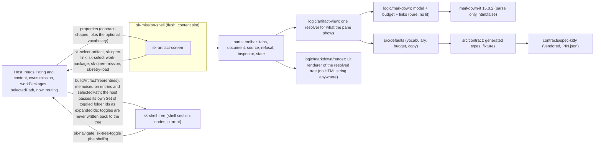
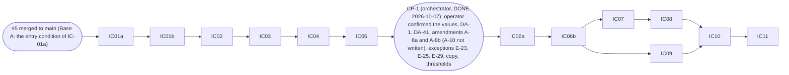

# Implementation Plan: Artifact Viewer screen

**Branch**: `feat/artifact-viewer-screen-7` (current branch, planning base and merge target; `branch_matches_target: true`) | **Date**: 2026-10-06 | **Spec**: `kitty-specs/artifact-viewer-screen-01M47VP5/spec.md`
**Input**: the specification with the operator's rulings on Q1 to Q9 and N-Q10 to N-Q12 (2026-10-06, commits 6fbc341 and 1a2322e), GitHub issue spec-kitty/spec-kitty-mission-ui#7, the Mission Status contract `1.0.0-SNAPSHOT` on spec-kitty `main` (read at tip `2261ad5`, 151 files under `contracts/mission-status` and `contracts/_shared`, counted as blobs), the approved Kitty Desktop V2 prototype page `05-artifact.html` with `prototype.css`, the merged code of mission-ui#4 (PR #6, merge `cef2d53`) and mission-ui#5 (planning branch `feat/work-package-screen-5`; its implementation is on its mission and lane branches, WP01 to WP09 approved and WP10 in progress at the verification date, NOT merged; see "Build base").

## Summary

Add ONE public element, `sk-artifact-screen`, to `@spec-kitty/mission-ui`, with private part files, taking `ArtifactListing`, `ArtifactContent` and a refusal code as properties (thirteen in all: the twelve of FR-001 plus one optional `vocabulary`, amendment A-9; `contracts/sk-artifact-screen.md`), emitting five `sk-*` intent events (`sk-select-artifact` and `sk-open-link` new; `sk-select-work-package` and `sk-open-mission` reused from #4; `sk-retry-load` shared with #5: both payload types, their union and the one `declare global` live in a neutral `src/retry-types.ts`), read-only and free of I/O. The screen is the document pane plus inspector, set to the shell's `flush`; the tree is the shell's, fed by the pure `buildArtifactTree` helper (Q2). Markdown is parsed by `markdown-it` 15.0.2 (exact pin, `html: false`, linkify, typographer and plugins off) into a token stream, turned into a closed, bounded node model (budgets counted over the flattened stream, inline children included), classified once per link in a cached step, and drawn as Lit templates with literal tags: no `innerHTML`, no `unsafeHTML`, no `DOMParser`, no `markdown-it` render call, no `href`, no `img`, no property binding (`contracts/markdown-renderer.md`). A hostile-corpus test with three planted renderer weakenings (and two lint plants) is the gate. A throw, a budget overrun or an unknown token falls to the fallback (escaped source). The visual authority is the prototype: the 38-item drift register DA-1 to DA-38 (plus DA-39 and DA-40, amendment A-6, ruled "keep" with their values pinned at CP-1 (900 px and 68 px), and the new DA-41, the bidirectional-control notice) was CONFIRMED by the operator at CP-1 on 2026-10-07, which sat after six spikes (S-A1 to S-A6) and before every work package that builds visuals. No kind, lane, phase or refusal-code literal enters the screen: the vocabulary lives in `defaults/`, and IC-02 extends the `data-driven` gate to read the twelve `ArtifactKind` values and the seven refusal codes from the vendored schema enums. Six exceptions, E-23 and E-25 to E-29 (E-24 is merged into E-23; E-29 approved at CP-1; E-26 is the tab paint entry), are ruled at CP-1 in `contracts/gates.md`, each token-only, file-scoped and with a sunset; E-23 needs a `ch` unit grant in the Stylelint exception mechanism (IC-06a). 45 stories with dark-theme baselines, committed only in the last work package.

## Technical Context

**Language/Version**: TypeScript 5.9 strict (`exactOptionalPropertyTypes`, `noUncheckedIndexedAccess`), Lit 3.3.3, Node 22.22.2, pnpm 11.18.0 (pinned), all as #4
**Primary Dependencies**: `@spec-kitty/elements` 1.1.0-rc.10 (`sk-pill-tag` (no `sk-page-header`: this screen has a file toolbar, not a page header, DA-11), `sk-notice`, `sk-button`), `@spec-kitty/styles` (adopted families `facts` (the `factsSheet` export comes from #5's merged `library-sheets.ts`; this mission adds no sheet), `empty-state` and `progress` (present from #4) and `segmented-choice` (adopted by #4 for E-01; this screen does not use it, E-26 is a paint entry), and the `pill-tag` styles sheet for the E-29 pill class (see "Shared files", `library-sheets.ts`)), `@spec-kitty/tokens`; ONE new runtime dependency, **`markdown-it` 15.0.2** (exact pin, MIT, ships its own type declarations, so no `@types/markdown-it`; its transitive set is the one `pnpm why markdown-it` prints at IC-01b, not a list written here: at plan time `mdurl`, `argparse` (CLI only, not in the browser entry), `entities`, `linkify-it`, `uc.micro` and `punycode.js`, with no `@types/*` package, because `mdurl` and `linkify-it` ship their own declarations; the licence of each is read from its lockfile entry and goes into the PR description, FR-043). Supply-chain record (DIRECTIVE_051): registry, version, licence list, integrity, signatures, the six-advisory union of the repository list and the GitHub global advisory database, and the bundle figure, in `research.md` D-05; the pin is the version that fixes the newest advisory (GHSA-r7fv-28h4-cvq7) and is not below the patched versions of GHSA-253c-mchw-3w2r, GHSA-6v5v-wf23-fmfq, GHSA-38c4-r59v-3vqw and GHSA-6vfc-qv3f-vr6c (GHSA-j5p7-jf4q-742q, below 3.0.0, does not apply); linkify and typographer stay off regardless. No other runtime dependency; no new devDependency (no axe: accessibility is asserted with explicit role, accessible-name, landmark and idref checks and, in the spikes, Playwright's `ariaSnapshot`, which the existing Playwright already provides; PLAN-FRESH4-003 (b)).
**Storage**: N/A (no I/O, nothing stored)
**Testing**: Vitest browser mode (`page.viewport` first; the package's vitest runs in Chromium only, so nothing under `packages/mission-ui/test/` reads the file system or runs a bundler) for the screen, the corpus and the pure logic and markdown model; `node:test` files under `scripts/` for contract tooling, the bundle budget and the row-to-story test (run by `pnpm test:scripts`, the `hygiene` gate); source scans in the browser project through `import.meta.glob(..., { query: '?raw' })`; `gates/*.selftest.ts` (node vitest) for the data-driven and markdown-lint self-tests; Storybook stories; Playwright visual spec in the pinned container
**Target Platform**: evergreen browsers (dashboard) and the Kitty Desktop webview; the screen renders inside `sk-mission-shell` (mission layout, `flush`)
**Project Type**: pnpm workspace as #4: `packages/mission-ui`, `apps/storybook`, root `contracts/` and `scripts/`
**Performance Goals**: a 256 KiB markdown document reaches the document (not the fallback: the test pins the expected branch) and a 1000-entry tree builds and renders, each in 500 ms or less; a re-render on a property change that does not touch `content` in 200 ms or less (NFR-006: hard ceilings, each the best of three after a warm-up, with a counted `parseTokens` spy for the cache; the spec numbers are the ceilings: no multiplier: A-10 was not written, ruled at CP-1 on 2026-10-07); the parse is cached by the value of `content.content` and `content.mediaType` (D-07)
**Constraints**: no I/O; project CSS layout-only with `--sk-*` tokens (Stylelint; numbered exceptions only); ESLint bans raw `<button>/<input>`, `class=`, `style=`, `unsafeHTML` outside recorded exceptions, and, in this mission's code, under `logic/markdown/` every property or boolean binding and any attribute outside an allowlist, and in the element files any attribute outside the allowlist and any property or boolean binding not named in the reviewed R4 list (stories and fixtures excluded by glob); no arithmetic on contract values beyond the one size-display rule; no kind, lane, phase or refusal-code literal outside `defaults/`; document text never becomes markup, a URL, a style or a selector (C-014); fixtures free of paths, usernames, e-mail addresses and credential-shaped strings; baselines only inside the pinned container
**Scale/Scope**: 1 public element (13 properties, 5 events), 8 private part files (the renderer is `logic/markdown/render.ts`, not an element file), 5 new default modules plus the `defaults/index.ts` re-export, 9 new files under `logic/` plus 6 under `logic/markdown/` (the function list is the table in `contracts/defaults.md`), 6 exceptions ruled at CP-1 (E-23, E-25 to E-29) and one Stylelint mechanism grant (`chProperties`), 5 new plants (3 `unit-tests`, 2 `eslint`), 1 extension of the `data-driven` gate (kinds and codes), 30 new registered fixtures (13 contract examples and 17 overlays) plus 4 bulk generators, 45 new stories and baselines (committed in IC-11 only), 1 contract re-vendor (151 files at plan time), 1 neutral `src/retry-types.ts` for `sk-retry-load` (D-04), 2 additive `ShellIcon` glyphs, 13 work packages (IC-01a, IC-01b, IC-02 to IC-05, IC-06a, IC-06b, IC-07 to IC-11)

## Build base (dependency on #4 and #5)

#4 is MERGED (`cef2d53`); this branch holds it. **Base A only (operator ruling PLAN-DESIGN-017, 2026-10-06)**: implementation builds on #5 AFTER #5 has merged to `main`. IC-01a is blocked until then: that is its entry condition, not a choice put to the operator at dispatch. The orchestrator re-verifies the merge state upstream at dispatch (`gh pr list` on the repository, `git ls-tree` of the merged `main`) and does not dispatch IC-01a otherwise; the local refs are never evidence. **State of #5 as of the verification date (2026-10-06)**: no pull request for #5 exists upstream; the planning branch `feat/work-package-screen-5` holds planning artifacts only (its commit `1b43257` carries a `status.json` with WP01 to WP09 approved and WP10 in progress); the implementation exists on `kitty/mission-work-package-screen-01M44DSJ` and its lane branches `-lane-a` to `-lane-j` (lane-j tip `d15cb5d`, 2026-10-06 09:47 +0200; every symbol below was re-read at that tip), and nothing is merged to the target branch yet. Every row of the table below was checked against real code, not against a plan, and is re-read on the merged tree by the orchestrator (a mismatch is reported, not absorbed; the list is the checklist of `contracts/sk-artifact-screen.md`, "Dependencies on #4 and #5"). IC-01a starts from "`main` with #4 and #5 merged", records the sha, and runs the full gate set for a green baseline first. Nothing is stacked, so the maintainer's practice of landing stacked slices himself does not arise.

What this mission needs from #5:

| Need | Where it comes from (verified symbol, lane-j tip `d15cb5d`) |
|---|---|
| `sk-select-work-package` `{ missionId, wpId }`, `sk-open-mission` `{ missionId, slug }`, `LabelHooks`, `lookup`, `relativeTime`, `resolveActivity`, `VIEW_STATES`, `renderIcon`, `shellFrame`, `flush`, gates, `classOnly` ESLint helper, the exception table to E-16 | #4, merged |
| `sk-retry-load` and its payload: `RetryLoadDetail`, the landed union of `WorkPackageRetryDetail` and `DetailRetryDetail` (each `{ missionId, wpId, target }`), a type in `logic/wp-retry.ts`, aliased `SkRetryLoadDetail` in `sk-work-package-screen.ts` (`export type SkRetryLoadDetail = RetryLoadDetail`), whose `HTMLElementEventMap` entry `CustomEvent<SkRetryLoadDetail>` is today the one `declare global` of the key | #5, new. IC-06b moves both detail types, the union and the one `declare global` to the neutral `src/retry-types.ts` (D-04); #5's names stay as re-exports |
| `REVIEW_CYCLE_ARTIFACT_KIND` in `defaults/review.ts`, typed `components['schemas']['ArtifactKind']` | #5; this mission's `defaults/artifact-kinds.ts` owns the whole kind table and IMPORTS that constant (D-12) |
| `factsSheet` (and the event-timeline sheet) in `library-sheets.ts` | #5; imported, never added here |
| `eslint.data-driven.config.mjs`, `gates/data-driven.selftest.ts` and `gates/fixtures/data-driven/**` as #5 extended them (S13 and S14, 38 selector entries, bare words matched only in comparisons) | #5; IC-02 extends the merged file in that shape and derives every count from the arrays, not from literals |
| Contract tooling: `--from-repo`, `PIN.json` provenance fields, check C8, `update.test.mjs`, `cli.test.mjs`, the literal counts in `registry.test.mjs`, `overlays.test.mjs`, `check.test.mjs`; additive lines in `contract/types.ts`, `logic/types.ts`, `defaults/index.ts` | #5 IC-01 and later; the final re-vendor still uses the public `--sha` form (D-09) |
| Exceptions E-17 to E-22 and the `stylelint-exceptions.test.mjs` cases | #5; this mission's numbering starts at E-23 with no gap |
| `sk-open-artifact` `SkOpenArtifactDetail { missionId, path, kind }` (`sk-work-package-screen.ts`) | #5 (emitted by the Work Package screen); consumed by the host; this screen never imports or re-emits it (asserted with a dispatched event of the same name and shape, a plain `CustomEvent`) |
| `scripts/wp-story-catalogue.test.mjs` (a node:test row-to-story test; on #5's tip it runs under `test:terminology`, which CI does not run) | #5; the model for this mission's, which is deliberately placed in `test:scripts` so CI runs it (a new CI behaviour, not precedent, PLAN-FRESH4-010) |

Because this mission lands after #5, its contract re-vendor (151 files at plan-time main) already contains #5's 1.1 slice (`WorkPackageDetail*` schemas are present at `2261ad5`), and there is no "whichever lands second" case. After IC-11, every gate self-test is re-run on the final tree (a reviewer check). The shared files below are the additive edits this mission makes on the merged tree.

| Shared file | #5 (merged) holds | This mission adds | Rule |
|---|---|---|---|
| `packages/mission-ui/src/index.ts`, `custom-elements.json` | its screen's exports and manifest | `sk-artifact-screen` | manifest by `pnpm manifest:generate` only; `index.ts` by hand, additive |
| `package.json` (root and package), `pnpm-lock.yaml` | its scripts | `markdown-it`, script entries (`test:no-io`, `test:scripts`) | by hand, additive; lockfile by `pnpm install` |
| `eslint.config.mjs`, `stylelint.config.mjs`, `scripts/stylelint-exceptions.test.mjs` | E-17 to E-22 and their cases | R1 to R5, `noInlineConfig`, the `chProperties` grant, E-23, E-25 to E-27 (E-29), E-28 | ids are appended after E-21; by hand |
| `eslint.data-driven.config.mjs`, `gates/fixtures/data-driven/**`, `gates/data-driven.selftest.ts` | S13 and S14 words, 38 entries, `EXPECTED_WORDS` | kinds and codes, bare-word comparison selectors | every count is derived from the arrays (no literal arithmetic); re-run both data-driven commands |
| `packages/mission-ui/src/library-sheets.ts` | `factsSheet`, event-timeline | uses `factsSheet` | not edited |
| `defaults/index.ts`, `logic/types.ts`, `contract/types.ts`, `contract/bulk.ts` | additive lines | re-exports, view types, bulk generators (the shared `LabelHooks` of `logic/types.ts` is NOT edited here) | by hand, additive |
| `shell-types.ts`, `shell-icons.ts` (#4's files) | the closed `ShellIcon` set and the glyph paths | two additive members, `magnifier` and `table` (paths from `05-artifact.html:23-24`) | additive only; no existing member or path edited |
| `scripts/contract/*.test.mjs` literals (`registry`, `overlays`, `check`) | its fixture counts | 30 registered fixtures | counts relative to the merged base, derived from the registry where possible |
| `gates/plants/**`, `.github/workflows/ci.yml` timeouts, `surface-freeze.test.ts`, `story-support/shell-frame.ts` | its plants, tests, timeouts | five plants, the unit-tests proof-leg timeout, 13 properties of this screen, the sidebar tree option | by hand; plants are array entries |
| `sk-retry-load` typing: `logic/wp-retry.ts` and `sk-work-package-screen.ts` | `RetryLoadDetail` (the landed union), the alias `SkRetryLoadDetail`, the event-map entry | a neutral `src/retry-types.ts` holding `RetryLoadDetail`, `SkArtifactRetryDetail`, the union and the one `declare global` | ONE named edit of #5's merged files, by IC-06b: `logic/wp-retry.ts` re-exports `RetryLoadDetail`, `sk-work-package-screen.ts` keeps its alias and loses its event-map entry; #5's names, tests and manifest text are unchanged |
| both `CHANGELOG.md`, `README.md` | its entries | one line per slice | by hand |

## Charter Check

| Charter rule | Status |
|---|---|
| Data in as properties typed from the OpenAPI read contract | pass: types generated from the re-vendored pin; the screen's props are the generated `ArtifactListing`, `ArtifactContent` and a refusal code; `mission` and `workPackages` are host-held structural subsets of `MissionDetail` (`data-model.md`); gate `contract` proves freshness and fixture validity |
| View state in as a property | pass: `status` (four charter states plus `not-found` and `nothing-selected`) and `contentStatus` (`loading`, `ready`, `refused`, `error`), each with its own normaliser |
| Events out as `bubbles` `composed` `sk-*` CustomEvents, every payload asserted | pass: five events, literal dispatch sites in the screen file, `@fires`, EV-1 to EV-10 tests with positive controls |
| No I/O | pass: `no-io` scans every new file including `logic/markdown/`; images are never loaded, links never followed; the corpus test asserts the structure (no `img`, no `href`; the proof of NFR-005) and corroborates with a CSP `securitypolicyviolation` listener that has a positive control |
| Elements over CSS; a gap is not hand-rolled | pass with exceptions E-23 and E-25 to E-29 (ruled at CP-1) and gaps G-14 to G-21 (`research.md`); every primitive the library has is its element or its adopted family (`sk-button`, `sk-notice`, `sk-pill-tag`, the facts, empty-state and progress sheets) |
| Atomic design, deep modules | pass: one public element, small surface, private parts; the markdown model is a deep module with one entry (`buildMarkdownModel`) |
| Quality gates incl. manifest, no-io, visual | pass: all existing gates apply; `data-driven` extended; five plants added; surface-freeze extended |
| A story per view state, synthetic fixtures; a test per event | pass: 45 stories (D-17), fixtures from the contract examples plus named overlays and generators |
| Visual regression against the prototype; drift is REJECT | pass: the register DA-1 to DA-41 was CONFIRMED at CP-1 (2026-10-07); no visual work package started before CP-1; baselines only in IC-11 |
| Untrusted text is data (security) | pass: `contracts/markdown-renderer.md` states the allowlist, the budget, the link and image rules; NFR-012 plants |
| Fixtures: no real user data, paths, usernames, credentials | pass: hygiene and `contract` cover vendored and generated files; corpus credential-shaped strings are assembled at run time, never stored |
| Reviewer agent per work package; squad after the plan phase only | pass: this plan is the squad's input; the wrap-up aggregate squad is the operator's standing rule (below) |
| PR into `main`, operator merges; operator reviews Storybook after the last WP | pass: one PR after wrap-up; the dependency is named in the PR (FR-043) |
| Amendments and exceptions need operator approval | A-1 to A-4, A-6, A-7 and A-9 are accepted (their values ruled at CP-1), A-5 is rejected with a replacement, A-8 (a and b) was a PROPOSED amendment to N-Q12 and is ACCEPTED in whole at CP-1, and A-10 (a NFR-006 multiplier) is NOT written; E-23 and E-25 to E-29 are RULED at CP-1 (2026-10-07) |

Re-check after design: unchanged. No unjustified violation.

## Gates

Per-gate table, the data-driven extension, exceptions and plants: `contracts/gates.md`. Summary: existing gates keep their commands; `data-driven` is extended by IC-02 (kind enum and the seven refusal codes, read from schema enums); `unit-tests` gains the corpus test and its screen pass, `vocabulary-homes` and the surface freeze for `sk-artifact-screen`; `hygiene` gains two node:test files under `scripts/` through `test:scripts` (the bundle budget and the row-to-story test); source scans run in the browser project through `?raw` globs; `eslint` gains the markdown-renderer rules R1 to R5 and a block turning `noInlineConfig` on, with their self-test run by `test:no-io`; five plants are added (three `unit-tests` plants that weaken the renderer, two `eslint` plants); `contract` re-pins to main and `checkBulk` validates the bulk generators; `visual` gains 45 baselines in IC-11 only; the `unit-tests` proof-leg timeout is re-derived in IC-04, the others in IC-11. No new gate id and no proof-record schema change (a new gate id would need its own plant and a coverage entry). Baseline: before any change IC-01a records the green baseline of every gate command on `main` with #4 and #5 merged, including `pnpm visual` in the pinned container and `pnpm gate-proof`, run by the implementation agent or the orchestrator, never by a plan-phase agent.

## PR shape and wrap-up (operator standing rules, binding)

Reading of the charter: the plan-phase squad runs once after this phase; the aggregate review squad before the draft PR is the operator's standing wrap-up rule (charter 046), report-only, over the implementation diff. ONE pull request, opened only after: accept, test cleanup, the aggregate squad, compaction of history into named slices, rebase onto `main`, full gate re-run, and the operator's Storybook review after the last WP and before wrap-up; then the DRAFT PR. Work packages never push and never open pull requests. Compaction slices, named in advance: contract re-vendor and fixtures (IC-01a); markdown-it dependency and supply-chain record (IC-01b); defaults, logic and gate cases (IC-02); markdown model (IC-03); markdown renderer, corpus, lint rules and plants (IC-04); exceptions, Stylelint grant and lint configuration (IC-06a); skeleton, layout and surface freeze (IC-06b); document pane (IC-07); refusals and states (IC-08); inspector, tree and Work Package links (IC-09); tiers, accessibility and edge cases (IC-10); integration and baselines (IC-11). There is no spike slice: the IC-05 spike code is deleted by a named final commit (`chore(ic-05): remove spike code`), as #5 did. **The PR description names the new runtime dependency** (`markdown-it` 15.0.2, MIT, the licences of its transitive set as printed by `pnpm why markdown-it`, the advisory check re-run at wrap-up against the repository list and the global database (six advisories at plan time), the measured bundle figure and the hostile-corpus evidence, FR-043). Every WP brief states: the word `feature` (whole word, any case) is forbidden in `packages/*/src`, story titles, doc comments, fixture content and corpus text (C-009; the identifier `contentFeatures` is safe, the prose around it is not), and every WP that writes under `packages/*/src` (IC-01a, IC-02 to IC-04, IC-06b, IC-07 to IC-11) runs `pnpm test:terminology` as an exit check (CI first sees a red tree only on the PR run, after compaction); no sub-agents; no push; baselines only inside the pinned container; `pnpm visual` is not an exit check before IC-11; no absolute path or username in any committed file (use `<repo>`, `<prototype>`); a denied command means stop and report; the test-quality rules of #4 D-34 and the drift register status are copied in.

## Architecture



Screen layout, from the prototype (`.reading-layout`: `minmax(0, 1fr) 270px`, one column with the inspector first at a viewport of 800 px or less, `document-toolbar` column at 620 px or less) and the shell's real content widths. The shell has three tiers (`sk-mission-shell.ts`: expanded from a viewport of 1100 px, content cell = viewport minus 296 px; collapsed from 720 px, cell = viewport minus 112 px; mobile below 720 px, single column and no rail, cell = viewport), derived as #5 derived its own and proven by spike S-A6. The cell width is NOT monotonic in the viewport across the 720 px tier edge (a 719 px viewport gives a cell of 719 px, a 720 px viewport gives 608 px), so a threshold must be one the mobile tier cannot reach. The ruling (PLAN-A11Y-001 (a), A-1) is the rule below; its figures were ruled at CP-1 (2026-10-07) on S-A6:

| Content cell (container) | Layout |
|---|---|
| width at or above T = 45 rem (720 px; two columns), ruled at CP-1 (S-A6) | document pane `minmax(0, 1fr)` and inspector 270 px (E-28), the inspector placed in the right-hand track by grid placement although it is FIRST in the DOM (PLAN-A11Y-009 (b)). The shell's mobile tier (cell = viewport, below 720 px) can never reach T. The 1100 px viewport (content about 804 px) is HERE: two columns, which corrects spec rows AV-33 and DA-33 (amendment A-1) |
| width below T (one column) | one column, the inspector first (it is first in the DOM, so there is no `order` property), flat inspector with a top border. The 800 px viewport gives a cell of 688 px and is HERE. Viewports 801 to 831 px on the collapsed tier (cell 689 to 719 px) are also here although the prototype shows two columns: a 31 px window of confirmed drift, recorded at CP-1 (DA-33) |
| toolbar stack, OPTION C (ruled at CP-1): a container query `@container (max-width: 38.75rem)` (620 px) COMBINED with `:host(:state(shell-mobile))` from #5's `ShellTierController`, so the toolbar stacks only in the shell's mobile tier at a cell of 620 px or less | the toolbar stacks; tables keep their own scroll box (they have it at every width). The prototype's 620 px breakpoint lies inside the mobile tier. S-A6 measured zero drift over the sampled widths (no 720 to 732 px window, no 601 to 620 px window); the container-only option A (a 13 px window at 720 to 732 px) and the lower-threshold option B (fails the 620 px anchor) are rejected. The controller is used ONLY for this rule: the one-column rule stays the container threshold T with no controller, and the controller consumes the host's one `attachInternals()`, so the screen calls `attachInternals` nowhere else |

The shell owns the viewport tiers; the screen's thresholds are container queries on its own host (`container-type: inline-size`, the probe passed for #5), written in rem so the column switch follows the reader's text size (NFR-004; the figures above convert at the default 16 px root), values measured by S-A6 over the sampling list 689, 719, 720, 732, 799, 800, 801, 831, 832, 1099 and 1100 px, recording for each viewport the ONE tier the shell selects and the resulting content-cell width (with 1280, 1000 and 620 px) and recorded in `contracts/sk-artifact-screen.md`, "Layout". Every `display: grid` declares `grid-template-columns: minmax(0, 1fr)`-based tracks (#5's spike S9 lesson).

## Project Structure

### Documentation (this mission)
```
kitty-specs/artifact-viewer-screen-01M47VP5/
├── spec.md  plan.md  research.md  data-model.md  quickstart.md
├── contracts/ sk-artifact-screen.md  markdown-renderer.md  contract-pin.md  defaults.md  gates.md
├── tracer-design-decisions.md        # orchestrator-owned log (rulings Q1-Q9 and N-Q10 to N-Q12 recorded)
├── reviews/                          # squad trail (plan phase)
└── tasks.md                          # NOT created here
```

### Source code (repository root; additions on top of the build base)
```
contracts/spec-kitty/**  PIN.json                                  # re-vendored from main (151 files at plan time)
scripts/contract/{update,check,overlays,registry,generate}.mjs  *.test.mjs  # literals, relaxations, fixture inventory, checkBulk (IC-01a)
scripts/bundle-budget.test.mjs  scripts/artifact-story-catalogue.test.mjs   # node:test, run by test:scripts (IC-04, IC-11)
gates/plants/{unit-tests,eslint}/plant.json  + plant files          # five plants (IC-04)
gates/markdown-lint.selftest.ts                                     # the self-test of rules R1 to R5, run by test:no-io (IC-04)
eslint.data-driven.config.mjs  gates/fixtures/data-driven/*  gates/data-driven.selftest.ts  # IC-02: kinds and codes
eslint.config.mjs  eslint-rules/  stylelint.config.mjs             # R1 to R5, noInlineConfig, local rules R1 and R4 (IC-04); chProperties grant, E-23, E-25 to E-28, the R4 options schema and the empty element list (IC-06a); the derived R4 element list (IC-06b)
packages/mission-ui/package.json  pnpm-lock.yaml                    # markdown-it 15.0.2 exact (IC-01b)
packages/mission-ui/src/
├── contract/  types.ts (+ ArtifactListingView, ArtifactContentView aliases)  bulk.ts (+ listing, markdown, long-line, over-budget generators)  fixtures.generated.ts  types.generated.ts
├── defaults/  artifact-kinds.ts  artifact-media.ts  artifact-refusals.ts  artifact-copy.ts  markdown.ts  index.ts (re-exports)
├── logic/     artifact-types.ts  artifact-status.ts  artifact-path.ts  artifact-tree.ts  artifact-view.ts  artifact-wp.ts  artifact-size.ts  artifact-refusal.ts  artifact-facts.ts
│              markdown/ parse.ts (the only markdown-it importer)  model.ts  links.ts  budget.ts  render.ts (lit only)  index.ts (the pure surface; render.ts is imported directly)
└── elements/sk-artifact-screen/
    sk-artifact-screen.ts  toolbar-parts.ts  tab-parts.ts  document-parts.ts  source-parts.ts  refusal-parts.ts
    inspector-parts.ts  state-parts.ts  prose-styles.ts  fixtures.ts  *.stories.ts (4 files)
packages/mission-ui/src/story-support/shell-frame.ts               # + sidebar tree option (IC-06b only)
packages/mission-ui/src/overflow-region.ts                           # #4's OverflowRegion, ONE named additive edit: several targets, both axes (IC-06b)
packages/mission-ui/src/retry-types.ts                              # NEW, neutral: RetryLoadDetail, SkArtifactRetryDetail, the union, the one declare global (IC-06b)
packages/mission-ui/src/shell-types.ts  shell-icons.ts              # + two additive ShellIcon members, magnifier and table (IC-02)
packages/mission-ui/test/  sk-artifact-screen.<area>.test.ts  markdown-*.test.ts  markdown-corpus.test.ts  markdown-corpus.screen.test.ts  artifact-*.test.ts  vocabulary-homes.test.ts  support/walk-allowed.ts  surface-freeze.test.ts (extended)
packages/mission-ui/src/index.ts  custom-elements.json             # one registration, one manifest regeneration (IC-06b)
apps/storybook/tests/visual/__snapshots__/                         # 45 new baselines (IC-11)
README.md  CHANGELOG.md (root and package)                         # IC-11
```
**Structure Decision**: follow #4's "Add an element" recipe; registration only through `src/index.ts`; generated files only through `pnpm contract:generate`; the part file is the unit of write ownership. `logic/markdown/render.ts` imports `lit` (`html`, `nothing`) and nothing from the DOM, and draws a resolved tree (every link already classified in the cached step); it is the "token-stream to Lit-template renderer in `logic/`" of the operator's ruling and is imported directly by `document-parts.ts`, never through `logic/index.ts`, so the model stays lit-free. The one separator and the one path-resolution rule live in `logic/artifact-path.ts`, shared by the tree, the link classifier and the Work Package matcher.

## Implementation Concern Map

A serial foundation (IC-01a, IC-01b, IC-02 to IC-05), the operator checkpoint CP-1, IC-06a (exceptions, Stylelint grant and lint configuration), IC-06b (skeleton, layout, surface freeze), then two region chains with disjoint write scopes (chain X: IC-07, IC-08; chain Y: IC-09; the truncation note's render body is IC-07's alone, and IC-09 owns only the AV-17 story title and IC-10 the AV-17 test), IC-10 (tiers, accessibility, edge cases) and IC-11 (integration and baselines). IC-01 was split into IC-01a (contract re-vendor, fixtures, relaxations) and IC-01b (the `markdown-it` dependency, the supply-chain record, S-A0 step one), and IC-06 into IC-06a and IC-06b (PLAN-DESIGN-019, ruled 2026-10-06), so each review judges one kind of evidence; IC-02 stays whole and carries per-concern exit checks. The scheme is `IC-NN` with an `a` and `b` only where a split exists; every reference in this mission's artifacts uses it. A WP depends on its parent by `depends_on`; IC-10 needs the orchestrator merge of chain Y into chain X's lane.



CP-1 is not a work package. After IC-05 is approved the orchestrator puts the prototype beside the spike renders (S-A1 to S-A6: prose and the full-syntax document, the raw block, a wide table in its scroll box, the inspector, the tablist and inline link control, the container thresholds over the S-A6 sampling list in each shell tier) in front of the operator, with the drift register, the spec amendments, the exception decisions and the copy defaults (`contracts/defaults.md`). The answer is recorded in `tracer-design-decisions.md` (entry `CP-1 confirmed`) and `spec.md` Clarifications; IC-06a, IC-06b and every later WP check that entry as a file precondition. IC-01a to IC-05 are data, logic, security gate and throwaway spikes, so they run before CP-1.

### Lane mechanics (orchestrator-owned; WP agents never do any of this)

As #4 and #5 recorded (a spec-kitty tooling issue fast-forward `kitty/mission-<slug>` before every first claim and after any merge of `main`; a spec-kitty tooling issue and a spec-kitty tooling issue for dependent lanes and `status.json`; `owned_files` and `lanes.json` `write_scope` tool-owned and never hand-edited): (0) the entry condition of IC-01a (#5 merged upstream) is checked first and a miss is a stop; (1) record the base sha at dispatch; (2) pre-create each dependent lane from the approved parent's tip; (3) IC-10 is parented on IC-08 (chain X): the orchestrator merges the approved IC-09 tip into its lane (`git merge --no-ff`), resolves `custom-elements.json` by `pnpm manifest:generate` only, checks both chains' stories are present, and checks owned-files disjointness: the files changed by IC-09's tip against the `owned_files` of IC-07 and IC-08, where any overlap is a stop, reported, not merged by hand; (4) fallback: if that merge conflicts beyond `custom-elements.json` and `status.json`, serialise IC-09 after IC-08 and record it; (5) the CP-1 entry reaches the lanes by being committed on the target branch and `kitty/mission-<slug>` fast-forwarded; `git merge-base --is-ancestor <CP-1 commit> HEAD` is checked before `implement` and by the reviewer; (6) after IC-01b is approved the orchestrator copies the gzip figure and the node timing table from the IC-01b WP report into `research.md` D-05 and commits on the target branch (fast-forwarding `kitty/mission-<slug>`), BEFORE IC-04 is dispatched, because IC-04 sets the bundle budget from them (`research.md` is on the orchestrator's partition and is never written in a lane).

### Shared files: who may write them

| File | Writer | Everyone else |
|---|---|---|
| `src/index.ts`, `custom-elements.json` | IC-06b (full public surface: 13 properties with attributes, `@fires` including the untrusted-`href` text of `sk-open-link`, all five literal `dispatchEvent` methods and payload builders); later only `pnpm manifest:generate` | a surface change is reported; IC-11 regenerates once; manifest conflicts resolve by regeneration only |
| `sk-artifact-screen.ts` | IC-06b only: class, properties (the `vocabulary` property included) and their normalisers' wiring, layout grid, placement (inspector first in the DOM), container queries, the five dispatch methods, the selected-tab state (seed from `view`, reset on a path change, `onSelect`), the `OverflowRegion` wiring (the screen's scroll elements as its targets, both axes) and the `overflowing` set it feeds, the hidden-heading wiring, the status and content-status switches (calls into `state-parts.ts`), the import and call of every part renderer, the composed `static styles`, the adoption of the sheets, the three caches (`willUpdate`) and the focus rule. Region WPs fill part bodies only | change request to the orchestrator |
| `library-sheets.ts` | nobody, with ONE named additive edit that follows from E-29 (CP-1): `pillTagSheet`, the library's pill-tag styles sheet (`@spec-kitty/styles` `pill-tag/sk-pill-tag.css`; verify the export at the pin), because the raw `button.sk-pill-tag` needs the class rules and the file holds no such sheet today; made by IC-09 (WP11), the consumer, and listed in its hand-off. `factsSheet` and the event-timeline sheet come from #5's merged file, the `empty-state`, `progress` and `segmented-choice` sheets from #4; any other missing sheet is reported | report the need |
| every `*-parts.ts`, `prose-styles.ts` | created by IC-06b as stubs with final export signatures (`contracts/sk-artifact-screen.md`, "Part signatures"); `renderEmptyForm` is complete in IC-06b; the owning WP replaces stub bodies and keeps every signature | none |
| `fixtures.ts` of the element (prop builders and the story pairing table of `contracts/contract-pin.md`) | IC-06b creates a builder for every fixture name and the whole pairing table (IC-02 does not touch this file); later WPs only import | change request |
| `src/defaults/**`, `src/logic/**` (including `logic/markdown/**`) and their tests | IC-02 (defaults, non-markdown logic, `vocabulary-homes.test.ts`), IC-03 (`logic/markdown/{parse,model,links,budget}.ts`), IC-04 (`logic/markdown/render.ts`, `index.ts`, corpus, `test/support/walk-allowed.ts`) | a gap is a change request |
| `shell-types.ts`, `shell-icons.ts` (#4's files) | IC-02 only: two additive `ShellIcon` members, `magnifier` and `table`, and their paths (A-5 rejected; no existing member or path edited, so no baseline changes) | none |
| `src/retry-types.ts` (new) and the named edit of #5's merged files | IC-06b only: the neutral file holds `RetryLoadDetail`, `SkArtifactRetryDetail`, the union and the one `declare global` of `sk-retry-load`; ONE named edit of #5's merged files: `logic/wp-retry.ts` re-exports `RetryLoadDetail`, `sk-work-package-screen.ts` keeps its alias `SkRetryLoadDetail` and loses its event-map entry (D-04); no #5 name, test or manifest text changes | a change to this file is reported |
| `packages/mission-ui/src/overflow-region.ts` (#4's file; `OverflowRegion`, used by the Work Package board and the Pipeline screen) | IC-06b only: ONE named additive edit (several targets and both axes; measure-on-update and the fonts-ready pass kept; PLAN-FRESH3-001 (a)); the existing options and behaviour of its two users, and their tests, are unchanged | a change to this file is reported |
| `src/contract/**`, `scripts/contract/**`, `contracts/spec-kitty/**` | IC-01a only (bulk generators and `checkBulk` included; IC-11's final re-pin check is the one other writer, if main moved) | a missing fixture is a change request |
| `eslint.config.mjs`, `eslint-rules/**`, `gates/markdown-lint.selftest.ts` | IC-04 (rules R1 to R5, the `noInlineConfig` block, the local rules R1 and R4, the self-test and its leak cases), IC-06a (the options schema of rule R4 for the element files and the EMPTY named list with its leak cases; E-27 `classOnly` overrides, E-26 raw-button allowance (ruled at CP-1), and the `calculateConfigForFile` case that every override keeps R1 to R5) and IC-06b (ONLY the reviewed named list of rule R4 for the element files, DERIVED from the stubs and the part signatures it writes, each name with a one-line reason; PLAN-FRESH3-005 (b)). A name a later Work Package needs that the list lacks is a stop and a change request to the orchestrator, not an edit | none |
| `stylelint.config.mjs`, `scripts/stylelint-exceptions.test.mjs` | IC-06a (the `chProperties` grant in `exceptionOverrides()` with its proof cases; E-23 as a literal `EXCEPTIONS` entry, E-25, E-28 as ruled at CP-1, E-26 as the paint entry, E-29 as ruled, each with proof cases) | none |
| `eslint.data-driven.config.mjs`, `gates/fixtures/data-driven/**`, `gates/data-driven.selftest.ts` | IC-02 | none |
| `gates/plants/**` | IC-04 (five plants) | none |
| `story-support/shell-frame.ts` | IC-06b only | none |
| `package.json` (root), `.github/workflows/ci.yml` | IC-11, except the named edits: IC-01a needs no `test:contract` edit (the script is a glob that already matches new test files); IC-01b adds `markdown-it` to `packages/mission-ui/package.json` and the lockfile; IC-04 adds `gates/markdown-lint.selftest.ts` to the `test:no-io` script, `scripts/bundle-budget.test.mjs` to `test:scripts` and re-derives the `unit-tests` proof-leg timeout in `ci.yml`; IC-11 adds `scripts/artifact-story-catalogue.test.mjs` to `test:scripts` and re-derives the other timeouts; IC-02 adds its test files if the globs need it | change request |
| `README.md`, both `CHANGELOG.md` | IC-11 | change request |
| `scripts/bundle-budget.test.mjs` | IC-04 | none |
| `scripts/artifact-story-catalogue.test.mjs` | IC-11 | none |
| `test/markdown-corpus.screen.test.ts` | IC-07 | none |
| stories | the WP that owns the story title (`contracts/sk-artifact-screen.md`, "Story catalogue"); disjoint names | none |
| baseline PNGs | IC-11 only | none |
| `spikes/ic-05/**` and its one `stories` entry and one ESLint `ignores` entry | IC-05 only, all removed by its named final commit | none |
| `tracer-*.md`, `spec.md` Clarifications | the orchestrator only | none |

### IC-01a Contract re-vendor and fixtures
- **Entry condition (Base A, PLAN-DESIGN-017)**: #5 is merged to `main`; the orchestrator re-verifies this upstream at dispatch (`gh pr list` on the repository and `git ls-tree` of the merged `main`) and the IC is not dispatched otherwise.
- **Purpose**: baseline record on `main` with #4 and #5 merged (run every gate command once, including `pnpm visual` in the pinned container and `pnpm gate-proof`, by the implementation agent or the orchestrator, never by a plan-phase agent); **keep the contract pin** (FR-038, Q8; operator ruling 2026-10-07, FORK-4 (a)): #5 vendored spec-kitty `main` at `b61d1fa` (`provenance: main`) and that tree already holds every artifact read (nine `schemas/Artifact*.yaml` including `ArtifactRefusalCode`, seven responses, 2 paths, 1 parameter and 13 examples; 151 blobs by `git ls-tree -r`), and the `contracts` tree of `main` at `2261ad5` and at the tip checked on 2026-10-07 is the same tree, so there is NO `contract:update` and no change under `contracts/spec-kitty/**`; verify the pin with `pnpm contract:check --require-main` and a blob count of the vendored tree; regenerate types and fixtures (the generated types already hold the artifact types; only the fixtures file gains documents); update the literals (vendored file count to the figure read from the pinned tree, 151 at plan time; fixture count and kind tallies in `registry.test.mjs`, `overlays.test.mjs` and `check.test.mjs`, relative to the merged base); register the 13 example fixtures (`ArtifactListing.populated` and `.truncated`, `ArtifactContent.markdown`, `.redacted`, `.json`, `.empty`, seven `ArtifactRefusal.*`) and the 17 named overlays of `contracts/contract-pin.md` (a listing with the open files, empty, unreadable, unknown kind (listing and content, two fixtures), unknown refusal code, long names, deep nesting, full-syntax markdown, hostile text, the four non-markdown media types, a BOM, a prompt and a review cycle); the bulk generators (`makeArtifactListing`, `makeLargeMarkdown`, `makeLongLine`, `makeOverBudgetMarkdown`) in `bulk.ts`, validated by an extended `checkBulk` and never registered or stored; the two relaxations `artifact-kind-open` and `refusal-code-open` (the latter patches the `code` property of the last `allOf` entry of `ArtifactRefusal`, `allowedPath` `/^\/code$/`) with reverted-must-fail proofs; view types.
- **Relevant requirements**: FR-038, FR-044 (part), C-002, NFR-007, NFR-010.
- **Affected surfaces**: `contracts/spec-kitty/**`, `scripts/contract/**`, `packages/mission-ui/src/contract/**`, new `*.test.mjs` files under `scripts/contract/` (picked up by the `test:contract` glob `node --test scripts/contract/*.test.mjs`, so no edit of that script is needed, PLAN-FRESH4-010).
- **Exit checks**: `pnpm test:terminology` green; `pnpm contract:check && pnpm test:contract` green with reporter pass above 0 (and `--require-main` if the base's check has it); relaxations red when reverted; `tsc` green for the existing screens (the re-vendor must not break #4's board and Pipeline fixtures or #5's; a failure is fixed in the tooling or overlays and reported, never by editing a screen); hygiene green (no path in `PIN.json`); `git grep` for the checkout path prefix empty; the base sha and the pin sha recorded in the WP report.
- **Version strings**: `infoVersion`, `changelogTopVersion` and the generated-header version are read from the pinned commit (`1.0.0-SNAPSHOT` at plan time); no test may hard-code them.
- **Depends on**: #5 merged (the entry condition). **Risks**: R-01 (the re-vendor changes WorkPackage fixtures #4 or #5 rely on), R-02 (main moves between plan and dispatch).

### IC-01b Dependency, supply-chain record and spike S-A0 step one
- **Purpose**: **add `markdown-it` 15.0.2 (exact) to `@spec-kitty/mission-ui` and the lockfile**; record the supply-chain evidence of `research.md` D-05 (DIRECTIVE_051: registry, integrity, signatures, licence list, the six-advisory union, install scripts); spike S-A0 step one (raw `markdown-it` with the exact option table in a scratch script: the gzip figure and a node timing table, reported in the WP report; the orchestrator then copies them into `research.md` D-05 and commits on the target branch before IC-04 is dispatched, lane mechanics step (6)); confirm the programmatic `build` of the root `vite` devDependency is importable from the repository root (IC-04's `scripts/bundle-budget.test.mjs` relies on it).
- **Relevant requirements**: FR-043, C-013, NFR-013 (figure).
- **Affected surfaces**: `packages/mission-ui/package.json`, `pnpm-lock.yaml` (and a scratch script that is not committed). `research.md` D-05 is NOT a lane file: the orchestrator writes it from the WP report (lane mechanics step (6)).
- **Exit checks**: `pnpm install --frozen-lockfile --ignore-scripts` green and `allowBuilds` unchanged; the lockfile additions equal the set printed by `pnpm why markdown-it` (not a hard-coded list); every licence read from its lockfile entry and listed for the PR description; the WP report contains the gzip figure and the node timing table (the D-05 copy is the orchestrator's step, not this WP's diff); `node --input-type=module -e "import { build } from 'vite'; if (typeof build !== 'function') process.exit(1)"` run from the repository root exits 0 (TEST-001: the bundle-budget test needs it, and a failure here is found before IC-04); hygiene green.
- **Depends on**: IC-01a. **Risks**: R-03 (dependency install blocked by the registry setup: `preflight` credentials are for `@spec-kitty/*` only, markdown-it comes from the default registry).

### IC-02 Defaults, logic and data-driven extension
- **Purpose**: the five default modules (and the `defaults/index.ts` re-export; `defaults/artifact-copy.ts` exports the single `LISTING_MAX_ENTRIES`, 1000, from which `TRUNCATED_NOTE` is built, and the fixtures import it) and the logic of `contracts/defaults.md` with unit tests (foreign-value inputs included): `artifact-types.ts` (`ArtifactLabelHooks extends LabelHooks`; the shared `LabelHooks` is not edited; the `ArtifactVocabulary` type of the one optional `vocabulary` property, DESIGN-022, whose default is the `defaults/` values; a partly filled `vocabulary` is completed PER GROUP against `defaults/` (PLAN-FRESH3-004 (b)): the five groups are the kind table, the Work Package link kinds, the container segment with the token separator, the markdown media type and the budget (the copy of `artifact-copy.ts` is not a member; string overrides go through `labels`, PLAN-FRESH4-007 (b)); a group that is present is used as given, whole and not merged key by key, and a group that is absent takes the `defaults/` value, so `{}` equals `null`; the argument claim covers ONLY the functions that read a member of the vocabulary (`buildArtifactTree` and `resolveArtifactFacts` read the kind table, `markdownFor` (IC-03) the media type, `buildMarkdownModel` (IC-03) the budget, `matchWorkPackage` the link kinds, the container segment and the token separator), while `formatArtifactSize`, `resolveArtifactRefusal` and `countBidiControls` read tables that are not members and take no `vocabulary`; a refusal code outside the seven is not part of `vocabulary`: it goes through `labels.refusal(code)`, which replaces the eyebrow (the cause word) only), the screen's own normalisers for `status`, `contentStatus` and `view`, the path helper (`splitPath`, `dirOf`, `resolveRelative`) behind one `PATH_SEPARATOR`, `buildArtifactTree` and `pathOfArtifactNode`, `resolveArtifactView` (the total table of `data-model.md`, one test per row; its `markdown` input and the vocabulary's budget group are typed structurally in `artifact-types.ts`, `{ kind: 'ok' | 'fallback' }` and the numeric budget record of `defaults/markdown.ts`, which IC-03's `MarkdownResult` and `MARKDOWN_BUDGET` satisfy; `markdownFor` is IC-03's, operator ruling on analyze A1, option (A)), `matchWorkPackage`, `formatArtifactSize`, `resolveArtifactRefusal`, `resolveArtifactFacts` (the Modified fact is `resolveActivity`), the bidirectional-control count (`countBidiControls`, over the code-point list of `defaults/markdown.ts`) and the hidden-heading predicate (`needsHiddenHeading`); **two additive `ShellIcon` members** (`magnifier`, `table`) in `shell-types.ts` and `shell-icons.ts`, the paths copied from the prototype (`05-artifact.html:23-24`), because the per-kind icon table of `defaults/artifact-kinds.ts` is typed `ShellIcon` and uses them (A-5 rejected; no existing member or path is edited); `test/vocabulary-homes.test.ts`; extend the `data-driven` gate (D-11) to read `ArtifactKind` from `schemas/ArtifactKind.yaml` and the seven refusal codes from the enum of `schemas/ArtifactRefusalCode.yaml` (guards 12 and 7), extending #5's shape with counts derived from the arrays and new positive self-test cases red against the UNCHANGED config.
- **Relevant requirements**: FR-018, FR-020 to FR-022, FR-025 to FR-028, FR-030, FR-031, FR-042, C-004, C-007, NFR-009, NFR-011.
- **Affected surfaces**: `src/defaults/**`, `src/logic/artifact-*.ts` (nine files), `src/shell-types.ts` and `src/shell-icons.ts` (two additive members), `test/artifact-*.test.ts`, `test/vocabulary-homes.test.ts`, the data-driven trio. `logic/types.ts` is not edited.
- **Exit checks, one subsection per concern** (the reviewer judges each against its own evidence, PLAN-DESIGN-019 (b)):
  - *Defaults and logic*: `pnpm test:terminology` green; unit tests with positive controls; `buildArtifactTree` tests: nesting, counts, byte order kept, the selected leaf current, ancestors open, unreadable rows (a leaf with `readable` false has `unavailable: true` and `meta: UNAVAILABLE_TEXT`, and when the SELECTED leaf is unavailable `current` is `''`, PLAN-DESIGN-005), 1000 entries under the NFR-006 bound, unknown kind, no `spec.md` or `tasks/` literal in the file (grep test); `pathOfArtifactNode` round trip over odd paths; the path cross-check (for every entry of the 1000-entry listing, `resolveRelative` of its own relative name from its directory returns its own path and the tree builds the leaf with the matching id); one test per row of the `resolveArtifactView` table; `countBidiControls` (a document with and without the controls: the count and zero), `needsHiddenHeading` (one case per pane and tab); each function that reads a vocabulary member called with an explicit `vocabulary` and with none, and the per-group completion cases (a vocabulary with one group, an empty object equals `null`, a present group is not merged key by key).
  - *Data-driven gate*: `pnpm lint:data-driven && pnpm test:data-driven` green; each new case red without the config change; false-positive cases (a member-access read `item.other`, a member-access read `item.spec`, an import path segment `contract`, a data attribute containing `contract`; an object-literal KEY of a bare word outside the allow-list is reported, not clean) stay green.
  - *Shell icons*: `git diff` of `shell-types.ts` and `shell-icons.ts` shows additions only (existing union members and path strings byte-identical); no existing baseline can change (FR-037); a unit case renders both new glyphs as decorative inline SVG (`aria-hidden`).
- **Depends on**: IC-01b. **Risks**: R-04 (selector false positives on bare words; rename, never silence).

### IC-03 Markdown model (parse, budget, links)
- **Purpose**: `logic/markdown/parse.ts` (the ONLY file that imports `markdown-it`; builds the instance once from the option table of `contracts/markdown-renderer.md`; exports `parseTokens(source)` and NOTHING else, never the instance), `budget.ts` (pre-parse guards `maxSourceChars` and `maxLineChars`, post-parse `maxTokens`, `maxDepth`, `maxNodes`, `maxTableCells`, `maxTextRun`, all read from `defaults/markdown.ts`, computed over the FLATTENED token stream, inline children included, before the model recursion), `model.ts` (`buildMarkdownModel(source: string, budget?: MarkdownBudget): MarkdownResult`, the budget being the vocabulary's member with `MARKDOWN_BUDGET` as default, the token stream to the closed node model by the token-to-node table, each table node carrying its integer position (`index`, `total`) in the document; unknown token type throws `MarkdownUnsupported`; the result is `{ kind: 'ok', blocks } | { kind: 'fallback', reason }`), `markdownFor(content)` (exported from `model.ts`, moved here from IC-02 by the operator's ruling on analyze A1, option (A): `null` unless `content.mediaType` equals `MARKDOWN_MEDIA_TYPE`, else `buildMarkdownModel(content.content)`; its tests, with and without an explicit `vocabulary`, are this WP's, as is the with-and-without-`vocabulary` case of `buildMarkdownModel`), `links.ts` (`classifyLink(destination, openPath, kindOf)` and `resolveLinks`: the N-Q12 rule in two layers, exact, with the unit rows of the contract). All pure, no `lit` import, testable without a DOM (they still run in the package's Chromium vitest: the "model twin" tests are model assertions in the browser project, not a separate environment).
- **Relevant requirements**: FR-005 (model half), FR-006, FR-007, FR-008, FR-009 (budget half), C-014, NFR-006.
- **Affected surfaces**: `src/logic/markdown/{parse,model,links,budget}.ts` and their tests (`test/markdown-*.test.ts`; the model twin and the source-scan tests). No other file (`render.ts` and `index.ts` of that directory are IC-04's).
- **Exit checks**: `pnpm test:terminology` green; `pnpm test` files for each module; the link table (every row of N-Q12 including `javascript:`, `JaVaScRiPt:`, `data:`, `vbscript:`, `file:`, `//host`, `\\host`, control characters, `..` above the root, percent-encoded `..`, fragment-only, mailto, http with no host, userinfo, an over-long destination, a space in a decoded path, empty segments, a trailing slash, double encoding); a test that `[x](javascript:1)` yields no `link_open` (the first layer, markdown-it's `validateLink`); depth, token and line-length cases land in `fallback`, never in a thrown error out of `buildMarkdownModel`, and the depth test uses nested INLINE emphasis (matched alternating emphasis, strong and strike, 25 and 40,000 deep) and 60,001 inline tokens in one paragraph, not only nested block quotes; a document at exactly `maxDepth` renders into the model and one level deeper falls back; the expected branch is pinned per fixture: `makeLargeMarkdown` resolves to `{ kind: 'ok' }` with a block count above 0 and `makeOverBudgetMarkdown` to `fallback` with reason `budget`; an export-shape test that `parse.ts` has exactly one export, `parseTokens` (so no instance can be configured elsewhere, CORRECT-001 (b)); a counted `parseTokens` spy (the parse-count test the cache and NFR-006 rely on); the `no-io` and `data-driven` gates green on the new directory; a source-level test (an `import.meta.glob` with `?raw` in browser mode) that `markdown-it` is imported by `parse.ts` alone and that no file calls `.render(` or `.renderInline(` (also enforced by lint in IC-04).
- **Depends on**: IC-02. **Risks**: R-05 (markdown-it stops BLOCK nesting at its own `maxNesting` and does not cap inline nesting; the model's depth check over the flattened stream is lower, so a truncated or deep parse is always a fallback), R-06 (quadratic shapes; pre-parse guards plus the corpus timing in IC-04).

### IC-04 Markdown renderer, hostile corpus and plants (the security gate)
- **Purpose**: `logic/markdown/render.ts` (`renderMarkdown(blocks: ResolvedBlock[], handlers): TemplateResult`: exhaustive `switch` over the resolved node union, literal tags only, `never` check; data reaches the DOM only as Lit text bindings and the attributes of the allowlist; no classification, no property binding; a table scroll box is drawn as a plain `div`, and as `role="region"` with `tabindex="0"` and a static positional `aria-label` (`TABLE_LABEL(index, total)` from `defaults/`, no document text) only while the `overflowing` set the handlers carry names it, A11Y-003 and A11Y-004), `index.ts` (the pure surface; it does not re-export `render.ts`); the ESLint rules R1 to R5 of D-06 with a `linterOptions: { noInlineConfig: true }` block for `packages/*/src/**` (the main config has none today), R2 and R3 appended to `elementSyntaxRestrictions` in `eslint-rules/index.mjs` (R2 now only the four member calls `render`, `renderInline`, `renderToken` and `renderAttrs` and the `.renderer` access, repo-wide, exactly as `contracts/gates.md` R2 (no `render*` glob: existing code such as `this.renderNode(...)` must stay clean, PLAN-FRESH4-012); the `.set`, `.use`, `.enable`, `.disable` selectors are dropped), R1 (`sk/markdown-it-import-home`) and R4 (`sk/markdown-template-attributes`, clause (a) only under `logic/markdown/**`; element non-story files take the attribute allowlist and the named-binding list; `*.stories.ts` and `fixtures.ts` excluded by glob) as dedicated local rules with their own ids, and the self-test `gates/markdown-lint.selftest.ts` (table-driven: one violating, one clean and one leak case per rule, with a guard that exactly five rules are exercised, and the story-versus-`render.ts` case of FRESH-001; run by `test:no-io`, a named edit of the root `package.json`); the **hostile-corpus test** `test/markdown-corpus.test.ts` (browser mode: a CSP `<meta http-equiv="Content-Security-Policy" content="img-src 'none'; frame-src 'none'; object-src 'none'">` inserted in THIS test file's document before rendering, with a `securitypolicyviolation` listener that fires without network and a positive control (a hand-built `` triggers it); renders each entry into a container and walks the whole subtree with `walkAllowed` (open shadow roots, the visited count asserted above 0 and, for valid documents, equal to the count the model twin derives from the model), asserts a timing ceiling per entry measured in Chromium (hard ceilings, best of three after a warm-up, TEST-008), asserts activation of every link emits nothing or the one expected event, asserts no `href`; the structural walk (assertions 1 and 3) is the stated proof of NFR-005 and the CSP listener is corroboration) plus its model twin and the walker's own self-test; the bundle-budget test `scripts/bundle-budget.test.mjs` (node:test under `scripts/`, run by `test:scripts`, building `parse.ts` with the root `vite` programmatic `build`), S-A0 step two (re-measure the real `parse.ts` chunk and the Chromium corpus timings; the ceilings are the spec numbers, 500 ms and 200 ms; a multiplier would exist only as amendment A-10, which CP-1 did not write on 2026-10-07: no multiplier); **plants** (`contracts/gates.md`): (a) link destination into an `href`, (c) an `` for the image node, (d) a `.innerHTML=${text}` property binding, all `unit-tests` with the token `corpus escape`; (b) `DOMParser` and (e) the property binding, both `eslint` with `markdown-renderer: R3` and `markdown-renderer: R4`.
- **Relevant requirements**: FR-005, FR-006 to FR-010, FR-044, C-014, NFR-005, NFR-006, NFR-012, NFR-013, SC-003.
- **Affected surfaces**: `src/logic/markdown/render.ts` and `index.ts`, `test/markdown-corpus.test.ts` and its model twin, `test/support/walk-allowed.ts` and its self-test, `eslint.config.mjs` and `eslint-rules/**` (rules R1 to R5), `gates/markdown-lint.selftest.ts`, `gates/plants/**`, `scripts/bundle-budget.test.mjs`, root `package.json` (the named edits to `test:no-io` and `test:scripts`), `.github/workflows/ci.yml` (the `unit-tests` proof-leg timeout only).
- **Exit checks**: `pnpm test:terminology` green; corpus green; each plant red then green; each ESLint rule has a violating, a clean and a leak case, and an `eslint-disable-next-line` above a banned construct still reports; **`pnpm lint` green on the unchanged base** (no existing code, including `Map.set` calls, trips a new rule); a clean `pnpm test` prints no `corpus escape`; `pnpm lint:no-io && pnpm test:no-io` green; the CSP positive control fires and the corpus fails if the listener is detached; the bundle budget and the Chromium corpus ceilings cite the S-A0 re-measurement; the unit-tests suite wall time measured (clean plus three planted runs) and the `unit-tests` proof-leg timeout in `ci.yml` re-derived in this WP; `pnpm gate-proof --only unit-tests` and `--only eslint` green by the orchestrator.
- **Depends on**: IC-03. **Risks**: R-07 (corpus completeness: a reviewer adds entries from the OWASP markdown XSS list and the CommonMark spec edge cases and records the source list in the WP report), R-08 (the allowlist test passes vacuously on an empty render: every entry also asserts its expected visible text and a visited-element count above 0).

### IC-05 Foundation spikes and CP-1 evidence
- **Purpose**: spikes S-A1 to S-A6 (`research.md`) as throwaway stories under `spikes/ic-05/`, made renderable by exactly two additions, both removed by the named final commit: one `stories` entry in `apps/storybook/.storybook/main.ts` and one ESLint `ignores` entry. Uncommitted pinned-container screenshots (prototype beside spike) go into the WP report, not the tree. No committed baseline. Review check: `git ls-tree -r HEAD -- spikes/` empty on the tip and the tip tree equals its base tree (as #5). S-A4 also answers which library control renders a clickable Work Package pill and carries the DA-39 and DA-40 numbers; S-A5 compares variants (a) and (c) of the tablist control in three engines; S-A6 measures per shell tier over the extended sampling list.
- **Relevant requirements**: FR-036, FR-040, NFR-008, DA-15 to DA-17, DA-22, DA-23, DA-33, DA-34.
- **Affected surfaces**: `spikes/ic-05/**`, the one `stories` entry in `apps/storybook/.storybook/main.ts` and the one ESLint `ignores` entry, all removed by the named final commit (`chore(ic-05): remove spike code`); nothing else.
- **Exit checks**: `git ls-tree -r HEAD -- spikes/` is empty on the tip and the tip tree equals its base tree; the CP-1 screenshots (prototype beside spike for S-A1 to S-A6, with the S-A4 DA-39 and DA-40 numbers and the S-A6 per-tier table) are listed in the WP report; no PNG is committed; `pnpm test:terminology` green on the tip.
- **Depends on**: IC-04 (S-A1 needs the real renderer). **Risks**: a spike can change a part's shape or add an exception, which is why spikes precede the surface freeze.

### CP-1 Operator checkpoint (orchestrator-owned, above)

### IC-06a Exceptions, Stylelint grant and lint configuration
- **Purpose**: every lint and Stylelint change the screen needs, each with its reverted-must-fail proof, before any element code exists (PLAN-DESIGN-019): the **`chProperties` grant in `exceptionOverrides()`** of `stylelint.config.mjs` (the `ch` unit as a per-property grant beside `pxProperties` and `emProperties`; the base `unit-allowed-list` is `['%', 'fr']` and cannot otherwise express `max-width: 68ch`), with `unit-allowed-list` and `declaration-property-unit-disallowed-list` cases: allowed in the granted file, refused in a sibling file, refused on a property without the grant, reverted-must-fail; **E-23 written as a literal `EXCEPTIONS` entry** (files, properties, unstrict, values, pinned, pxProperties, chProperties) with the complete property tables of `contracts/gates.md` (values ruled at CP-1, S-A1 and S-A3), E-25 and E-28 as ruled at CP-1, E-26 as the PAINT entry (token `border-color`, `background` and `color` keyed on `aria-selected` plus the forced-colours `Highlight` border), and E-29 (the raw `button.sk-pill-tag`); the E-27 `classOnly` overrides (now including `sk-pill-tag` for `inspector-parts.ts` and no segmented-choice row), the E-26 raw-button allowance (`type="button" role="tab"`, no class), the options schema of rule R4 for `elements/sk-artifact-screen/**` and the EMPTY named list (structural attribute names and named property or boolean bindings, each needing a one-line reason; `href`, `src`, `srcset`, `srcdoc`, `style`, `on*` and `.innerHTML` never accepted by the schema), with the leak cases; the list itself is derived by IC-06b from the stubs it writes (PLAN-FRESH3-005 (b)), because no element code exists yet here, and the `ESLint.calculateConfigForFile` case (a named addition to `gates/markdown-lint.selftest.ts`) that every overridden screen file and one `elements/**` file keep R1 to R5.
- **Relevant requirements**: FR-040, C-005.
- **Affected surfaces**: `stylelint.config.mjs`, `scripts/stylelint-exceptions.test.mjs`, `eslint.config.mjs`, `eslint-rules/**` (options only), `gates/markdown-lint.selftest.ts` (named additions). No file under `packages/*/src`.
- **Exit checks**: `pnpm lint:styles`, `pnpm lint` and `pnpm test:scripts` green; every proof case red when its grant is reverted, with a leak case per exception (a sibling file refused); the `ch` grant refused on a non-granted property and for a file outside the entry; `pnpm lint:no-io && pnpm test:no-io` green with the added case; the E-23 entry in `stylelint.config.mjs` equals the CP-1 ruling property for property (the reviewer diffs the two).
- **Depends on**: IC-05 and CP-1 (file precondition: the `CP-1 confirmed` entry; the WP stops and reports if absent; the reviewer rejects if it was not present before the first IC-06a commit).

### IC-06b Skeleton, layout and surface freeze
- **Purpose**: `sk-artifact-screen` with the FULL public surface (thirteen properties, `contracts/sk-artifact-screen.md`, including the optional `vocabulary`) and the normalisers of its enumerated properties wired; the selected-tab state (seed from `view`, reset on a path change, `onSelect`) with its skeleton test; the container-query layout (thresholds from S-A6, in rem; the inspector FIRST in the DOM and placed by the grid, A11Y-009 (b)); the overflow measurement (A11Y-003): the screen's scroll elements (the pane, the rendered article, the raw block, each table box) are the targets of the package's existing `OverflowRegion` (`packages/mission-ui/src/overflow-region.ts`, "the one overflow measurement of the package", used by the Work Package board and the Pipeline screen), extended by ONE named additive edit owned by IC-06b: an optional list of targets (several scrollers measured by the one controller) and an optional axis choice (horizontal, vertical or both, the default staying horizontal so its two present users behave exactly as before), with a per-target result the screen reads as its `overflowing` set; measure-on-every-host-update and the fonts-ready pass are kept, so no bespoke detector exists, feeding the `overflowing` set the parts receive; the named edit of `overflow-region.ts` is made here, with its own unit tests, and the board's and the Pipeline screen's existing tests stay green unchanged; every `*-parts.ts` and `prose-styles.ts` as a stub with its final export signatures (`renderEmptyForm` complete, the `renderStatus` bodies are IC-08's); **the reviewed named list of rule R4 for the element files, derived from those stubs and the part signatures of `contracts/sk-artifact-screen.md`** (every structural attribute name and every named property or boolean binding the parts need, `tone` of `sk-notice` among them, each with a one-line reason, written into the options IC-06a landed; exit check: `pnpm lint` green over the stubs with the list, red when one name is removed from it); the screen file draws every region container and `data-region` element, the pane as `role="region"` named `DOCUMENT_LABEL(name)` with `tabindex="-1"` and no id (the shell's skip link is not involved), and the visually hidden h1 where `needsHiddenHeading` says the pane has none (`src/visually-hidden.ts`, A11Y-005); the status and content-status switches; the five typed dispatch methods and payload builders (one literal `dispatchEvent` site each, `@fires` declared with the untrusted-`href` text for `sk-open-link`); **the neutral `src/retry-types.ts`** holding `RetryLoadDetail` (moved from `logic/wp-retry.ts`), `SkArtifactRetryDetail`, the union and the one `declare global` entry for `sk-retry-load`, with the ONE named edit of #5's merged files (`logic/wp-retry.ts` re-exports `RetryLoadDetail`; `sk-work-package-screen.ts` keeps its alias `SkRetryLoadDetail` and loses its event-map entry), and a type-level assertion file under `packages/mission-ui/test/` that compiles only with the union, so reverting it fails `pnpm typecheck`; a manifest-text assertion, carried by the existing manifest check or the surface-freeze test, that the `@fires` description of `sk-open-link` contains the word "untrusted"; the three caches in `willUpdate` (markdown model by value, path-to-kind map by listing, resolved tree).
- **Affected surfaces** (the files of the shared-files table that IC-06b owns): `src/elements/sk-artifact-screen/sk-artifact-screen.ts`, every `*-parts.ts` and `prose-styles.ts` as stubs (`renderEmptyForm` complete), `fixtures.ts`, `src/retry-types.ts` (new) with the named edit of `logic/wp-retry.ts` and `sk-work-package-screen.ts`, `src/overflow-region.ts` (the one named additive edit) with its unit tests, `src/story-support/shell-frame.ts` (the sidebar tree option and the `skipLink` text option), `src/index.ts` and `custom-elements.json` (the one manifest regeneration), `eslint.config.mjs` (only the derived R4 named list), `test/surface-freeze.test.ts`, the skeleton, layout and type-level assertion tests under `test/`. The stories files of the later WPs are not touched.
- **Exit checks**: skeleton tests (one per event, exactly one event, exact payload, `bubbles`, `composed`; an unknown value per enumerated property; layout cases: track counts at the S-A6 sampling widths (at least 1280, 1100, 1000, 800, 720, 719 and 620 px and the two widths either side of the ruled threshold) inside `shellFrame`; the DOM order test (inspector before the pane) at 1280, 800 and 620 px; one test per cache; the pane is focusable; the `overflowing` set flips when a wide child is added, with the control that a narrow child does not, and the CONTENT-ONLY case on both axes: the pane box keeps exactly its size while its content grows (a wider table or a longer document, a late font load) and the set flips on, with the positive control that the same unchanged-size box with content that fits stays off and that shrinking the content flips it off again); `surface-freeze.test.ts` extended (13 properties with attributes and run-time defaults; the 5 event names); `fixtures.ts` builders; `story-support/shell-frame.ts` gains an optional sidebar tree (`items`, `current`) so the shell tree stories need no new frame, and an optional `skipLink` text (default unchanged, `Skip to the content`, so no existing baseline moves) that this screen's stories pass as `Skip to artifact` (DA-2, C-010; PLAN-FRESH4-011); `pnpm test:terminology` green (exit check); an uncommitted side-by-side per tier (1280, 1100, 1000, 800, 720 and 620 px) with the stub parts, handed to the orchestrator before chains X and Y start; one `shellFrame` scratch story NOT committed; the single manifest regeneration (the freeze).
- **Relevant requirements**: FR-001 (as amended by A-9), FR-002, FR-032, FR-037, FR-039, FR-040, C-001, C-005, C-010.
- **Depends on**: IC-06a and the CP-1 entry (file precondition, as IC-06a).

### IC-07 Document pane (chain X)
- **Purpose**: `toolbar-parts.ts`, `tab-parts.ts`, `document-parts.ts`, `source-parts.ts`, `prose-styles.ts`; **the document eyebrow (the kind word above the document title, DA-14; drawn by `renderDocument` from `DocumentView.eyebrow`, `contracts/sk-artifact-screen.md` "Part signatures", PLAN-FRESH4-001; its exit evidence is the AV-01 side-by-side and an element test of the word)**; story title `Document`: AV-01 to AV-08 (rendered, raw, `Markdown full syntax` (the spec row AV-03 is titled with the word the terminology check forbids in source, so the story, its doc comment and the fixture text never use it), hostile, fallback, non-markdown raw-only, empty file, redacted) and the tab and link tests (AV-31, EV-1 to EV-3, EV-10): the tablist (roles, `aria-selected`, roving tabindex, arrows wrap, Home and End, selection follows focus, `aria-controls`; the selected-tab state itself is IC-06b's and these are its consumers), the rendered article and raw block named (`SOURCE_LABEL` for a raw-only block) and each a tab stop ONLY WHILE IT OVERFLOWS, applied to the element that actually scrolls (A11Y-003 (a); the `overflowing` set comes from IC-06b): tests of both states with a positive control (a wide child flips the stop on, removing it flips it off) and a PageDown test that moves `scrollTop`; the link activation tests with positive controls, the link name and description dump (internal, external and inert in one paragraph), the semantics cases (two tabs, fallback, none: no dangling idref), the redaction line, **the truncation note (DA-10), whose render body is IC-07's alone** (`renderDocument`; AV-17's story title belongs to IC-09 and its test to IC-10; the note is drawn with the library `sk-notice` of tone `info` (the tone the package's other quiet notes use), as are the redaction line and the bidirectional-control notice), the empty-file body (a call of `renderEmptyForm` from `state-parts.ts`; AV-07 is the text/plain file, row 9b, no tablist; the markdown empty file, row 9a, is an element test with inline content built from `contentEmpty` with the markdown media type: both tabs render "This file is empty.", the tabpanel and `aria-labelledby` wiring has no dangling idref, and the positive control is the same content with `text/plain`, which shows no tablist), the fallback notice, **the bidirectional-control notice in the raw and fallback source blocks** (PLAN-SECURE-009: "contains N bidirectional control characters", drawn with the library `sk-notice` of tone `info` (the tone the package's other quiet notes use), words and code-point list from `defaults/`, the text itself unchanged; element tests with a document that holds the controls, one that holds none as the positive control, and the escaped-source equality still passing; an uncommitted screenshot goes to the WP report, there is no prototype for it and the new drift entry DA-41 is decided at CP-1), the escaped-source equality test (`content` character for character, for every non-empty file; the empty file has its own assertion, rows 9a and 9b), AV-06 (no Rendered tab and no notice, with a markdown fixture as the control that shows the tab), the heading cases of the bodies it draws (the hidden h1 appears for raw-only, Raw tab, fallback and empty-file bodies and not for a rendered body), and the screen pass of the corpus (`test/markdown-corpus.screen.test.ts`: every entry mounted in `sk-artifact-screen` inside `shellFrame`, the same walker over the pane, the Raw tab and the fallback source block, every `sk-*` event recorded; the entry count equals the model twin's; `gate-proof --only unit-tests` is re-run so the planted renderer weakenings also fail this pass). FR-003 to FR-014. Checked at IC-07: for AV-01 and AV-08 the document pane and the redaction line above the document; the inspector facts and the inspector redaction line of those two rows are IC-09's and are checked at the IC-10 review of the merged chains, where the side-by-side for those two stories is repeated. Exit evidence: uncommitted side-by-side screenshot per story against the prototype (no `pnpm visual` until IC-11); exit check `pnpm test:terminology` green (the AV-03 story name and fixture text are the likeliest leak). Depends on IC-06b.
- **Relevant requirements**: FR-003 to FR-014, FR-035 (part), NFR-003 (part), NFR-011 (part), NFR-014 and NFR-015 (the per-region forced-colors screenshot), DA-14, DA-39 and DA-40 (as decided at CP-1).
- **Affected surfaces**: `toolbar-parts.ts`, `tab-parts.ts`, `document-parts.ts` (the document eyebrow included), `source-parts.ts` and `prose-styles.ts` (stub bodies replaced, signatures kept); the `Document` stories file; its tests under `test/` (`sk-artifact-screen.<area>.test.ts`) and `test/markdown-corpus.screen.test.ts`. Never `sk-artifact-screen.ts`, `state-parts.ts`, `refusal-parts.ts` or `inspector-parts.ts`.
- **Exit checks**: `pnpm test:terminology` green; the tab, link, redaction, truncation-note, bidirectional-notice, escaped-source-equality, semantics and heading tests and the screen pass of the corpus green, each with its positive control; the eyebrow test (the kind word above the title); `gate-proof --only unit-tests` re-run so the planted renderer weakenings also fail the screen pass; an uncommitted side-by-side screenshot per story against the prototype in the WP report (no `pnpm visual`, no committed PNG); a diff touching a file outside the surfaces above is a stop.
- **Depends on**: IC-06b.

### IC-08 Refusals and states (chain X)
- **Purpose**: `refusal-parts.ts`, `state-parts.ts` (the `renderStatus` bodies for loading, error, not-found and nothing-selected; `renderEmptyForm` is IC-06b's and AV-18 uses it); story title `Refusals and states`: AV-09 to AV-14, AV-20 to AV-23 (unavailable, too large with the entry size, not text, credential, content failed with retry, listing failed with retry, listing loading, content loading, nothing selected, Mission not found with "Return to Pipeline"); event tests EV-5, EV-6, EV-7; a table-driven test over the seven refusal codes read from the vendored `ArtifactRefusalCode` enum (guard 7: cause word, sentence, Retry present exactly when the row is retryable, with both outcomes present as the positive control, no `content` text in the pane, the too-large sentence names the entry's size); the unknown-code test (raw code, generic sentence, no retry); the no-content-ever test (a refused state with a `content` property set still shows none); heading levels (the refusal title and every state title are an `h1`, as the prototype, `05-artifact.html:62`; a heading-level case per state); the live-region lifecycle and announcement tests (a `MutationObserver` on the region: one text change per transition, a rapid A then B selection announces once, no announcement for the first render of a ready state); the focus tests of rule 8 (Retry activated and a link activation that swaps content: focus lands on the pane after `updateComplete` plus one animation frame, never on body; a positive control where focus is elsewhere and is left alone; the tree-driven swap is tested in IC-09's host composition against the same screen-side mechanism of rule 8, PLAN-FRESH4-002 (a)); the payload-rule tests (one per branch of the `missionId` builder; controls inert when no Mission id); exit check `pnpm test:terminology` green. FR-015 to FR-017, FR-023, FR-024, FR-035 (part). Depends on IC-07.
- **Relevant requirements**: FR-015 to FR-017, FR-023, FR-024, FR-035 (part), SC-005.
- **Affected surfaces**: `refusal-parts.ts` and `state-parts.ts` (the `renderStatus` bodies; `renderEmptyForm` stays as IC-06b wrote it); the `Refusals and states` stories file; its tests under `test/`. Never `sk-artifact-screen.ts` or a chain Y file.
- **Exit checks**: `pnpm test:terminology` green; the seven-code table test (guard `codes.length === 7`) with both retry outcomes present and Retry absent for `artifact_listing_unreadable` in the content block (present with `target: 'listing'` in the listing error state), the unknown-code, no-content, payload-rule, announcement-lifecycle, selection-agreement, heading-level and rule 8 focus tests green, each with its positive control; EV-5 to EV-7; an uncommitted side-by-side per story in the WP report; a diff touching a file outside the surfaces above is a stop.
- **Depends on**: IC-07.

### IC-09 Inspector, Work Package links and tree stories (chain Y)
- **Purpose**: `inspector-parts.ts`; story title `Inspector and tree`: AV-15 to AV-19 (the shell tree fed by `buildArtifactTree`: populated, unreadable rows with the word, truncated note, empty listing, folder toggle and the selection's parents open), AV-24 to AV-29 (file facts, Mission facts present and absent, linked Work Packages, "Open Work Package" for a prompt and a review cycle, unknown kind with its raw word in the tree data and the inspector; the eyebrow half of AV-29 is IC-10's, because the eyebrow is IC-07's part and the assertion cannot pass in lane Y against the IC-06b stub, PLAN-FRESH4-001); the inspector's group headings are `h3` (File, Mission, Linked Work Packages, as the prototype, `05-artifact.html:67`); event tests EV-4 and EV-9 in a host composition (`sk-mission-shell` with the tree fed by `buildArtifactTree`, memoised on `entries` and `selectedPath`, and the screen in its slot: a click on a leaf and on a toggle; the host sees exactly one `sk-navigate` and one `sk-tree-toggle`, each originating inside the shell tree by `composedPath()`, and none from the screen host; **toggle a folder and the focused summary survives**, because the host never rebuilds the tree or writes the toggle back to the shell tree on a toggle, PLAN-DESIGN-006; **the host keeps a Set of the folder ids from `sk-tree-toggle` (read-only; the shell tree itself is never written back) and passes it as `expandedIds` on the next rebuild, so a folder the user opened stays open after a selection change** (PLAN-FRESH3-008 (b): a test opens a sibling folder, selects a file elsewhere and finds the sibling still open, with the control that the same composition without the Set finds it closed; and a test of the focus against the rule 8 mechanism: focus a tree row, change `selectedPath` (the shell tree re-creates its rows), `await updateComplete` and one animation frame, and assert focus is on the pane, never on the body; positive controls: an element outside the tree and the pane keeps focus, and with focus on `body` beforehand nothing is moved); **a selected leaf that is unavailable**: `current` is `''`, the shell nav item keeps `aria-current`, and the pane shows the refusal, PLAN-DESIGN-005); the `matchWorkPackage` integration cases (longest id, no match hides the action); AV-16 (row disabled and the word present), AV-24 (facts from the entry and the fallbacks, Modified omitted without an entry); **AV-17: IC-09 keeps ONLY the story title** (`Inspector and tree`), and writes NO part of the note's render body (the single owner of the note is IC-07, PLAN-CORRECT-013 (a); the signature table of `contracts/sk-artifact-screen.md` places it in `renderDocument`); **the AV-17 test (the note present when `truncated`, absent otherwise, read through the screen) is IC-10's**, because IC-10 runs after the merge of the chains and the test cannot pass in lane Y against the IC-06b stub (PLAN-FRESH3-010 (b)); IC-09 never edits `document-parts.ts` (chain X), and a diff of IC-09 touching a chain X file is a stop at the IC-10 merge step. FR-018 to FR-022, FR-025 to FR-030. The Work Package control element is a raw `button.sk-pill-tag` (S-A4 outcome (c), E-29, ruled at CP-1). Exit check: `pnpm test:terminology` green; the story AV-17 exists with its title and renders (its note assertion is IC-10's). Depends on IC-06b (parallel with chain X; disjoint writes).
- **Relevant requirements**: FR-018 to FR-022, FR-025 to FR-030, FR-035 (part), NFR-014 and NFR-015 (the per-region forced-colors screenshot).
- **Affected surfaces**: `inspector-parts.ts`; the `Inspector and tree` stories file; its tests under `test/` (the host-composition tests). Never a chain X file (`document-parts.ts` included) and never `sk-artifact-screen.ts`.
- **Exit checks**: `pnpm test:terminology` green; EV-4 and EV-9 in the host composition, the `matchWorkPackage` integration cases, the unavailable-leaf and focus-survival cases green with their controls; the AV-17 story exists with its title and renders (its note assertion and the eyebrow half of AV-29 are IC-10's); an uncommitted side-by-side per story in the WP report; the owned-files check: the diff touches no chain X file.
- **Depends on**: IC-06b (parallel with chain X; disjoint writes).

### IC-10 Tiers, accessibility and edge cases
- **Purpose**: Story title `Tiers and edge cases`: AV-30 (six variants), AV-32a to AV-32d (focus order: tree, inspector, tabs, document; focus ring on an inline link, on a table scroll box and on the raw block), AV-33 (expanded tier edge, 1100 px, two columns), AV-34 (collapsed tier, 800 px, one column), AV-35 (mobile tier, 620 px); focus-order and `tab-<n>` tests (counts start at the shell's wrapper) **at 1280, 800 and 620 px**, asserting the inspector's controls come before the tabs at every width (A11Y-009 (b)); the NFR-004 test (root font size 200% at 1100 and 720 px, no horizontal overflow, the resolved track count at 200% at 1100 px, and a 320 px at 400% reflow check) and NFR-003 (tab stops equal controls shown; a scroll region is a tab stop only while it overflows, with an overflowing and a non-overflowing document as the pair of controls), each as a helper with a control (a deliberately wide child flips the overflow detector, and so does content growing inside a pane box of unchanged size; an added `button` flips the stop count); NFR-006 timing tests (256 KiB, 1000 entries, re-render) as HARD ceilings at the spec numbers, each measured as the best of three after a warm-up, with the expected branch pinned first (`makeLargeMarkdown` resolves to `ok` and its block count is above 0 before the clock starts; `makeOverBudgetMarkdown` to `fallback`), and the cache proved by a counted `parseTokens` spy over N property changes that leave `content` unchanged (a revert of the cache fails it); the ceilings are the spec numbers and there is no multiplier (A-10 is not written, CP-1 2026-10-07); the semantics, heading-outline (a test over the six fixtures: markdown, json, empty, refused, not-found, hostile; one `h1` in every state except a rendered markdown body, which keeps the headings it was authored with) and announcement tests, with explicit role, accessible-name, landmark and idref assertions and no axe (PLAN-FRESH4-003 (b)); forced-colors and reduced-motion assertions by the Vitest browser `cdp()` session (`Emulation.setEmulatedMedia` with `forced-colors: active` and `prefers-reduced-motion: reduce`, asserting the computed outline, border and animation values, each with a positive control that the same element differs without the emulation; a new test file owned by IC-10, no edit of `packages/mission-ui/vitest.config.ts`, PLAN-FRESH4-004) and the bounding-box assertions (a tab at least 36 px, a Work Package control at least 24 px); the AV-33 to AV-35 outcome assertions (inspector placement, toolbar stacking) at the S-A6 widths and at 1000 px, with a control width where the outcome flips; EV-8 (positive control: a dispatched `sk-open-artifact` is consumed, nothing re-emitted); the SC-002 audit (a capture-phase listener for every `sk-*` name on the document through the composition test: the seen names are a subset of the manifest's events and at least the five declared events were seen); unknown kind and unknown code in a full host composition; the dynamic-pipeline test (SC-004: a `vocabulary` with a thirteenth kind, its own icon and a different container segment renders with no change to the element, and a refusal code outside the seven renders through `labels.refusal` as its eyebrow with the generic sentence and no retry; a type-level case shows that `copy` is not a member of `ArtifactVocabulary`; a refusal code is NOT carried by `vocabulary`); **AV-17 (the note present when `truncated`, absent otherwise, read through the screen on the merged chains; moved here from IC-09, PLAN-FRESH3-010 (b))**; **the eyebrow half of AV-29 (the raw kind word of an unknown kind as the document eyebrow, read through the screen on the merged chains; moved here from IC-09, PLAN-FRESH4-001)**; exit check `pnpm test:terminology` green, and the AV-17 test green on the merged tree. FR-034 to FR-036, NFR-002 to NFR-004, NFR-006, NFR-011. Merge step: the orchestrator merges IC-09 into IC-08's lane and runs the owned-files disjointness check; the side-by-side for AV-01 and AV-08 is repeated here. Depends on IC-08 with IC-09 merged in by the orchestrator.
- **Relevant requirements**: FR-034 to FR-036, NFR-002 to NFR-004, NFR-006, NFR-011, NFR-014, NFR-015, SC-002, SC-004, SC-006, SC-010.
- **Affected surfaces**: the `Tiers and edge cases` stories file; new test files under `test/` (tier, accessibility, timing, forced-colors and reduced-motion, composition and dynamic-pipeline tests); no part file and no `sk-artifact-screen.ts`; `packages/mission-ui/vitest.config.ts` is NOT edited (PLAN-FRESH4-004). A defect found in a chain X or chain Y file is a change request to the orchestrator, not an edit here.
- **Exit checks**: `pnpm test:terminology` green; the NFR-003, NFR-004 and NFR-006 helpers with their controls; the NFR-006 hard ceilings at the spec numbers; the forced-colors and reduced-motion tests (the `cdp()` mechanism with positive controls); the role, accessible-name, landmark and idref assertions green (no axe, no new devDependency); the tier outcome assertions; the SC-002 audit; the dynamic-pipeline test; the AV-17 test and the eyebrow half of AV-29 green on the merged tree; the owned-files disjointness check at the merge step and the repeated AV-01 and AV-08 side-by-side recorded in the WP report.
- **Depends on**: IC-08 with IC-09 merged in by the orchestrator.

### IC-11 Integration, baselines and wrap-up inputs
- **Purpose**: Integrate; the BASELINES: the only WP that commits baseline PNGs (after the chains merge), each checked side by side against the prototype and the CP-1 entry by the reviewer; the row-to-story node test `scripts/artifact-story-catalogue.test.mjs` (a node:test file run by `test:scripts`, modelled on #5's `scripts/wp-story-catalogue.test.mjs`, which #5 runs under `test:terminology`, while this one is deliberately added to `test:scripts` so that CI runs it (PLAN-FRESH4-010): it reads the rows of the CP-1-amended spec, takes the 45 from the length of the pairing table with a guard that it equals the catalogue, normalises trailing letters, and runs against a temp copy with a row deleted to prove it fails); the shell check for FR-037 (every pre-existing baseline identical, including the shell stories that draw icons, which the two additive glyphs cannot change; `sk-mission-shell.stories.ts` empty diff); the host-composition test (SC-009); **NFR-002 and SC-007 are evidenced by five consecutive local `pnpm visual` runs in the pinned container on an unchanged tip, all with 0 failures, recorded in the WP report (as #4 and #5 did); the green CI `visual` job (it repeats every story five times with `--repeat-each=5`) on the final tip is additional evidence, not a substitute**; the snapshot size and settle time of AV-30d and AV-30f are recorded (clip the 256 KiB story to its first screen if the size or settle time warrants); `pnpm gate-proof`; `pnpm test:terminology` green over the integrated tree; the other timeouts re-derived; README and CHANGELOG reconciled; if `main` moved since IC-01a, re-run `contract:update --sha` and repeat the freshness check, the visual runs and the baseline check on the re-pinned tree; the drift review against the register as confirmed at CP-1; PR description inputs (the dependency record of FR-043 with the advisory query re-run against both sources (the repository list and the global database), exceptions as ruled, gaps G-14 to G-21, amendments, WebKit untested as an accepted open risk (Kitty Desktop on Linux runs WebKitGTK), timing). Depends on IC-10.
- **Relevant requirements**: FR-037, FR-038, FR-041, NFR-001, NFR-002, NFR-010, NFR-013, SC-001, SC-007, SC-009.
- **Affected surfaces**: `apps/storybook/tests/visual/__snapshots__/` (the 45 baselines), `scripts/artifact-story-catalogue.test.mjs`, root `package.json` (`test:scripts` entry), `.github/workflows/ci.yml` (the other timeouts), `README.md` and both `CHANGELOG.md`, `custom-elements.json` (the one regeneration, only if the surface changed), `contracts/spec-kitty/**` only if `main` moved (re-pin). No source file under `packages/*/src` unless a gate failure forces a reported change request.
- **Exit checks**: five consecutive local `pnpm visual` runs in the pinned container on an unchanged tip, all with 0 failures, recorded in the WP report (the green CI `visual` job is additional); every pre-existing baseline identical (FR-037) and `sk-mission-shell.stories.ts` with an empty diff; the row-to-story test green and red against a temp copy with a row deleted; the host-composition test green; `pnpm gate-proof` and `pnpm test:terminology` green on the integrated tree; the timeouts re-derived; the drift review against the register as confirmed at CP-1 recorded; the PR description inputs listed.
- **Depends on**: IC-10.

## CP-1 asks (what the operator is shown and decides)

The operator's rulings of 2026-10-06 ("accept all" on the 23 plan forks and on A-1 to A-8, A-5 and A-8 excepted as stated below) settled the PRINCIPLES. CP-1 took the values that needed spike evidence (marked PENDING CP-1 until the operator's rulings of 2026-10-07) and the two items that were proposed only; all are ruled (`plan.md`, "CP-1 rulings (2026-10-07)").

1. The drift register DA-1 to DA-38, DA-39 and DA-40 (A-6, ruled "keep"; the raw block measure and the toolbar `min-height` values ruled at CP-1 on S-A2 and S-A4: a pinned 900 px and a pinned 68 px) and the new entry DA-41 (the bidirectional-control notice, below), with the six spike renders (S-A1 to S-A6) beside the prototype.
2. Spec amendments: the A-1 numbers (ruled at CP-1 on S-A6: T = 45 rem, toolbar stack option C); A-8a (layer 1) and A-8b (the three N-Q12 narrowings), PROPOSED and decided at CP-1 and nowhere else (both ACCEPTED as drafted on 2026-10-07; each stays separately revertable); and A-10 (a NFR-006 ceiling multiplier), only if IC-04 reported S-A0 step two figures that showed a need (ruled at CP-1: A-10 is NOT written, no multiplier).
3. Exceptions E-23 and E-25 to E-28, each decided on its spike evidence (ruled at CP-1: E-26 became the PAINT entry on S-A5; E-23 on S-A1 and S-A3, with the `ch` grant for `max-width: 68ch`; E-25 on S-A2; E-28 on S-A6), and E-29 on S-A4 (APPROVED). The design-library issues for G-14 to G-16, G-19, G-20 and G-21 (and G-17, G-18) are drafted before CP-1 and filed on the operator's word, so each ruled exception cites a number (filing is not covered by the CP-1 rulings and waits for the operator's word).
4. The copy defaults (`contracts/defaults.md`), including the bidirectional-control notice words, and the container thresholds S-A6 measured, per shell tier.
5. The tab-control and inline-link-control choice (D-13, D-14) on the S-A5 evidence (variant (c), a raw button with the segmented-choice family class plus `role="tab"`, was the preferred candidate and failed its own criterion on the S-A5 evidence; ruled at CP-1: the token paint variant, E-26), and the Work Package pill control (S-A4 outcomes (a), (b), (c); ruled at CP-1: outcome (c), a raw `button.sk-pill-tag`, E-29).
6. Notes, not decisions: (i) the prototype draws a no-fold glyph for `plan.md` and `tasks.md` (`05-artifact.html:21-22`); the plan keeps the existing `file` glyph for them, and whether the no-fold glyph is intended is read at CP-1 (the data table makes either answer a data change); (ii) the optional shell fold of PLAN-DESIGN-005 (`isSidebarTreeShown()` requiring that `current` matches a route leaf, a latent shell defect for any host) is NOT adopted here, because it touches shell code under FR-037; it is raised as a note for the operator; (iii) the cross-flag that #5's shipped container rule (`@container (min-width: 848px)` and `(max-width: 688px)` in `sk-work-package-screen.ts`) shows two columns in the viewports 689 to 719 px of the shell's mobile tier, which is the defect A11Y-001 fixes here; under "one shared rule" the operator decides whether #5 gets the same correction, and this mission changes nothing in #5 for it.

## Spec amendments (rulings of 2026-10-06; the plan is written to the amended text)

- **A-1** (`AV-33`, `AV-34`, `AV-35`, `FR-036`, `DA-33`; ACCEPTED; numbers ruled at CP-1, 2026-10-07: T = 45 rem (720 px), toolbar stack option C): the prototype's `.reading-layout` stays two columns down to a viewport of 800 px; the spec's "inspector under the toolbar at about 1100 px" misreads the prototype (at 1100 px only the shell changes tier). The rows become: AV-33 two columns at a 1100 px viewport (the shell's expanded tier edge; the spec's title "collapsed tier" is corrected to "expanded tier edge"), AV-34 one column with the inspector first at 800 px (the collapsed tier, content cell 688 px), AV-35 mobile at 620 px (the mobile tier, toolbar stacked, tables scrolling). The rule (PLAN-A11Y-001 (a)): two columns only from a content cell of at least 720 px, which the mobile tier (cell = viewport, below 720 px) can never reach; the 801 to 831 px viewport window of the collapsed tier (cell 689 to 719 px) shows one column where the prototype shows two, recorded as confirmed drift at CP-1 (DA-33). S-A6 samples 689, 719, 720, 732, 799, 800, 801, 831, 832, 1099 and 1100 px, recording for each viewport the one tier the shell selects and the content-cell width and fixes the numbers and the toolbar-stack threshold. Not taken: keeping 689 (a 419 px document column in the mobile tier) and a viewport media query at 800 px (contradicts FR-036).
- **A-2** (`FR-043`, `C-013`; ACCEPTED): `markdown-it` 15.0.2 ships its own types; the dependency record lists no `@types/markdown-it`. The "and its types" wording is dropped.
- **A-3** (`FR-032`, `EV-6`, `EV-7`; ACCEPTED): `sk-retry-load` is shared with #5 but its payload is a discriminated union on `target` (`'content'` and `'listing'` here, `'work-package'` and `'detail'` there). The union, both detail types and the one `declare global` live in a neutral `src/retry-types.ts` (PLAN-DESIGN-002 (a), the `shell-types.ts` precedent); #5's names (`RetryLoadDetail`, alias `SkRetryLoadDetail`) stay as re-exports, and the single named edit of #5's merged files is in the shared-files table (D-04).
- **A-4** (`FR-005`, `NFR-009`; ACCEPTED): the lint rule set is named (D-06, R1 to R5; R2 reshaped by PLAN-CORRECT-001 (b), R4 by PLAN-FRESH-001 (a)) and the `data-driven` gate learns `ArtifactKind` and the seven refusal codes from schema enums (D-11), which the spec left to this plan.
- **A-5** (`FR-003`, `AV-15`, `AV-29`, `DA-3`; REJECTED): the proposed collapse of every per-kind icon to one file glyph is NOT adopted. Replacement: the magnifier (`<circle cx="11" cy="11" r="6"/><path d="m16 16 4 4"/>`) and the table (`<path d="M5 5h14v14H5zM5 10h14"/>`) glyphs of the prototype (`05-artifact.html:23-24`) are added to `shell-icons.ts` (and `shell-types.ts`) as two additive `ShellIcon` members, `magnifier` and `table`, the file's own stated rule being "paths copied from the prototype"; the per-kind icon stays data in `defaults/artifact-kinds.ts`, so DA-3 is met without drift; existing baselines are untouched (FR-037 protects baselines, not additive glyphs); G-17 shrinks to the general icon-set gap (#4's G-08). The prototype's no-fold glyph for `plan.md` and `tasks.md` goes to CP-1 as a question.
- **A-6** (the drift register; ACCEPTED as "keep"; values ruled at CP-1, 2026-10-07: DA-39 a pinned 900 px, DA-40 a pinned 68 px): two items the prototype carries and the register does not mention are DA-39 (the raw block's reading measure, `.raw-view` `width: min(900px, 100%)`) and DA-40 (the toolbar band's `min-height: 68px`); each is carried with a token where one exists, otherwise by E-25 or E-28 pinned. S-A2 and S-A4 include the two numbers in their prototype side-by-sides.
- **A-7** (`NFR-004`, `NFR-011`, new `NFR-014`, `NFR-015`; ACCEPTED): NFR-004 gains a reflow clause (at a 200% root size the 1100 px viewport resolves to one column, and at 320 px and 400% only tables scroll); NFR-011's list of non-colour-only states gains the selected tab and the current tree row; NFR-014 forced colors and reduced motion (the selected tab, the focus ring and the table box stay distinguishable in forced colors; the screen's own elements run no animation under reduced motion); NFR-015 target size (a tab at least 36 px and a Work Package control at least 24 px of block size).
- **A-8** (`N-Q12`, `FR-007`, `EV-2`; amendment to N-Q12, PROPOSED and ACCEPTED in whole at CP-1 on 2026-10-07 (A-8a and A-8b both stand as drafted; the revert recipes below stay as the record); it is NOT a clarification that changes no ruling). It is TWO separately rejectable parts; the host obligation is neither.
  - **A-8a (layer 1)**: markdown-it's default `validateLink` turns `javascript:`, `vbscript:`, `file:` and non-image `data:` destinations into LITERAL TEXT (the paragraph shows the raw `[x](...)` source, with no inert link and no `title`), where N-Q12 says "inert text with the destination in `title`". Written in IC-03 (link table, the `[x](javascript:1)` yields-no-`link_open` test) and IC-04 (corpus entries whose expected text is the literal source). IF REJECTED, the literal N-Q12 stands: the stuck point is the one line `md.validateLink = () => true` inside `parse.ts` (the instance is still never exported, so R1, R2 and the export-shape test are untouched); the blocked schemes then reach `classifyLink`, whose row 7 already returns inert, and the renderer draws the inert span with the destination in `title`; the layer-1 test flips to "a `link_open` exists and is classified inert, with no `href`", and the corpus expectations change from the literal source to the link text. Cost: one line, one test and the corpus expectations, all inside IC-03 and IC-04 files; no other WP is touched. The defence in depth is then `classifyLink` plus the walker (R4, the structural test), which the plan states as the accepted loss.
  - **A-8b (three narrowings)**: of an absolute link that N-Q12 would send as `sk-open-link`: a `mailto:` with a query or fragment (row 6), an authority with userinfo (`@`, row 5) and a destination over 2048 characters (row 1) are inert; an external link carries its truncated destination in `title`. Each narrowing is individually rejectable: a rejected one reverts its own table row and unit rows to N-Q12's literal wording (the destination is sent as `sk-open-link` and the host obligation covers it); the other two stay.
  - Until CP-1 the plan, the link table and the corpus are written to A-8a and A-8b as proposed. The sentence of `EV-2` in `spec.md` was REVERTED (done, commit of the operator's rulings). The HOST OBLIGATION stays a contract obligation in `contracts/sk-artifact-screen.md` and in the `@fires` text of `sk-open-link` whatever CP-1 decides (the `href` is untrusted; the host re-validates the scheme, never navigates its window to it, and shows the destination first). If A-8 is approved (in whole or in part), the orchestrator writes the EV-2 sentence back. [CP-1, 2026-10-07: A-8 approved in whole; the EV-2 sentence is written back in `spec.md`. WP04's `mailto:` check also rejects a leading or trailing `@`, which the A-8b wording does not name; the operator was told.]
- **A-9** (`FR-001`; ACCEPTED with PLAN-DESIGN-022 (a)): FR-001's "twelve properties" becomes THIRTEEN: the twelve named there plus one optional `vocabulary` property (`ArtifactVocabulary | null`, default null meaning the `defaults/` values), passed into the logic functions, so a later charter-driven pipeline changes props and not the element (the spec's dynamic-pipeline constraint). The surface is 13 properties everywhere (this plan, `data-model.md`, `contracts/sk-artifact-screen.md`, `contracts/gates.md`, the surface-freeze text, IC-06b).
- **A-10** (`NFR-006`; NOT WRITTEN: ruled at CP-1 on 2026-10-07, no multiplier): the spec numbers (500 ms, 200 ms) ARE the gate ceilings, with NO multiplier. A multiplier on any ceiling is allowed ONLY as this numbered amendment, which IC-04 reports with its S-A0 step two figures (best of three, Chromium) and the operator decides at CP-1; until the operator rules, a test over the spec numbers that fails is a finding, not a trigger to scale. The default is no multiplier, and no amendment is written if the headroom is about 2x or more. [CP-1, 2026-10-07: no amendment is written; the markdown budget was raised to option O3 instead (`maxTokens` 150,000, `maxNodes` 110,000, `maxTableCells` 32,000), and a ceiling test that flakes goes back to the operator and is never quietly relaxed.]

New drift-register entry for CP-1 (PLAN-SECURE-009, ruled 2026-10-06): **DA-41** (proposed; CONFIRMED at CP-1, 2026-10-07): in the raw and fallback views only, a quiet notice drawn with the library `sk-notice` of tone `info` "contains N bidirectional control characters" (words and the code-point list, U+202A to U+202E, U+2066 to U+2069 and U+200E and U+200F, from `defaults/`; the text itself is shown unchanged, so FR-012 and the escaped-source equality hold). There is no prototype counterpart; the operator decides its look at CP-1. R-09 is corrected to "accepted, no mitigation" (the rendered view shows no notice).

Spec rows read as amended by the rulings (the spec rows were written back by the orchestrator at CP-1 on 2026-10-07; this list is kept as the record, and a reviewer holding an older spec text reads these rows as follows): AV-32 (focus order) reads "tree, inspector, tabs, document" because the inspector is first in the DOM (PLAN-A11Y-009 (b)); FR-035 ("the document pane focusable; documented focus order tree, tabs, document, inspector") reads the same order, tree, inspector, tabs, document; NFR-003's "scrolling region counts as a control" reads "a scroll region is a tab stop only while it overflows" (PLAN-A11Y-003 (a)); FR-012 ("the block is focusable and named, so it scrolls by keyboard") and DA-23 ("both the rendered article and the raw block focusable and named", a drift-register item shown to the operator at CP-1) read "focusable and named only while it overflows", the same rule, on the element that actually scrolls; NFR-005 ("asserted in the corpus test by observing resource loads") reads "asserted by the structural walk of the produced template (the proof, PLAN-TEST-003 (a)); a CSP and a resource-load observation are corroboration only".

The CP-1 write-back list (DONE on 2026-10-07 in the CP-1 commit; items (1) to (10) written to `spec.md`, the rulings recorded in `spec.md` Clarifications and `tracer-design-decisions.md`; orchestrator-owned; the operator-owned record, `spec.md` Clarifications and `tracer-design-decisions.md`, names A-1 to A-8 only and is not edited by a plan-phase agent; the `Drift register status` text named in item (6) is part of that list): at CP-1 the orchestrator writes back (1) the spec rows read as amended above, (2) A-9 (FR-001 reads thirteen properties, the twelve plus the optional `vocabulary`; from PLAN-DESIGN-022 (a)) so the acceptance of A-9 is findable in that record, (3) A-10 if the operator rules one, and (4) A-8a and A-8b as ruled, with the EV-2 sentence if approved; and, for the other accepted amendments whose spec text now contradicts the plan (PLAN-FRESH4-005), (5) A-2 (FR-043 and C-013: "markdown-it and its types are added" reads "markdown-it 15.0.2 is added; it ships its own types and no `@types/markdown-it` is added"), (6) A-6 and DA-41 (DA-39 to DA-41 appended to the drift register, the "Sum of drift-register items: 38 (DA-1 to DA-38)" line reading 41 (DA-1 to DA-41), and the `Drift register status` text of `tracer-design-decisions.md` reading "DA-1 to DA-41 are PROPOSED"), (7) A-7 (the NFR-004 reflow clause, the NFR-011 list of non-colour-only states, new NFR-014 and NFR-015, and the "Sum of non-functional requirements: 13" line reading 15 (NFR-001 to NFR-015)), (8) Base A (C-012 and the Assumptions bullet on stacking read "implementation starts after #5 has merged to `main`; nothing is stacked", operator ruling PLAN-DESIGN-017), and (9) A-3 (a note on FR-032 that the `sk-retry-load` payload is a discriminated union on `target`, with `'content'` and `'listing'` here and `'work-package'` and `'detail'` in #5), and (10) PLAN-FRESH4-008 (a) (the spec edge case "a code other than `artifact_unreadable` and `artifact_listing_unreadable` is final (no retry)" reads "a code other than `artifact_unreadable` is final in the content block (no retry); the listing failure is `status: error` with Retry `target: 'listing'`"). Items (5) to (10) are orchestrator-owned like (1) to (4), are written in the same CP-1 commit and are checked at CP-1: a reviewer holding the old spec text reads the rows as amended by A-2, A-3, A-6, A-7 and Base A in this plan.

Also noted for CP-1, not amendments: task-list checkboxes (`- [ ]`) are not parsed by core markdown-it and show as literal text.

## CP-1 rulings (2026-10-07)

CP-1 confirmed on 2026-10-07 on the WP06 evidence (Chromium and Firefox; WebKit could not launch and is an accepted open risk: Kitty Desktop on Linux runs WebKitGTK). The verbatim record is in `spec.md` Clarifications ("Operator rulings at CP-1, 2026-10-07") and `tracer-design-decisions.md` ("CP-1 rulings (2026-10-07)"). Every PENDING CP-1 marker of this plan is resolved by this section; the values are:

| Item | Ruled value | Written to |
|---|---|---|
| Markdown budget | option O3: `maxTokens` 150,000, `maxNodes` 110,000, `maxTableCells` 32,000; `maxDepth` 24 and the rest unchanged; no A-10 multiplier | `contracts/markdown-renderer.md` (limit table), `contracts/defaults.md`, WP08 (named edit of the code), WP12 (ceiling-test shape) |
| Tab control | the token PAINT variant: E-26 paint entry (token `border-color`, `background`, `color` keyed on `aria-selected`; forced-colours `Highlight` border; raw `<button type="button" role="tab">`, no class); no `sk-segmented-choice*` row in E-27; both panels rendered (one `hidden`) or `aria-controls` omitted on the unselected tab; sunset G-16 | `contracts/gates.md`, `contracts/sk-artifact-screen.md`, `research.md` D-13, WP07, WP09, WP12 |
| Work Package pill | raw `button.sk-pill-tag` (S-A4 outcome (c)); E-29 approved; `sk-pill-tag` is `classOnly` in `inspector-parts.ts` (E-27); sunset G-21; DA-29 resolved; the pill-tag sheet is one additive named edit of `library-sheets.ts` by WP11 | `contracts/gates.md`, `contracts/sk-artifact-screen.md`, WP07, WP11 |
| Inspector facts | the library `sk-facts` look accepted (no row separators, 16 px values, 14 px terms): accepted drift in DA-34 and DA-28, no exception | `spec.md` |
| Toolbar stack | option C: `@container (max-width: 38.75rem)` combined with `:host(:state(shell-mobile))` through `ShellTierController`; the one-column rule stays the container threshold T = 45 rem (720 px) with NO controller; the controller is used ONLY for the toolbar stack; the screen calls `attachInternals` nowhere else (the controller consumes the host's one); no toolbar window | `contracts/sk-artifact-screen.md` (Layout), the Layout table above, WP08, WP12 |
| Prose | token CSS kept (E-23); `ch` grant approved for `max-width: 68ch`; `letter-spacing` and `text-wrap` dropped; G-14 reworded | `contracts/gates.md`, `research.md`, WP07, WP09 |
| E-25 | `white-space: pre-wrap` plus a pinned 900 px measure (`max-width: 900px`, DA-39); no `overflow-wrap` grant; no box paint (`border`, `border-radius`, `background` not granted) | `contracts/gates.md`, WP07, WP09 |
| E-28 | `270px` track and `68px` toolbar `min-height` (DA-40) pinned | `contracts/gates.md`, WP07, WP08 |
| A-1 | T = 45 rem (720 px); the 801 to 831 px viewport window is confirmed drift (DA-33); no toolbar window under option C | `spec.md`, Layout table, `contracts/sk-artifact-screen.md` |
| A-8a, A-8b | both ACCEPTED as drafted; the EV-2 sentence is written back; WP04's `mailto:` check also rejects a leading or trailing `@` (noted) | `spec.md` (EV-2, EV-3, N-Q12 note), `contracts/markdown-renderer.md` |
| A-10 | not written | `spec.md`, this plan |
| Drift register | DA-1 to DA-41 confirmed with the additions: DA-34 and DA-28 name the facts drift; DA-23 reads "focusable only while it overflows" (Home and End inert for single-line files); DA-33 no toolbar window; DA-29 resolved by the pill ruling; DA-39 and DA-40 pinned; DA-41 confirmed | `spec.md` |
| Copy | stays as rendered (`contracts/defaults.md`) | `contracts/defaults.md` |
| WebKit | untested, accepted open risk; the PR description states it | WP13 |

The CP-1 write-back list below (items (1) to (10)) is done in `spec.md` in the CP-1 commit. Work packages WP07 to WP13 carry a "CP-1 rulings binding on this work package" block; the prompts of WP01 to WP06 (done and approved) are history and are not rewritten. The file precondition of WP07 and WP08 (the `CP-1 confirmed` entry in `tracer-design-decisions.md` and `spec.md` Clarifications, and the ancestor check) is satisfied by the commit whose subject begins `spec(artifact-viewer-screen): CP-1 confirmed`; the lane worktrees must contain it (merge the planning branch into the lane before dispatch).

## Traceability

| Requirement | Plan element | Proof |
|---|---|---|
| FR-001, FR-039 | IC-06b, `contracts/sk-artifact-screen.md` | surface-freeze test, manifest check |
| FR-002 to FR-004, FR-010 to FR-014 | IC-07 | stories AV-01 to AV-08, tab and fallback tests |
| FR-005 to FR-009, FR-044 | IC-03, IC-04, `contracts/markdown-renderer.md` | corpus, plants, lint rules, link table |
| FR-015 to FR-017, FR-023, FR-024 | IC-08 | stories AV-09 to AV-14, AV-20 to AV-23, event tests |
| FR-018 to FR-022, FR-025 to FR-030 | IC-02, IC-09 | `buildArtifactTree` and `matchWorkPackage` tests, stories AV-15 to AV-19, AV-24 to AV-29 |
| FR-031, FR-033, FR-034 | IC-02, IC-10 | data-driven gate, EV-8, wrapping tests, the `vocabulary` composition test |
| FR-032, SC-002 | IC-06b (the five dispatch methods, skeleton tests), IC-07 to IC-10 (the EV-1 to EV-10 tests) | event tests with positive controls, manifest `@fires`, the SC-002 audit in IC-10 |
| FR-035, FR-036 | IC-07, IC-08, IC-10 | a11y tests, tier stories |
| FR-037 | IC-02 (additive glyphs), IC-06b, IC-11 | shell baselines identical, `shell-frame.ts` option |
| FR-038, NFR-010 | IC-01a, IC-11 | `contract` gate, re-pin check |
| FR-040 | IC-06a, `contracts/gates.md` | Stylelint and ESLint proof cases |
| FR-041, SC-001 | IC-11 | row-to-story node test, five local visual runs, green CI `visual` job |
| FR-042 | IC-02 | `formatArtifactSize` tests |
| FR-043, C-013, NFR-013 | IC-01b, IC-04, IC-11 | lockfile, bundle test, PR text |
| NFR-001, NFR-002, SC-007 | every IC, IC-11 | gate set, five consecutive local `pnpm visual` runs, the CI `visual` job (five repeats) as extra |
| NFR-003, NFR-004, NFR-011, SC-006, SC-010 | IC-10 | a11y tests |
| NFR-005, NFR-012, C-014, SC-003 | IC-04 | corpus (structural walk, CSP corroboration), `no-io`, the five plants |
| NFR-006 | IC-03 (branch pins), IC-04 (corpus ceilings), IC-10 | hard-ceiling timing tests, parse-count spy |
| NFR-007, C-008 | IC-01a, IC-11 | hygiene, `contract` |
| NFR-008, C-006, SC-008 | IC-05, IC-11 | CP-1, side-by-side review |
| NFR-009, C-007, SC-004 | IC-02, IC-10 | extended `data-driven` gate, foreign-value tests |
| SC-005 | IC-08 | the seven-code table test, retry exactly for the retryable rows |
| SC-009 | IC-10, IC-11 | host-composition test |
| C-001, C-003 | IC-06b | skeleton tests (no write event exists), `no-io` |
| C-002 | IC-01a | `contract` gate |
| C-004 | IC-02 | `formatArtifactSize` tests, self-check list (no arithmetic on contract values) |
| C-005 | IC-06a, `contracts/gates.md` | exceptions and the lint and Stylelint proof cases |
| C-009 | every IC | the terminology check of the base (`pnpm test:terminology`) |
| C-010 | IC-06b, IC-11 | `shellFrame` with `flush`, shell baselines identical |
| C-011 | "PR shape and wrap-up" | the per-WP review, the squad after the plan phase, the PR rules |
| C-012 | "Build base" | recorded base sha |
| NFR-014, NFR-015 (A-7, accepted) | IC-10 (assertions), IC-07 to IC-09 (the per-region forced-colors screenshot) | forced-colors, reduced-motion and bounding-box assertions |
| A-1 | IC-06b (layout thresholds), IC-10, IC-11 (AV-33 to AV-35) | S-A6 measurement, tier stories |
| A-2 | IC-01b, IC-11 | dependency record without `@types/markdown-it` |
| A-3 | IC-06b (`retry-types.ts`, union typing), IC-08 (EV-6, EV-7) | type-level assertion file, event tests |
| A-4 | IC-02, IC-04 | data-driven extension, lint rules R1 to R5 |
| A-5 (rejected; replacement) | IC-02 (two additive glyphs, kind table), IC-09 (AV-15, AV-29) | per-kind icons from the kind table, raw kind word shown, shell baselines identical |
| A-6 | IC-05, CP-1, IC-06a (E-28, E-25), IC-07 | DA-39 and DA-40 decided at CP-1 |
| A-7 | IC-10, IC-07 to IC-09 | see NFR-014 and NFR-015 above |
| A-8a and A-8b (accepted in whole at CP-1) | IC-03 (link table), IC-04 (corpus), IC-06b (`@fires` text) | link rows 1, 5 and 6 (A-8b), corpus entries; each part reverted on its own if rejected (A-8a: one line in `parse.ts`) |
| A-9 | IC-02 (`ArtifactVocabulary`), IC-06b (property, surface freeze), IC-10 (SC-004) | surface-freeze test, composition test |
