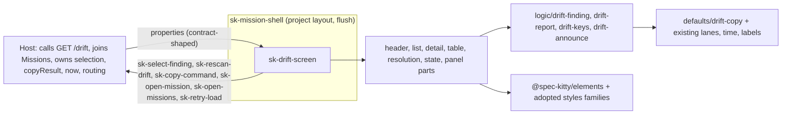
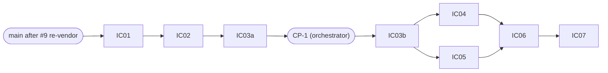

# Implementation Plan: Drift screen

**Branch**: `feat/drift-screen-10` (current branch, planning base and merge target; `branch_matches_target: true`) | **Date**: 2026-10-08 | **Spec**: `kitty-specs/drift-screen-01M4C93T/spec.md`
**Input**: the specification with the operator rulings of 2026-10-08 (Q1 to Q10 as recommended; exceptions E-35..E-39; retry target `drift-report`; no stacked branches), GitHub issue spec-kitty/spec-kitty-mission-ui#10, the Mission Status contract after spec-kitty#5776 (PR #5881, read from its worktree; not yet on `main`), the V2 prototype page `06-drift.html`, and the code of mission-ui#4 and #5 on `main` (`ad94164`).

## Summary

Add ONE public element, `sk-drift-screen`, to `@spec-kitty/mission-ui`, with private part files. It takes the contract's `DriftReport` as a property (eleven properties in all: `status`, `report`, `selectedFinding`, `missionId`, `missions`, `rescanning`, `copyResult`, `refusalCode`, `now`, `labels`, `errorMessage`), emits six `sk-*` events (three new: `sk-select-finding`, `sk-rescan-drift`, `sk-copy-command`; `sk-open-mission`, `sk-open-missions` and `sk-retry-load` reused), and draws: a page header with last scan and Rescan; a finding list (listbox) with a head; and a finding detail (kicker, title, explanation, authority panel, lane table, suggested resolution with Copy, facts) plus the loading, clean, truncated, rescanning, unreadable, not-found and choose-a-finding states. New files: `defaults/drift-copy.ts`, four `logic/drift-*.ts` modules, an extended `LabelHooks`, one more member of the `sk-retry-load` union, fixtures with a new relaxation, 32 stories and baselines, one extension of the `data-driven` gate, and five numbered exceptions (E-35..E-39) plus an E-18 scope extension. The shell needs no change (`nav-drift` exists; spec FR-023 corrected accordingly).

## Technical Context

**Language/Version**: TypeScript 5.9 strict (`exactOptionalPropertyTypes`, `noUncheckedIndexedAccess`), Lit 3.3.3, Node 22.22.2, pnpm 11.18.0, as #4 and #5
**Primary Dependencies**: `@spec-kitty/elements` 1.1.0-rc.10 (`sk-page-header`, `sk-pill-tag`, `sk-notice`, `sk-button`, `sk-card`, `sk-section-header`), adopted `@spec-kitty/styles` families (`facts`, `empty-state`, `progress`; table, listbox and copy-field families only if spike S1 finds them). No new runtime dependency.
**Storage**: N/A. **Testing**: Vitest browser mode (`page.viewport` first), `node:test` for contract tooling and scripts, vitest node environment for the data-driven self-test, Storybook stories, Playwright visual spec in the pinned container.
**Target Platform**: evergreen browsers and the Kitty Desktop webview; the screen renders in `sk-mission-shell` (project layout, `flush`).
**Performance Goals**: 1000 findings render and a selection change re-renders in 200 ms or less (NFR-006).
**Constraints**: no I/O (no clipboard either); project CSS layout-only with `--sk-*` tokens; ESLint bans raw `<button>`, `class=`, `style=` outside recorded exceptions; no kind, severity-tone, authority, remedy, source-code or lane literal outside `defaults/`; no arithmetic beyond display counts; fixtures free of paths, usernames and e-mail addresses; baselines only in the pinned container.
**Scale/Scope**: 1 public element (11 properties, 6 events), 7 private part files, 1 default module, 4 logic modules, 1 new relaxation, about 18 new fixtures, 32 stories and baselines, 1 gate extension, 5 exceptions plus 1 scope extension, 8 work packages.

## Build base and dependency

1. **Base**: `main` at `ad94164`. This branch contains no #7 code. `main` still holds the retry union in `logic/wp-retry.ts`; if #7 (`src/retry-types.ts`) has merged when IC-02 starts, IC-02 extends the union there and records which file in its hand-off (operator decision 2026-10-08).
2. **Contract**: the Drift schemas exist only after the contract re-vendor, done once, first, by #9 Projects after PR #5881 merges (operator decision 2026-10-08). Implementation starts from `main` after that. IC-01's first step is the precondition check: `contracts/spec-kitty/mission-status/schemas/DriftReport.yaml` exists and `PIN.json` has `provenance: main`. If not, the mission is BLOCKED and the WP reports; nobody re-vendors from this branch.
3. **Merge main before dispatch**: planning-branch rulings are missing from new lanes until the planning branch is merged into the lane (orchestrator step, see Lane mechanics). `main` is merged into this branch after the re-vendor lands, then `kitty/mission-<slug>` is fast-forwarded.
4. Planning artifacts do not need the re-vendor and are complete without it; only IC-01 and the fixtures depend on it.

## Charter Check

| Charter rule | Status |
|---|---|
| Data in as properties, typed from the OpenAPI read contract | pass: types generated from the re-vendored pin; `DriftFindingView` widens only the vocabulary fields (data-model.md); `contract` gate proves freshness and fixture validity, the new relaxation has a reverted-must-fail proof |
| View state in as a property | pass: `status` (four charter states plus the screen's own `not-found`, FR-008) and `rescanning` |
| Events out as `bubbles` `composed` `sk-*` CustomEvents, every payload asserted | pass: six events (EV-1..EV-6), literal dispatch in the screen file (IC-03b), `@fires`, tests with positive controls, each owned by the WP that draws the control |
| No I/O | pass-with-condition: no browser API beyond the DOM; manual selection of the command text uses a Selection API route that must be no-io-clean and typecheck-clean (`ShadowRoot.getSelection` is not in `lib.dom`, and the no-io gate bans casting or aliasing `document`), proven by S5; no clipboard (the host writes it); `now` is a property; no timers |
| Elements over CSS; gap not hand-rolled | pass with exceptions pending CP-1: E-35 (split layout track), E-36 (option row), E-37 (table scroll), E-38 (copy field), E-39 (slug ellipsis), and the E-18 scope extension for `panel-parts.ts`; each has a design-library sunset, issue numbers allocated at CP-1 |
| Atomic design, deep modules | pass: one public element, small surface, private parts, pure view-model in `logic/` |
| Quality gates incl. manifest, no-io, visual | pass: all existing gates apply (Gates below); `data-driven` extended in IC-02 |
| A story per view state, synthetic fixtures; a test per event | pass: 32 stories (33 state-matrix rows, DR-07a and DR-07b counted separately, minus DR-09, which is dropped by ruling) |
| Visual regression against the prototype; drift is REJECT | pass-with-condition: DD-1..DD-21 are PROPOSED; the spike-rendered ones are confirmed at CP-1, the rest at the Storybook review after the last WP; CP-1 precedes every visual WP |
| Fixtures: no real user data, paths, usernames | pass: hygiene and `contract` cover generated files; Mission slugs and ids are synthetic |
| Reviewer agent per work package; squad after the plan phase only | pass: this plan is the squad's input; the aggregate squad before the PR is the operator's standing wrap-up rule |
| PR into `main`, operator merges; operator reviews Storybook after the last WP | pass: one PR after wrap-up (D-16); Storybook review before wrap-up |
| Amendments and exceptions need operator approval | pending: E-35..E-39, the E-18 extension and amendment A-1 go to the operator at CP-1 |

Re-check after design: unchanged. No unjustified violation.

## Gates

The enforced gates of this repo (it is `spec-kitty-mission-ui`, not the spec-kitty tooling repo, so the CLI repo's commitlint, doctrine-schema, Contextive, coverage-floor and SonarCloud gates do not apply; they belong to a repo this mission does not touch).

| Gate | Command | Applies | Note |
|---|---|---|---|
| Typecheck | `pnpm typecheck` | yes | strict |
| ESLint | `pnpm lint` | yes | bans raw `button`, `class=`, `style=` outside E-36 and E-38 files |
| Stylelint | `pnpm lint:styles` | yes | token-only; exception entries added by IC-03b, each with a leak plant |
| no-io | `pnpm lint:no-io` and `pnpm test:no-io` | yes | the manual-selection code (S5, then IC-05) must pass this gate as written, with no cast or alias to get round it; the gate self-test gets no new plant |
| data-driven | `pnpm lint:data-driven` and `pnpm test:data-driven` | yes | extended in IC-02 (defaults.md, scope) |
| Unit and interaction tests | `pnpm test` | yes | Vitest browser mode |
| Manifest | `pnpm manifest:generate`, `pnpm manifest:check` | yes | regenerated once in IC-03b and once in IC-07 |
| Contract | `pnpm contract:check`, `pnpm test:contract` | yes | `--require-main` green before merge |
| Hygiene | `pnpm hygiene` | yes | no path, no username |
| Terminology | `pnpm test:terminology` | yes | "Mission", never "feature" |
| Scripts tests | `pnpm test:scripts` | yes | stylelint exceptions test pins the exact `::part` and exception sets per file |
| Storybook build | `pnpm build-storybook` | yes | |
| Visual | `pnpm visual` | IC-07 only | region WPs have no committed baselines; missing snapshots are the known red until IC-07 |
| Gate proof | `pnpm gate-proof` | yes | plants for the new exception entries |

Baseline: before any change IC-01 records the green baseline of every gate command on the tree it starts from (including the pinned-container visual run and gate-proof). A red at baseline is escalated, not absorbed.

## PR shape and wrap-up (operator standing rule)

ONE pull request, opened only after accept, dev-assist test cleanup, the aggregate review squad (report-only), compaction of history into named slices, rebase onto `main`, a full gate re-run and the operator's Storybook review (after the last WP, before wrap-up), then the DRAFT pull request. Work packages never push and never open pull requests. Two blocking contract steps: `contract:check --require-main` green, and the pin equal to what #9 vendored. The charter's "squad after the plan phase only" governs the design phases; the aggregate squad is the standing wrap-up rule, as in #4 and #5.

## Architecture



| Content width (container) | Layout |
|---|---|
| wide cell | two panes: list track `420px` (E-35) and `minmax(0, 1fr)` detail; the list scrolls inside its column, the detail inside its own |
| below the S2 threshold, and in the shell's mobile tier | one column: list above detail, the list's right border dropped, the lane table scrolls sideways, Copy stays reachable |

The thresholds are container queries derived by spike S2 from the project layout's real content widths (not carried over from #5's mission-layout numbers). The shell's mobile tier is read through `ShellTierController` and `:state(shell-mobile)`. Every `display: grid` stack declares `grid-template-columns: minmax(0, 1fr)` (the #5 S9 lesson).

## Project Structure

### Documentation (this mission)
```
kitty-specs/drift-screen-01M4C93T/
├── spec.md  plan.md  research.md  data-model.md  quickstart.md  operator-questions.md
├── contracts/ sk-drift-screen.md  defaults.md
├── tracer-design-decisions.md  tracer-tooling-friction.md
├── reviews/                  # plan squad trail
└── tasks.md                  # NOT created here
```

### Source code (additions on `main`)
```
scripts/contract/registry.mjs overlays.mjs (+ tests)          # IC-01: Drift fixture entries, relaxation drift-vocabulary-open (append-only; rebase over #9 and #11)
packages/mission-ui/src/contract/ types.ts bulk.ts fixtures.generated.ts types.generated.ts   # IC-01
packages/mission-ui/src/defaults/drift-copy.ts index.ts       # IC-02 (+ one export line)
packages/mission-ui/src/logic/ drift-finding.ts drift-report.ts drift-keys.ts drift-announce.ts types.ts(LabelHooks) wp-retry.ts or retry-types.ts(one union member)  # IC-02
eslint.data-driven.config.mjs gates/data-driven.selftest.ts gates/fixtures/data-driven/*     # IC-02
packages/mission-ui/src/elements/sk-drift-screen/
  sk-drift-screen.ts panel-parts.ts (IC-03b) header-parts.ts list-parts.ts state-parts.ts (IC-04)
  detail-parts.ts table-parts.ts resolution-parts.ts (IC-05) fixtures.ts (IC-03b) *.stories.ts
packages/mission-ui/test/ sk-drift-screen.<area>.test.ts  drift-<logic>.test.ts  surface-freeze.test.ts (extended)
packages/mission-ui/src/index.ts custom-elements.json         # IC-03b (one registration, one manifest regeneration)
stylelint.config.mjs eslint.config.mjs                        # IC-03b: E-35..E-39, E-18 scope extension
apps/storybook/tests/visual/__snapshots__/                    # 32 baselines, IC-07 only
README.md CHANGELOG.md                                        # IC-07
```
**Structure Decision**: follow #4's "Add an element" recipe; registration only through `src/index.ts`; generated files only through `pnpm contract:generate`; the part file is the unit of write ownership.

## Implementation Concern Map

A serial foundation (IC-01, IC-02, IC-03a), the operator checkpoint CP-1, IC-03b (skeleton, layout, surface freeze), two region chains with disjoint write scopes (chain X: IC-04 list, header, states; chain Y: IC-05 detail, table, resolution), IC-06 (tiers, accessibility, edge cases) and IC-07 (integration, baselines, wrap-up inputs).



CP-1 is not a work package: after IC-03a is approved the orchestrator shows the operator the prototype beside the spike renders, DD-1..DD-21, the copy of `contracts/defaults.md`, E-35..E-39 and the E-18 extension, with the S1..S6 evidence that decides the conditional exceptions (E-36, E-37, E-38 are dropped if S1 finds a library family).

### Lane mechanics (orchestrator-owned; WP agents never do any of this)

As #5's plan, items restated: (1) fast-forward `kitty/mission-<slug>` to the target branch before every first claim and after any merge of `main`; (2) merge the planning branch (rulings, amendments) into each new lane before dispatch; (3) IC-06 needs two parents, which the tool cannot express: parent it on IC-04 and merge the approved IC-05 tip into its lane before dispatch, applying the `status.json` rule; (4) claims are serialised, one at a time; (5) the orchestrator, not a WP agent, runs `move-task --force` where the operator allows. WP briefs forbid sub-agents, `git stash`, `git rebase` and pattern kills, and bound repo-wide commands by a `rev-parse --show-toplevel` guard.

### Shared files: who may write them

| File | Writer | Everyone else |
|---|---|---|
| `src/index.ts`, `custom-elements.json` | IC-03b (full public surface); later only `pnpm manifest:generate` (IC-07) | report a surface change |
| `sk-drift-screen.ts` | IC-03b only: class, 11 properties, grid, status switch, the six dispatch methods and payload builders, focus rule, live region, composed styles, import and call of every part | change request |
| `panel-parts.ts`, `fixtures.ts` | IC-03b (complete) | read-only |
| other `*-parts.ts` | created by IC-03b as stubs with final signatures (`contracts/sk-drift-screen.md`); the owner replaces bodies and keeps signatures | none |
| `header-parts.ts`, `list-parts.ts`, `state-parts.ts` | IC-04 | none |
| `detail-parts.ts`, `table-parts.ts`, `resolution-parts.ts` | IC-05 | none |
| `src/defaults/**` (`drift-copy.ts`, the index line), `src/logic/**` and tests | IC-02 only | change request |
| `src/contract/**`, `scripts/contract/**`, `gates/plants/contract/**` | IC-01 only (append-only entries; rebase over #9 and #11) | change request |
| `eslint.data-driven.config.mjs`, `gates/**` self-test | IC-02 | none |
| `stylelint.config.mjs`, `eslint.config.mjs` | IC-03b (E-35..E-39 and E-18 extension, each with a leak plant and a `scripts/stylelint-exceptions.test.mjs` pin) | none |
| `LabelHooks` in `logic/types.ts` | IC-02 (additive optional members) | none |
| tests `sk-drift-screen.skeleton`, `surface-freeze` | IC-03b | none |
| tests `...events-*`, `...states`, `...a11y`, `...perf`, `...time` | the WP that draws the control (list and states: IC-04; resolution and detail: IC-05); a11y, perf, time: IC-06 | none |
| stories | the WP that owns the story title; disjoint names | none |
| baseline PNGs | IC-07 only | none |
| `spikes/ic-03a/**`, one `stories` glob entry and one ESLint `ignores` entry for it | IC-03a only, removed by its named final commit | none |
| `README.md`, both `CHANGELOG.md`, CI timeouts | IC-07 (IC-01 and IC-02 add one CHANGELOG line each) | none |
| `package.json` | IC-07, plus the named test-script edits of IC-01 and IC-02 | change request |
| `tracer-*.md`, `spec.md` Clarifications | the orchestrator only | none |

Cross-mission rule: #9 re-vendors first (operator ruling); #10 and #11 each append only their own entries to the shared files below, re-read each file at dispatch, re-derive any count literal the contract tooling checks from the tree at rebase time (never from this plan), and whoever lands second rebases. Shared touches: `scripts/contract/registry.mjs`, `overlays.mjs`, `src/defaults/index.ts`, `src/index.ts`, `LabelHooks`, the retry union file, `stylelint.config.mjs`, `eslint.config.mjs`, `package.json` test scripts, CHANGELOGs.

### IC-01 Drift contract wiring and fixtures
- **Purpose**: precondition check (Build base 2); baseline record of every gate; `contract:generate`; `DriftReportView`, `DriftFindingView`, `DriftFindingKey`, `DriftMissionName` in `src/contract/types.ts`; registry entries for the six contract examples and the overlays of `data-model.md`; the relaxation `drift-vocabulary-open` with a reverted-must-fail proof and any literal floors the contract tooling counts (fixture and vendored-file counts are read from the tree after #9's re-vendor, never hard-coded from this plan); `bulk.ts` generator for the 1000-finding report; fixture hygiene.
- **Relevant requirements**: FR-029, C-002, NFR-007.
- **Exit checks**: `pnpm contract:check && pnpm test:contract` green with reporter pass above 0; relaxation proof red then green; `tsc` green; hygiene green; revert check per test file.
- **Depends on**: main after #9's re-vendor. **Risks**: registry/overlay merge conflicts with #9 and #11; the contract's open `maxItems 1000` versus the bulk fixture (it holds exactly 1000, not more).

### IC-02 Defaults, logic, gate extension, hooks and retry member
- **Purpose**: `defaults/drift-copy.ts` (contracts/defaults.md); `logic/drift-finding.ts`, `drift-report.ts`, `drift-keys.ts`, `drift-announce.ts` with unit tests including foreign-value inputs and the unsorted-order test; `LabelHooks` additions; the `DriftRetryDetail` union member AND its own pure builder `driftRetryDetail(missionId)` (the shipped `retryDetail()` returns null without a Mission and needs a `wpId`, so it cannot serve a whole-project scan whose `missionId` is null), with a test that the null-scope case builds a payload and the two existing members still type-check; the `data-driven` gate reads the five Drift enums from the vendored schemas and holds the four `sourceCode` values (no enum schema exists) in an explicit constant with a description-agreement self-test (scope in defaults.md), with new positive self-test cases red before the config change, false-positive cases green.
- **Relevant requirements**: FR-007, FR-011, FR-013, FR-014, FR-019..FR-022, FR-026..FR-028, FR-033, NFR-009, NFR-010.
- **Exit checks**: `pnpm lint:data-driven && pnpm test:data-driven` green; each new self-test case red against the unchanged config; unit tests with positive controls and revert checks; typecheck green.
- **Depends on**: IC-01. **Risks**: selector false positives on the new logic (rename fields, never silence); the `error`/`warning`/`git` collision (documented, covered by foreign-value tests).

### IC-03a Foundation spikes and CP-1 evidence
- **Purpose**: S1..S6 (`research.md`) as throwaway stories under `spikes/ic-03a/`, with exactly the two config additions, both removed by the named final commit `chore(ic-03a): remove spike code`; side-by-side captures in the WP report, not in the tree; evidence for CP-1.
- **Relevant requirements**: FR-024, FR-030, FR-032, NFR-008.
- **Depends on**: IC-02. **Risks**: a spike can change a part shape or an exception, which is why spikes precede the surface freeze.

### CP-1 Operator checkpoint (orchestrator-owned)
File precondition for IC-03b: a `CP-1 confirmed` entry in `tracer-design-decisions.md` naming the confirmed DD items and the exception decisions; IC-03b stops and reports if absent.

### IC-03b Skeleton, layout and surface freeze
- **Purpose**: `sk-drift-screen` with the FULL public surface; the real layout (thresholds from S2); `panel-parts.ts` complete; every other part a stub with its final signatures; the screen file draws every container and region id, the status switch, the six dispatch methods with payload builders, the focus rule, the live region and the composed styles; `fixtures.ts` complete; the stylelint/eslint entries for E-35..E-39 (those CP-1 keeps) and the E-18 extension, each with a leak plant; registration, manifest regeneration; surface-freeze test; skeleton test (one test per event, exact payload, `bubbles`, `composed`, layout cases at 1280, 1100, 800, 620 in `shellFrame`).
- **Relevant requirements**: FR-001, FR-008, FR-024, FR-030, FR-032, C-001, C-005, C-010.
- **Exit checks**: surface-freeze and skeleton tests green and each shown red against the reverted surface (a removed property, a renamed event); `manifest:check` green; every stylelint/eslint exception entry has a leak plant that is red then green and is pinned by `scripts/stylelint-exceptions.test.mjs`; typecheck, lint, lint:styles, lint:no-io, lint:data-driven green.
- **Depends on**: IC-03a and CP-1. **Risks**: the surface must reflect spike outcomes; the layout lands here so no region WP changes the grid.

### IC-04 Header, list, head, states (chain X)
- **Purpose**: header (title, subtitle, last scan, Rescan busy rule); head (count, roll-up, badge); the listbox with rows, roving tabindex, arrows, Home, End, selection follows focus; the Mission slug ellipsis (E-39); states: loading, clean, error, not-found, choose-a-finding, truncation note, rescanning; live region content via `drift-announce`; the foreign-finding fail-closed look.
- **Relevant requirements**: FR-002..FR-009, FR-018..FR-020, FR-022, FR-025 (list part), FR-026.
- **Exit checks**: events EV-1, EV-2, EV-5, EV-6 tests with positive controls, each shown red against the reverted part; keyboard table test (`drift-keys`); host-ignores-event test; side-by-side captures of the header, list and state regions (cropped, the detail is a stub in this lane) for DR-14..DR-23, DR-30, DR-31 (uncommitted); gates except `visual` green.
- **Depends on**: IC-03b.

### IC-05 Detail, lane table, resolution (chain Y)
- **Purpose**: kicker, title, explanation, authority panel, facts (Mission link EV-4); the lane table with real headers and the not-present word; the corrupt-JSON sentence; the resolution (command, Copy EV-3, the result region, manual selection, the unknown-slug and unknown-remedy cases); the detail for unknown kind/severity/authority.
- **Relevant requirements**: FR-010..FR-017, FR-021, FR-027.
- **Exit checks**: events EV-3, EV-4 tests, each shown red against the reverted part; the stale-`copyResult`-at-press test (nothing announced until the property changes) and the wrong-finding test; manual selection passes `lint:no-io` and typecheck as written (S5); side-by-side captures of the detail region only (cropped, the list is a stub in this lane) for DR-02..DR-08, DR-10..DR-13, DR-32.
- **Depends on**: IC-03b.

### IC-06 Tiers, accessibility, edge cases
- **Purpose**: tiers DR-27..DR-29 and the shell-mobile rule; focus order and tagged stops (DR-26); focus-loss rule tests; 200% text, forced colours, reduced motion; 1000-row perf; long-text stories DR-25; edge cases of the spec.
- **Relevant requirements**: FR-024, FR-025, FR-026, NFR-003, NFR-004, NFR-006, NFR-010, NFR-011.
- **Also owns** the two whole-screen stories that need both chains: DR-01 and DR-24, with their uncommitted side-by-side captures.
- **Exit checks**: every new test shown red against the reverted part; focus order walk; 200% text; forced colours; the 1000-row timing.
- **Depends on**: IC-04 and IC-05 (merge, Lane mechanics item 3).

### IC-07 Integration, baselines, wrap-up inputs
- **Purpose**: the shell-wiring story (`nav-drift`, `flush`); all 32 baselines in the pinned container, five consecutive stable runs; manifest regenerate; README and CHANGELOG; timeouts re-derived by #4's rule; the wrap-up inputs (exception list for the PR description).
- **Relevant requirements**: FR-023, FR-030, FR-034, NFR-001, NFR-002, NFR-008.
- **Exit checks**: `pnpm visual` green five consecutive runs with 32 committed baselines; a deliberately changed pixel shown red; `manifest:check`, hygiene, terminology, `contract:check --require-main`, `gate-proof` green; the story catalogue test lists exactly the 32 stories.
- **Depends on**: IC-06.

## Traceability

| Requirement | Concern |
|---|---|
| FR-001, FR-008, FR-032 | IC-03b |
| FR-002..FR-007, FR-009, FR-018..FR-020, FR-022 | IC-04 |
| FR-010..FR-017, FR-021 | IC-05 |
| FR-011, FR-013, FR-014, FR-027, FR-028, FR-033 | IC-02 (logic, defaults); drawn by IC-04/IC-05 |
| FR-024, FR-025, FR-026 | IC-03b (rule), IC-04/IC-05 (use), IC-06 (proof) |
| FR-029 | IC-01 |
| FR-030, FR-034 | IC-07 |
| FR-031 | tests in the owning WP |
| FR-023 | IC-07 (amended A-1) |
| NFR-009 | IC-02; NFR-005 every WP; NFR-007 IC-01; NFR-002/NFR-008 IC-07 |

| State-matrix rows | Story owner |
|---|---|
| DR-02..DR-08 (DR-07a, DR-07b), DR-10..DR-13, DR-32 | IC-05 (detail) |
| DR-14..DR-23, DR-30, DR-31 | IC-04 |
| DR-01, DR-24, DR-25..DR-29 | IC-06 (DR-01 and DR-24 need both chains) |
| DR-09 | no story (dropped by ruling) |

## Risks and spikes

| Risk | Mitigation |
|---|---|
| Contract not re-vendored on `main` at dispatch | BLOCKED at IC-01, no workaround on this branch |
| Selection API inside a shadow root unreliable (Desktop webview) | S5; fallback recorded, not silent |
| 1000 options cost | S3, NFR-006; no virtualization unless S3 forces a ruling |
| Library has no table/listbox/copy-field | E-36..E-38 exist for that; S1 may delete them |
| `error`/`warning`/`git` ungated | foreign-value tests, reviewer self-check, gate header comment |
| Three missions edit the same shared files | append-only edits, rebase by whoever lands second |
