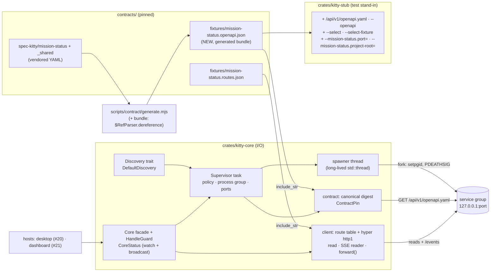

# Implementation Plan: kitty-core: shared Rust core (contract client, change stream, supervision)

**Branch**: `feat/kitty-core-19` | **Date**: 2026-10-15 | **Spec**: [spec.md](spec.md) (including its 2026-10-15 Amendments)
**Input**: Mission specification from `kitty-specs/kitty-core-01M50D10/spec.md`; mission-ui issue 19 under epic 16, with the design notes on issues 19, 20 and 21 from the PR #32 landing review.
**Branch contract**:
- Planning starts on `feat/kitty-core-19`, which is the planning base and the merge target of every work package.
- `feat/kitty-core-19` contains `origin/main` with #17 merged (squash `39a51a6`). Every probe uses `origin/main`, because the local `main` ref is stale (R6-01).
- The mission PR goes from `feat/kitty-core-19` into `main`.
- The coordination branch `kitty/mission-kitty-core-01M50D10` carries status and event logs only. It is never merged into `feat/kitty-core-19`, and lanes are based on `feat/kitty-core-19` (see "Branches and merge order").

**Revision**: plan-squad fix rounds 1 and 2. All R1–R6 findings and the fresh-sweep items (FS-01 to FS-17) are folded in; see `reviews/plan.squad.md`.
**Plan decisions**: every decision is resolved. The four forks were each resolved as A on 2026-10-15, and four operator rulings from the squad round are recorded as decisions (see "Plan decisions").

## Summary

`crates/kitty-core` becomes the one Rust core that both hosts use, for one project at a time. It covers five concerns:

1. **Discovery.** A replaceable lookup finds the service binary. It tries, in order:
   - a configured absolute path;
   - then one environment variable holding an absolute path;
   - then a PATH search over absolute entries only.

   If nothing is found, the result is service-missing.
2. **Supervision.**
   - **Launch.** The binary runs exactly as `--mission-status.project-root=<canonical root> --mission-status.port=<n>`, in its own process group, with a cleared, allowlisted environment, stdin set to null and the working directory set to the project root.
   - **Readiness.** It is the contract check.
   - **Busy port.** A busy port is retried on a port not yet tried.
   - **Crashes.** A crash restarts after 0.5, 1, 2, then 4 s. The 5th crash within 5 minutes gives up.
   - **`stop()`.** SIGTERM to the group, a 5 s grace period, then SIGKILL to the group.
   - **Dropping the last handle.** An immediate SIGKILL to the group.
3. **Contract check.** It fetches `/api/v1/openapi.yaml` (capped at 4 MiB) and parses it as JSON first, falling back to YAML. The parsed document is written in canonical form: sorted keys, JSON numbers with JavaScript semantics, no whitespace. Its SHA-256 is compared with the pinned digest, which is computed by the same code from the bundled document that `contract:generate` derives from the vendored pin.
4. **Relay.**
   - **Reads.** They use a route table built from `routes.json` over a hyper `conn::http1` connection, and return status, content type and raw body bytes.
   - **The change stream.** kitty-core's own SSE frame reader turns it into raw changes, with one terminal outcome (refused or unavailable).
   - **`forward()`.** A pass-through, so that #21's proxy enforces the same loopback and header rules.
5. **Degraded signal.** One `CoreStatus` carries the state, the degraded reason, a launch `generation`, and whether the initial start is over. A total mapping to the port's five `ConnectionState` strings is tested against `port.ts`.

**The stub** gains:
- the `GET /api/v1/openapi.yaml` route;
- `--openapi <file>`;
- `--select` and `--select-fixture`;
- the two upstream launch options. With these the real stub can be **supervised** by `Core`, which a test proves end to end.

The port, the workspace members, the CI jobs and the four #17 fixture files do not change (SC-004, amended by A-01).

## Technical Context

**Language/Version**: Rust 1.98.1, pinned in `rust-toolchain.toml` and unchanged; edition 2021. Node 22.22.2 and pnpm 11.18.0, for the contract generator only (IC-02).

**Primary Dependencies**:
- **Already pinned, used through member-level additions.**
  - `hyper =1.11.1`, adding `client` (with `http1`).
  - `hyper-util =0.1.21`, using `tokio` for `TokioIo`.
  - `http-body-util =0.1.5`.
  - `tokio =1.53.1`, adding `process`, `io-util` and `sync` at member level. There is no `test-util`: virtual time is kitty-core's own `Clock`.
  - `serde =1.0.229`.
  - `serde_json =1.0.151`, with `preserve_order`.
- **Newly direct, already locked.** `percent-encoding =2.3.2` and `libc =0.2.189` (Unix only, behind `cfg`).
- **New.** `yaml_serde =0.10.7` and `sha2 =0.10.9`.
- **Dev-only.** kitty-core uses `kitty-stub` as a dev-dependency, and kitty-stub uses kitty-core as one. Mutual dev-dependencies resolve and compile, as checked with `cargo tree` and `cargo check --all-targets`.
- **Lock.** 14 new entries (research R-07).
- **npm.** No change.

**Storage**: none. One new generated, committed file: `contracts/fixtures/mission-status.openapi.json`.

**Testing**:
- **`cargo test` under `Gate: rust`.** kitty-core's integration tests run against three kinds of peer:
  - the stub **in-process**: `kitty_stub::app` plus `run_server` on `127.0.0.1:0`, using `Fixtures::load` or `from_values`;
  - a **raw-TCP fake** that writes byte-exact faults and records every request (path, query and headers) for the header and encoding assertions;
  - **`kitty-fake-service`**, a `[[bin]]` of kitty-core, for supervision.
- **`crates/kitty-stub/tests/supervised.rs`.** It supervises the real `kitty-stub` binary through `Core`.
- **`node --test` under `Gate: contract`.** This covers the bundle generator.

**Target Platform**: CI is ubuntu-24.04, Linux only. Development is on macOS and Linux. Every libc use is behind `cfg(unix)`, and every `prctl` use behind `cfg(target_os = "linux")`. Windows and macOS behaviour is the business of #20's multi-OS matrix (Job Objects and launchd notes in research R-06 and R-11).

**Project Type**: a pnpm and Cargo monorepo. The work lives in `crates/kitty-core` and `crates/kitty-stub`, plus one generator change under `scripts/contract/`.

**Performance Goals**:
- NFR-003: 10 ms p95 or less, measured by the method in IC-05 and recorded as evidence.
- NFR-001 as amended by A-04:
  - kitty-core's tests take 60 s or less in total;
  - no single real-time wait in a test exceeds 1 s;
  - the `Gate: rust` job stays at 8 minutes or less (a hard limit);
  - the rust proof leg follows the #17 formula.

**Constraints**:
- **Frozen.** SC-004 and C-002 (as amended by A-01).
- **Placement.** I/O only in `crates/*`.
- **Address.** `127.0.0.1` only.
- **Pins.** Exact, aged pins (NFR-002).
- **Bounded memory.**
  - SSE: 1 MiB since the last dispatched frame.
  - Bodies: 16 MiB.
  - Contract document: 4 MiB.
  - Output: 64 KiB per child.
  - Transitions: 64 queued.
- **No panics** (NFR-005).
- **Deterministic supervision** (NFR-006).
- **Offline** (NFR-007).
- **No new gate** (C-007).

**Scale/Scope**:
- 9 reads and 1 stream;
- 3 event names;
- 5 supervision states;
- 3 service-missing reasons;
- one bundle of about 630 KB;
- 14 new lock entries, 1 with a build script and 0 procedural macros;
- 1 new plant.

## Charter Check

*GATE: Must pass before Phase 0 research. Re-check after Phase 1 design.*

| Charter rule | Verdict | Note |
|---|---|---|
| Screens: no I/O; data via properties | PASS | No change under `packages/*` (C-001). The IC-10 probe diffs `packages/`. |
| Hosts: I/O only in `apps/*` and `crates/*` | PASS | All I/O is in `crates/kitty-core` and `crates/kitty-stub`. The Node generator runs at development time and in a gate, like the existing contract scripts. |
| Hosts read spec-kitty only through published contracts | PASS | The route table and the pinned digest come from the vendored pin (C-005). |
| Host servers bind 127.0.0.1; own Host and Origin checks | PASS | kitty-core addresses only `127.0.0.1:<port>`. It sends `Host: 127.0.0.1:<port>` and no `Origin` or forwarding headers, and `forward()` enforces the same for #21. The stub and the fake bind `127.0.0.1` only. |
| Never ask the service to loosen its protections | PASS | Only the two upstream launch arguments are passed (FR-017, as amended by A-06). |
| Least privilege for the launched service (R3-02, R3-03) | PASS | `env_clear()` plus an allowlist of `PATH`, `HOME`, `LANG`, `LC_*` and `TMPDIR`. `stdin` is null, and the working directory is the canonical project root. A test reads the environment the fake recorded. |
| Quality gates: `cargo fmt --check`, clippy `-D warnings`, `cargo test` | PASS | The `Gate: rust` command is unchanged. |
| Hosts tested against a local stub; one test per host security rule | PASS | Host, Origin, forwarding and loopback each have a test (IC-04). The supervised stand-in test runs the real stub binary (IC-09). |
| Review: separate reviewer per WP; squad after plan; operator merges | PASS | `reviews/plan.squad.md` (round 1). |
| Risk boundaries: no secrets, paths or usernames in tracked files | PASS | Captured output stays in memory. Tests write only to temp directories. The stub's compile-time fixtures fallback ends up in the built binary, never in a tracked file. |
| Exact version pins | PASS | `=x.y.z`, each with a `# published YYYY-MM-DD` comment (R3-12). |
| Distribution: never bundle the service | PASS | `kitty-fake-service` and `kitty-stub` are test binaries in `publish = false` crates. |
| Exceptions are documented in the PR | PASS | None planned. Proof-leg timeouts are formula-tuned (decision `01M50HVPJ9CDBB7405T9K0645R`; A-04). |

Re-checked after fix round 1: no new conflicts.

## Architecture



### Pinned and served digests

- `ContractPin::embedded()` holds the bundle (`include_str!`). Its digest is computed once.
- `digest_of(bytes)` parses with `serde_json::from_slice` first and falls back to `yaml_serde` only when that fails (R3-11). It then writes the canonical form and takes its SHA-256 (`contracts/bundled-document.md`).
- `CoreConfig.contract` defaults to `ContractPin::embedded()`. Tests can inject another pin (R4-08).
- **The digest is not a trust boundary** (R2-01). Any local process could serve the same document. It detects a different contract; it does not authenticate a binary.

### Relay, never interpret

- Reads return `ReadOutcome`. Streams yield `StreamEvent` and end with one terminal item.
- `open_stream` refuses before any I/O with `Err(StreamOpenError)` when:
  - the status is not `Ready`;
  - the contract does not match;
  - the scope is invalid.
- There is no reconnect, no cursor store and no `resync` (C-003).

### Supervision: pure policy and thin I/O

- **Policy time.** It is driven by `Clock` (monotonic `Instant` in production) and `Sleeper`. In tests, `ManualClock` and `RecordingSleeper` make delays exact.
- **I/O time.** It uses real tokio timers with durations from `Timings`. Every test value is in the table in IC-08.
- **Process ownership.**
  - The supervisor task is the **only** owner of the child's `Child` (inside a `ChildGuard`). Signals are sent only from that task, only while `child.id()` is `Some`, and never after a `wait()` has completed (R2-09).
  - `HandleGuard` is the host-handle count, held by every `Core` clone. When the last one drops, it aborts the supervisor task. The `ChildGuard` drop then sends SIGKILL to the group, still from the owning task's stack, and `kill_on_drop` fires as a backstop (R1-03, R3-05, R2-07).
  - **Forking** happens on one long-lived `std::thread` (the *spawner*) owned by kitty-core, which enters the runtime handle before calling `Command::spawn`. `PR_SET_PDEATHSIG` is tied to the forking thread, and this thread lives as long as any `Core` (R4-05).

### Supervision sequence (one start)

```mermaid
sequenceDiagram
  participant H as Host
  participant C as Core
  participant S as Supervisor task
  participant T as Spawner thread
  participant P as service group
  H->>C: Core::start(config) → (Core, Subscription{initial, rx})
  C->>S: spawn task (Starting, generation 1)
  S->>S: discovery.locate()  (miss → Stopped + service-missing:not-found)
  Note over S: one start budget = start_timeout (A-03)
  loop up to 3 attempts, ports never repeated (FR-019, R2-17)
    S->>T: spawn bin --mission-status.project-root=R --mission-status.port=N
    T->>P: fork: setpgid(0,0); prctl(PDEATHSIG,SIGKILL); getppid check
    loop poll (each poll ≤ budget left)
      S->>P: GET /api/v1/openapi.yaml
      Note over S: biased select: child exit wins (R2-01)
      alt refused / reset / 503
        S->>S: keep polling
      else first other answer
        S->>S: final: digest or mismatch
      end
    end
  end
  alt digest equal and try_wait() == None
    S-->>C: Ready{endpoint(port N, generation g)}
  else mismatch
    S->>P: stop sequence (group)
    S-->>C: Stopped + contract-mismatch{expected, actual}
  else budget spent
    S->>P: full stop sequence (group)
    S-->>C: Crashed → policy
  end
```

## Project Structure

### Documentation (this mission)

```
kitty-specs/kitty-core-01M50D10/
├── spec.md                 # + Amendments (2026-10-15)
├── plan.md                 # this file
├── research.md
├── data-model.md
├── quickstart.md
├── contracts/
│   ├── kitty-core-api.md   # public Rust surface (SC-005), supervised stand-in route for #20/#21
│   ├── bundled-document.md # the generated bundle and the canonical digest form
│   └── stub-http-delta.md  # the stub's new route and options
├── decisions/              # 16 decisions: 5 specify rulings, 4 plan forks, 4 round-1 operator rulings, 3 round-2 coordinator decisions (all resolved)
├── reviews/plan.squad.md
└── checklists/requirements.md
```

### Source Code (repository root)

```
Cargo.toml                          # EXTENDED [workspace.dependencies]: yaml_serde, sha2, percent-encoding, libc (exact, "# published" comments)
Cargo.lock                          # EXTENDED: the 14 entries of research R-07, nothing else
crates/kitty-core/
├── Cargo.toml                      # IC-01: deps; IC-04: dev-dep kitty-stub; IC-08: [[bin]] kitty-fake-service (test = false, doc = false)
├── src/
│   ├── lib.rs                      # IC-04: every module pre-declared (empty stubs); KEEPS version() + single top-level #[cfg(test)]
│   ├── routes.rs  endpoint.rs  client.rs  forward.rs     # IC-04
│   ├── sse.rs                      # IC-05
│   ├── contract.rs                 # IC-06
│   ├── discovery.rs                # IC-07
│   ├── supervisor/{mod,policy,process,spawner,ports,output}.rs   # IC-08
│   ├── status.rs  facade.rs        # IC-09 (the facade module is `facade`, not `core`: a crate-level `core` module would shadow the `core` crate in paths; A13)
│   └── bin/kitty-fake-service.rs   # IC-08 (modes in contracts/kitty-core-api.md)
└── tests/
    ├── workspace.rs                # UNCHANGED
    ├── common/mod.rs               # IC-04 owner: in-process stub, raw-TCP fake + request log, panic counter, temp dirs, fake scenario writer
    ├── reads.rs  stream.rs  contract_check.rs  discovery.rs  supervision.rs  status_mapping.rs
    ├── panic_probe.rs              # proves the panic counter catches a panic (own binary, so the counter is not shared)
    └── latency.rs                  # NFR-003 measurement, #[ignore]
crates/kitty-stub/
├── Cargo.toml                      # IC-09 requests: dev-dep kitty-core (path)
├── src/{lib.rs,main.rs}            # IC-03: openapi route, --openapi, --select, --select-fixture, upstream options, fixtures default
└── tests/openapi.rs  select.rs  upstream_flags.rs   # IC-03;  tests/supervised.rs  # IC-09
scripts/contract/generate.mjs       # IC-02: FIXTURE_FILES.openapi + bundle emitter
scripts/contract/bundle.test.mjs    # IC-02
contracts/fixtures/mission-status.openapi.json   # IC-02, generated
.gitattributes                      # IC-02: one LF + linguist-generated line (untested by design, see IC-02)
gates/plants/contract/plant.json    # IC-02: stale-bundle plant
.github/workflows/ci.yml            # IC-10: proof-matrix timeout values only
README.md, CHANGELOG.md             # IC-10
```

**Structure Decision**:
- **No new workspace member (C-002).** The fake service is a `[[bin]]` of kitty-core, because tests get `CARGO_BIN_EXE_*` only for binaries of their own package.
- **The supervised-stub test lives in kitty-stub's tests (R4-01).** That is the only package whose tests can reach the `kitty-stub` binary. kitty-stub takes kitty-core as a dev-dependency.
- **The operator's suggested `stub` mode of `kitty-fake-service` is not possible.** A binary target cannot use dev-dependencies, so kitty-core would need `kitty-stub` (and axum) as a *normal* dependency, which would ship them to both hosts.
- **The stub never depends on kitty-core outside its tests.**

## Complexity Tracking

| Violation | Why Needed | Simpler Alternative Rejected Because |
|---|---|---|
| A generated bundle of about 630 KB committed under `contracts/fixtures/` | The stub must serve the pinned document. The pinned digest must come from the bundling the contract scripts already have (C-005). | A Rust inliner would be a second resolver (decision `01M50HVKZ0D1C5HBMB1J1P99E1`, option B, not chosen). |
| A test-only `[[bin]]` in a production crate | C-002 forbids a new member. Cargo exposes only a package's own binaries to its tests. | A self-exec harness would need `harness = false` and a hand-written runner. |
| Mutual dev-dependencies (kitty-core ⇄ kitty-stub) | kitty-core's relay tests need the stub library. The supervised test needs the stub binary next to `Core`. | Making the stub a normal dependency would ship axum to the hosts. |
| A dedicated spawner thread | `PR_SET_PDEATHSIG` fires when the *forking thread* exits. Runtime workers and blocking-pool threads do not have guaranteed lifetimes. | Forking on a runtime worker would leave the tie to the parent as an accident of thread lifetime. |
| `unsafe` limited to libc calls (`kill`; `setpgid`, `prctl` and `getppid` in `pre_exec`) | Group signalling and the parent-death tie | tokio offers neither. `nix` would be a new crate. |

## Implementation Concern Map

### IC-01 — Dependencies and exact pins

- **Purpose**: kitty-core gains its dependencies with exact, aged pins and a proven lock.
- **Relevant requirements**: NFR-002, NFR-007, C-002, SC-004.
- **Affected surfaces**:
  - root `Cargo.toml` `[workspace.dependencies]`:
    - `yaml_serde = "=0.10.7"   # published 2026-08-18`;
    - `sha2 = "=0.10.9"   # published 2025-04-30`;
    - `percent-encoding = "=2.3.2"   # published <date from crates.io, recorded by the WP>`;
    - `libc = "=0.2.189"   # published <date>`.

    Each line carries a `# published YYYY-MM-DD` comment, which is a new style the reviewer checks (R3-12).
  - `crates/kitty-core/Cargo.toml`: the dependencies and member-level options above. No `[[bin]]` stanza here: IC-08 adds it with the file (R6-03).
  - `Cargo.lock`.
- **Sequencing/depends-on**: none. This IC goes first.
- **Risks**:
  - **Lock resolution (R3-10, R4-10).** Online resolution differs from the evidence set on three entries: `want` (0.3.2, published 2026-10-05, too young), `cfg-if` (1.0.5) and `generic-array` (0.14.9). The WP adds the dependencies, then runs `cargo update -p want --precise 0.3.1`, `cargo update -p cfg-if --precise 1.0.4` and `cargo update -p generic-array --precise 0.14.7`. It then compares the 14 new `[[package]]` entries with research R-07 by name, version and checksum source. The lock's expected change is those 14 entries plus the two workspace dev-dependency edges (`kitty-core` → `kitty-stub`, `kitty-stub` → `kitty-core`). The edges only add names to existing members' `dependencies` lists and add no package, so the comparison excludes them (FS-01). `typenum` does not differ: 1.20.1 is both the newest release and the one in the table.
  - **No shared minimum rises**, so no workspace pin is bumped. The WP shows this with `cargo tree -i`.
  - **Build scripts and procedural macros** are re-derived from `cargo metadata`.

### IC-02 — The bundled contract document

- **Purpose**: one generated document with every reference inlined, kept current by `Gate: contract`.
- **Relevant requirements**: FR-012, FR-014, C-005, C-007, A-01.
- **Affected surfaces**:
  - `scripts/contract/generate.mjs`: `FIXTURE_FILES.openapi` and a separate `generateBundleSource(root)` (`$RefParser.dereference` with `circular: false`, then `jsonText`). It is **not** an entry in `generateJsonSources` (FS-02); `generateAll` writes it.
  - `scripts/contract/check.mjs`: `checkBundleFresh(root)`, with its own try/catch, called right after `checkJsonFresh`.
  - `scripts/contract/check.test.mjs`: the expectations the bundle changes (FS-02, below);
  - `scripts/contract/bundle.test.mjs`, which covers:
    - determinism;
    - no `$ref` left;
    - a one-file edit in a temp copy changes the bundle;
    - a cycle fails loudly;
    - plus the R6-09 rule: the test never prints the plant's token string and never uses it as a test title.
  - `contracts/fixtures/mission-status.openapi.json`.
  - `.gitattributes`.
  - `gates/plants/contract/plant.json`.
- **Sequencing/depends-on**: none.
- **Risks**:
  - The four #17 files stay byte-identical.
  - **The bundle has its own try/catch (FS-02).** `generateJsonSources` builds the three #17 files exactly as today. `checkBundleFresh` calls `generateBundleSource` in a separate try/catch, so a dereference failure (a missing or circular file) gives exactly **one** bundle-specific problem, `the bundled contract document could not be regenerated: <reason>` with token `stale generated file`, and never masks the other three files' checks.
  - **Contract tests that change (FS-02).** The schemas `$ref` their example files (for example `schemas/StreamRefusal.yaml` → `examples/StreamRefusal.negative.yaml`), so the bundle inlines examples, and any edit to a vendored schema, path or example now also makes the bundle stale.
    - `check.test.mjs` "C1: a deleted vendored file gives file set" (deletes `StreamRefusal.negative.yaml`) gains the bundle problem in its exact token list.
    - "JSON staleness: a changed vendored example leaves examples.json stale" (edits the same file) gains the bundle-stale problem; its `messagesOf(r)[1]` index is re-pointed.
    - The filter-based tests (the shrinking-floor guard, the anchor-file guard and the three-case JSON staleness loop, which edits only the generated JSON) keep their assertions. The WP confirms this by running `pnpm test:contract` and lists every changed expectation in the WP.
    - NFR-008 ("every #17 test passes unchanged") covers the **stub** tests only; contract-script tests may change, each one listed.
  - `scripts/hygiene/gitattributes.test.mjs` is **not** changed (R5-14, R6-06), so the bundle's LF and `linguist-generated` attribute is untested. Extending that test would extend `Gate: hygiene`, which would need a hygiene plant and a hygiene leg timeout change for a one-line attribute. A diff of the `.gitattributes` line is a reviewer check instead.
  - `Gate: contract`'s job cap is 5 minutes (`ci.yml`). The gate step is 113 s today, and the bundle adds about 1 s of dereferencing.

### IC-03 — Stub extensions

- **Purpose**: the stub serves the contract document, can pick a scenario at start-up, and can be launched like the service.
- **Relevant requirements**: FR-014, FR-015, C-008, NFR-008, A-07, A-08.
- **Affected surfaces**:
  - `crates/kitty-stub/src/lib.rs`:
    - the route `GET /api/v1/openapi.yaml`;
    - `Fixtures::with_openapi_document(Bytes)` and `Fixtures::with_selections(..) -> Result`;
    - `Options`, `app`, `load` and `from_values` stay unchanged.
  - `crates/kitty-stub/src/main.rs`:
    - **`--openapi <file>`.** An explicit file that cannot be read is exit 1. A missing *default* file serves 404 `no-openapi-document` (R4-07).
    - **`--select` and `--select-fixture`.** Repeatable, with exit 2 on invalid input.
    - **Upstream options.** `--mission-status.port=<n>` and `--mission-status.project-root=<dir>`, in `--name=value` form. Giving both `--port` and `--mission-status.port` is a usage error.
    - **Fixtures directory.** `--fixtures` wins. Otherwise it is `<project-root>/.kitty-stub/fixtures` when that is a directory (FS-10, decision `01M525WSMXB8VDB63XNDMTG80A`). Otherwise it is the compile-time workspace path `concat!(env!("CARGO_MANIFEST_DIR"), "/../../contracts/fixtures")`. The stub is a `publish = false` test stand-in run from this workspace, so a path relative to the working directory would break whenever a host starts it from elsewhere. The baked path exists only in the built binary. The stub never prints the resolved fixtures path, not in `listening` and not in errors, which name only the file's base name (FS-09).
    - **Pinned load order.** Arguments first, then the fixtures, then selections are checked against them, then the document, then `listening`.
  - New tests `openapi.rs`, `select.rs` and `upstream_flags.rs`.
  - `contracts/stub-http-delta.md`.
- **Sequencing/depends-on**: IC-02.
- **Risks**:
  - Every existing stub test must stay unchanged, so `Options` gains no field.
  - A `routes.json` path of `/openapi.yaml` is refused at load.

### IC-04 — Contract client, read relay and `forward()`

- **Purpose**: relay the nine reads byte for byte, and give #21 a pass-through that enforces the same rules.
- **Relevant requirements**: FR-001 to FR-006, NFR-004, NFR-005, NFR-007, SC-001.
- **Affected surfaces**:
  - `src/{routes,endpoint,client,forward}.rs`;
  - `src/lib.rs` (owner), which **pre-declares every module of the crate as an empty stub file**, so later ICs fill files instead of editing `lib.rs` (R6-04);
  - `tests/common/mod.rs` (owner);
  - `tests/reads.rs`.
- **Sequencing/depends-on**: IC-01 and IC-03.
- **Risks**:
  - **Oracle.** The coverage test reads `routes.json` from disk, independently of kitty-core, and compares each answer with the test's own raw-TCP request. A missing operation names itself.
  - **Path values (R2-04).**
    - An empty value, `.`, `..`, a value containing `/` or `\`, or any control character is refused before I/O with `Transport(InvalidParameter)`.
    - Other values percent-encode everything except `ALPHA`, `DIGIT`, `-`, `_`, `.` and `~`.
    - Query values encode everything except those unreserved characters (`/` included).
    - FR-006's query encoding is asserted on the raw-TCP fake's request log, because `/__stub/last-request` drops the query (R5-01).
  - **Headers.** Reads send exactly `Host` and `Accept`. `forward()` sends exactly `Host` and the caller's `Accept`, refuses a path outside `/api/v1/`, and returns the hyper response with its body untouched. The helper `upstream_request_headers(&ServiceEndpoint, accept)` is exported (R3-07, R4-03).
  - **Limits.**
    - `read_timeout` is a **total** deadline (connect, headers and body) (R3-08).
    - A body of 16 MiB + 1 byte is `BodyTooLarge`, with nothing partial.
    - **`forward()` (FS-08).** Its deadline (`read_timeout`) covers connecting and the response headers only. The body belongs to the caller, with no cap and no deadline from kitty-core, because #21 streams it through. Test: a forwarded event stream outlives `read_timeout` (1 s in tests) by at least 500 ms and still delivers its frames.
  - **Plant anchors.** The rust plants' anchors in `lib.rs` must survive. The reviewer checks both with `grep -c`.
  - **Terminology.** The terminology gate scans every `.rs` file in `crates/*/src` and `crates/*/tests` for the banned whole word.

### IC-05 — Change-stream relay

- **Purpose**: raw changes in order, with exactly one terminal outcome.
- **Relevant requirements**: FR-007 to FR-010, NFR-003, NFR-004, NFR-005, A-08.
- **Affected surfaces**: `src/sse.rs`, `tests/stream.rs` and `tests/latency.rs`.
- **Sequencing/depends-on**: IC-04.
- **Risks**:
  - **FrameReader edge cases (R2-06).** Each case is fed byte by byte *and* whole:
    - a CRLF split across chunks; a BOM split across chunks, honoured only at stream start;
    - the 1 MiB cap counting **all bytes since the last event boundary** (a blank line, whether or not it dispatched an event), including a pending line with no newline and comment lines (R3-08, FS-13). Tests: a single line of 1 MiB + 1 with no newline, and 100,000 heartbeat frames (`: heartbeat\n\n`, more than 1 MiB in total) that must **not** trip the cap;
    - `MalformedFrame`, meaning a line that is not valid UTF-8. Checks run in this order: cap, UTF-8, then field parse;
    - a bare `data` line (no colon) counts as empty data;
    - several `data:` lines are joined with `\n`;
    - an empty `id:` sets the cursor to none, and an `id` containing NUL is ignored, both as in the SSE specification;
    - a frame with several `id:` lines: the last one wins (R2-06, fix round 2);
    - a response with no or non-SSE `content-type` on 200 is `Unavailable(Status)` with the body;
    - a clean EOF is `Dropped`;
    - after the terminal item the stream is fused, and `next()` returns `None` forever.
  - **Opening (R1-04, R2-12).** `open_stream` returns `Result<ChangeStream, StreamOpenError>`. A test asserts nothing reached the fake's request log.
  - **Async contract (R2-13).** `next()` is cancel-safe: dropping its future loses no byte, because the buffered state lives in the stream. `ChangeStream` is `Send + 'static`.
  - **Terminal bodies (FS-14, FS2-04).** The body read for `Refused` and for `Unavailable(Status)` is capped at 16 MiB and bounded by `read_timeout`.
    - Over the cap, it is `Unavailable(BodyTooLarge { limit })` with no body.
    - Past the deadline, it is `Unavailable(Timeout)`.
    - Tests: a 409 whose body never ends, and a 409 whose body is 16 MiB + 1.
    - **Note for #20 and #21.** A declared refusal with a huge or endless body arrives as `Unavailable`, not `Refused`.
  - **The 404 refusal (R1-01, A-08).** The in-process stub is built with `from_values(...)` with one in-memory `Problem` example (status 404) added to the examples value, plus `with_selections(streamEvents → that example)`. The raw-TCP 404 is a second case. The five `StreamRefusal` examples are selected with `with_selections`.
  - **Idle (R5-09).** A heartbeat every 100 ms keeps a stream with a 300 ms idle limit alive for 600 ms. A stall then ends it as `Idle`.
  - **NFR-003 method (R5-15).**
    - The raw-TCP fake writes 200 `status-transition` frames, one every 5 ms. It records an `Instant` right after each frame's last byte is flushed.
    - The consumer records an `Instant` when `next()` returns the change.
    - Latency is the receipt time minus the flush time, and p95 is over the 200 events.
    - It is run with `--ignored` in release and debug, and recorded in the evidence. It is not a gate.

### IC-06 — Contract digest check

- **Purpose**: the pinned digest follows the pin, and an unknown contract never reaches a screen.
- **Relevant requirements**: FR-011 to FR-013, SC-002, A-09.
- **Affected surfaces**: `src/contract.rs` (`ContractPin`, `canonical_json`, `digest_of`, `check`) and `tests/contract_check.rs`.
- **Sequencing/depends-on**: IC-01 to IC-04.
- **Risks**:
  - **Numbers (R2-10).** Every number is converted to `f64` first (JavaScript semantics), and `-0` becomes `0`. An integral value with magnitude ≤ 2^53 is written as an integer, and anything else with **one** shortest round-trip formatter (`serde_json`'s `f64` output). Tests cover `-0`, `2^53`, `2^53 + 1` (which rounds to `2^53` in both the Node and Rust paths), `1.0` against `1`, and `0.1`.
  - **Parse order (R3-11).** `serde_json::from_slice` first, then `yaml_serde` only when JSON fails. The pinned bundle never touches the YAML parser.
  - **Real bundle (R5-12).** `digest_of(bundle) == digest_of(yaml_serde::to_string(parse(bundle)))`.
  - **Cap.** The fetched document is capped at 4 MiB. Anything over is `Mismatch { actual: Transport(BodyTooLarge) }`. Test: a document of exactly 4 MiB + 1 byte from the raw-TCP fake is refused, and one of exactly 4 MiB is parsed (R3-08, fix round 2).
  - **Cost (R5-06).** The WP first measures `digest_of(bundle)` in the dev profile (about 80 ms locally) and records it. Readiness budgets include it: the 2 s test start timeout leaves at least 10× margin.
  - **FR-013 at `Core` level (R5-01, R2-05).**
    - A `serve-modified` fake leads to `Stopped` with `ContractMismatch`, and the child is gone.
    - `core.read(..)` then returns `ContractMismatch`, not a transport error, and `core.open_stream(..)` returns `Err(ContractMismatch)`.
    - The fake's request log holds only the `openapi.yaml` fetch.
    - The client-level variant asserts `/__stub/last-request` is still the `openapi.yaml` fetch.

### IC-07 — Discovery

- **Purpose**: a replaceable lookup with the three ruled rules.
- **Relevant requirements**: FR-023, FR-022 (`not-found`), US5, US6.
- **Affected surfaces**: `src/discovery.rs` and `tests/discovery.rs`.
- **Sequencing/depends-on**: IC-04 (module pre-declared).
- **Risks (R2-14, R3-09).**
  - The configured path and the environment value must be **absolute**. A relative one is `NotFound` with that detail, and there is no fallback.
  - PATH entries that are not absolute (including empty ones) are skipped.
  - Symlinks are followed (documented). The resolved target must be a regular file with an execute bit (Unix).
  - Each rule, and each skip, has a test built on an `EnvSnapshot` and temp directories.
  - A macOS GUI app launched from launchd gets a minimal PATH. That note is for #20, which should prefer the configured path.

### IC-08 — Supervision

- **Purpose**: start, watch, restart and stop one child process group per project, deterministically.
- **Relevant requirements**: FR-016 to FR-022 (as amended by A-02, A-03, A-05 and A-06), NFR-001, NFR-004 to NFR-006, SC-003.
- **Affected surfaces**:
  - `src/supervisor/{mod,policy,process,spawner,ports,output}.rs`;
  - `src/bin/kitty-fake-service.rs`;
  - the `[[bin]]` stanza in `crates/kitty-core/Cargo.toml`, requested from IC-01;
  - `tests/supervision.rs`.
- **Sequencing/depends-on**: IC-06 and IC-07.
- **Risks**:
  - **Restart policy** (decision `01M50M407F65T4SQA9TNWQYCQT`). It keeps two separate counters (FS-03):
    - a **crash window**: the timestamps of crashes in the last 300 s of `Clock` time, used only for give-up. The 5th crash in the window gives up with `Crashing`.
    - a **consecutive-crash index**: it selects the delay (0.5, 1, 2, 4 s) and resets to 0 after 60 s of uninterrupted `Ready`. The reset does **not** clear the crash window.
    - **Policy tests.** Crash, then 70 s of `Ready`, then crash gives 0.5 s twice (the index reset). The window still holds 2 crashes.
    - Five crashes, each after 61 s of `Ready`, all within 300 s, still give up: every delay is 0.5 s, but the window reaches 5 (FS2-01).
    - A start failure (the budget spent, or 3 exits before ready) is a crash.
    - The pure-policy test runs each sequence 10 times in a loop (R5-08).
    - Scenario tests assert the `RecordingSleeper` log as well as the states (R5-13).
  - **Start budget (A-03, R2-03).**
    - One `start_timeout` budget covers every attempt of a start. Each poll is bounded by the budget left.
    - Before the first HTTP answer, a refused or reset connection means *keep polling*. A 503 while starting also means keep polling.
    - Any other first answer is final: a 200 goes to the digest, anything else is a mismatch.
    - A child whose budget runs out goes through the **full stop sequence** before `Crashed`.
  - **Readiness race (R2-01, R3-06).**
    - The poll loop uses a `biased` `select!` in which the child's exit wins.
    - After a digest match, `try_wait()` must return `None` before `Ready`.
    - The busy-port test adds a *squatter* case: the chosen port is held by a listener that answers HTTP with the pinned document, and the fake exits because the port is busy. The exit must win, and the next attempt runs on a new port.
  - **503 while starting (FS-05, A-10, decision `01M525WMWERXEBRY05X78Q6P3F`).** Before the first final answer, a 503 means "not yet ready", and the poll continues within the start budget. A start budget spent on 503s counts as a start failure, giving `Crashed`.
    - Test: the `serve-503` fake mode stays `Starting` until the budget is spent, then `Crashed`, then the policy (FS2-01).
  - **Socket ownership (FS-06, decision `01M525WQ8AFYF4PZAF4ACKSBXJ`).**
    - **The squatter test is deterministic.** The squatter accepts the connection but holds its answer until the fake has exited, or for 200 ms, whichever comes first, so the child's exit is always observed before any answer.
    - **Linux check.** Before `Ready`, the supervisor checks that the inode of the socket listening on `127.0.0.1:<port>` (from `/proc/net/tcp`) is among the socket fds of a member of the child's process group (`/proc/<pid>/fd/*` → `socket:[inode]`, for each pid whose `/proc/<pid>/stat` names the group). It uses `std` only.
    - **A mismatch is treated as a busy-port attempt (FS2-02).** The group is stopped, and the start retries with attempt + 1 on an untried port. It takes no crash-window slot and no backoff. Three attempts used up are a start failure, as for a busy port.
    - **Test.** In the `alive-no-bind` fake mode, the fake stays alive and never binds, while a squatter answers at once with the pinned document. The test asserts the start failure and that `Ready` never occurs. It is gated on `cfg(target_os = "linux")` (FS2-01).
    - **Note for #22.** A service that calls `setsid` or `setpgid` itself leaves the group, so it would always fail this check.
    - **Elsewhere.** No check exists, which is a documented limit: another local process, even another project's service, could answer on the chosen port. "The service identifies its project root and pid" goes on #22's notes.
  - **Ports (R2-17).** The picker never returns a port already tried in the same start.
  - **Launch (A-06, R3-01, R3-02, R3-03).**
    - The argv is exactly the two `=` strings. The project root is canonicalised (`std::fs::canonicalize`), or the start is refused as `cannot-execute`.
    - `env_clear()` plus the allowlist `PATH`, `HOME`, `LANG`, `LC_*` and `TMPDIR`, plus the platform defaults behind `cfg` (`SystemRoot` on Windows), plus `CoreConfig.env_passthrough: Vec<OsString>`, which is empty by default (FS-11). A note for #22: the real service may need, for example, `JAVA_HOME`, which a host would add there.
    - `stdin(Stdio::null())`, and `current_dir(<canonical root>)`.
    - The fake records its argv and environment, and the test asserts both.
  - **Process group (decision `01M50M42PBSJ806A432AP7M13S`).**
    - `pre_exec` makes only these calls: `setpgid(0, 0)`, `prctl(PR_SET_PDEATHSIG, SIGKILL)` (Linux), and `getppid()`.
    - If `getppid()` differs from the parent pid captured before the fork, `pre_exec` returns `Err(io::Error::from_raw_os_error(ESRCH))`, so `spawn` fails cleanly. There is no `_exit` (R2-09, R3-04).
    - SIGTERM and SIGKILL go to `-pgid`.
    - **Forking test.** The `fork-child` fake mode starts a grandchild that writes its pid. After `stop()`, both are gone.
  - **Signal discipline (R2-09).** Signals are sent only by the task that owns the `ChildGuard`, only while `child.id()` is `Some`, and never after `wait()` has returned, with **one** exception (FS-07).
  - **The probe after reap (FS2-05).** `kill(-pgid, 0)` after the reap is the second exception. Signal 0 delivers nothing: it only reports whether the group exists, so even a reused pid would receive no signal.
  - **The SIGKILL after reap (FS-07).** Exactly one `kill(-pgid, SIGKILL)` is allowed immediately after the leader is reaped, to reach grandchildren that are still alive.
    - **Why it is safe.** POSIX does not reuse a pid as a process id while it is still the id of a process group with members. If the group is empty, the call fails with `ESRCH`.
    - **Residual risk.** If the group is empty and the pid has been reused in the microseconds between the reap and the call by a new process that is itself a group leader, the signal would hit it. That needs pid wrap-around inside that window. It is recorded, not mitigated.
    - **Probing.** `stop()` can probe with `kill(-pgid, 0)`: `ESRCH` means the group is gone.
    - **Test.** The leader exits while its grandchild lives on; after the post-reap SIGKILL, the grandchild is gone within 1 s.
  - **PDEATHSIG is SIGKILL (R4-05).** A dying host cannot run a grace period. It reaches only the direct child; a grandchild relies on the service handling its own group, which goes on #22's asks ("exit on parent death"). Windows Job Objects are named for #20.
  - **Host exit (R5-05, R4-06; moved to IC-09 by analyze finding A1).** The `host` mode needs `kitty_core::Core`, which IC-09 builds, so the mode and its test (`tests/host_exit.rs`) belong to IC-09. IC-08's binary has **no** `host` arm, so it compiles at every IC-08 commit. IC-09 adds the arm as a recorded out-of-map edit.
    - In `host` mode the fake runs `kitty_core::Core` on its own runtime, with its own project root (a sub-directory of the test's temp dir), supervising a fake in `ready` mode. That supervised service (the host's direct child) writes its own pid to a file (FS-15). The host exits through `std::process::exit` without `stop()`.
    - The test asserts that the supervised service, by the pid it wrote, is gone within 1 s.
    - The WP shows the test failing with `prctl` removed.
    - Unix-only modes are gated with `cfg`.
  - **Output (R1-06, R2-16).**
    - Pipes are drained continuously.
    - The **most recent child's** output is kept after it exits.
    - The `Crashing` detail carries the cause of the last start failure: "start budget spent on 503s", "listening socket not owned by the service", or the exit status or signal (FS2-03).
    - A macOS-quarantined binary killed by the OS shows as a signal exit, so 5 of them give `crashing`. That note goes to #20.
  - **Fake behaviour per launch (R5-04, R2-15).**
    - The scenario file has `launches: [mode, ...]`. The fake picks the entry at its launch index, kept in `<root>/kitty-fake-service.count`. Read, increment and write is safe because the supervisor never runs two children at once.
    - `crashAfterMs` counts from the first `openapi.yaml` GET served.
  - **Generation (FS-12).** Every launch publishes a `Starting` with the new generation, including a busy-port retry and a restart after backoff. Supervisor generations start at 1. Generation 0 is reserved for `ServiceEndpoint::loopback()`.
  - **Unit tests (R5-09, R5-10, fix round 2).**
    - Default values: `Timings::default()` equals the production column of the table below, and `RestartPolicy::default()` equals 0.5, 1, 2, 4 s, give-up at the 5th crash in 300 s, and a reset after 60 s.
    - The output ring: after 100 KiB written in uneven chunks, it holds exactly the newest 64 KiB.
  - **No liveness probe (R4-09).** A service that hangs while its process stays alive stays `Ready` in #19. A liveness probe goes on #22's notes.
  - **Test `Timings` (R1-08, R2-11, R2-15).**

    | Field | Production | Tests |
    |---|---|---|
    | `poll_interval` | 50 ms | 10 ms |
    | `start_timeout` | 10 s | 2 s; 300 ms in the two budget-exhaustion scenarios, never-ready and serve-503 (A3, B2). alive-no-bind keeps 2 s |
    | `stop_grace` | 5 s | 300 ms |
    | `read_timeout` | 30 s | 1 s |
    | `idle_limit` | 90 s | 300 ms |

    A test may wait in real time for at most 1 s, so a 2 s start timeout is never actually reached; the two budget-exhaustion scenarios (never-ready, serve-503) use 300 ms (A3, B2). Reviewers check every test against this table (R5-07).

### IC-09 — Core facade, the degraded signal and the supervised stand-in

- **Purpose**: the one public surface the hosts build on, proven against the real stub.
- **Relevant requirements**: FR-013, FR-016, FR-024, SC-005, C-003, A-05, A-07.
- **Affected surfaces**:
  - `src/{facade,status}.rs` (the module is named `facade`, so no path can be confused with the `core` crate; A13);
  - `crates/kitty-core/tests/host_exit.rs`, and the `host` mode of `kitty-fake-service`, added as a recorded out-of-map edit to WP08's binary (A1);
  - `tests/status_mapping.rs`;
  - `tests/panic_probe.rs`;
  - `crates/kitty-stub/tests/supervised.rs` and the dev-dependency on kitty-core in `crates/kitty-stub/Cargo.toml` (both requested from IC-03);
  - `contracts/kitty-core-api.md`.
- **Sequencing/depends-on**: IC-04 to IC-08.
- **Risks**:
  - **Start (R4-02, R5-02, R4-04).**
    - `Core::start(config) -> Result<(Core, Subscription), StartError>` uses `config.runtime`, or `Handle::try_current()`. It never panics outside a runtime.
    - The `Subscription` is pre-subscribed. `Core::subscribe()` returns the current status and a receiver atomically, under the lock that publishes.
    - The initial status is `Starting`, generation 1, degraded `None`, `left_initial_start = false` (generation 0 is reserved for `loopback()`, FS-12).
    - A `SendError` (no receivers) is ignored.
  - **Generation (R3-07).** `generation` increments on every launch. A `ServiceEndpoint` carries it and is valid only until the next transition. `ready_endpoint()` returns it, and #21's proxy re-reads it on every transition.
  - **Drop (A-05).** As in "Architecture". The test drops the last handle and asserts the process group is gone within 1 s.
  - **Panic check (R5-03).**
    - `tests/common` installs a panic hook that counts panics (chained to the default hook). Every scenario asserts the count is 0.
    - `stop()` returns `Err(SupervisorPanicked)` when the supervisor task's `JoinError` is a panic.
    - `panic_probe.rs`, as its own test binary, proves the counter catches a deliberate panic.
  - **`left_initial_start` (FS-04).** It becomes `true` only at the first `Ready` or the first `Stopped`. `Crashed` and `Backoff` before the first `Ready` map to `connecting`: the port's SO-DES-003 meaning is "before first contact". The exhaustive hint test covers these rows.
  - **Hint (R1-08).** `connection_state_hint(&CoreStatus) -> Option<&'static str>` uses the status's own `left_initial_start` flag; there is no second parameter. The full table is in data-model.md. The test enumerates every combination and parses `CONNECTION_STATES` from `packages/mission-shell/src/client/port.ts`.
  - **Supervised stand-in (decision `01M50M47K1PNKP9KHCGGDBQZ0A`).** `supervised.rs` builds a `Core` whose `Discovery` returns `CARGO_BIN_EXE_kitty-stub`, with a temp project root. It reaches `Ready`, does one read, and streams the scripted sequence through `Core`, then `stop()`s. The stub serves the default bundle from the workspace fixtures, so the digest matches.
    - The test's `idle_limit` is at least 2 s (FS-09), because the stub sends heartbeats every 30 s by default. The scripted sequence arrives at time scale 1, with delays of 0, 250, 250, 250 and 250 ms (about 1 s in total, each gap below 2 s), and the test reads only up to the last scripted event.
    - `supervised.rs` is a separate test binary in another package, so it carries its own small copy of the panic-counter hook from `crates/kitty-core/tests/common` (FS-17). It is a deliberate duplicate of about 15 lines.

### IC-10 — Documentation, evidence and wrap-up

- **Purpose**: documentation, measured budgets, the SC-004 probe and the timeouts.
- **Relevant requirements**: NFR-001, NFR-003, NFR-008, SC-004 to SC-006, A-04.
- **Affected surfaces**: `README.md`, `CHANGELOG.md`, `.github/workflows/ci.yml` (timeout values only) and the mission evidence.
- **Sequencing/depends-on**: all.
- **Risks**:
  - **SC-004 probe (R1-07).**
    - `git diff --exit-code "$base" -- packages/`;
    - the four #17 fixture files;
    - `Cargo.toml` `members`;
    - the job list and `matrix.gate` list in `ci.yml`.

    Here `base="$(git merge-base HEAD origin/main)"`, after `git fetch origin main` (FS-16), which contains #17 (`39a51a6`). It must not be the local `main`: in this checkout local `main` is stale at `9c9d83c`, where the merge-base predates #17 (R6-01). The reviewer repeats the probe.
  - **Timings (R5-07).** The WP sums kitty-core's `finished in` lines from the CI log of `Gate: rust` and records the total, which must be 60 s or less.
  - **Determinism (R5-08).** The process-level supervision scenarios are run 10 times locally, with the state sequences and sleeper logs recorded. The reviewer repeats one run.
  - **Timeouts (R5-11, R6-05).** Both are re-derived from the PR's first CI run:
    - the contract leg as `max(21, (1 + 9) × T_contract + 2)`;
    - the rust leg as `(1 + 3) × T_rust + 2`, by A-04.

## Shared-file ownership

| File | Owner | Requested by |
|---|---|---|
| root `Cargo.toml` (`[workspace.dependencies]` only) | IC-01 | — |
| `Cargo.lock` | IC-01 | IC-04 (dev-dep edge `kitty-core` → `kitty-stub`), IC-09 (dev-dep edge `kitty-stub` → `kitty-core`) (FS-01) |
| `crates/kitty-core/Cargo.toml` | IC-01 | IC-04 (dev-dep `kitty-stub`), IC-08 (`[[bin]]` with its file) |
| `crates/kitty-core/src/lib.rs` | IC-04 (pre-declares every module) | IC-09 (re-exports only) |
| `crates/kitty-core/src/bin/kitty-fake-service.rs` | IC-08 | IC-09 (the `host` mode arm; A1) |
| `crates/kitty-core/src/client.rs` | IC-04 | IC-09 (the `Core`-only `ReadOutcome` variants `NotReady` and `ContractMismatch`; the enum is `#[non_exhaustive]`; B1) |
| `crates/kitty-core/src/sse.rs` | IC-05 | IC-09 (the same two variants on the `#[non_exhaustive]` `StreamOpenError`; B1) |
| `crates/kitty-core/src/status.rs` | IC-09 | IC-08 (the status types, needed by the public `StatusSink`; A2). The supervisor sets `left_initial_start` (B3) |
| `crates/kitty-core/tests/common/mod.rs` | IC-04 | IC-05 (fault modes), IC-06, IC-08 (scenario writer), IC-09 (panic counter) |
| `crates/kitty-stub/Cargo.toml`, `crates/kitty-stub/src/{lib,main}.rs` | IC-03 | IC-09 (dev-dep `kitty-core`, `tests/supervised.rs`) |
| `scripts/contract/generate.mjs`, `contracts/fixtures/mission-status.openapi.json`, `.gitattributes`, `gates/plants/contract/plant.json` | IC-02 | — |
| `gates/plants/rust/plant.json`, `scripts/hygiene/gitattributes.test.mjs` | not touched | — |
| `.github/workflows/ci.yml` (timeout values only) | IC-10 | IC-02 |
| `README.md`, `CHANGELOG.md` | IC-10 | all |

## Gates

No gate, job or matrix entry is added or removed.

**Canonical gate strings** (byte-identical to `ci.yml` and `plant.json`):

- `rust`: `cargo fmt --all --check && cargo clippy --workspace --all-targets --frozen -- -D warnings && cargo test --workspace --frozen`
- `contract`: `pnpm contract:check && pnpm test:contract`

| Gate | Change | New plants |
|---|---|---|
| `rust` | New tests only: kitty-core's tests and the stub's `openapi.rs`, `select.rs`, `upstream_flags.rs` and `supervised.rs`. Exempt from plants (C-007). | 0 |
| `contract` | the new `checkBundleFresh` (calling `generateBundleSource` in its own try/catch) checks the bundle; `bundle.test.mjs` is added, and two `check.test.mjs` expectations change (FS-02). | 1 |
| `hygiene` | No change. `gitattributes.test.mjs` is deliberately untouched (IC-02). | 0 |
| others | No change. | 0 |

**Plants**: 1 new plant, with a single, failure-only token.

| Gate | Plant | Overlay | `expectFailPattern` |
|---|---|---|---|
| `contract` | stale bundled document | `contracts/fixtures/mission-status.openapi.json`: `"version": "1.0.0-SNAPSHOT"` → `"version": "1.0.0-PLANTED"` (occurs exactly once; verified at plan time) | `stale generated file: contracts/fixtures/mission-status.openapi.json differs` |

`bundle.test.mjs` never prints this token and never uses it as a test title (R6-09). Only the gate's own staleness check can produce it.

**Proof-leg timeouts.** The formula is (1 + plants) × the measured gate time + 2 minutes (decision `01M50HVPJ9CDBB7405T9K0645R`; A-04).

| Leg | Measured today (run 38794142800) | Plants | Planned timeout |
|---|---|---|---|
| `contract` | gate step 113 s | 8 → 9 | 19 → `max(21, 10 × T + 2)` from the PR's first CI run |
| `rust` | gate step 34 s (proof leg 35 s) | 3 → 3 | `4 × T + 2` from the PR's first CI run. It stays 5 while T ≤ 45 s, and is about 6 if T is about 60 s |

The 8-minute `Gate: rust` job budget and the 5-minute `Gate: contract` job cap are hard limits.

## Plan decisions

All are resolved, and `decision verify` is clean.

| Decision | Subject | Ruling |
|---|---|---|
| `01M50HVKZ0D1C5HBMB1J1P99E1` | bundle source | A: `contract:generate` + `Gate: contract` |
| `01M50HVNACZ8T6XM1XKJ68TR8J` | YAML parser | A: `yaml_serde =0.10.7`, used only after a JSON parse fails (R3-11) |
| `01M50HVPJ9CDBB7405T9K0645R` | timeouts frozen? | A: no, they are formula-tuned |
| `01M50HVQZBYA7M58WD1ABFMF8K` | hyper layer | A: `conn::http1` + `TokioIo`, no pool |
| `01M50M407F65T4SQA9TNWQYCQT` | restart policy (R2-02) | 0.5, 1, 2, 4 s, then give up at the 5th crash in 5 min. The start timeout is per start. The clock is monotonic `Instant` |
| `01M50M42PBSJ806A432AP7M13S` | process group (R2-08) | `setpgid(0,0)`, signals to `-pgid`, a forking-fake test |
| `01M50M453N70QGMXHK8AJX1E1H` | rust budget (R6-02, R1-05) | NFR-001 and SC-006 amended: the formula for the proof leg, and the 8-minute job stays hard |
| `01M525WMWERXEBRY05X78Q6P3F` | 503 while starting (FS-05; coordinator) | not yet ready; a budget spent on 503s is a start failure (A-10) |
| `01M525WQ8AFYF4PZAF4ACKSBXJ` | socket ownership (FS-06; coordinator) | deterministic squatter; Linux inode check before `Ready`; a documented limit elsewhere; a #22 note |
| `01M525WSMXB8VDB63XNDMTG80A` | stub fixtures default (FS-10; coordinator) | `<project-root>/.kitty-stub/fixtures`, else the compiled-in `contracts/fixtures` |
| `01M50M47K1PNKP9KHCGGDBQZ0A` | supervised stand-in (R4-01) | upstream options on the stub, a fixtures default, a supervised test through `Core`, documented for #20 and #21 |

## Supply chain (DIRECTIVE_051)

The 14 new lock entries are unchanged by this round. There are no others. Details are in research R-07:

| Crate | Version | Published |
|---|---|---|
| `yaml_serde` | 0.10.7 | 2026-08-18 |
| `libyaml-rs` | 0.3.0 | 2026-03-11 |
| `ryu` | 1.0.23 | 2026-02-08 |
| `sha2` | 0.10.9 | 2025-04-30 |
| `digest` | 0.10.7 | 2023-05-19 |
| `block-buffer` | 0.10.4 | 2023-03-09 |
| `crypto-common` | 0.1.7 | 2025-11-12 |
| `generic-array` | 0.14.7 | 2023-03-28 (has a build script) |
| `typenum` | 1.20.1 | 2026-05-29 |
| `version_check` | 0.9.5 | 2024-07-25 |
| `cpufeatures` | 0.2.17 | 2025-01-25 |
| `cfg-if` | 1.0.4 | 2025-10-15 |
| `want` | 0.3.1 | 2023-06-14 |
| `try-lock` | 0.2.5 | 2023-12-07 |

- No new procedural macros.
- The mutual dev-dependency adds no crate.
- Dropping `tokio/test-util` adds none.

## Branches and merge order

- **The coordination branch** `kitty/mission-kitty-core-01M50D10` (worktree `.worktrees/kitty-core-01M50D10-coord`):
  - It carries `status.events.jsonl`, the status log, including the `DecisionPointOpened` and `DecisionPointResolved` events.
  - It is never merged into `feat/kitty-core-19`.
  - WP lanes are based on `feat/kitty-core-19`.
- **The decision ledger.** `decisions/index.json` and the `DM-*.md` files are written by the CLI to the **primary** checkout (`feat/kitty-core-19`), by design (spec-kitty `decisions/service.py`, `_ledger_dir` → `PRIMARY_METADATA`). The coordination branch still holds a stale copy of the five specify decisions from mission creation, which no tool reads.
- **Divergence check.** `spec-kitty doctor decisions --mission kitty-core-01M50D10` reports `clean`: 16 decision ids appear in both the event log and the primary index. Nobody hand-edits either side.
- **Uncommitted events.** The coordination worktree's `status.events.jsonl` has uncommitted event lines appended by the CLI. Committing them is left to the spec-kitty tooling and the orchestrator, not to plan edits (R6-08).
- **Merge order with #18 (R6-07).** Whichever of #18 and #19 is green first merges first. The other then:
  - merges `main`;
  - re-runs its SC-004 probe and its timeout derivation;
  - resolves `CHANGELOG.md` and `README.md`.

## PR shape

There is one PR from `feat/kitty-core-19` into `main`. A separate reviewer reviews each WP, and the pre-merge R1–R3 squad runs before hand-off. The operator merges.

## Traceability

| Requirement | IC |
|---|---|
| FR-001 to FR-006 | IC-04 |
| FR-007 to FR-010 | IC-05 |
| FR-011 | IC-06 |
| FR-012 | IC-02, IC-06 |
| FR-013 | IC-06, IC-09 |
| FR-014, FR-015 | IC-02, IC-03, IC-09 (supervised stand-in) |
| FR-016 to FR-021 | IC-08 |
| FR-022 | IC-07, IC-08 |
| FR-023 | IC-07 |
| FR-024 | IC-09 |
| NFR-001 | IC-08, IC-10 |
| NFR-002 | IC-01 |
| NFR-003 | IC-05, IC-10 |
| NFR-004 | IC-04, IC-05, IC-06, IC-08 |
| NFR-005, NFR-006 | IC-08, IC-09, IC-10 |
| NFR-007 | IC-01, IC-04 |
| NFR-008 | IC-03, IC-10 |
| C-001, C-004, C-006, C-009 | all ICs |
| C-002 | IC-01, IC-08, IC-10 |
| C-003 | IC-05, IC-09 |
| C-005 | IC-02 |
| C-007 | IC-02 |
| C-008 | IC-03 |
| SC-001 | IC-04 |
| SC-002 | IC-06 |
| SC-003 | IC-08 |
| SC-004, SC-006 | IC-10 |
| SC-005 | IC-09 |
| Amendments A-01 to A-10 | A-01 IC-02, IC-10 · A-02, A-03, A-05, A-06 IC-08 · A-04 IC-10 · A-07 IC-03, IC-09 · A-08 IC-05 · A-09 IC-06 · A-10 IC-08 |
