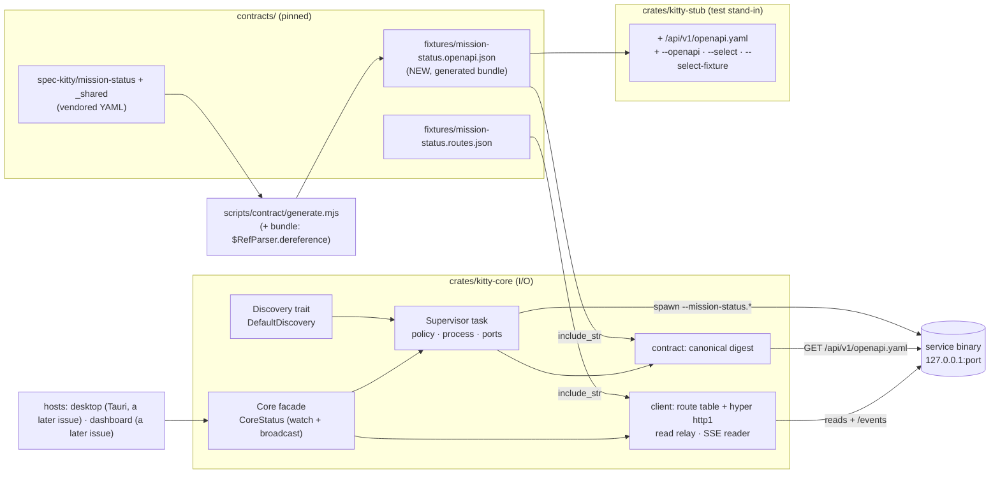
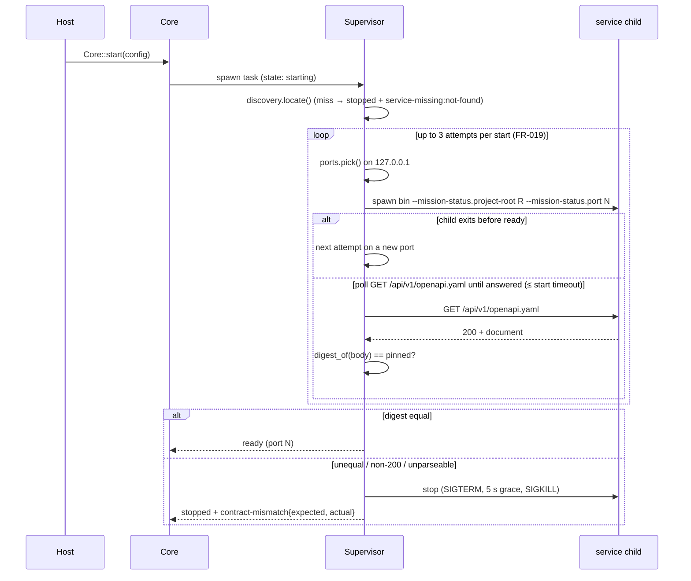

# Implementation Plan: kitty-core: shared Rust core (contract client, change stream, supervision)

**Branch**: `feat/kitty-core-19` | **Date**: 2026-10-15 | **Spec**: [spec.md](spec.md)
**Input**: Mission specification from `kitty-specs/kitty-core-01M50D10/spec.md`; mission-ui issue 19 under epic 16, with the design notes on issues 19, 20 and 21 from the PR #32 landing review.
**Branch contract**: planning starts on `feat/kitty-core-19`, which is also the planning base and the merge target of every work package; the mission PR goes from `feat/kitty-core-19` into `main`.
**Plan decisions**: the operator resolved all four plan forks on 2026-10-15, choosing option A each time (see "Plan decisions").

## Summary

`crates/kitty-core` becomes the one Rust core that both hosts use. It does five things for one project at a time:

1. **Discovery.** A replaceable lookup finds the service binary. The default rules are: a configured path, then one environment variable, then a PATH search. If nothing is found, the result is service-missing.
2. **Supervision.** It starts the binary with `--mission-status.project-root` and `--mission-status.port` on a port it picks. It detects readiness through the contract check, retries a busy port on a new port, restarts after a crash with capped backoff, gives up after 5 crashes in 5 minutes, and stops the child with SIGTERM, then a 5 s grace period, then SIGKILL.
3. **Contract check.** It fetches `/api/v1/openapi.yaml`, parses it, writes it in a canonical form (sorted keys, JSON, integral numbers as integers) and compares the SHA-256 with the pinned digest. The pinned digest is computed by the same code from the bundled document that `contract:generate` derives from the vendored pin, so there is no hand-maintained value.
4. **Relay.** Reads use a route table built from `routes.json` over a hyper HTTP/1.1 client connection. They come back as status, content type and raw body bytes. The change stream is parsed by kitty-core's own SSE frame reader and handed on as raw changes (event name, cursor, data bytes) with one terminal outcome: refused or unavailable.
5. **Degraded signal.** There is one `CoreStatus`: the supervision state plus a degraded reason. A documented mapping to the port's five `ConnectionState` strings is checked by a test against `port.ts`.

The stub gains three things:
- the `GET /api/v1/openapi.yaml` route, serving the bundled document by default;
- `--openapi <file>`, to serve a modified document instead;
- `--select` and `--select-fixture`, to choose a scenario at start-up.

The existing stub tests run unchanged. The port, the workspace members, the CI jobs and the four existing fixture files do not change (SC-004).

## Technical Context

**Language/Version**: Rust 1.98.1, pinned in `rust-toolchain.toml` and unchanged; edition 2021, inherited from the workspace. Node 22.22.2 and pnpm 11.18.0 only for the contract generator (IC-02).
**Primary Dependencies**:
- **Already pinned in the workspace.** `hyper =1.11.1` (kitty-core adds the `client` Cargo option at member level) and `hyper-util =0.1.21` (`tokio` option, for `TokioIo`), plus `http-body-util =0.1.5`, `tokio =1.53.1` (member level adds `process`, `io-util` and `sync`; dev adds `test-util`), `serde =1.0.229` and `serde_json =1.0.151` (`preserve_order`).
- **Newly direct, already in `Cargo.lock`.** `percent-encoding =2.3.2` and `libc =0.2.189`.
- **New.** `yaml_serde =0.10.7` and `sha2 =0.10.9`.
- **Dev-only.** `kitty-stub` as a path dependency, to run the stub in-process.
- **New lock entries.** There are 14: see "Supply chain" and research R-07.
- **Node.** The existing `@apidevtools/json-schema-ref-parser 16.0.3` and `yaml 2.9.1` produce the bundle. No npm change.

**Storage**: none. There is one new generated, committed file: `contracts/fixtures/mission-status.openapi.json`.
**Testing**:
- **`cargo test`** under `Gate: rust`:
  - kitty-core integration tests run the stub **in-process** (`kitty_stub::app` + `run_server` on `127.0.0.1:0`);
  - a raw-TCP fake server sends byte-exact faults: 503, malformed or oversized SSE, a stall and a drop;
  - the supervision tests run `kitty-fake-service`, a `[[bin]]` target of kitty-core.
- **`node --test`** under `Gate: contract`, for the bundle generator.
- **Gate-proof**: one new contract plant.
**Target Platform**: CI is ubuntu-24.04 (Linux only, as today). Development is on macOS and Linux. Windows and macOS process behaviour is covered when the multi-OS matrix arrives with #20.
**Project Type**: a pnpm + Cargo monorepo. All the work is in `crates/kitty-core` and `crates/kitty-stub`, plus one generator change under `scripts/contract/`.
**Performance Goals**:
- **NFR-003.** A change is relayed in 10 ms p95 or less after its last byte. This is measured over 200 events and recorded as evidence, not asserted.
- **NFR-001.** kitty-core's tests take 60 s or less. The `Gate: rust` step must stay at 45 s or less on CI, so that the rust proof-leg formula still yields 5 minutes (it measured 34 s on run 38794142800; see Gates).
**Constraints**:
- SC-004 and C-002 freeze the port types, the members, the gate jobs and the existing fixture shapes;
- I/O only in `crates/*` (C-001);
- `127.0.0.1` only (FR-005, C-004);
- exact, aged pins (NFR-002);
- bounded memory: 1 MiB per frame, 16 MiB per body, 64 KiB of output per child (NFR-004);
- no panics (NFR-005);
- deterministic supervision (NFR-006);
- offline tests (NFR-007);
- no new gate (C-007).
**Scale/Scope**:
- 9 reads and 1 stream;
- 3 event names;
- 5 supervision states;
- 3 degraded reasons for service-missing;
- one bundled document of about 630 KB (two-space JSON, as `jsonText` writes it);
- 14 new crates in `Cargo.lock`, of which 1 has a build script and 0 are procedural macros.

## Charter Check

*GATE: Must pass before Phase 0 research. Re-check after Phase 1 design.*

| Charter rule | Verdict | Note |
|---|---|---|
| Screens: no I/O; data via properties | PASS | No change under `packages/*` (C-001). |
| Hosts: I/O only in `apps/*` and `crates/*` | PASS | All I/O is in `crates/kitty-core` and `crates/kitty-stub`. The Node generator runs only at development time and in a gate, like the existing contract scripts. |
| Hosts read spec-kitty only through published contracts | PASS | The route table and the pinned digest come from the vendored pin (C-005). kitty-core reads nothing under `kitty-specs/` or `.kittify/`. |
| Host servers bind 127.0.0.1; own Host and Origin checks | PASS | kitty-core is a client. It addresses only `127.0.0.1:<port>` and refuses any other address before I/O (FR-005). It sends `Host: 127.0.0.1:<port>` and no `Origin` or forwarding header (FR-004). The stub and `kitty-fake-service` bind `127.0.0.1` only. |
| Never ask the service to loosen its protections | PASS | No flag beyond the two upstream launch flags (FR-017). |
| Quality gates: `cargo fmt --check`, clippy `-D warnings`, `cargo test` | PASS | The existing `Gate: rust` command is unchanged. |
| Hosts tested against a local stub; one test per host security rule | PASS | Host, Origin, forwarding and loopback each have their own test (IC-04). |
| Review: separate reviewer per WP; squad after plan; operator merges | PASS | The R1–R6 plan squad runs next and is recorded in `reviews/plan.squad.md`. |
| Risk boundaries: no secrets, paths or usernames in tracked files | PASS | Captured child output lives only in memory (C-006). Tests write only to temp directories. |
| Exact version pins | PASS | Every new crate is `=x.y.z` in `[workspace.dependencies]`, with its publish date in a comment (NFR-002). |
| Distribution: never bundle the service; discover it | PASS | Discovery only (FR-023). `kitty-fake-service` is a test binary in a `publish = false` crate. It is never packaged by #20 or #21, which build only their own binaries. |
| Exceptions are documented in the PR | PASS | No exception is planned. Proof-leg timeouts are formula-tuned values, not frozen wiring (DM `01M50HVPJ9CDBB7405T9K0645R`, resolved A). |

Re-checked after Phase 1 design: no new conflicts.

## Architecture



- **One canonical-digest function, two inputs.** `contract::digest_of(text)` parses YAML (JSON is a subset), writes it in canonical form and hashes it.
  - The pinned digest is `digest_of(BUNDLE)`, where `BUNDLE` is `include_str!` of the generated file, computed once (`OnceLock`).
  - The served digest is `digest_of(body)`.
  - There is no hand-typed digest anywhere (FR-012).
- **Relay, never interpret.**
  - A read returns `ReadOutcome::Answer { status, content_type, body: Bytes }`, or one of `Transport`, `NotReady` or `ContractMismatch`.
  - A stream yields `StreamEvent::Change(RawChange)` and `StreamEvent::Diagnostic(..)`, then at most one terminal `Refused` or `Unavailable`, then `None`.
  - There is no reconnect, no cursor store and no `resync` (C-003).
- **Supervision is pure policy plus thin I/O.**
  - `RestartPolicy` is a pure function of a `Clock` and the crash history, unit-tested under a manual clock.
  - The process layer (`spawn`, readiness poll, stop) uses real tokio timers with durations that tests can configure. No supervision test waits on a real timer for more than 1 s (NFR-001).
  - The backoff sleep goes through an injectable `Sleeper`. The test sleeper records each delay, advances the virtual clock and returns at once, so the delays and states are identical across runs (NFR-006).

### Supervision sequence (one start)



## Project Structure

### Documentation (this mission)

```
kitty-specs/kitty-core-01M50D10/
├── spec.md
├── plan.md                 # this file
├── research.md
├── data-model.md
├── quickstart.md
├── contracts/
│   ├── kitty-core-api.md   # the Rust public surface hosts build on (SC-005)
│   ├── bundled-document.md # the generated bundle and the canonical digest form
│   └── stub-http-delta.md  # the stub's new route and options (extends #17's stub-http.md)
├── decisions/              # specify rulings + the four resolved plan decisions
└── checklists/requirements.md
```

### Source Code (repository root)

```
Cargo.toml                          # EXTENDED [workspace.dependencies]: yaml_serde, sha2, percent-encoding, libc (exact, dated)
Cargo.lock                          # EXTENDED: 14 new entries (research R-07), resolved with --precise where needed
crates/kitty-core/
├── Cargo.toml                      # real deps; [[bin]] kitty-fake-service (test = false, doc = false); dev-dep kitty-stub (path)
├── src/
│   ├── lib.rs                      # module tree + re-exports; KEEPS version() and its single top-level #[cfg(test)] (rust plant anchors)
│   ├── routes.rs                   # RouteTable from include_str!(routes.json); path/query filling, percent-encoding
│   ├── endpoint.rs                 # ServiceEndpoint: 127.0.0.1:<port> only
│   ├── client.rs                   # hyper conn::http1 request execution, header rules, body cap, timeouts
│   ├── sse.rs                      # SSE frame reader (pure, byte-fed) + ChangeStream
│   ├── contract.rs                 # canonical form, digest_of, pinned_digest, check()
│   ├── discovery.rs                # Discovery trait, DefaultDiscovery, EnvSnapshot
│   ├── supervisor/{mod,policy,process,ports,output}.rs
│   ├── status.rs                   # SupervisionState, DegradedReason, CoreStatus, connection_state_hint
│   ├── core.rs                     # Core facade: start/stop/retry/status/read/open_stream/ready_endpoint
│   └── bin/kitty-fake-service.rs   # test-only service stand-in (std + libc), modes read from <project-root>/kitty-fake-service.json
└── tests/
    ├── workspace.rs                # UNCHANGED
    ├── common/mod.rs               # in-process stub, raw-TCP fault server, temp dirs, fake-service mode writer
    ├── reads.rs                    # FR-001..006, SC-001
    ├── stream.rs                   # FR-007..010
    ├── contract_check.rs           # FR-011..013, SC-002
    ├── discovery.rs                # FR-023, FR-022 (not-found)
    ├── supervision.rs              # FR-016..022, NFR-005/006, SC-003
    ├── status_mapping.rs           # FR-024 (incl. cross-check against packages/mission-shell/src/client/port.ts)
    └── latency.rs                  # NFR-003 measurement, #[ignore]
crates/kitty-stub/src/{lib.rs,main.rs}   # EXTENDED: openapi route, --openapi, --select/--select-fixture (Options struct unchanged)
crates/kitty-stub/tests/openapi.rs, select.rs   # NEW tests; existing tests untouched
scripts/contract/generate.mjs       # EXTENDED: FIXTURE_FILES.openapi + bundle emitter (dereference, jsonText)
scripts/contract/bundle.test.mjs    # NEW: determinism, every $ref inlined, a one-file edit changes the bundle
contracts/fixtures/mission-status.openapi.json   # NEW, generated
.gitattributes                      # EXTENDED: one LF + linguist-generated line for the bundle
gates/plants/contract/plant.json    # EXTENDED: stale-bundle plant
.github/workflows/ci.yml            # timeout values only, and per DM 01M50HVPJ9CDBB7405T9K0645R, resolved A (contract 19→21)
README.md, CHANGELOG.md             # EXTENDED
```

**Structure Decision**:
- **No new member (C-002).** The fake service is a `[[bin]]` of kitty-core, because integration tests only get `CARGO_BIN_EXE_*` for binaries of their own package. It uses only `std` and `libc`, and reads its scenario from a file in the project root it is given. It therefore needs neither an extra flag nor an extra environment variable, and FR-017's argument assertion stays exact.
- **The stub runs in-process.** kitty-core's relay tests run it through a dev-dependency (`kitty_stub::app`), not as a binary. Cargo exposes no other package's binary to a test.
- **No cycle.** The stub never depends on kitty-core.

## Complexity Tracking

| Violation | Why Needed | Simpler Alternative Rejected Because |
|---|---|---|
| A generated bundle of about 630 KB committed under `contracts/fixtures/` | The stub must serve the pinned document, and the pinned digest must come from one bundling that already exists in the contract scripts (C-005) | A bundler in Rust would be a second, hand-written reference resolver (decision `01M50HVKZ0D1C5HBMB1J1P99E1`, option B, not chosen). Bundling at stub start-up would make the stub depend on a parser stack it does not need. |
| A test-only `[[bin]]` inside a production crate | C-002 forbids a new member, and cargo exposes only a package's own binaries to its tests | A self-exec of the test harness would need `harness = false` and a hand-made runner. A binary in kitty-stub cannot be reached from kitty-core's tests. |
| One `unsafe` block family (`libc::kill`, `prctl` in `pre_exec`) | SIGTERM before SIGKILL (FR-021), and tying the child to its parent on Linux (spec edge case) | tokio only offers SIGKILL. `nix` would be a new crate for two calls. |

## Implementation Concern Map

### IC-01 — Dependencies and exact pins

- **Purpose**: kitty-core gains its real dependencies with exact, aged pins, and with the lock entries proven.
- **Relevant requirements**: NFR-002, NFR-007, C-002 (kitty-core's dependencies are the only workspace change), SC-004.
- **Affected surfaces**:
  - root `Cargo.toml` `[workspace.dependencies]`:
    - `yaml_serde = "=0.10.7"`, published 2026-08-18;
    - `sha2 = "=0.10.9"`, published 2025-04-30;
    - `percent-encoding = "=2.3.2"`, already locked;
    - `libc = "=0.2.189"`, already locked;
    - each with a date comment, in the style of the existing pins;
  - `crates/kitty-core/Cargo.toml`:
    - member-level features `hyper/client` and `http1`, `hyper-util/tokio`, and `tokio/{process,io-util,sync}`;
    - the dev-dependency `tokio/test-util`;
    - the dev-dependency `kitty-stub = { path = "../kitty-stub" }`;
    - the `[[bin]]` declaration requested by IC-08;
  - `Cargo.lock`.
- **Sequencing/depends-on**: none. This IC goes first.
- **Risks**:
  - Online resolution picks `want 0.3.2`, published 2026-10-05, which is younger than 14 days. The WP runs `cargo update -p want --precise 0.3.1` and checks the lock against the 14 entries in research R-07, by name and version.
  - Any further drift from that list needs a dated justification in the WP.
  - No workspace pin rises: every new crate's minimum of a shared crate is already met (serde 1.0.195 or later, indexmap 2.2.1 or later, itoa 1). The WP re-verifies this with `cargo tree -i`.
  - Build scripts and procedural macros are listed from `cargo metadata`, not predicted. The only new build script is `generic-array 0.14.7`, built with `version_check 0.9.5`.

### IC-02 — The bundled contract document

- **Purpose**: one generated document with every reference inlined, derived from the vendored pin and kept current by `Gate: contract`.
- **Relevant requirements**: FR-012, FR-014 (the source of the document), C-005, C-007.
- **Affected surfaces**:
  - `scripts/contract/generate.mjs`:
    - `FIXTURE_FILES.openapi = 'contracts/fixtures/mission-status.openapi.json'`;
    - `buildBundle(root)`: `new $RefParser().dereference(openapi, { dereference: { circular: false } })`, then `jsonText`;
    - an entry in `generateJsonSources`, so `checkJsonFresh` covers it unchanged;
  - `scripts/contract/bundle.test.mjs`, which checks that:
    - generating twice gives identical bytes;
    - no `$ref` key remains;
    - a temp copy of the vendored tree with one schema edited yields a different bundle;
    - a circular reference fails generation loudly;
  - `contracts/fixtures/mission-status.openapi.json`;
  - `.gitattributes`;
  - `gates/plants/contract/plant.json`.
- **Sequencing/depends-on**: none. It can run in parallel with IC-01.
- **Risks**:
  - `circular: false` must throw on a cycle rather than emit a partial document. The current pin has none, as verified at plan time.
  - The existing four fixture files must stay byte-identical (SC-004). The WP runs `git diff --exit-code` on them.
  - Any test that counts `FIXTURE_FILES` or the generator's output line is updated in the same WP.
  - Decision `01M50HVKZ0D1C5HBMB1J1P99E1` was resolved A, so this IC stands as written.

### IC-03 — Stub extensions

- **Purpose**: the stub serves the contract document, can serve a modified one, and can pick a scenario at start-up without request headers.
- **Relevant requirements**: FR-014, FR-015, C-008, NFR-008.
- **Affected surfaces**:
  - `crates/kitty-stub/src/lib.rs`:
    - a new route `GET /api/v1/openapi.yaml` under the same guard and record layers;
    - builder methods `Fixtures::with_openapi_document(Bytes)` and `Fixtures::with_selections(..)`;
    - the `Options` struct and the `app`, `from_values` and `load` signatures stay unchanged;
  - `crates/kitty-stub/src/main.rs`:
    - `--openapi <file>`, defaulting to `<fixtures>/mission-status.openapi.json`, read once before `listening`;
    - `--select <operationId>=<Schema.name>` and `--select-fixture <operationId>=<fixture>`, both repeatable;
    - every invalid value is exit 2 with the usage text, before `listening`;
  - new tests `tests/openapi.rs` and `tests/select.rs`;
  - `contracts/stub-http-delta.md` in this mission.
- **Sequencing/depends-on**: IC-02, for the default document file.
- **Risks**:
  - The existing tests must pass unchanged, so `Options` gains no field (it is built by struct literal in `tests/common/mod.rs`).
  - A start-up selection is checked by the same schema-fit rule as the headers, and the request header still wins.
  - A route in `routes.json` whose path is `/openapi.yaml` would collide, so it is refused at load, as conflicts already are.
  - Without a document (lib use without the builder), the route answers 404 `{"code":"no-openapi-document"}`. kitty-core's "no contract route" test uses that answer.
  - The document is served byte for byte with `content-type: application/yaml`.

### IC-04 — Contract client and read relay

- **Purpose**: relay the nine reads byte for byte, with loopback and header rules and safe encoding.
- **Relevant requirements**: FR-001 to FR-006, NFR-004, NFR-005, NFR-007, SC-001.
- **Affected surfaces**:
  - `src/{routes,endpoint,client}.rs`;
  - `src/lib.rs` (owner);
  - `tests/common/mod.rs` (owner);
  - `tests/reads.rs`.
- **Sequencing/depends-on**: IC-01 and IC-03 (the tests use `with_selections` in-process).
- **Risks**:
  - **Oracle.** The coverage test reads `routes.json` from disk on its own, not through kitty-core's embedded table. It compares each relayed answer with a direct raw-TCP request the test makes itself. A missing operation names itself.
  - **Body fixture.** The stub writes `serde_json::to_vec`, so a body with `null`s, an unknown field and a non-alphabetical key order is served by the raw-TCP fake for the byte test (FR-002).
  - **Encoding.** Every path segment percent-encodes everything except `ALPHA`, `DIGIT`, `-`, `_` and `~`. `.` is encoded too, so a value of `..` cannot become a dot-segment. Query values use the same set.
  - **Headers.** `Host` is set explicitly. The request carries `Accept`, plus `Host`, and nothing else.
  - **Limits.**
    - A body over 16 MiB is a transport failure, and nothing partial is returned.
    - The read timeout is 30 s by default and configurable.
  - **Plant anchors.** The rust plants in `lib.rs` (`    env!("CARGO_PKG_VERSION")\n` and the single `\n#[cfg(test)]\n`) must survive. The reviewer checks both by `grep -c`.

### IC-05 — Change-stream relay

- **Purpose**: open scoped or unscoped streams and relay raw changes in order, with exactly one terminal outcome.
- **Relevant requirements**: FR-007 to FR-010, NFR-003, NFR-004, NFR-005.
- **Affected surfaces**:
  - `src/sse.rs`:
    - a pure `FrameReader::feed(&[u8]) -> Vec<Frame>`;
    - `ChangeStream`;
  - `tests/stream.rs`;
  - `tests/latency.rs`.
- **Sequencing/depends-on**: IC-04.
- **Risks**:
  - **Line handling.** LF, CR and CRLF line ends are handled, and a leading BOM is ignored. `data:` lines join with `\n`, and one optional space after the colon is stripped. `retry:` is ignored. A comment line resets the idle timer and is never relayed.
  - **Unknown events.** An event name outside the three is a `Diagnostic`, not a failure. The list of three is cross-checked by a test against `paths/events.yaml`.
  - **Invalid data.** Data that is not one JSON value (checked with `serde_json::from_slice::<IgnoredAny>`) ends the stream as `Unavailable(MalformedData)`.
  - **Refused or not.** The stream is `Refused` only when the status is declared in `routes.json` `refusals` for `streamEvents` (400, 404 or 409). Every other non-200 is `Unavailable(Status)`, with the body read up to 16 MiB.
  - **Idle limit.** It is 90 s by default and configurable. Tests use 200 ms against a fake that stalls.
  - **Cursor rule.** A cursor without a non-empty mission is refused before any I/O.
  - **No `Problem` entry to select (spec deviation, for the squad).** FR-009 asks for "the 404 at stub start-up", but neither `examples.json` nor `fixtures.json` holds a `Problem` entry, and C-002 freezes both. The 404 `Problem` refusal is therefore produced by the raw-TCP fake, with a body built in the test. The five `StreamRefusal` examples are selected on the stub with `--select`.
  - **Terminology.** The terminology gate scans every `.rs` file under `crates/*/src` and `crates/*/tests` for the banned whole word. A Rust source must never contain it, not even in a `cfg(...)` or a comment.

### IC-06 — Contract digest check

- **Purpose**: the pinned digest follows the pin, and an unknown contract never reaches a screen.
- **Relevant requirements**: FR-011, FR-012 (Rust side), FR-013, SC-002.
- **Affected surfaces**:
  - `src/contract.rs`:
    - `canonical_json(&Value) -> Vec<u8>`;
    - `digest_of(&[u8]) -> Result<Digest, ParseError>`;
    - `pinned_digest()`;
    - `check(endpoint) -> CheckOutcome`;
  - `tests/contract_check.rs`.
- **Sequencing/depends-on**: IC-01, IC-02, IC-03 and IC-04.
- **Risks**:
  - **Canonical form.** It is defined in `contracts/bundled-document.md`:
    - keys are sorted by UTF-8 bytes;
    - numbers with an integral value of magnitude below 2^53 are written as integers;
    - other numbers use `serde_json`'s float form;
    - strings use `serde_json`'s escaping;
    - there is no whitespace.
  - **Why integral numbers matter.** The Node bundle writes `1.0` as `1`, while a real YAML document parsed in Rust keeps `1.0`. A test asserts that the same document gives the same digest in JSON-flow and in YAML block form.
  - **Fail closed.** A non-200 answer, a parse error and an unequal digest all give `contract-mismatch`, with an `actual` that says which.
  - **No request after a mismatch.** The FR-013 test reads `/__stub/last-request` after a mismatch and asserts that it is still the `openapi.yaml` fetch.

### IC-07 — Discovery

- **Purpose**: a replaceable lookup with the three ruled rules.
- **Relevant requirements**: FR-023, FR-022 (`not-found`), US5, US6.
- **Affected surfaces**:
  - `src/discovery.rs`:
    - `trait Discovery: Send + Sync { fn locate(&self) -> Result<PathBuf, ServiceMissing>; }`;
    - `DefaultDiscovery { configured: Option<PathBuf>, env: EnvSnapshot, binary_name: OsString }`;
    - `EnvSnapshot::from_process()`;
  - `tests/discovery.rs`.
- **Sequencing/depends-on**: IC-01.
- **Risks**:
  - **No global environment in tests.** Tests never mutate the process environment: `EnvSnapshot` is built explicitly.
  - **Explicit choices never fall through.** An invalid configured path fails with no fallback. An environment variable that is set but invalid also fails with no fallback.
  - **PATH search.** It skips entries that are not executable files (on Unix, by the execute bit), as a shell does.
  - **Names.** The environment variable is `KITTY_MISSION_STATUS_SERVICE`. The default binary name is `mission-status-api` and is configurable.
  - **Windows.** `PATHEXT` is documented for #20 and not tested here (CI is Linux only).

### IC-08 — Supervision

- **Purpose**: start, watch, restart and stop one child per project, deterministically.
- **Relevant requirements**: FR-016 to FR-022, NFR-001, NFR-004, NFR-005, NFR-006, SC-003.
- **Affected surfaces**:
  - `src/supervisor/policy.rs`: the pure `RestartPolicy`, with `Clock`;
  - `src/supervisor/ports.rs`: the `PortPicker` trait, whose default binds `127.0.0.1:0` and releases it;
  - `src/supervisor/process.rs`:
    - spawn with `kill_on_drop(true)`;
    - on Linux, `pre_exec` with `prctl(PR_SET_PDEATHSIG, SIGTERM)` plus a `getppid` re-check;
    - stop with SIGTERM, the grace period, then SIGKILL;
  - `src/supervisor/output.rs`: a 64 KiB ring buffer per child;
  - `src/supervisor/mod.rs`: the state machine task;
  - `src/bin/kitty-fake-service.rs`;
  - `tests/supervision.rs`.
- **Sequencing/depends-on**: IC-06 (readiness is the digest check) and IC-07.
- **Risks**:
  - **Restart policy (FR-020).**
    - The backoff runs 0.5 s, 1, 2, 4, 8, 16, then 30 s and stays there. It resets after 60 s of uninterrupted `ready`.
    - The crash window slides: the 5th crash within 300 s of virtual time gives up.
    - A start failure (timeout, or 3 busy-port attempts used up) counts as a crash.
    - The policy is unit-tested under a manual clock, with the exact sequences.
  - **Test timing.** Readiness polling (every 50 ms, timeout 10 s), the stop grace (5 s) and the idle limit are real-time durations set through `Timings`. Tests use 10 ms, 400 ms and 300 ms, so no test waits more than 1 s.
  - **Process lifetime.**
    - **Parent death.** PDEATHSIG fires when the thread that forked the child exits. Spawning therefore happens on the supervisor's runtime worker, never inside `spawn_blocking`.
    - **Host exit.** A Linux-only test runs `kitty-fake-service host …`: the binary acts as a host, starts a supervised child, then calls `exit` without stopping it. The test asserts that the grandchild is gone within 1 s.
    - **macOS.** It has no PDEATHSIG. This is a documented limit (spec Assumptions).
  - **Output capture.** Pipes are drained continuously, so a chatty child never blocks. Output is never written to disk (C-006).
  - **Fake scenarios.** `kitty-fake-service` reads `<project-root>/kitty-fake-service.json`, which holds `{ mode, recordArgs, crashAfterMs }`. The modes are `ready`, `crash-after`, `exit-at-start`, `never-ready`, `ignore-term`, `serve-modified` and `host`.
  - **Contract-mismatch is final.** The child is stopped and the state is `stopped` with contract-mismatch. There is no restart until the host retries.

### IC-09 — Core facade and the degraded signal

- **Purpose**: the one public surface the hosts build on.
- **Relevant requirements**: FR-013, FR-016, FR-024, SC-005, C-003.
- **Affected surfaces**:
  - `src/{core,status}.rs`;
  - the `src/lib.rs` re-exports (requested from IC-04);
  - `tests/status_mapping.rs`;
  - `contracts/kitty-core-api.md`.
- **Sequencing/depends-on**: IC-04, IC-05, IC-06 and IC-08.
- **Risks**:
  - **Status delivery.** The current status is held in a `watch`. Each transition is also sent on a `broadcast` with a capacity of 64. A slow subscriber gets `Lagged(n)`, never blocks the supervisor, and can read `status()`.
  - **Gating.** A read or a stream answers `NotReady` or `ContractMismatch` at once, before any I/O, unless the state is `ready`.
  - **`ready_endpoint()`** is exposed for #21's pass-through proxy. It is `Some` only while the state is `ready`.
  - **Mapping test.** It parses the five strings out of `packages/mission-shell/src/client/port.ts` (`CONNECTION_STATES`), so the Rust hint table cannot drift from the port.

### IC-10 — Documentation, evidence and wrap-up

- **Purpose**: the documentation, the measured budgets, the SC-004 probe and the timeout values.
- **Relevant requirements**: NFR-001, NFR-003, NFR-008, SC-004, SC-006, C-006.
- **Affected surfaces**:
  - `README.md`: the kitty-core section, discovery configuration, the stub's new options;
  - `CHANGELOG.md`;
  - `.github/workflows/ci.yml`: the proof-matrix `timeout` values only, as decision `01M50HVPJ9CDBB7405T9K0645R` (resolved A) allows;
  - the mission evidence: NFR-003 p95, local and CI gate times.
- **Sequencing/depends-on**: all.
- **Risks**:
  - **SC-004 probe.** It is `git diff --exit-code "$(git merge-base HEAD main)" -- packages/mission-shell/src/client contracts/fixtures/mission-status.{routes,examples,fixtures,changes}.json`. It also checks that `Cargo.toml` `members` and the job and matrix lists of `ci.yml` are unchanged. The reviewer repeats it.

## Shared-file ownership

Each shared file has exactly one owning IC. Other ICs request their changes through the owner's WP, or land after it, rebased on it.

| File | Owner | Requested by |
|---|---|---|
| root `Cargo.toml` (`[workspace.dependencies]` only; `members` untouched) | IC-01 | none expected beyond IC-01's list |
| `Cargo.lock` | IC-01 | — |
| `crates/kitty-core/Cargo.toml` | IC-01 | IC-08 (`[[bin]] kitty-fake-service`), IC-04 (dev-dep `kitty-stub`) |
| `crates/kitty-core/src/lib.rs` | IC-04 | IC-05, IC-06, IC-07, IC-08, IC-09 (one `pub mod` or `pub use` line each; the plant anchors stay) |
| `crates/kitty-core/tests/common/mod.rs` | IC-04 | IC-05 (stall and drop fault modes), IC-06, IC-08 (fake-service scenario writer), IC-09 |
| `crates/kitty-stub/src/lib.rs`, `crates/kitty-stub/src/main.rs` | IC-03 | — |
| `scripts/contract/generate.mjs`, `contracts/fixtures/mission-status.openapi.json`, `.gitattributes` | IC-02 | — |
| `gates/plants/contract/plant.json` | IC-02 | — |
| `gates/plants/rust/plant.json` | not touched (anchors preserved by IC-04) | — |
| `.github/workflows/ci.yml` (timeout values only) | IC-10 | IC-02 (contract leg 19→21) |
| `README.md`, `CHANGELOG.md` | IC-10 | all |

## Gates

The aggregate `Gate: all` must be green. No gate, job or matrix entry is added or removed (C-002, C-007).

**Canonical gate strings.** These are byte-identical to `ci.yml` and `gates/plants/*/plant.json`:

- `rust`: `cargo fmt --all --check && cargo clippy --workspace --all-targets --frozen -- -D warnings && cargo test --workspace --frozen`
- `contract`: `pnpm contract:check && pnpm test:contract`

**Gates touched.**

| Gate | Change | New plants |
|---|---|---|
| `rust` | new tests only: kitty-core's integration tests and the stub's `openapi.rs` and `select.rs`. Exempt from plants (C-007) | 0 |
| `contract` | `checkJsonFresh` now covers a fourth generated JSON file; `bundle.test.mjs` joins `test:contract` | 1 |
| `hygiene` | no change. Its existing `cargo-pins` and tracked-file scans judge the new pins and files | 0 |
| every other gate | no change | 0 |

**Plants.** There is one new plant. Its `expectFailPattern` is one string that appears only when the check fails:

| Gate | Plant | Overlay | `expectFailPattern` |
|---|---|---|---|
| `contract` | stale bundled document | `contracts/fixtures/mission-status.openapi.json`: `"version": "1.0.0-SNAPSHOT"` → `"version": "1.0.0-PLANTED"` (the WP verifies the find string occurs exactly once) | `stale generated file: contracts/fixtures/mission-status.openapi.json differs` |

This brings the mission-level total to 1 new plant. The contract leg goes from 8 plants to 9, and rust stays at 3.

**Proof-leg timeouts** use NFR-002's formula from #17: (1 + plants in the leg) × the measured gate time + 2 minutes. The gate times come from CI run 38794142800, on the #17 landing head.

| Leg | Measured gate step | Plants after | Formula | Timeout now → planned |
|---|---|---|---|---|
| `contract` | 113 s (1.88 min) | 9 | 10 × 1.88 + 2 = 20.8 | 19 → **21** (allowed: `01M50HVPJ9CDBB7405T9K0645R` resolved A) |
| `rust` | 34 s (0.57 min) today | 3 | 4 × T + 2 ≤ 5 ⇔ T ≤ 45 s | 5 → 5 if T ≤ 45 s on the PR's first CI run; otherwise 4 × T + 2, rounded up (allowed by the same ruling) |

The rust leg's real cost is smaller than the formula: the plants fail at fmt, at clippy and early in test, and they share the build (the leg measured 35 s against a 34 s gate). The formula is still the rule.

**Rust budget.**
- The `Gate: rust` job stays within 8 minutes. It measures about 50 s today; about 1.5 min is planned.
- kitty-core's tests take 60 s or less (NFR-001). The planned running time is under 10 s:
  - the stub runs in-process;
  - the fake service starts in milliseconds;
  - each wait is 1 s or less;
  - backoff is virtual.
- The extra compile is 14 small crates. A local cold `cargo check` of the whole set took 6.7 s.
- Every WP records `cargo test -p kitty-core` wall time. IC-10 records the CI step time, which decides the rust leg value.

## Plan decisions

Each one is a recorded Decision Moment (`--flow plan`). The operator resolved all four on 2026-10-15, choosing option A each time. The ruling was relayed by the coordinator. The last column records what option B would have changed.

| Decision | Question | Ruled (A) | Option B, not chosen |
|---|---|---|---|
| `01M50HVKZ0D1C5HBMB1J1P99E1` | Where is the bundle produced and checked? | A: `contract:generate` plus the `Gate: contract` staleness check, +1 plant | B: IC-02 becomes a Rust inliner in kitty-core (a build script embeds the vendored files). The stub binary serves the document only with `--openapi <file>`. No contract plant, no contract timeout change. |
| `01M50HVNACZ8T6XM1XKJ68TR8J` | Parse the served document as YAML now? | A: `yaml_serde =0.10.7` | B: JSON only, 3 fewer crates. The real service's YAML is contract-mismatch until #22. |
| `01M50HVPJ9CDBB7405T9K0645R` | Are proof-leg timeouts frozen wiring? | A: no; they are set by formula | B: forces bundle option B, and kitty-core must keep the rust step at 45 s or less. |
| `01M50HVQZBYA7M58WD1ABFMF8K` | Which hyper client layer? | A: `conn::http1` + `TokioIo`, no pool | B: the `client-legacy` pool, +3 crates (`tracing`, `tracing-core`, `once_cell`). |

## Supply chain (DIRECTIVE_051)

The full table is research R-07.

- **New `Cargo.lock` entries (14).** Each was published at least 14 days before 2026-10-15. Publish dates are from the crates.io API.

  | Crate | Version | Published |
  |---|---|---|
  | `yaml_serde` | 0.10.7 | 2026-08-18 |
  | `libyaml-rs` | 0.3.0 | 2026-03-11 |
  | `ryu` | 1.0.23 | 2026-02-08 |
  | `sha2` | 0.10.9 | 2025-04-30 |
  | `digest` | 0.10.7 | 2023-05-19 |
  | `block-buffer` | 0.10.4 | 2023-03-09 |
  | `crypto-common` | 0.1.7 | 2025-11-12 |
  | `generic-array` | 0.14.7 | 2023-03-28 |
  | `typenum` | 1.20.1 | 2026-05-29 |
  | `version_check` | 0.9.5 | 2024-07-25 |
  | `cpufeatures` | 0.2.17 | 2025-01-25 |
  | `cfg-if` | 1.0.4 | 2025-10-15 |
  | `want` | 0.3.1 | 2023-06-14 |
  | `try-lock` | 0.2.5 | 2023-12-07 |

- **Newly direct but already locked.** `percent-encoding 2.3.2` and `libc 0.2.189`.
- **Build scripts among the new entries.** Only `generic-array 0.14.7`, which uses `version_check`.
- **Procedural macros among the new entries.** None.
- **Workspace pin bumps.** None.
- **Hyper client features.** The ruling's `client`, `client-legacy`, `http1` and `tokio` set is **not** fully covered by the current lock:
  - `hyper/client` adds `want` and `try-lock`;
  - `hyper-util/client` adds `tracing`, `tracing-core` and `once_cell`;
  - `http1` and `tokio` are already covered.
  - `01M50HVQZBYA7M58WD1ABFMF8K` was resolved A, so only `hyper/client` is taken.

## PR shape

There is one PR from `feat/kitty-core-19` into `main`, opened by the orchestrator after the WPs. A separate reviewer agent reviews each WP, and the pre-merge R1–R3 squad runs before hand-off. The operator merges. Agents never push, merge or post without the operator.

## Traceability

| Requirement | IC |
|---|---|
| FR-001, FR-002, FR-003, FR-004, FR-005, FR-006 | IC-04 |
| FR-007, FR-008, FR-009, FR-010 | IC-05 |
| FR-011 | IC-06 |
| FR-012 | IC-02, IC-06 |
| FR-013 | IC-06, IC-09 |
| FR-014 | IC-02, IC-03 |
| FR-015 | IC-03 |
| FR-016, FR-017, FR-018, FR-019, FR-020, FR-021 | IC-08 |
| FR-022 | IC-07, IC-08 |
| FR-023 | IC-07 |
| FR-024 | IC-09 |
| NFR-001 | IC-08, IC-10 |
| NFR-002 | IC-01 |
| NFR-003 | IC-05, IC-10 |
| NFR-004 | IC-04, IC-05, IC-08 |
| NFR-005, NFR-006 | IC-08 (and every test) |
| NFR-007 | IC-01, IC-04 |
| NFR-008 | IC-03, IC-10 |
| C-001, C-004, C-006, C-009 | scope (all ICs) |
| C-002 | IC-01, IC-08, IC-10 |
| C-003 | IC-05, IC-09 |
| C-005 | IC-02 |
| C-007 | IC-02 (the plant) |
| C-008 | IC-03 |
| SC-001 | IC-04 |
| SC-002 | IC-06 |
| SC-003 | IC-08 |
| SC-004, SC-006 | IC-10 |
| SC-005 | IC-09 |
