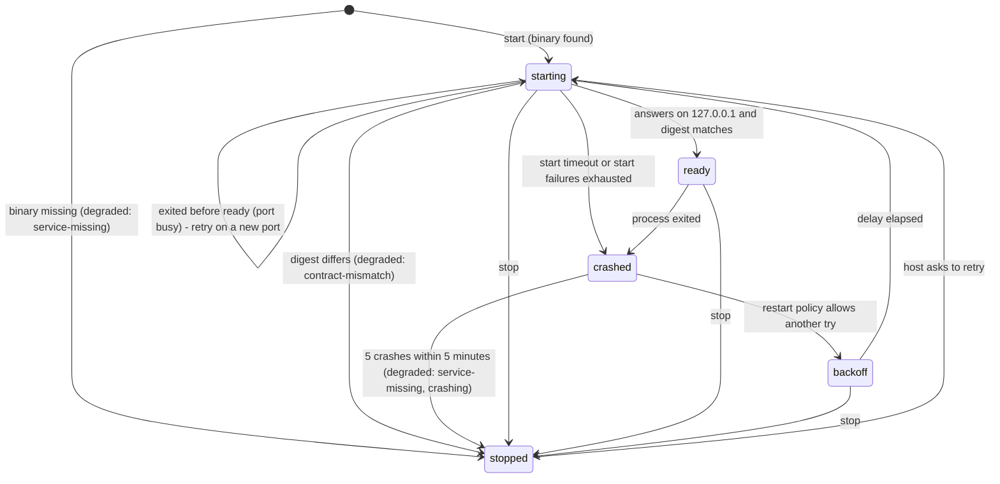

# Mission Specification: kitty-core: shared Rust core (contract client, change stream, supervision)

**Mission Branch**: `feat/kitty-core-19`
**Created**: 2026-10-15
**Status**: Specified. Intent is taken from issue #19, its landing-review design notes, and the ownership decisions of #17. The five open questions were ruled by the operator on 2026-10-15 (see Clarifications).
**Input**: GitHub issue moes-media/kitty-mission-ui#19 ("M3 kitty-core: shared Rust core (contract client, SSE, supervision)"), Phase 0 mission 3 of 6 under the epic #16. It builds on #17 (PR #32), which delivered the workspace, the client port, the stub and the shared fixtures.

## Intent Summary

Kitty Desktop and Kitty Dashboard both read spec-kitty's Mission Status service. The service ships as an unsigned native binary. It has no install location, serves one project per process, binds only `127.0.0.1`, exits when its port is busy, and never announces an ephemeral port. Both hosts need the same answers to the same questions: where is the binary, how is it started and kept alive, does it speak the contract this repository pinned, and how do its reads and live changes reach the host without being altered?

`crates/kitty-core` answers them once, for both hosts:

1. **Discovery.** Finds the service binary through a replaceable lookup, or reports that it is missing.
2. **Supervision.** Starts the service for one project on a port it picks, notices when it is ready, restarts it after a crash, and stops it cleanly.
3. **Contract check.** Before the service is used, compares a digest of the contract the service serves with the pinned contract.
4. **Relay.** Relays every read (status and raw body) and every change on the stream (raw), unchanged.
5. **Degraded signal.** Tells the host, in one observable status, whether the service is usable and, if not, why.

- **Primary actors:**
  - the developers and agents building the desktop host (#20) and the dashboard host (#21);
  - those hosts at run time;
  - the CI gate that judges kitty-core.
- **Trigger:** a host starts for a project, or the service it uses stops, crashes or turns out to speak another contract.
- **Outcome:** a host gets a ready service with a checked contract, or one clear degraded reason. It never crashes, and it never sees data that differs from what the service sent.
- **Rules that always hold:**
  - kitty-core relays and never interprets: it decides no refetch, keeps no cursor and does not reconnect a stream;
  - the service is addressed only on `127.0.0.1`;
  - an unknown contract fails loudly, as contract-mismatch;
  - the port, the workspace members, the gate wiring and the fixture shapes delivered by #17 stay unchanged (SC-004).
- **Out of scope:** refresh policy (#18), Tauri commands and Channels (#20), the dashboard proxy and the HTTP adapter (#21), and the real service (#22).

## Clarifications

### Operator rulings, 2026-10-15

The operator chose the recommended option for each of the five specify questions. Each one is recorded as a resolved Decision Moment.

- **Client transport** (decision `01M50D3SCB6ZG0PDWCEBGVAG7T`). kitty-core uses a route table built from the generated `contracts/fixtures/mission-status.routes.json`, over the hyper and hyper-util client already pinned in the workspace, with its own SSE frame reader. There are no typed models and no client generated from `openapi.yaml`. This fixes FR-001, FR-002 and FR-007.
- **Contract digest** (decision `01M50D47J1Q1P03XASV69C4J5X`). The digest is canonical:
  - the pinned multi-file contract is bundled into one document with every reference inlined;
  - both that bundle and the document the service serves are parsed and canonicalised (sorted keys, JSON form) before SHA-256;
  - the stub serves that bundle.
  
  This fixes FR-011, FR-012 and FR-014.
- **Restart policy** (decision `01M50D3W9ZS4VHP9K4CWQQW4Q4`). After a crash the supervisor restarts with capped exponential backoff. After 5 crashes within 5 minutes it gives up: the state is `stopped` with degraded service-missing, reason `crashing`, until the host asks to retry. This fixes FR-020.
- **Service lifetime** (decision `01M50D3XMBS9DD3AEWP1F66RRS`). Each host's kitty-core starts its own child process per project, on a port it picks, and stops it when the host stops. kitty-core never attaches to a service it did not start, so two hosts on one project run two services. This fixes FR-017 and FR-021.
- **Discovery lookup rules** (decision `01M50D403EEYQYEPSSMAV732DF`). The rules, in order:
  1. A path from host configuration wins, and an invalid one fails loudly with no fallback.
  2. Otherwise, one environment variable.
  3. Otherwise, a PATH search for a configurable binary name.
  4. Nothing found means service-missing.
  
  This fixes FR-023.

### Binding decisions carried into this mission (operator, #17 landing review, 2026-10-15)

- **Ownership (SO-DES-001).** This replaces the issue body's "map each event to the resources to refetch" and "do a full refetch on reconnect". Who owns what:

  | Owner | Owns |
  |---|---|
  | The shell (`mission-shell`, #18) | Refresh policy: which change triggers which refetch, and the reaction to `resync` and `log-truncated`. |
  | The adapters (fixture; Tauri, #20; HTTP, #21) | Transport-level reconnect, backoff, cursor bookkeeping, emitting `resync`, and mapping transport events to `ConnectionState`. |
  | kitty-core | Supervision, discovery, the contract digest check, and a raw `Change` relay. On desktop the relayed change travels over a Tauri Channel (#20). |

- **Port additions land in #17, not here.**
  - `ConnectionState` has five states: `connecting` (the initial state; supervision starts here), `connected`, `reconnecting`, `degraded: service-missing` and `degraded: contract-mismatch`.
  - `Change` has five kinds: `status-transition`, `mission-lifecycle`, `log-truncated`, `refused` and `resync`. `resync` is emitted after each reconnect, before any later event.
  - This mission consumes those types and does not change them.
- **Verbatim relay (SO-DES-012).** A read is relayed as the upstream status plus the raw body. It is never re-serialised through models, so `null`s, unknown fields and key order reach the host exactly as the dashboard's pass-through proxy delivers them. Desktop and dashboard therefore agree byte for byte.
- **Digest, not version (SO-DES-010).** `info.version` is `1.0.0-SNAPSHOT` and never changes, so the check compares a digest. The stub does not yet serve `/api/v1/openapi.yaml`. Adding that route, plus a way to serve a modified document, is in scope here.
- **Stub scenario selection (SO-DES-009).** Today the stub selects scenarios only through `X-Kitty-Stub-*` request headers. Start-up selection is added, so kitty-core's tests (and #21's proxy tests) never inject test-only headers through the production client.
- **Exact crate pins (SO-DES-015).**
  - Every new crate is pinned `=x.y.z`.
  - Each pinned release is at least 14 days old, and its publish date is recorded beside its pin.
  - When a new crate needs a newer minimum of a shared crate (tokio, serde, hyper), the workspace pin is bumped in the same change.
  - `serde_json`'s `preserve_order` is workspace-wide and applies to kitty-core.
- **One client per project (SO-DES-013).** Switching project means a new client and a new supervisor. The port carries no project identity.
- **Upstream service facts (#16, from spec-kitty#5529):**
  - the launch flags are `--mission-status.project-root` and `--mission-status.port`;
  - one process serves one project;
  - the service binds `127.0.0.1` only and exits if the port is busy;
  - an ephemeral port is never announced, so the supervisor picks the port.

## User Scenarios & Testing *(mandatory)*

### User Story 1 - A host reads data exactly as the service sent it (Priority: P1)

The desktop host asks kitty-core for a read (for example, the Mission list) and passes the result to the webview. The dashboard host proxies the same read straight through. Both must show the same thing, so kitty-core hands back the service's status and body bytes unchanged.

**Why this priority**: every screen depends on reads. If kitty-core re-shaped bodies, desktop and dashboard would disagree on `null`s and unknown fields, and nobody would notice until a screen rendered differently.

**Independent Test**: for each of the nine reads, fetch the stub directly and through kitty-core, then compare status, content type and body bytes.

**Acceptance Scenarios**:

1. **Given** a ready service (the stub), **When** a host requests any of the nine reads in the pinned contract, **Then** kitty-core returns the service's status, content type and body bytes, identical to a direct request.
2. **Given** a body with `null` fields, an unknown field and a non-alphabetical key order, **When** it is relayed, **Then** the bytes are unchanged.
3. **Given** the stub is started to answer a read with a declared refusal (for example 404 `ArtifactRefusal.not-found`), **When** the read is requested, **Then** kitty-core relays that status and problem body unchanged and reports no error of its own.
4. **Given** the service answers 503 or another status the contract does not declare, **When** the read is requested, **Then** kitty-core relays the status and body, and neither retries nor panics.
5. **Given** any relayed request, **When** the stub records it, **Then** it carried `Host: 127.0.0.1:<port>`, no `Origin`, and no `Forwarded` or `X-Forwarded-*` header.

### User Story 2 - Live changes reach the host raw and in order (Priority: P1)

A host subscribes to the change stream, for one Mission or for all. kitty-core opens the stream and relays each event as a raw change: the event name, the cursor when the stream sends one, and the data unchanged. The adapter decides about reconnecting and resuming, and the shell decides what to refetch.

**Why this priority**: live updates are the reason for a host over a service. A relay that re-orders, drops or rewrites events breaks the shell's refresh policy silently.

**Independent Test**: open scoped and unscoped streams on the stub's scripted sequence. Compare the relayed changes, item by item, with `changes.json`. Then open the stream with each selected refusal.

**Acceptance Scenarios**:

1. **Given** a Mission-scoped stream, **When** the scripted sequence plays, **Then** the host receives one raw change per event, in order, each carrying its event name, its cursor (the `id:` line), and its data bytes unchanged.
2. **Given** an unscoped stream, **When** the sequence plays, **Then** every change carries no cursor.
3. **Given** a `log-truncated` event, **When** it is relayed, **Then** it arrives as its own kind with no cursor, and kitty-core takes no action of its own.
4. **Given** a scoped stream opened with a cursor, **When** the stub resumes after that cursor, **Then** kitty-core sent the cursor as `streamCursor` and relays only the events after it.
5. **Given** the stub is started to refuse the stream (400 or 409 `StreamRefusal`, or 404 `Problem`), **When** the stream is opened, **Then** the host receives exactly one refused outcome carrying the status and raw body, and nothing after it.
6. **Given** the stream opens with 503 or another undeclared status, or the connection drops, or no byte (event or heartbeat) arrives within the idle limit, **When** that happens, **Then** the stream ends with an unavailable outcome distinct from refused, and kitty-core does not reconnect by itself.
7. **Given** heartbeats, **When** they arrive, **Then** they are not relayed as changes.

### User Story 3 - A service that speaks another contract is caught before use (Priority: P1)

A newer or older service binary is installed whose contract differs from the pinned one. Before any read or stream is relayed, kitty-core fetches the service's contract document, compares its digest with the pinned digest, and puts the host into contract-mismatch instead of rendering wrong data.

**Why this priority**: the upstream contract is a SNAPSHOT that keeps moving while #957 and #5533 land. Rendering data from an unknown contract is the failure that the epic and spec-kitty#5531 say must be loud.

**Independent Test**: start the stub with the pinned document, and the check passes. Start it with a modified document, and the host is in contract-mismatch with both digests reported.

**Acceptance Scenarios**:

1. **Given** the stub serves the pinned contract document, **When** the service becomes reachable, **Then** the digest check passes and the service is ready.
2. **Given** the stub is started with a modified contract document, **When** the check runs, **Then** the status is degraded contract-mismatch, reporting the expected and the actual digest.
3. **Given** the contract document cannot be fetched (a non-200 answer) or cannot be parsed, **When** the check runs, **Then** the result is contract-mismatch, never "assume compatible".
4. **Given** contract-mismatch, **When** a host requests a read or a stream, **Then** kitty-core answers contract-mismatch at once, without contacting the service.
5. **Given** the vendored contract is updated through `contract:update`, **When** tests run, **Then** the pinned digest follows the vendored files, with no hand-maintained value to forget.

### User Story 4 - The service is started and kept alive for one project (Priority: P1)

A host opens a project. kitty-core starts the service for that project on a free loopback port and reports `starting`. It reports `ready` once the service answers and its contract checks out. If the service crashes, kitty-core reports `crashed`, waits through `backoff` and starts it again. When the host closes, kitty-core stops the service and leaves no process behind.

**Why this priority**: the upstream binary does not manage itself. Without supervision, a crash or a busy port leaves a host silently stuck.

**Independent Test**: drive the supervisor with a fake service binary that can become ready, crash after a delay, exit because its port is busy, never become ready, or ignore the stop signal. Assert the sequence of states and the restart delays under a controllable clock.

**Acceptance Scenarios**:

1. **Given** a fake service that becomes ready, **When** the supervisor starts it for a project, **Then** it is launched with `--mission-status.project-root <project>` and `--mission-status.port <chosen port>`, and the states run `starting` → `ready`.
2. **Given** the fake crashes after becoming ready, **When** the crash is noticed, **Then** the states run `ready` → `crashed` → `backoff` → `starting` → `ready`, and the backoff delays follow the restart policy.
3. **Given** the chosen port is already taken, so the fake exits before becoming ready, **When** the supervisor notices, **Then** it retries on a different port and reaches `ready`.
4. **Given** the fake never becomes ready, **When** the start timeout passes, **Then** the attempt counts as a start failure and follows the restart policy.
5. **Given** a stop request, **When** the fake exits on the stop signal, **Then** the state is `stopped` and the process no longer exists. **Given** a fake that ignores the stop signal, **When** the grace period ends, **Then** the process is killed.
6. **Given** the supervisor is dropped, or its host exits without calling stop, **When** that happens, **Then** no service process is left running.

### User Story 5 - No service binary means a clear degraded state, not a crash (Priority: P1)

A user runs a host on a machine where the service is not installed, cannot be found, or cannot be executed (for example, a quarantined unsigned binary). The host shows degraded service-missing, with a reason it can explain, and keeps running.

**Why this priority**: this is the first-run experience on most machines until upstream ships an installer. A panic here is a crash at launch.

**Independent Test**: run discovery and supervision with no binary, with a path to a missing file, and with a file that is not executable.

**Acceptance Scenarios**:

1. **Given** discovery finds no binary, **When** a host starts a project, **Then** the status is degraded service-missing (reason: not found), the supervisor is `stopped`, and nothing panics.
2. **Given** a binary that exists but cannot be executed, **When** the supervisor tries to launch it, **Then** the status is degraded service-missing (reason: cannot execute) and the OS error is kept as detail.
3. **Given** service-missing, **When** the host asks to retry (for example, after the user installs the binary), **Then** discovery runs again.

### User Story 6 - Discovery follows rules that can be tested now (Priority: P2)

Upstream has no install convention yet. Discovery sits behind a replaceable interface, and this mission implements and tests only its lookup rules (operator ruling, 2026-10-15). A real convention can be added later without touching supervision.

**Why this priority**: it unblocks hosts today and keeps the later upstream convention a local change. It is P2 because supervision tests can inject a binary path directly.

**Independent Test**: arrange temporary directories and settings for each rule, and assert which binary is found, or that service-missing is reported.

**Acceptance Scenarios**:

1. **Given** an explicit binary path, **When** discovery runs, **Then** that path is used, and an invalid explicit path is service-missing. Discovery never falls back to another rule.
2. **Given** no explicit path, **When** discovery runs, **Then** the environment variable is used if set, else a PATH search for the configured binary name, and nothing found is service-missing.
3. **Given** a host or a test, **When** it provides its own discovery implementation, **Then** the supervisor uses it unchanged.

### Supervision lifecycle

### Edge Cases

- **The port picked as free is taken before the service binds it.** The service exits before it is ready. This is the race the epic names, and it is retried on a different port (FR-019).
- **A service that becomes reachable but serves no `/api/v1/openapi.yaml`.** It answers 404, which is contract-mismatch (FR-011).
- **An event name outside the contract's three.** It is not relayed as a change. It is reported as a diagnostic and does not fail the stream (the contract treats an unknown value as unknown, not as a failure).
- **An event whose data is not one JSON value, or a frame larger than the size limit.** The stream ends as unavailable with a transport reason, and nothing partial is relayed.
- **A cursor without a Mission.** kitty-core refuses it before any I/O, and nothing is sent to the service. The port's type already forbids it (`SubscriptionScope`).
- **A path or query value with reserved characters or `../`** (for example an `ArtifactPath`). It is percent-encoded, so the request path the stub records is the route template filled in, and no value changes which route is hit.
- **Two hosts open the same project.** Each host starts its own service on its own port (operator ruling, 2026-10-15). A supervisor owns only the process it started, and never attaches to or stops one it did not start.
- **The host process is killed hard** (SIGKILL). A child cannot always be reaped. Where the platform allows, the child is tied to the parent's lifetime; otherwise this is a documented limit (Assumptions).
- **Captured service output.** It is bounded in size, kept only in memory for diagnostics, and never written to tracked files.
- **A refusal on a later connection.** kitty-core relays one stream connection at a time, so a refusal on a reconnect is relayed the same way as on the first open. Ending the subscription is the adapter's job.

## Requirements *(mandatory)*

### Functional Requirements

| ID | Title | User Story | Priority | Status | Delivery | No-op passable? |
|----|-------|------------|----------|--------|----------|-----------------|
| FR-001 | Every read is relayed | As a host developer, I want kitty-core to relay each of the nine reads of the pinned contract (the `kind: "read"` operations of `contracts/fixtures/mission-status.routes.json`), filling in path and query parameters from the caller, so that a host can read everything the screens need through one core. A coverage test fails, naming the operation, when the route table holds a read that kitty-core cannot relay. | High | Open | [build] | no — removing one operation from kitty-core must make the coverage test fail and name it |
| FR-002 | Bodies relayed byte for byte | As a host developer, I want every relayed read to return the service's status, content type and body bytes unchanged, never re-serialised through models, so that the desktop and dashboard paths agree byte for byte (SO-DES-012). | High | Open | [build] | no — the test compares relayed bytes with a direct request on bodies with `null`s, an unknown field and non-alphabetical key order |
| FR-003 | Every status relayed, none invented | As a host developer, I want declared refusals, the `default` Problem and undeclared statuses (including the service's 503 capacity answer) relayed with their status and body, and only a failure with no HTTP answer (connection refused, timeout, a body over the size limit) reported as a transport failure, so that the adapter applies the port's read error contract with full information. kitty-core never retries a read. | High | Open | [build] | no — the test selects a refusal, and a fake answers 503, and each must be relayed with its own status and body |
| FR-004 | Request headers the service accepts | As the operator, I want every request kitty-core sends to carry `Host: 127.0.0.1:<port>` exactly, and no `Origin`, `Forwarded`, `X-Forwarded-*` or credential header, so that the service's Host, Origin and forwarding protections stay strict (charter, Risk boundaries). | High | Open | [build] | no — asserted on `/__stub/last-request` for a read and for the stream; the stub refuses a wrong Host with 403, which makes a wrong value visible |
| FR-005 | Loopback only | As the operator, I want kitty-core to address the service only at `127.0.0.1:<port>`, and to refuse any other address when the client is built, with no option that widens it, so that no host traffic leaves the machine. | High | Open | [build] | no — the test builds a client for a non-loopback address and expects a refusal before any I/O |
| FR-006 | Safe parameter encoding | As the operator, I want path and query values percent-encoded so that reserved characters or `../` in a value cannot change the route that is requested. | Medium | Open | [build] | no — the test sends a traversal `ArtifactPath` and a `wpId` containing `/`, and asserts the path the stub recorded |
| FR-007 | Raw change relay | As a host developer, I want each event of an open stream relayed as one raw change, in order: the event name, the cursor (the `id:` line, or none), and the data bytes unchanged. Heartbeats are not relayed. kitty-core does not interpret, filter by kind, store cursors, emit `resync`, or reconnect (SO-DES-001). This is so the adapter and the shell own those decisions. | High | Open | [build] | no — the test compares relayed changes with `changes.json` item by item, scoped and unscoped |
| FR-008 | Stream scope and cursor pass-through | As a host developer, I want a stream opened for one Mission (optionally with a cursor, sent as `streamCursor`) or for all Missions, and a cursor without a non-empty Mission refused before any I/O, so that the adapter can resume through kitty-core while the contract's rule cannot be broken. | High | Open | [build] | no — the test opens the stub's stream with a `scopedId` from `changes.json` and asserts only the later items arrive; a cursor without a Mission must send nothing |
| FR-009 | Refused stream relayed | As a host developer, I want a stream that the service refuses before any event (400 or 409 `StreamRefusal`, 404 `Problem`) to end in exactly one refused outcome carrying the status and the raw body, so that the adapter can deliver the port's `refused` change without parsing the body twice. | High | Open | [build] | no — the test selects each of the five `StreamRefusal` examples and the 404 at stub start-up |
| FR-010 | Unavailable stream distinguished | As a host developer, I want any other end of a stream (an undeclared status such as 503 at open, a dropped connection, malformed framing, an oversized frame, or no byte within the idle limit, which defaults to 90 seconds: three heartbeat intervals) reported as an unavailable outcome with its reason, and with the status and body when there was an answer, distinct from refused, so that the adapter backs off and reconnects instead of ending the subscription. | High | Open | [build] | no — each reason is produced by the stub or a fake, and the outcome kind is asserted |
| FR-011 | Contract digest check | As the operator, I want kitty-core to fetch `GET /api/v1/openapi.yaml` after each start, and before the service counts as ready, and compare its digest with the pinned digest. Both sides are digested in the same canonical form: parsed, references inlined, keys sorted, JSON form, SHA-256. An unequal digest, a non-200 answer or an unparseable document is contract-mismatch. This is so that a service speaking another contract is never used. | High | Open | [build] | no — the pinned document must pass, and a modified document must fail, on the same stub |
| FR-012 | Pinned digest follows the pin | As the operator, I want the pinned digest derived from the vendored contract under `contracts/spec-kitty/`, bundled into one document with every reference inlined, never typed in by hand, and a test that fails when they disagree, so that `contract:update` cannot leave a stale digest. | High | Open | [build] | no — editing one vendored contract file in a test copy must change the derived digest |
| FR-013 | Mismatch blocks use | As a host developer, I want every read and stream request made while the status is contract-mismatch answered at once with contract-mismatch, without contacting the service. The supervisor then stops a service it started. This is so that no data from an unknown contract reaches a screen. | High | Open | [build] | no — the stub's last-request must show no request after the check failed |
| FR-014 | Stub serves the contract document | As a test author, I want the stub to serve `GET /api/v1/openapi.yaml` (the pinned contract bundled into one document, with every reference inlined) under the same Host, Origin and forwarding rules as its other routes, and a start-up option to serve another document file instead, so that the digest check can be tested to pass and to fail (SO-DES-010). | High | Open | [build] | no — a test fetches the route, compares it with the pinned document, and does the same for a substitute file |
| FR-015 | Stub start-up selection | As a test author, I want a repeatable start-up option that makes a route serve a selected example or fixture without request headers (for example `--select <operationId>=<Schema.name>`). It follows the acceptance rules of the existing header selection, and a request header still takes precedence. An invalid selection is a usage error before the stub listens. This is so that kitty-core's and #21's tests never inject test-only headers (SO-DES-009). | High | Open | [build] | no — a refusal selected at start-up must be served with no headers, and an unknown selection must exit with the usage code |
| FR-016 | Supervision state machine | As a host developer, I want one supervisor per project, with the states `starting`, `ready`, `crashed`, `backoff` and `stopped` and the transitions in the lifecycle diagram, and each transition delivered to the host in order, so that both hosts drive their UI from the same lifecycle. | High | Open | [build] | no — every scenario test asserts the exact sequence of states |
| FR-017 | Launch | As a host developer, I want the supervisor to start the discovered binary with `--mission-status.project-root <project root>` and `--mission-status.port <chosen port>`, one process per project, with its output captured in memory up to a size limit, so that the service starts as upstream documents it. kitty-core always starts its own child, and never attaches to a service it did not start. | High | Open | [build] | no — the fake binary records its arguments, and the test asserts them |
| FR-018 | Readiness | As a host developer, I want `ready` reported only after the service answers on its loopback port and the digest check (FR-011) has passed. A start that has not reached ready within the start timeout (10 s by default) is a start failure. This is so that a host never relays to a half-started service. | High | Open | [build] | no — a fake that never answers must time out into the restart policy |
| FR-019 | Busy port retry | As a host developer, I want a service that exits before it is ready to be restarted at once on a different free loopback port, up to 3 attempts per start, before the attempt counts as a crash, so that the race between picking a port and binding it does not strand the host. | High | Open | [build] | no — the test occupies the first chosen port and asserts a second port is used and `ready` is reached |
| FR-020 | Crash restart and give-up | As a host developer, I want a service that exits after `ready` to be reported `crashed`, then restarted after a `backoff` delay that grows exponentially from 0.5 s to a cap of 30 s and resets after 60 s of uninterrupted `ready`. After 5 crashes within 5 minutes it gives up: the state is `stopped` with degraded service-missing, reason `crashing`, until the host asks to retry. This is so that a crashing service recovers without spinning forever. | High | Open | [build] | no — under a controllable clock the test asserts each delay and the give-up point |
| FR-021 | Clean shutdown | As a host developer, I want a stop request, or dropping the supervisor, to send the platform's stop signal, wait a 5 s grace period, then kill the process, and to report `stopped`, so that no service process outlives its host. | High | Open | [build] | no — the test asserts the process no longer exists, including for a fake that ignores the stop signal |
| FR-022 | Missing or unusable binary | As a user, I want a binary that is not found, or that cannot be executed (for example, quarantined or without execute permission), to give degraded service-missing with a reason (`not-found` or `cannot-execute`) and the OS error as detail, without panicking and without a retry loop. A retry happens only when the host asks. This is so that the host can explain the problem, including the unsigned-binary case (#20). | High | Open | [build] | no — one test per reason; each must yield the reason and `stopped` |
| FR-023 | Discovery behind an interface | As a host developer, I want discovery behind a replaceable interface. Its default implementation applies these lookup rules in order: a path from host configuration wins and, if invalid, fails loudly with no fallback; otherwise one environment variable; otherwise a PATH search for a configurable binary name; nothing found is service-missing. Each rule is tested. This is so that an upstream install convention can be added later without touching supervision. | Medium | Open | [build] | no — one test per rule in temporary directories, plus a test that an injected implementation is used |
| FR-024 | Degraded-mode signal | As a host developer, I want one observable status that combines the supervision state with a degraded reason: none, `service-missing` (with its reason) or `contract-mismatch` (with the expected and the actual digest). I also want a documented mapping from it to the port's `ConnectionState` for adapters to apply. Both hosts can then show the same banner, while the port's types stay unchanged. | High | Open | [build] | no — every scenario test asserts the status, and a test asserts the documented mapping covers every combination |

### Non-Functional Requirements

| ID | Title | Requirement | Category | Priority | Status |
|----|-------|-------------|----------|----------|--------|
| NFR-001 | Gate budget | kitty-core's tests, including supervision with the fake binary, finish within 60 s of wall-clock time on the standard CI runner. The whole `Gate: rust` job stays within its 8-minute budget, and its proof leg within 5 minutes. Supervision tests use a controllable clock, and no single test waits on a real timer for more than 1 s. | Performance | High | Open |
| NFR-002 | Exact, aged pins | 100% of the dependencies added to kitty-core (and to the stub, if any) are pinned `=x.y.z`. Each pinned release was published at least 14 days before the work package that adds it started, and its publish date is recorded in a comment beside the pin. A shared crate whose minimum rises is re-pinned at the workspace level in the same change (SO-DES-015). | Maintainability | High | Open |
| NFR-003 | Relay latency | A change is handed to the host within 10 ms (p95) of its last byte arriving at kitty-core. This is measured over 200 events from the stub at time scale 0 and recorded in the mission's evidence. It is a measurement, not a gate assertion. | Performance | Medium | Open |
| NFR-004 | Bounded memory | No input grows memory without limit. A stream frame over 1 MiB, or a read body over 16 MiB, ends that request as a transport failure. Captured service output is capped at 64 KiB per process, keeping the newest output. | Reliability | High | Open |
| NFR-005 | No panics | 0 panics across every failure scenario of this spec: missing binary, cannot execute, crash, busy port, start timeout, contract-mismatch, refused stream, malformed or oversized stream, and stall. Each test asserts it explicitly. | Reliability | High | Open |
| NFR-006 | Deterministic supervision | Each supervision scenario produces the same sequence of states and the same backoff delays across 10 consecutive runs. | Reliability | High | Open |
| NFR-007 | Offline tests | kitty-core's tests contact nothing but `127.0.0.1` and local binaries built from this workspace. | Reliability | High | Open |
| NFR-008 | Gates stay green | Every existing gate passes with 0 findings on the mission's pull request, and every existing stub test from #17 passes unchanged. | Quality | High | Open |

### Constraints

| ID | Title | Constraint | Category | Priority | Status |
|----|-------|------------|----------|----------|--------|
| C-001 | I/O placement | I/O lives only in `crates/*` and `apps/*`. Nothing under `packages/*` changes in this mission (charter, Hosts). | Technical | High | Open |
| C-002 | Frozen interfaces from #17 (SC-004) | This mission makes 0 changes to: the port types in `mission-shell` (including the five `ConnectionState` values and the five `Change` kinds); the Cargo workspace members (exactly `kitty-core`, `kitty-stub`, `kitty-desktop`, `kitty-dashboard`, with kitty-core gaining real dependencies as the only change); the gate wiring (CI jobs, the aggregate gate, the proof matrix); and the shapes of `contracts/fixtures/*`. A fake service binary for tests is therefore a target inside an existing member, not a new member. | Technical | High | Open |
| C-003 | Ownership boundary | kitty-core does not decide refetches, reconnect a stream, keep cursors, emit `resync`, or define or change `ConnectionState`. Those belong to the shell and the adapters (SO-DES-001). | Technical | High | Open |
| C-004 | Loopback and service protections | kitty-core addresses the service only on `127.0.0.1`, and never asks it to loosen its loopback, Host or Origin protections (charter, Risk boundaries). | Security | High | Open |
| C-005 | Pinned contract only | The route table and the pinned digest come from the vendored pin and the fixtures generated from it. Nothing is fetched from upstream, and the existing contract scripts are reused, not duplicated. | Technical | High | Open |
| C-006 | Hygiene | Tracked files contain no local paths, OS usernames, secrets or tokens. Captured service output is never written to a tracked file. | Security | High | Open |
| C-007 | Plants for extended gates | No new gate is added (C-002). Any existing gate whose checks this mission extends beyond adding tests inside `Gate: rust` gets a planted defect, proven red by gate-proof (charter rule). | Quality | High | Open |
| C-008 | Stub stays a test stand-in | `kitty-stub` keeps `publish = false`, binds `127.0.0.1` only, and keeps its request rules. Its new route and option are documented in its HTTP contract. | Technical | High | Open |
| C-009 | Scope boundary | Out of scope: refresh policy and banners (#18); Tauri commands, Channels and installer text (#20); the dashboard proxy and the HTTP adapter (#21); the real service and its real discovery convention (#22); and the governance contract (Phase 2). The upstream binary is never bundled. | Business | High | Open |

### Key Entities *(include if the mission involves data)*

- **Relayed read**: the outcome of one read. It is either an HTTP answer (status, content type, raw body bytes) or a transport failure with a reason. It is never parsed into a model.
- **Raw change**: one relayed stream event: event name, cursor or none, and the raw data bytes. It is relayed into the port's `Change` by the adapter.
- **Stream outcome**: how one stream connection ends. It is refused (status and raw body, before any event), unavailable (reason, plus status and body when there was an answer), or closed by the caller.
- **Supervisor**: owns at most one service process for one project. It has a state (`starting`, `ready`, `crashed`, `backoff`, `stopped`), the chosen port, and restart bookkeeping.
- **Core status (degraded signal)**: the supervision state plus a degraded reason: none, `service-missing` (`not-found`, `cannot-execute` or `crashing`), or `contract-mismatch` (expected and actual digest).
- **Pinned contract digest**: the canonical digest of the vendored contract (bundled with references inlined, keys sorted, JSON form, SHA-256), derived from `contracts/spec-kitty/`.
- **Discovery**: a replaceable lookup that yields a binary path or "not found", with the reason.

## Domain Language

| Canonical term | Meaning | Avoid |
|---|---|---|
| service | spec-kitty's Mission Status service (`mission-status-api`), the upstream binary. | daemon, backend, server (for the service) |
| supervisor | The kitty-core part that starts, watches, restarts and stops the service for one project. | process manager, launcher |
| relay | Passing a read or a change on unchanged. kitty-core relays; it does not interpret. | proxy (that is #21's dashboard proxy), client mapping |
| raw change | A stream event as relayed by kitty-core, before an adapter turns it into a port `Change`. | event model, view-model |
| digest check | Comparing the digest of the service's contract document with the pinned digest. | version check |
| degraded | A status in which the host keeps running but the service cannot be used: `service-missing` or `contract-mismatch`. | error state, offline |
| refetch | Re-reading data after a change. It is decided only by the shell. | refresh (in kitty-core) |
| mission | A spec-kitty mission. The repository's terminology rule bans the f-word synonym. | the banned synonym |

## Success Criteria *(mandatory)*

### Measurable Outcomes

- **SC-001**: 9 of 9 reads in the pinned contract reach the host through kitty-core with status and body bytes identical to a direct request to the stub. — [build] · no-op passable: no
- **SC-002**: The contract check passes for the pinned document and reports contract-mismatch for a modified one: 2 of 2 outcomes correct, on the same stub. — [build] · no-op passable: no
- **SC-003**: The supervision scenarios of the issue all pass with 0 panics: crash then restart with backoff, busy port then a new port, clean shutdown, and missing binary giving service-missing. That is 4 of 4. — [build] · no-op passable: no
- **SC-004**: The mission's pull request shows 0 changes, against its base, to the port types, to the workspace member list (kitty-core's dependencies excepted), to the gate wiring, and to the shapes in `contracts/fixtures/*`. — [ratchet] · no-op passable: yes — paired with SC-001 to SC-003 on the same pull request, so a do-nothing change cannot satisfy both
- **SC-005**: The desktop (#20) and dashboard (#21) missions can begin with 0 changes to kitty-core's public surface. This is checked when their plans are reviewed. — [build] · no-op passable: no
- **SC-006**: The mission's pull request passes every existing gate with 0 findings, and `Gate: rust` stays within its 8-minute job and 5-minute proof-leg budgets. — [ratchet] · no-op passable: yes — paired with SC-001 to SC-003 on the same pull request

## Assumptions

- The port additions from the #17 landing (`connecting`, `resync`, `refused` as a `Change` kind) are merged before this mission's implementation starts. The orchestrator rebases this branch onto `main` after #17 merges.
- The real service serves its contract at `GET /api/v1/openapi.yaml`, as the epic states. Whether it serves one bundled document or the root index file with relative references is not yet known upstream. The canonical digest assumes a bundled document. If the real service serves the unbundled root file, it shows as contract-mismatch until #22 adapts the check.
- The service's 503 capacity answer comes from the spec-kitty#5529 service facts and is not declared in the pinned contract. It is relayed as an undeclared status (FR-003, FR-010).
- How the service signals a busy port (exit code or message) is undocumented. Any exit before ready is treated as a possible busy port and retried on a new port, up to the attempt limit (FR-019).
- A hard kill of the host (SIGKILL) may leave the child running on platforms where a child cannot be tied to its parent's lifetime. Where that is possible it is done, and otherwise the limit is documented.
- The binary name for discovery is configurable, because upstream has not fixed it.
- CI runs kitty-core's tests on Linux only, as the existing `Gate: rust` does. Signal and process behaviour on macOS and Windows is covered when #20 adds the multi-OS matrix.
- The plan picks any remaining crates (for example, for YAML parsing and SHA-256) and the structure (including where the fake binary lives inside the existing members), within C-002, NFR-002 and the operator's transport ruling.

## Open Questions

None. The operator ruled on all five questions on 2026-10-15, choosing the recommended option each time (see Clarifications):

| Question | Decision | Ruling |
|---|---|---|
| Q1: client transport | `01M50D3SCB6ZG0PDWCEBGVAG7T` | A route table from `routes.json`, over the pinned hyper and hyper-util client, with kitty-core's own SSE frame reader |
| Q2: digest document and form | `01M50D47J1Q1P03XASV69C4J5X` | A canonical digest of the bundled document (references inlined, keys sorted, SHA-256), and the stub serves the bundle |
| Q3: restart policy | `01M50D3W9ZS4VHP9K4CWQQW4Q4` | Capped backoff; give up after 5 crashes within 5 minutes and go to `stopped`, degraded service-missing (`crashing`), until the host retries |
| Q4: service lifetime | `01M50D3XMBS9DD3AEWP1F66RRS` | Each host starts its own child per project, on a port it picks, and stops it on exit |
| Q5: discovery lookup rules | `01M50D403EEYQYEPSSMAV732DF` | A configured path wins and fails loudly with no fallback; otherwise one environment variable; otherwise a PATH search for a configurable binary name |

## Amendments

### 2026-10-15: plan-phase squad (`reviews/plan.squad.md`)

Each amendment is from an operator ruling, recorded as a Decision Moment, or from an orchestrator decision on a squad finding. Where an amendment and the text above disagree, the amendment wins.

- **A-01 — C-002 and SC-004: what "fixture shapes" covers (R1-02).** The frozen shapes are those of the four files delivered by #17 (`mission-status.{routes,examples,fixtures,changes}.json`). Adding the generated bundle `contracts/fixtures/mission-status.openapi.json` (decision `01M50HVKZ0D1C5HBMB1J1P99E1`) is not a shape change.
- **A-02 — FR-020: the reachable restart policy (operator, R2-02; decision `01M50M407F65T4SQA9TNWQYCQT`).**
  - After a crash, the backoff is 0.5 s, 1 s, 2 s, then 4 s.
  - The 5th crash within 5 minutes gives up: the state is `stopped`, degraded service-missing (`crashing`).
  - The backoff restarts at 0.5 s after 60 s of uninterrupted `ready`.
  - The 30 s cap is removed, because the give-up rule makes it unreachable.
  - The policy reads a monotonic clock (`Instant`) in production.
- **A-03 — FR-018: start timeout (operator, R2-02; decision `01M50M407F65T4SQA9TNWQYCQT`).** The start timeout (10 s by default) is one budget per start. It covers every busy-port attempt of that start (FR-019).
- **A-04 — NFR-001 and SC-006: rust budget (operator, R6-02 and R1-05; decision `01M50M453N70QGMXHK8AJX1E1H`).**
  - The `Gate: rust` job stays within its hard 8-minute budget.
  - The rust proof leg no longer has a fixed 5-minute limit. Its timeout follows the #17 formula: (1 + plants in the leg) × the measured gate time + 2 minutes, set from the mission PR's first CI run.
  - kitty-core's own tests stay within 60 s.
- **A-05 — FR-021: shutdown (R1-03, R3-05, R2-07; operator, R2-08, decision `01M50M42PBSJ806A432AP7M13S`).**
  - Only `stop()` is graceful: SIGTERM, a 5 s grace period, then SIGKILL. Hosts must `await stop()` before they exit.
  - Dropping the last host handle is an immediate kill (SIGKILL), with no grace period.
  - The service is started in its own process group (`setpgid(0, 0)`). Every signal goes to the whole group, so a service that forks leaves nothing behind.
- **A-06 — FR-017: launch arguments (R3-01).** The service is launched with exactly two arguments:
  - `--mission-status.project-root=<canonical absolute path>`;
  - `--mission-status.port=<n>`.

  The project root is canonicalised before launch. A root that cannot be canonicalised is refused as service-missing (`cannot-execute`), with the OS error.
- **A-07 — FR-014 and FR-015: the stub as a supervised stand-in (operator, R4-01, decision `01M50M47K1PNKP9KHCGGDBQZ0A`; R4-07).**
  - `kitty-stub` also accepts `--mission-status.port=<n>` and `--mission-status.project-root=<dir>`.
  - Without `--fixtures`, it reads `<project-root>/fixtures` when that directory exists, and otherwise the workspace's `contracts/fixtures`.
  - A missing *default* contract document makes the route answer 404 `no-openapi-document`. Only an unreadable *explicit* `--openapi <file>` is exit 1.
- **A-08 — FR-009: the 404 stream refusal (R1-01).** Neither `examples.json` nor `fixtures.json` holds a `Problem` entry, and C-002 freezes both files. The 404 `Problem` refusal is therefore selected on an in-process stub built from in-memory fixture values that add one `Problem` example. A raw-TCP fake covers the same case a second time.
- **A-09 — NFR-004: contract document cap (R3-08).** The fetched contract document is capped at 4 MiB. A larger one is contract-mismatch.
