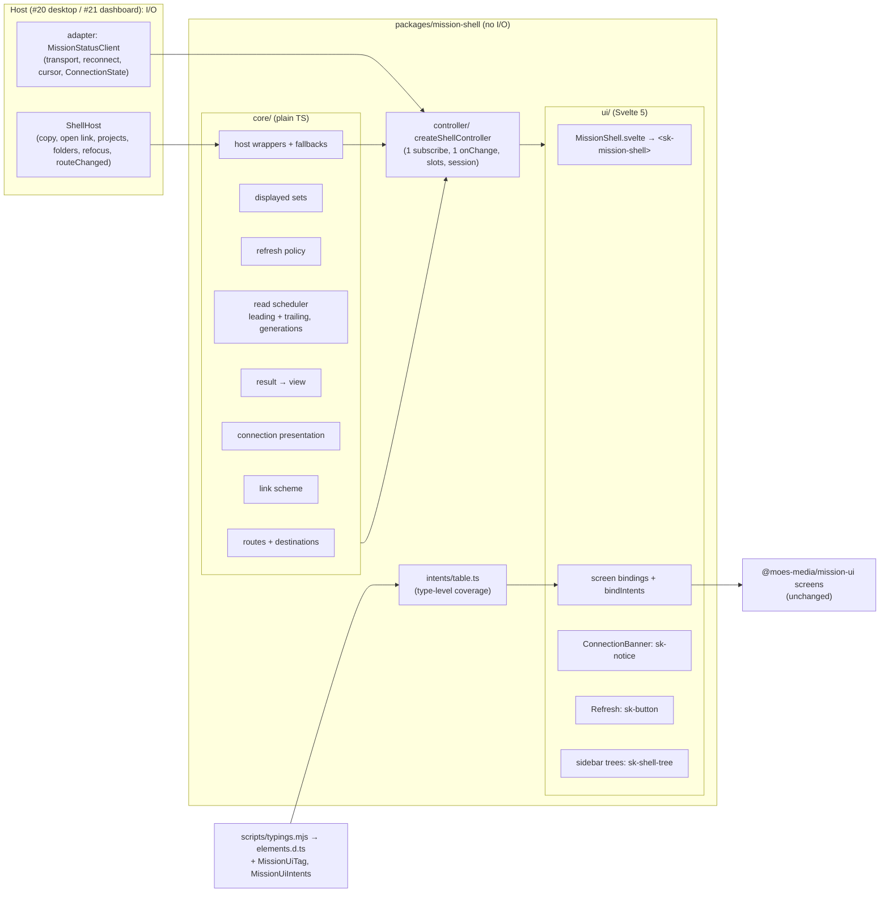
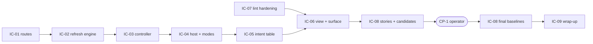

# Implementation Plan: mission-shell: shared Svelte 5 shell over the MissionStatusClient port

**Branch**: `feat/mission-shell-18` | **Date**: 2026-10-15 | **Spec**: [spec.md](spec.md)
**Input**: Mission specification from `kitty-specs/mission-shell-01M50D2J/spec.md`; issue #18; epic #16. The base is the
#17 landing head (`8c1ce10`, merged into this branch as `5a382c2`; PR #32 is still open).

## Summary

The shell is the Svelte layer that Kitty Desktop (#20) and Kitty Dashboard (#21) mount. It has three layers, all
inside `packages/mission-shell` and all free of I/O:

1. **Core**: plain TypeScript.
   - Destinations and a round-tripping route grammar.
   - The displayed-resource set of each destination.
   - The refresh-policy table.
   - A read scheduler with one leading and one trailing read per 100 ms window, where only the latest-issued result is
     applied.
   - Result-to-view mapping, the link-scheme check, the connection presentation, and host-interface wrappers with
     fallbacks.
2. **Controller**: one deep module, `createShellController`. It holds the single unscoped subscription, the connection
   listener, the current destination, the session state and one slot per displayed resource. It is plain TypeScript,
   so its tests, including the refresh-policy recording, run in Node.
3. **View**: `MissionShell.svelte`. It renders `sk-mission-shell`, the hosted screens, the `sk-notice` banners, the
   Refresh `sk-button` and the sidebar trees from the controller's snapshot, and binds every intent through one
   table-driven binding.

A type-level check over manifest-generated typings makes the intent table complete. Shell stories with approved
baselines join the existing Storybook and visual gate through a second story glob and the Svelte Vite plugin, with no
new package version. Neither the port nor mission-ui changes.

## Technical Context

**Language/Version**: TypeScript 5.9.3 (strict) and Svelte 5.57.1 (runes in the view layer only). Node 22.22.2 and
pnpm 11.18.0 are unchanged. No Rust changes.

**Primary Dependencies**:
- Already present and unchanged: Svelte 5.57.1, `@sveltejs/vite-plugin-svelte` 6.2.4, `svelte-check` 4.7.6, Vitest
  4.1.11 with `@vitest/browser-playwright`, Playwright 1.62.1, Storybook 10.6.1 (`@storybook/web-components-vite`),
  `eslint-plugin-svelte` 3.23.0, `@moes-media/mission-ui` (workspace), and `@spec-kitty/elements` 1.1.0-rc.10
  (`sk-notice`, `sk-button`).
- **No new package and no new version** (research R-16). `apps/storybook/package.json` declares three packages that
  are already locked; only its lockfile importer entry changes.

**Storage**: none. Session state is in memory for the life of one mounted shell.

**Testing**:
- Vitest, two projects in `packages/mission-shell/vitest.config.ts`. Both run under `pnpm test`, the unchanged
  `Gate: unit-tests` command.
  - `logic` (Node): `test/logic/**/*.test.ts` covers core and controller: routes, the refresh-policy recording,
    coalescing, latest-wins, connection gating and timing, subscription counts, host fallbacks, the link check and
    view-state mapping.
  - `unit` (Chromium, the existing project): `test/**/*.test.ts` excluding `test/logic/**` covers the existing
    binding, coverage and fixture tests, plus the mounted-shell tests (routing on real screens, every intent on a real
    element, banners, Refresh, the picker and dashboard modes, and one mounted check that the view issues the
    controller's reads).
- Type-level: the intent coverage check runs under `svelte-check` (`Gate: typecheck`).
- Visual: eleven stories under the existing harness (`Gate: visual`).
- Every new or extended gate has a plant (see Gates).

**Target Platform**:
- CI: ubuntu-24.04, and the digest-pinned Playwright image for unit-tests and visual.
- The shell runs in the Tauri webview (#20) and in a browser (#21).

**Project Type**: pnpm and Cargo monorepo. This mission touches `packages/mission-shell`, `apps/storybook`,
`scripts/typings.mjs`, `eslint.config.mjs` and `gates/plants/*`.

**Performance Goals**:
- A re-read is issued at the change's delivery tick, and the value is applied within 150 ms (NFR-001).
- At most 2 reads per resource per 100 ms burst (NFR-002).
- 0 reads of undisplayed resources (NFR-003).
- A degraded banner within 100 ms; a reconnecting banner only after 1 s or more (NFR-004).

**Constraints**:
- No I/O (C-001).
- mission-ui byte-unchanged (C-002, SC-006).
- Port, workspace members, gate wiring and `contracts/fixtures/*` frozen (C-003, SC-004). How "gate wiring" is read
  is the operator's ruling of 2026-10-15 (decision `01M50HMK3E7A4XA93PZMZ9KBT8`, option A; research R-17): the gate
  set and how each gate is bound are frozen, while rule content, plants, story globs, a package's test projects and
  formula-derived timeouts may change.
- Ownership boundary (C-004).
- Elements over CSS (C-005).
- Hygiene (C-006).
- Offline gates with plants (C-007).
- Scope (C-008).

**Scale/Scope**:
- 7 screen destinations in 3 layouts.
- 10 resource kinds.
- 9 hosting and 5 nested elements: 40 `(element, intent)` pairs and 22 distinct intents.
- 5 change kinds and 5 connection states.
- 11 stories.

## Charter Check

*GATE: must pass before Phase 0 research. Re-checked after Phase 1 design.*

| Charter rule | Verdict | Note |
|---|---|---|
| Screens: data in as properties, view state in, intents out | PASS | The view types are supertypes of the contract types, so values pass unchanged (FR-005). Each screen gets exactly its declared properties. Screens are untouched (C-002). |
| `packages/mission-shell` owns routing, layout and state, maps `sk-*` to intents, depends only on the port, and does no I/O | PASS | All three layers are I/O-free. Native actions go through the optional `ShellHost`, and time through an injected scheduler and clock. no-io covers `src/**/*.{ts,svelte}` unchanged. A shell ESLint block adds `history`, `navigator.clipboard` and raw controls (IC-07). |
| Hosts read spec-kitty only through published contracts | PASS | Only port reads. Nothing parses `kitty-specs/` or `.kittify/`. |
| Elements over CSS; layout-only, token-only CSS | PASS | Banners are `sk-notice` and Refresh is `sk-button` (C-005). Shell CSS is layout with `--sk-*` tokens, judged by the existing `.svelte` Stylelint rules. Raw controls in shell markup become a lint error (IC-07). No local stand-in, so no exception. |
| Quality gates: typecheck, ESLint, Stylelint, Storybook build, unit and interaction tests, visual regression, manifest, no-io, token-only Stylelint, `svelte-check` | PASS | All run through the unchanged gate commands. The extended ones carry plants (see Gates). |
| Every screen has a story per view state; interaction tests assert every event | PASS | The shell's own UI has a story per banner state and layout composition (FR-018). Every intent is triggered on a real element (FR-003). |
| The shell is tested against a fixture adapter | PASS | `createFixtureClient` with injected tables or a recording wrapper, and no port change (CODE-BOUNDARY-011). |
| Review: separate reviewer per WP; adversarial squad after plan; operator merges | PASS | The post-plan squad (R1 to R6) is recorded in `reviews/plan.squad.md`. The design review is CP-1 with the operator. |
| Risk boundaries: no secrets, paths or usernames in tracked files | PASS | Story data is synthetic. Baselines are produced only in the pinned image. The hygiene gate scans the new files and `storybook-static`. |
| Exact version pins; versions 14 or more days old | PASS | No new version. The two re-declared pins are exact, 27 and 279 days old, with no install scripts (research R-16). |
| Quality standards not relaxed without operator approval | PASS | The only plant retired is the `sk-mission-sample` visual plant. It moves to the reconnecting-banner story by the operator's ruling of 2026-10-15 (decision `01M50HMCBJMREJ5XJASGE29X73`, option A; research R-12). |
| Exceptions documented in the PR | PASS | None planned. The ESLint boundary exemption for `**/*.stories.ts` narrows nothing (research R-08) and is noted in the PR. |

Re-checked after Phase 1 design, and again after the operator's rulings of 2026-10-15: no conflicts.

## Architecture



**Data flow of one change**:
1. The adapter delivers a `Change`.
2. The controller asks `refreshKeys(change, displayedSet)` for keys.
3. Each key's slot issues or coalesces a read.
4. The result goes through `applyResult`.
5. The snapshot updates, and the view re-renders the screen's properties.

The connection state only gates and presents. It never triggers a read, except the first `connected`, which loads the
current destination. Reconnects are re-read through the adapter's `resync`, which keeps ownership with the adapter
(SO-DES-001, C-004).

## Project Structure

### Documentation (this mission)

```
kitty-specs/mission-shell-01M50D2J/
├── spec.md
├── plan.md                        # this file
├── research.md                    # R-01 to R-18
├── data-model.md
├── quickstart.md
├── contracts/
│   ├── shell-api.md               # the public mount surface (SC-005)
│   ├── refresh-policy.md          # the expected read recording (SC-002 oracle)
│   ├── intent-map.md              # all 40 (element, intent) pairs
│   ├── connection-presentation.md # banners, Refresh, shell copy (design review)
│   └── stories.md                 # 11 stories, plants, baselines
├── design-review.md               # created at CP-1 by the orchestrator
├── reviews/plan.squad.md          # post-plan squad
└── decisions/
```

### Source code (repository root)

```
packages/mission-shell/
├── package.json                  # unchanged (exports '.' and './testing'; svelte peer 5.57.1)
├── vitest.config.ts              # EXTENDED: + 'logic' project (Node) for test/logic/**
├── README.md                     # EXTENDED: shell usage, host interface, routes, refresh policy
├── src/
│   ├── index.ts                  # EXTENDED: + MissionShell, mountShell, ShellHost, ShellOptions, ShellMode, routes
│   ├── testing.ts                # unchanged
│   ├── client/{port,fixture,coverage}.ts, contract/stream.ts   # unchanged (C-003)
│   ├── generated/elements.d.ts   # REGENERATED: + MissionUiTag, MissionUiIntents
│   ├── harness/**                # unchanged
│   ├── Shell.svelte              # REMOVED (#17 placeholder, never exported); MissionShell.svelte replaces it
│   ├── core/
│   │   ├── routes.ts             # Destination, formatRoute, parseRoute
│   │   ├── displayed.ts          # ResourceKey, displayedSet(destination), ofMission(key)
│   │   ├── refresh-policy.ts     # REFRESH_POLICY table + refreshKeys(change, displayed)
│   │   ├── scheduler.ts          # ResourceSlot: leading/trailing window, generations, connection gating
│   │   ├── results.ts            # applyResult, per-screen view mapping, not-found mapping
│   │   ├── connection.ts         # presentation per state, grace timer
│   │   ├── links.ts              # isAllowedExternalLink
│   │   └── host.ts               # ShellHost, safe wrappers with fallbacks
│   ├── controller/
│   │   └── shell-controller.ts   # createShellController (deep module)
│   ├── intents/
│   │   └── table.ts              # INTENT_TABLE + coverage type
│   ├── ui/
│   │   ├── MissionShell.svelte   # single root <sk-mission-shell>
│   │   ├── shell-state.svelte.ts # runes mirror of the controller snapshot
│   │   ├── bind-intents.ts       # Svelte action: listeners from INTENT_TABLE for one hosting element
│   │   ├── ConnectionBanner.svelte
│   │   ├── RefreshButton.svelte
│   │   ├── screens/*.svelte      # one thin binding per screen (props from snapshot)
│   │   └── mount.ts              # mountShell
│   └── stories/
│       ├── connection-banners.stories.ts
│       └── layouts.stories.ts
└── test/
    ├── logic/                    # Node project: routes, refresh-policy, scheduler, connection,
    │                             #   controller, host, links, results (*.test.ts)
    └── shell/                    # Chromium project: routing, intents, banners, refresh, modes, mount (*.test.ts)
apps/storybook/
├── .storybook/main.ts            # EXTENDED: + shell stories glob, + svelte() plugin with vitePreprocess
├── package.json                  # EXTENDED: + @moes-media/mission-shell (workspace), svelte 5.57.1, @sveltejs/vite-plugin-svelte 6.2.4
└── tests/visual/__snapshots__/shell-*.png   # NEW: 11 baselines (approved at CP-1)
scripts/typings.mjs, scripts/typings.test.mjs  # EXTENDED: emit MissionUiTag, MissionUiIntents
eslint.config.mjs                 # EXTENDED: shell block (raw controls, clipboard, history); stories exempt from the fixture boundary
gates/plants/{unit-tests,typecheck,eslint,storybook-build,visual}/   # plants (see Gates)
pnpm-lock.yaml                    # apps/storybook importer entry only
.github/workflows/ci.yml          # proof-leg timeouts only, and only if the formula requires it
README.md, CHANGELOG.md           # shell section; Unreleased entry
```

**Structure decision**:
- The stories live in `packages/mission-shell/src/stories`, because mission-ui is frozen. That keeps them inside the
  no-io, data-driven, terminology and lint scans of `packages/*/src`.
- The Svelte view is the only layer that imports `svelte`. Core and the controller import neither Svelte nor the DOM,
  which the Node test project enforces in practice: a DOM access there fails in Node.

## Complexity Tracking

| Item | Why needed | Simpler alternative rejected because |
|---|---|---|
| A second Vitest project (Node) inside `mission-shell` | It keeps the unit-tests proof leg (10 full runs) from growing about 0.5 min per run (research R-15, SO-DES-017). | Running everything in Chromium costs about 5 min more per leg. |
| Generated `MissionUiTag` and `MissionUiIntents` types | They let FR-004 be a typecheck plant, at about 0.27 min, instead of a unit-tests plant at about 2 min. | Deriving the tag list from `SvelteHTMLElements` would also pick up any `sk-*` augmentation another package ships. |

## Implementation Concern Map

### IC-01 — Destinations, routes and displayed sets

- **Purpose**: the pure model of where the user can be, its route string, and which resources each place displays.
- **Relevant requirements**: FR-001 (model), FR-002, FR-015 (`/projects` on the dashboard), US1-6, US1-7; the edge
  cases on unknown routes and unknown Mission ids.
- **Affected surfaces**: `src/core/routes.ts`, `src/core/displayed.ts`, `test/logic/routes.test.ts`, and
  `packages/mission-shell/vitest.config.ts` (adds the `logic` Node project and excludes `test/logic/**` from the
  Chromium project).
- **Sequencing/depends-on**: none.
- **Risks**:
  - The `logic` project must run under the unchanged `pnpm test`. A misconfigured project that runs nothing would be
    vacuous. IC-02's unit-tests plant (P-1) fails inside this project and so proves that it runs.
  - Mixed Node and browser projects in Vitest 4: if a project cannot disable the browser, the fallback is to run
    `test/logic` in Chromium. That costs leg time, which IC-09 records and the operator sees.
  - The ULID and WP-id patterns follow the contract's parameter patterns. A test proves them against the valid ids used
    in `contracts/fixtures`.

### IC-02 — Refresh engine: policy, read scheduler and subscription

- **Purpose**: decide which displayed resources a change re-reads, coalesce bursts, apply only the latest result, and
  gate on the connection.
- **Relevant requirements**: FR-007, FR-008, FR-009, FR-010, NFR-001, NFR-002, NFR-003, C-004, SC-002; the edge cases
  on bursts, `resync` in flight, unsubscribe on unmount, and Missions never read.
- **Affected surfaces**:
  - `src/core/refresh-policy.ts`, `src/core/scheduler.ts`;
  - `test/logic/refresh-policy.test.ts` (the recording of `contracts/refresh-policy.md`) and
    `test/logic/scheduler.test.ts`;
  - `gates/plants/unit-tests/plant.json` (P-1).
- **Sequencing/depends-on**: IC-01.
- **Risks**:
  - The recording is the oracle. Every cell of `contracts/refresh-policy.md` is asserted with exact counts and
    parameters, so a shell that reads nothing fails (the positive control of NFR-003).
  - The fixture adapter's scheduler and the shell's scheduler must be the **same** fake instance in tests, or the
    replay and the coalescing window drift apart.
  - `setConnectionState` is imported by relative path from `src/client/fixture.ts`, as the #17 tests do. It is not
    exported (C-003).
  - P-1's anchored edit targets one row of `REFRESH_POLICY`. The table is written one row per line, so the anchor is
    unique.

### IC-03 — Shell controller: reads to view state, session, explicit refresh, connection

- **Purpose**: the deep module that ties core to a client. It reads, applies results, holds session state, runs the
  explicit refresh triggers, presents the connection, and releases everything on destroy or a client change.
- **Relevant requirements**: FR-005, FR-006, FR-011 (logic), FR-016 (logic), NFR-004, NFR-007, US2, US4, US6; the
  edge cases on load-more refusal, 404, flapping, degraded while in flight, and `resync` with only the picker.
- **Affected surfaces**:
  - `src/core/results.ts`, `src/core/connection.ts`, `src/controller/shell-controller.ts`;
  - `test/logic/{controller,results,connection}.test.ts`.
- **Sequencing/depends-on**: IC-01, IC-02.
- **Risks**:
  - The per-screen status vocabularies differ (`WpScreenStatus`, `DetailStatus`, `ArtifactStatus`,
    `ArtifactContentStatus`, `DriftScreenStatus`, `OpsScreenStatus`). `results.ts` types each mapping against the
    generated typings' property types, so a renamed status fails svelte-check.
  - NFR-007 is enforced by a test harness that fails on any uncaught error or unhandled rejection. In the Node project
    that is `process.on('unhandledRejection')` in a setup file. In Chromium it is `window` `error` and
    `unhandledrejection` listeners in the test setup. Test files are outside `src/`, so outside no-io.
  - No ticking timers: `now` is refreshed only when a result is applied (research R-18).

### IC-04 — Host interface, modes and link safety

- **Purpose**: the optional native actions with their fallbacks, the desktop picker flows, the dashboard's ignored
  intents, and the exact link-scheme check.
- **Relevant requirements**: FR-012, FR-013, FR-014, FR-015, US5, NFR-007; the edge cases on mixed-case schemes and
  absent members.
- **Affected surfaces**: `src/core/host.ts`, `src/core/links.ts`, the controller's host-facing commands (in
  `shell-controller.ts`; requested through IC-03, its owner), and `test/logic/{host,links}.test.ts`.
- **Sequencing/depends-on**: IC-03.
- **Risks**:
  - FR-013's positive control: one `https:` link gives exactly one host call, in the **same** test as the
    `javascript:` and `httpx:` negatives.
  - FR-015's positive control: the **same** recording host in desktop mode gets exactly one call per desktop-only
    intent.
  - `listRecentProjects` and `listFolders` can reject. Their wrappers turn that into the screen's or dialog's `error`.

### IC-05 — Intent table and the type-level coverage check

- **Purpose**: one table mapping every declared `(element, intent)` pair to its effect, made complete by a type that
  names any missing pair.
- **Relevant requirements**: FR-003 (table), FR-004, FR-017, SC-001; the edge case of a new intent in mission-ui.
- **Affected surfaces**:
  - `scripts/typings.mjs` (emits `MissionUiTag` and `MissionUiIntents`), `scripts/typings.test.mjs`, and the
    regenerated `packages/mission-shell/src/generated/elements.d.ts`;
  - `src/intents/table.ts`;
  - `gates/plants/typecheck/plant.json` (P-2).
- **Sequencing/depends-on**: IC-03, IC-04 (the handlers the table points to).
- **Risks**:
  - The marker-type trick must make svelte-check print the marker's text in its error. A spike proves the message
    shape before the plant is written, and the token `unmappedIntent` must not occur in clean output. svelte-check
    prints no source on success.
  - An extra key (an intent no longer declared) must also fail. The table uses `satisfies` with an exact mapped type.
  - `manifest:check` keeps the generated file current. The existing manifest plant ("elements.d.ts is stale") still
    proves it, so no new manifest plant is needed. `typings.test.mjs` gains cases for the two new types.

### IC-06 — Svelte view, bindings and the public surface

- **Purpose**: render everything from the snapshot, bind intents once per hosting element, and export the mount
  surface of `contracts/shell-api.md`.
- **Relevant requirements**: FR-001, FR-003 (on real screens), FR-011 (presentation, announced to assistive
  technology), FR-016 (button), C-005, SC-005, US1, US5-3, US5-6.
- **Affected surfaces**:
  - `src/ui/**` (`MissionShell.svelte`, `shell-state.svelte.ts`, `bind-intents.ts`, `ConnectionBanner.svelte`,
    `RefreshButton.svelte`, `screens/*.svelte`, `mount.ts`);
  - `src/index.ts`; removal of `src/Shell.svelte`;
  - `test/shell/*.test.ts`.
- **Sequencing/depends-on**: IC-03, IC-04, IC-05, IC-07 (lint rules in place before the view is written).
- **Risks**:
  - `MissionShell.svelte` must have exactly one root element, `<sk-mission-shell>`. The stories depend on it
    (research R-07).
  - Register first: the module that mounts screens imports `@moes-media/mission-ui` at top level (the #17 binding
    rule).
  - Exactly-once delivery for the "via" intents: a browser test dispatches each from the nested element.
  - Banners are `sk-notice` with `announce` as in `contracts/connection-presentation.md`. The test asserts the
    attribute.
  - Data-driven: no lane or phase word is written in the view. Tree `meta` passes the contract word through.

### IC-07 — Shell lint hardening (C-001, C-005)

- **Purpose**: make the spec's no-clipboard, no-history and elements-over-raw-controls rules mechanical for the shell,
  without changing the no-io gate.
- **Relevant requirements**: C-001, C-005, C-007, FR-017.
- **Affected surfaces**:
  - `eslint.config.mjs`: one block for `packages/mission-shell/src/**` with `svelte/no-restricted-html-elements`
    (button, input, select, textarea) and `no-restricted-properties` (`navigator.clipboard`, `history`), with
    failure-only messages (research R-13);
  - the boundary block gains `**/*.stories.ts` in its `ignores` (research R-08);
  - `gates/plants/eslint/plant.json` and two plant payloads: `PlantRawControl.svelte.plant` and
    `plant-shell-clipboard.ts.plant` (P-3, P-4).
- **Sequencing/depends-on**: none. It can land first, and every later IC is then linted by it.
- **Risks**:
  - In scope by the operator's ruling on "gate wiring" (decision `01M50HMK3E7A4XA93PZMZ9KBT8`, option A): rule
    content may change.
  - `noInlineConfig` already applies to `packages/*/src/**`, so the rules cannot be silenced inline.
  - The `history` entry matches member access on the identifier `history`, so a shell local of that name would be
    flagged. Locals must be named otherwise.

### IC-08 — Stories, Storybook integration and visual baselines

- **Purpose**: the eleven shell stories in the existing Storybook and visual gate, with approved baselines.
- **Relevant requirements**: FR-018, SC-006, SC-007, NFR-005 (visual budget), FR-017.
- **Affected surfaces**:
  - `packages/mission-shell/src/stories/*.stories.ts`;
  - `apps/storybook/.storybook/main.ts`, `apps/storybook/package.json`, `pnpm-lock.yaml` (importer entry only);
  - `apps/storybook/tests/visual/__snapshots__/shell-*.png`;
  - `gates/plants/storybook-build/plant.json` and its payload (P-5); `gates/plants/visual/plant.json` (P-6).
- **Sequencing/depends-on**: IC-06, and CP-1 for final baselines.
- **Risks**:
  - The mount technique under the harness (research R-07, options a to c): a spike story first, built with
    `heavy pnpm build-storybook`, then one visual run of the spike story only, before the eleven are written.
  - The `svelte()` plugin must not change how mission-ui's Lit stories build. The storybook-build gate and the visual
    gate re-check all 330 existing baselines.
  - Svelte's production build embeds no file names. The hygiene scan of `storybook-static` must stay clean; if it does
    not, the plugin's `compilerOptions.dev` is checked to be false.
  - Baselines are made only in the pinned image (`heavy pnpm visual:update`). They are not final before CP-1.
  - The visual plant moves (decision `01M50HMCBJMREJ5XJASGE29X73`, option A): `gates/plants/visual/plant.json` loses
    the `sk-mission-sample` gap edit and gets P-6 instead. The plant stays a single entry with the same `ciCommand`
    and `prepare`.

### IC-09 — Proof timing, documentation and wrap-up

- **Purpose**:
  - re-derive the proof-leg timeouts;
  - document the shell;
  - prove the frozen surface;
  - record the design review in the PR.
- **Relevant requirements**: SC-004, SC-005 (the surface in the README), SC-006, SC-007, NFR-005, NFR-006, C-003.
- **Affected surfaces**: `.github/workflows/ci.yml` (proof-leg `timeout` values only, and only if required),
  `packages/mission-shell/README.md`, `README.md`, `CHANGELOG.md`.
- **Sequencing/depends-on**: all.
- **Risks**:
  - **The frozen-surface check** (SC-004, with base `git merge-base HEAD main`):
    1. `git diff --exit-code` over `packages/mission-shell/src/client/port.ts`,
       `packages/mission-shell/src/contract/stream.ts`, `pnpm-workspace.yaml`, the `[workspace]` table of
       `Cargo.toml`, `contracts/fixtures/`, `scripts/gate-proof.mjs`, `scripts/gate-proof/` and
       `packages/mission-ui/` (SC-006).
    2. A parse of `ci.yml` at the base and at HEAD, with `yaml`. It compares the job ids, `needs`, each `id: gate`
       step's `run`, the proof matrix `gate` list and each `include` entry's `image`, and `all.needs`. Every
       `timeout-minutes` and matrix `timeout` is ignored.
    3. Every plant's `ciCommand` equal at the base and at HEAD.
    4. The root `package.json` gate scripts listed in research R-17 equal at the base and at HEAD.

    The WP pastes the outputs into the PR body, and its reviewer repeats them.
  - **Timeouts.** Each touched leg's timeout is (1 + its total plants) × the measured gate step + 2 minutes, never
    below the current value. It is measured on the mission PR's first CI run (research R-15).
  - **Port exports.** The README's port section stays as #17 wrote it. Only shell sections are added.

### CP-1 — Design review (orchestrator-owned; not a work package)

The checkpoint sits between IC-08's candidate baselines and their finalisation, as described in research R-14.
- The operator sees the eleven PNGs and the copy of `contracts/connection-presentation.md`.
- The orchestrator records a dated `CP-1 confirmed` entry in `kitty-specs/mission-shell-01M50D2J/design-review.md`,
  with the sha256 of each approved baseline.
- IC-08's reviewer rejects any committed `shell-*.png` whose hash is not in that entry.
- IC-09 copies the entry into the PR body's "Design review" section (SC-007).
- No WP agent waits for the operator. IC-08 stops at "candidate baselines committed" and is finalised after CP-1.

### Sequencing



IC-07 is independent and can start first. Everything else is one chain, because each layer consumes the one before
it. Within the chain, IC-04 and IC-05 can be one WP if the tasks phase prefers fewer handoffs.

## Shared-file ownership

Each shared file has exactly one owning IC. Other ICs request their changes through the owner's WP, or land after it,
rebased on it.

| File | Owner | Requested by |
|---|---|---|
| `packages/mission-shell/vitest.config.ts` | IC-01 (adds `logic`) | IC-03 (Node setup file), IC-06 (Chromium setup file for the unhandled-error trap) |
| `packages/mission-shell/src/controller/shell-controller.ts` | IC-03 | IC-04 (host-facing commands), IC-06 (snapshot fields the view needs) |
| `packages/mission-shell/src/core/displayed.ts` | IC-01 | IC-02 (`ofMission`) |
| `packages/mission-shell/src/index.ts` | IC-06 | IC-01 (route helpers), IC-04 (`ShellHost` type) |
| `packages/mission-shell/README.md` | IC-09 | all |
| `scripts/typings.mjs`, `scripts/typings.test.mjs`, `src/generated/elements.d.ts` | IC-05 | none |
| `eslint.config.mjs` | IC-07 | IC-08 (the stories exemption is pre-added by IC-07) |
| `gates/plants/unit-tests/plant.json` | IC-02 | none |
| `gates/plants/typecheck/plant.json` and its payloads | IC-05 | none |
| `gates/plants/eslint/plant.json` and its payloads | IC-07 | none |
| `gates/plants/storybook-build/plant.json`, `gates/plants/visual/plant.json` | IC-08 | none |
| `apps/storybook/.storybook/main.ts`, `apps/storybook/package.json`, `pnpm-lock.yaml` | IC-08 | none |
| `.github/workflows/ci.yml` (proof-leg `timeout` values only) | IC-09 | IC-02, IC-05, IC-07, IC-08 (each records its local leg timing in its WP) |
| `README.md`, `CHANGELOG.md` | IC-09 | all |

## Gates

The aggregate `Gate: all` must be green. **No gate command changes.** These canonical strings are identical in
`ci.yml` (`id: gate` steps), in each `plant.json` `ciCommand`, and in this plan:

| Gate | Canonical command (unchanged) |
|---|---|
| `unit-tests` | `pnpm test` |
| `typecheck` | `pnpm typecheck` |
| `eslint` | `pnpm lint` |
| `storybook-build` | `pnpm build-storybook` |
| `visual` | `bash scripts/visual.sh -- --repeat-each=5` (plant `prepare`: `pnpm storybook:build-only`) |

Gates not extended: `preflight`, `stylelint` (the `.svelte` glob and its plant already cover shell styles), `no-io`
(unchanged, as C-001 requires), `data-driven` (already `.svelte`), `manifest` (the staleness check covers the
regenerated typings; its existing plant proves it), `hygiene`, `contract` and `rust`.

### Plants

Each plant has a single token that appears only when the plant fails.

| # | Gate | Plant | Overlay | Failure-only token |
|---|---|---|---|---|
| P-1 | unit-tests | refresh policy loses a row | anchored edit in `packages/mission-shell/src/core/refresh-policy.ts`: the `mission-lifecycle` row no longer lists `missions` | `refresh-policy mismatch on missions` |
| P-2 | typecheck | intent table loses a pair | anchored edit in `packages/mission-shell/src/intents/table.ts`: the `'sk-copy-command'` entry of `sk-drift-screen` is deleted | `unmappedIntent` |
| P-3 | eslint | raw control in shell markup | `packages/mission-shell/src/PlantRawControl.svelte` (from `PlantRawControl.svelte.plant`) with `<button type="button">` | `shell-markup: raw` |
| P-4 | eslint | clipboard in the shell | `packages/mission-shell/src/plant-shell-clipboard.ts` (from `plant-shell-clipboard.ts.plant`) calling `navigator.clipboard.writeText` | `shell-io: navigator.clipboard` |
| P-5 | storybook-build | shell story glob is built | `packages/mission-shell/src/stories/plant-shell-storybook.stories.ts` importing `./plant-shell-storybook-missing` | `plant-shell-storybook-missing` |
| P-6 | visual | banner appearance changes (moved: replaces the `sk-mission-sample` plant) | anchored edit in `packages/mission-shell/src/ui/ConnectionBanner.svelte` changing the banner's gap token | `shell-connection-banners--reconnecting-1280-diff.png` |

- P-6 replaces the existing `sk-mission-sample` visual plant, by the operator's ruling of 2026-10-15 (decision
  `01M50HMCBJMREJ5XJASGE29X73`, option A; research R-12). The visual leg keeps one plant.
- The mission adds **5 new plants (P-1 to P-5) and moves 1 (P-6)**.
- P-3 and P-4 are in scope by the operator's ruling on "gate wiring" (decision `01M50HMK3E7A4XA93PZMZ9KBT8`, option A).
- FR-017's named minimum is P-1 (refresh policy) and P-2 (intent coverage).
- The other new checks (latest-wins, coalescing, connection timing, subscription counts, host fallbacks, link
  positive and negative controls, exactly-once "via" intents) are tests inside gates that P-1 and the existing binding
  plants already prove are run and fail on red. They carry in-test positive controls, not extra plants (research R-15).

### Proof-leg timeouts (NFR-002 formula of #17)

timeout = (1 + all plants in the leg) × the measured gate step + 2 minutes, never lowered.

| Leg | Plants after | Measured gate step today (CI 38756980500) | Projected | Formula | Timeout |
|---|---|---|---|---|---|
| unit-tests | 9 | 2.15 min | about 2.7 | 29.0 | 30, unchanged; raised if the measured step exceeds 2.8 |
| typecheck | 5 | 0.27 | about 0.35 | 4.1 | 6, unchanged |
| eslint | 11 | 0.37 | about 0.45 | 7.4 | 8, unchanged; raised if the step exceeds 0.5 |
| storybook-build | 2 | 0.20 | about 0.3 | 2.9 | 8, unchanged |
| visual | 1 (moved) | 17.10 | about 17.7 | 37.4 | 60, unchanged |

**Leg-time impact** (SO-DES-017):
- unit-tests: about 13.8 to about 20 min (+6: one more run, plus about 0.5 min per run for the Chromium shell tests).
- typecheck: +0.4 min.
- eslint: +0.7 min.
- storybook-build: +0.6 min.
- visual: +1.2 min (two runs, as today). The visual leg stays the critical path at about 39 min.
- Gate jobs stay inside their budgets: unit-tests about 2.7 of 8 min, visual about 17.7 of 28 (NFR-005).

## Design review

Covered by CP-1 above, with the procedure in research R-14. Flagged UI:
- the five banner states;
- the Refresh button on Ops and Artifact;
- the shell copy defaults;
- the dashboard composition without picker entries.

Approval is recorded against exact baseline hashes, so a later re-render that changes pixels needs a new CP-1 entry.

## Operator decisions of the plan (ruled 2026-10-15)

1. Visual plant for FR-018 (decision `01M50HMCBJMREJ5XJASGE29X73`; research R-12): **A**. The single visual plant
   moves from `sk-mission-sample` to the reconnecting-banner story (P-6).
2. Scope of "gate wiring" under C-003 (decision `01M50HMK3E7A4XA93PZMZ9KBT8`; research R-17): **A**. The frozen
   surface is the gate set and its binding:
   - in `ci.yml`: the job ids, `needs`, each `id: gate` command, the proof-matrix gate list and images, and
     `all.needs`;
   - each plant's `ciCommand`;
   - `scripts/gate-proof.mjs` and `scripts/gate-proof/**`;
   - the root gate scripts.

   Rule content, plants, story globs, a package's test projects and formula-derived timeouts may change.

Both rulings were relayed by the coordinator and are recorded as resolved decisions.

## Timeline risks

1. **#17 is not yet merged** (PR #32 is open, with CI running on `8c1ce10`). If the landing head changes before merge,
   this branch is rebased and the plan's base facts are re-checked: the port surface, the plant counts and the timeouts.
2. **The Svelte-in-Storybook mount under the visual harness** (research R-07) is unproven. Its spike gates IC-08. The
   fallback (c) adds a wrapper element and may need the story set re-planned.
3. **CP-1 latency**: final baselines wait for the operator. IC-09 can start its documentation in parallel, but not its
   timeout derivation, which needs the final visual run.
4. **Baselines need the pinned image** on Linux x86_64 with podman, run as `heavy` (memory). Each `visual:update` is
   about 18 min and memory-heavy, so the WPs run it once per candidate set, never in parallel.
5. **Unit-tests leg growth**: if the Chromium shell tests exceed about 0.6 min per run, the unit-tests timeout rises
   above 30. That is a `ci.yml` timeout edit, which the "gate wiring" ruling allows (decision
   `01M50HMK3E7A4XA93PZMZ9KBT8`, option A).
6. **Mixed Vitest projects**: if Node and Chromium projects cannot coexist in one config, the logic tests run in
   Chromium. That is about +5 min of unit-tests leg time, and probably a timeout raise.
7. **The marker-type message shape** in svelte-check (IC-05) is unproven. If the error text does not carry the marker,
   the plant token becomes the property name `'sk-copy-command'` scoped to the table file, which is a weaker but still
   failure-only token.
8. **`@spec-kitty/elements` `sk-notice` tones and announce values** are taken from mission-ui's current use (`info`,
   `attention`, `danger`, `neutral`; `polite`, `assertive`, `off`). A library rc bump is out of scope. If a tone is
   missing, that is a design-library gap, not a hand-rolled banner.

## PR shape

- One PR from `feat/mission-shell-18` into `main`, opened after the #17 merge and a rebase.
- Each WP is reviewed by a separate reviewer agent. The pre-merge R1 to R3 squad runs before hand-off. The operator
  merges.
- The PR body carries:
  - the frozen-surface check output (SC-004, SC-006);
  - the "Design review" section from CP-1 (SC-007);
  - the supply-chain table (research R-16);
  - the measured gate steps and the derived timeouts;
  - the operator's rulings on the two plan decisions (both option A, 2026-10-15);
  - the note that the ESLint boundary exemption for stories narrows nothing.

## Traceability

| Requirement | IC |
|---|---|
| FR-001 | IC-01 (model), IC-06 (mounted) |
| FR-002 | IC-01 |
| FR-003 | IC-05 (table), IC-06 (real screens) |
| FR-004 | IC-05 |
| FR-005, FR-006 | IC-03 |
| FR-007, FR-008, FR-009, FR-010 | IC-02 (FR-010 presentation: IC-03, IC-06) |
| FR-011 | IC-03 (logic), IC-06 (presentation) |
| FR-012, FR-013, FR-014, FR-015 | IC-04 (FR-014 and FR-015 in the view: IC-06) |
| FR-016 | IC-03 (logic), IC-06 (button) |
| FR-017 | IC-02 (P-1), IC-05 (P-2), IC-07 (P-3, P-4), IC-08 (P-5, P-6) |
| FR-018 | IC-08, CP-1 |
| NFR-001, NFR-002, NFR-003 | IC-02 |
| NFR-004 | IC-03 |
| NFR-005 | IC-08, IC-09 |
| NFR-006 | IC-08 (research R-16) |
| NFR-007 | IC-03, IC-04, IC-06 |
| C-001 | IC-07; all (review) |
| C-002 | IC-08 (stories outside mission-ui), IC-09 (byte check) |
| C-003 | IC-09 (frozen-surface check) |
| C-004 | IC-02 |
| C-005 | IC-06, IC-07 |
| C-006 | IC-08 (story data), all (hygiene gate) |
| C-007 | Gates (P-1 to P-6) |
| C-008 | scope (no IC) |
| SC-001 | IC-05 |
| SC-002 | IC-02 |
| SC-003 | IC-03, IC-06 |
| SC-004 | IC-09 |
| SC-005 | IC-06, IC-09 (checked again at the #20 and #21 plan reviews) |
| SC-006 | IC-08, IC-09 |
| SC-007 | IC-08, CP-1, IC-09 |
