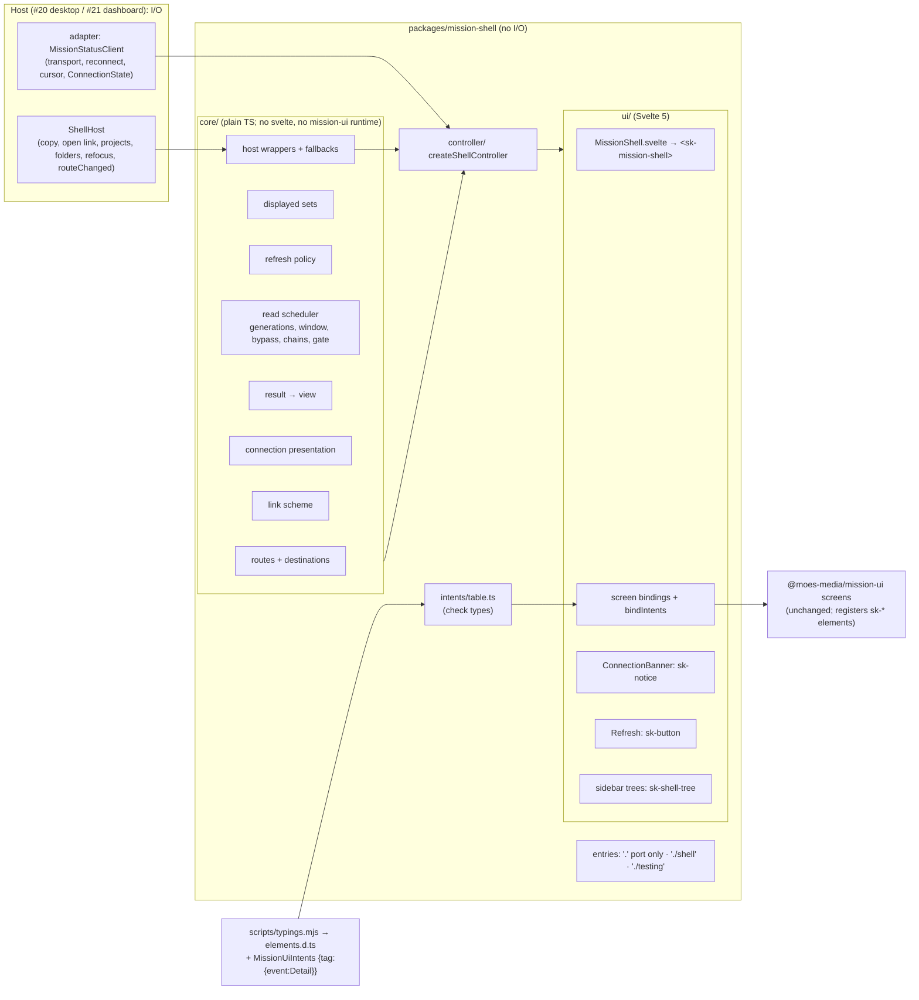
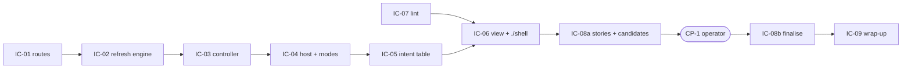

# Implementation Plan: mission-shell: shared Svelte 5 shell over the MissionStatusClient port

**Branch**: `feat/mission-shell-18` | **Date**: 2026-10-15 | **Spec**: [spec.md](spec.md)
**Input**: Mission specification from `kitty-specs/mission-shell-01M50D2J/spec.md`; issue #18; epic #16. #17 (PR #32) is
merged into `main` as squash commit `39a51a6` (the same tree as the landing head `8c1ce10`), and `origin/main` is merged
into this branch. The port contract is
`kitty-specs/phase0-bootstrap-01M4V5KK/contracts/client-port.md` on this branch.
**Revision**: the plan-squad fix round is applied (`reviews/plan.squad.md`), with seven operator or orchestrator
rulings recorded as resolved decisions (see "Decisions").

## Summary

The shell is the Svelte layer that Kitty Desktop (#20) and Kitty Dashboard (#21) mount. It has three layers, all
inside `packages/mission-shell` and all free of I/O:

1. **Core**: plain TypeScript.
   - Destinations and a route grammar that decodes defensively.
   - The displayed-resource sets and the refresh-policy table.
   - A read scheduler: one controller-wide generation counter; stream changes coalesced into a leading read and one
     trailing read per 100 ms window; bypass triggers; stale-while-revalidate; the connection gate; page chains.
   - Result-to-view mapping, the link-scheme check, the connection presentation, and host wrappers with fallbacks.
2. **Controller**: one deep module, `createShellController`. It holds one unscoped subscription, the connection
   listener, the session state and the slots. It is tested in Node.
3. **View**: `MissionShell.svelte`. Its single `<sk-mission-shell>` root renders the screens, the `sk-notice` banners,
   the Refresh `sk-button` and the trees. Intents are bound through one table-driven binding.

The shell is published as a new, additive `./shell` entry; `.` stays port-only.
- A type-level check over manifest-generated typings makes the intent table complete.
- Eleven shell stories join the existing Storybook and visual gate, with baselines approved at CP-1.
- No package version is added, and neither the port nor mission-ui changes.

## Technical Context

**Language/Version**: TypeScript 5.9.3 (strict) and Svelte 5.57.1 (runes in the view layer only). Node 22.22.2 and
pnpm 11.18.0 are unchanged. No Rust changes.

**Primary Dependencies**:
- Already present and unchanged: Svelte 5.57.1, `@sveltejs/vite-plugin-svelte` 6.2.4, `svelte-check` 4.7.6, Vitest
  4.1.11 with `@vitest/browser-playwright`, Playwright 1.62.1, Storybook 10.6.1 (`@storybook/web-components-vite`),
  `eslint-plugin-svelte` 3.23.0, and `@moes-media/mission-ui` (workspace).
- The library elements (`sk-notice`, `sk-button`) come from `@spec-kitty/elements` 1.1.0-rc.10, registered through
  mission-ui (research R-10).
- **No new package and no new version** (research R-16). `apps/storybook/package.json` re-declares three packages that
  are already locked. `packages/mission-shell/package.json` changes only its `exports`.

**Storage**: none. Session state is in memory per mounted shell.

**Testing**:
- Vitest has two projects in `packages/mission-shell/vitest.config.ts`. Both run under the unchanged `pnpm test`.
  - `logic` (`test/logic/**`): `browser: { enabled: false }`, `environment: 'node'`, with a sentinel test asserting
    `typeof window === 'undefined'`. It covers core and controller:
    - routes, including the decoding negatives;
    - the refresh-policy recording (a literal);
    - coalescing, bypass, generations, page chains and gating;
    - the connection timing;
    - the subscription counts;
    - the host fallbacks and the dashboard guard;
    - the link negatives;
    - view mapping and refusal coverage.
  - `unit` (Chromium, the existing project, excluding `test/logic/**`) covers:
    - the existing binding, coverage, fixture and package tests;
    - the mounted-shell tests: routing on real screens, the 40-case intent sweep driven from `INTENT_TABLE`, banners,
      Refresh, the picker and dashboard (no picker entry points), `mountShell` with `setClient` and `destroy`, and the
      NFR-001 property timing.
- Test-local clients live in `test/support/`: `createDeferredClient` and `createSequencedClient`.
- Both projects fail on any uncaught error or unhandled rejection (NFR-007).
- Type-level: the intent coverage check types run under `svelte-check` (`Gate: typecheck`).
- Visual: eleven stories under the existing harness (`Gate: visual`).
- Every new or extended gate has a plant (see Gates).

**Target Platform**:
- CI: ubuntu-24.04, and the digest-pinned Playwright image for unit-tests and visual.
- The shell runs in the Tauri webview (#20) and in a browser (#21).

**Project Type**: pnpm and Cargo monorepo. This mission touches `packages/mission-shell`, `apps/storybook`,
`scripts/typings.mjs`, `eslint.config.mjs`, `gates/plants/*` and the unit-tests matrix timeout in `ci.yml`.

**Performance Goals**:
- A re-read is issued at the delivery tick, and the value is applied in the same tick, or within 150 ms for a slower
  read (NFR-001).
- Exactly 2 reads for a burst of 5 changes inside 100 ms (NFR-002).
- 0 reads of undisplayed resources (NFR-003).
- A degraded banner in the same render; a reconnecting banner only after 1 s or more (NFR-004).

**Constraints**:
- No I/O (C-001).
- mission-ui byte-unchanged (C-002, SC-006).
- Frozen surface (C-003, SC-004) as ruled (decision `01M50HMK3E7A4XA93PZMZ9KBT8`, option A) and extended by the
  squad: research R-17.
- Ownership (C-004).
- Elements over CSS (C-005).
- Hygiene (C-006).
- Offline gates with plants (C-007).
- Scope (C-008).
- Spec FR-005 amendment of 2026-10-15: `unavailable` keeps existing data.

**Scale/Scope**:
- 7 screen destinations in 3 layouts.
- 10 resource kinds.
- 9 hosting and 5 nested elements: **40 pairs and 23 distinct intents**.
- 5 change kinds and 5 connection states.
- 11 stories.

## Charter Check

*GATE: must pass before Phase 0 research. Re-checked after Phase 1 design and after the squad fix round.*

| Charter rule | Verdict | Note |
|---|---|---|
| Screens: data in as properties, view state in, intents out | PASS | The view types are supertypes of the contract types, so values pass unchanged (FR-005). Screens are untouched (C-002). |
| `packages/mission-shell` owns routing, layout and state, depends only on the port, and does no I/O | PASS | Native actions go through `ShellHost`, and time through an injected scheduler and clock. no-io covers `src/**/*.{ts,svelte}` unchanged. A shell ESLint block bans `history`, `navigator`, `open`, `postMessage`, `print`, `alert`, `confirm`, `prompt`, `document.execCommand`, `document.location`, raw controls and resource-loading elements (IC-07). |
| Hosts read spec-kitty only through published contracts | PASS | Only port reads. |
| Elements over CSS; layout-only, token-only CSS | PASS | `sk-notice` and `sk-button`; layout-only CSS with `--sk-*` tokens; raw controls are a lint error. |
| Quality gates | PASS | Unchanged gate commands. The extended gates carry plants. |
| A story per state; interaction tests assert every event | PASS | A story per banner state and layout (FR-018). Every one of the 40 pairs is triggered on a real element (FR-003). |
| The shell is tested against a fixture adapter | PASS | `createFixtureClient` with injected tables and changes, plus test-local clients. No port change. |
| Review: separate reviewer per WP; squad after plan; operator merges | PASS | The squad is recorded in `reviews/plan.squad.md`. CP-1 is the design review. |
| No secrets, paths or usernames in tracked files | PASS | Synthetic story data. Baselines come from the pinned image only. |
| Exact pins; versions 14 or more days old | PASS | No new version (research R-16). |
| Quality standards not relaxed without operator approval | PASS | The only plant moved is the visual plant, by ruling (decision `01M50HMCBJMREJ5XJASGE29X73`). Every other base plant is retained, which IC-09 checks. |
| Exceptions documented in the PR | PASS | None. The stories boundary exemption was dropped (R4-07). |

## Architecture



**Data flow of one change**:
1. The adapter delivers a `Change`.
2. `refreshKeys(change, displayedSet)` returns the keys.
3. Stream changes coalesce per slot; bypass triggers issue at once.
4. Each result is applied only if its generation is the slot's latest.
5. The snapshot updates, and the view sets the screens' properties.

The connection state gates and presents. The first transition out of `connecting` loads the displayed set. Reconnects
re-read through the adapter's `resync`, or through a shell-side resync while the stream is refused (ruling
`01M50K4G2G0EA0JN3B6YGH607S`).

## Project Structure

### Documentation (this mission)

```
kitty-specs/mission-shell-01M50D2J/
├── spec.md                        # + Amendments (FR-005, 2026-10-15)
├── plan.md, research.md (R-01 to R-18), data-model.md, quickstart.md
├── contracts/ shell-api.md, refresh-policy.md, intent-map.md, connection-presentation.md, stories.md
├── reviews/plan.squad.md
├── design-review.md, design-review.sha256   # created at CP-1 by the orchestrator on feat/mission-shell-18
└── decisions/
```

### Source code (repository root)

```
packages/mission-shell/
├── package.json                  # EXTENDED: exports '.', './testing', './shell' (additive)
├── vitest.config.ts              # EXTENDED: + 'logic' project (Node, browser disabled); 'unit' excludes test/logic/**
├── README.md                     # EXTENDED: shell usage, host prerequisites, routes, refresh policy
├── src/
│   ├── index.ts                  # UNCHANGED: port-only entry
│   ├── shell.ts                  # NEW: the './shell' entry
│   ├── testing.ts, client/**, contract/stream.ts, harness/**   # unchanged (C-003)
│   ├── Shell.svelte              # KEPT unchanged: two gate self-tests lint it by path (R5-06)
│   ├── generated/elements.d.ts   # REGENERATED: + MissionUiIntents, MissionUiTag
│   ├── core/{routes,displayed,refresh-policy,scheduler,results,connection,links,host}.ts
│   ├── controller/shell-controller.ts
│   ├── intents/table.ts
│   ├── ui/{MissionShell.svelte, shell-state.svelte.ts, bind-intents.ts, ConnectionBanner.svelte,
│   │       RefreshButton.svelte, screens/*.svelte, mount.ts}
│   └── stories/{connection-banners,layouts}.stories.ts
└── test/
    ├── package.test.ts           # EXTENDED: expects the three entries
    ├── support/{deferred-client,sequenced-client,recording-client}.ts
    ├── logic/*.test.ts           # Node
    └── shell/*.test.ts           # Chromium
apps/storybook/.storybook/main.ts # EXTENDED: + shell stories glob, + svelte({ configFile: false, preprocess })
apps/storybook/package.json       # EXTENDED: + @moes-media/mission-shell, svelte 5.57.1, @sveltejs/vite-plugin-svelte 6.2.4
apps/storybook/tests/visual/__snapshots__/shell-*.png   # NEW: 11 baselines (CP-1); no existing baseline changes
scripts/typings.mjs, scripts/typings.test.mjs           # EXTENDED
eslint.config.mjs                 # EXTENDED: shell I/O and markup block; core/controller/intents layering block
gates/plants/{unit-tests,typecheck,eslint,storybook-build,visual}/
pnpm-lock.yaml                    # apps/storybook importer entry only
.github/workflows/ci.yml          # proof-leg matrix timeouts only (rise only)
README.md, CHANGELOG.md
```

**Structure decision**:
- The stories live in `packages/mission-shell/src/stories` because mission-ui is frozen.
- The layering (no Svelte or mission-ui runtime in `core/`, `controller/` and `intents/`) is **enforced by lint**,
  plant P-8. The Node test project only surfaces a violation earlier (R3-07).
- `src/Shell.svelte` is kept, because `gates/markdown-lint.selftest.ts` and `gates/data-driven.selftest.ts` name it.
  Keeping it avoids touching no-io and data-driven self-tests.

## Complexity Tracking

| Item | Why needed | Simpler alternative rejected because |
|---|---|---|
| A second Vitest project (Node) | It keeps about 0.5 min per run off an 11-run proof leg (SO-DES-017). | Running everything in Chromium costs about 5.5 min more per leg. |
| Generated `MissionUiIntents` | FR-004 becomes a typecheck plant, at about 0.27 min, and handlers are typed by detail. | Deriving tags from `SvelteHTMLElements` would pick up foreign `sk-*` augmentations. |
| The `./shell` entry | It keeps `.` port-only, so adapters importing the port do not pull in Svelte (ruling). | Exporting the shell from `.` was ruled out by the operator. |

## Implementation Concern Map

### IC-01 — Destinations, routes and displayed sets

- **Purpose**: the pure model of where the user can be, its route string, and which resources each place displays.
- **Relevant requirements**: FR-001 (model), FR-002, FR-015 (`/projects` on the dashboard), US1-6, US1-7; the edge
  cases on unknown routes and unknown Mission ids.
- **Affected surfaces**:
  - `src/core/routes.ts`, `src/core/displayed.ts`, `test/logic/routes.test.ts`;
  - `packages/mission-shell/vitest.config.ts`, which adds `logic` with `browser: { enabled: false }`, excludes it from
    `unit`, and adds the sentinel test.
- **Sequencing/depends-on**: none.
- **Risks**:
  - **Decoding**: a decode failure is an unknown route. Artifact paths are checked against the `ArtifactPath` pattern
    and length, and a Node test compares the copy with the contract YAML. Tested: `%`, `..%2F`, `%2F` and `%00`
    (R3-02).
  - **Round trip** over parsed destinations, plus a non-canonical encoding case (R3-03).
  - **`routeChanged`**: fired after the shell's own navigation and after normalising a non-canonical host route; never
    echoed.
  - A logic project that runs nothing would be vacuous. P-1 fails inside it, which proves it runs.

### IC-02 — Refresh engine: policy, read scheduler and subscription

- **Purpose**: decide which displayed resources a change re-reads; coalesce stream bursts; apply only the latest
  result; bypass for explicit triggers; gate on the connection; re-read page chains.
- **Relevant requirements**: FR-007, FR-008, FR-009, FR-010, NFR-001, NFR-002, NFR-003, C-004, SC-002; the edge cases
  on bursts, `resync` in flight and unsubscribe.
- **Affected surfaces**:
  - `src/core/refresh-policy.ts`, `src/core/scheduler.ts`;
  - `test/logic/{refresh-policy,scheduler}.test.ts`;
  - `test/support/*`;
  - `gates/plants/unit-tests/plant.json` (P-1).
- **Sequencing/depends-on**: IC-01.
- **Risks**:
  - The recording is a literal oracle, including the WP-none and Artifacts-none rows. The test injects a changes copy
    whose first `delayMs` is 250 (R2-02).
  - The transitions are those of `data-model.md` "Read scheduling":
    - the window-close transition (R2-01);
    - the bypass list (R2-03);
    - one monotonic counter, with the A→B→A test (R2-04);
    - stale-while-revalidate (R2-05);
    - page chains with a 2-page test (R2-06);
    - the gate release on leaving `connecting` (R2-09), tested on both paths.
  - The fixture's scheduler and the shell's scheduler are the same fake instance.
  - P-1's anchor is one row of `REFRESH_POLICY`, written one row per line.

### IC-03 — Shell controller: reads to view state, session, explicit refresh, connection

- **Purpose**: the deep module that ties core to a client.
- **Relevant requirements**: FR-005 (with its amendment), FR-006, FR-010, FR-011 (logic), FR-016 (logic), NFR-004,
  NFR-007, US2, US4, US6.
- **Affected surfaces**:
  - `src/core/results.ts`, `src/core/connection.ts`, `src/controller/shell-controller.ts`;
  - `test/logic/{controller,results,connection}.test.ts`.
- **Sequencing/depends-on**: IC-01, IC-02.
- **Risks**:
  - **Degraded states**: entering one sets every slot without a value to `error`. Gated reads are kept and issued.
    Tests: `connecting` → degraded, and an initial degraded state (R1-01).
  - **Refusals**: every refusal from `routes.json` is enumerated (research R-06 table). The 404 `Problem` is injected
    through `fixtures.examples` (R5-08).
  - **Refused stream**: each non-first `connected` is a shell-side resync, with no new subscription (ruling
    `01M50K4G2G0EA0JN3B6YGH607S`).
  - **Grace timer**: armed after the state update, cleared on every exit, re-armed on re-entry. Test: re-entry (R2-08).
  - **Copy protocol**: `null` is delivered before the host is awaited. Test: two `copied` answers in a row (R2-07).
  - **Errors**: the test harnesses fail on uncaught errors. The controller converts host errors to fallbacks and never
    swallows its own (R5-11).

### IC-04 — Host interface, modes and link safety

- **Purpose**: the optional native actions and their fallbacks, the desktop picker, the dashboard guard, and the link
  check.
- **Relevant requirements**: FR-012, FR-013, FR-014, FR-015, US5, NFR-007.
- **Affected surfaces**:
  - `src/core/host.ts`, `src/core/links.ts`;
  - the host-facing commands of `shell-controller.ts`, requested through IC-03;
  - `test/logic/{host,links}.test.ts`.
- **Sequencing/depends-on**: IC-03.
- **Risks**:
  - **Dashboard guard**: all six picker and dialog intents, tested through `controller.intent`, with the desktop
    positive control (R2-11).
  - **Dashboard with a null client**: an error state that makes no reads and does not throw.
  - **`setClient(client, route?)`**.
  - **Links**: the negatives of R3-05 sit in the same test as the `https:` positive control. `openExternalLink` carries
    the MUST and SHOULD host obligations in its documentation.

### IC-05 — Intent table and the coverage check types

- **Purpose**: one table mapping all 40 pairs to effects, made complete by check types.
- **Relevant requirements**: FR-003 (table), FR-004, FR-017, SC-001.
- **Affected surfaces**:
  - `scripts/typings.mjs`, which emits `MissionUiIntents` as `{ tag: { event: Detail } }` and `MissionUiTag`;
  - `scripts/typings.test.mjs`;
  - the regenerated `elements.d.ts`;
  - `src/intents/table.ts`;
  - `gates/plants/typecheck/plant.json` (P-2).
- **Sequencing/depends-on**: IC-03, IC-04.
- **Risks**:
  - **The check types** (research R-09): `Exclude<Declared, Mapped>` assigned `true`, and the reverse.
  - **P-2** deletes the one-line `'sk-copy-command':` entry. Its token is `sk-drift-screen sk-copy-command`, the
    literal svelte-check prints. A spike confirms the message shape before the plant is written.
  - **`via` entries** are constrained to hosting tags that declare the same event with a mutually assignable detail.
  - The existing manifest plant covers the staleness of the regenerated file.

### IC-06 — Svelte view, bindings and the `./shell` entry

- **Purpose**: render from the snapshot, bind intents once per hosting element, and publish `./shell`.
- **Relevant requirements**: FR-001, FR-003 (on real screens), FR-011 (presentation), FR-014, FR-015, FR-016 (button),
  C-005, SC-005, US1, US5.
- **Affected surfaces**:
  - `src/ui/**` and `src/shell.ts`;
  - `package.json` `exports` and `test/package.test.ts` (ruling `01M50K4K059HSWKGA56KV7KNJC`);
  - `test/shell/*.test.ts`;
  - `gates/plants/unit-tests/plant.json` (P-7, requested through IC-02, its owner);
  - `README.md` sections on host prerequisites (requested through IC-09).
- **Sequencing/depends-on**: IC-03, IC-04, IC-05, IC-07.
- **Risks**:
  - `MissionShell.svelte` has exactly one root, `<sk-mission-shell>`.
  - The screen components are looked up in a `SCREENS` table, one entry per line. P-7 swaps `drift: DriftScreen,` for
    `drift: OpsScreen,`, and the routing test fails with the assertion message `mounted screen mismatch on drift`.
  - `ConnectionBanner.svelte` keeps its tone and announce table one line per condition. P-6 anchors on
    `reconnecting: { tone: 'attention', announce: 'polite' },`.
  - The 40-case intent sweep is driven from `INTENT_TABLE`. The "via" intents are each handled exactly once.
  - A mounted dashboard test asserts that no picker entry point exists (R1-03).
  - A Chromium test drives `mountShell(...).setClient(b)` and then `destroy()`, and counts `subscribe`, `onChange` and
    `onWindowRefocus` registrations and releases (R5-07).
  - A mounted test asserts a screen property holds the re-read value by t = 150 (NFR-001).
  - `src/Shell.svelte` is kept (R5-06). `test:no-io` and `test:data-driven` run before hand-off, under `heavy` where
    they use the browser.

### IC-07 — Shell lint: I/O globals, markup and layering (C-001, C-005)

- **Purpose**: make the shell's no-I/O, elements-over-CSS and layering rules mechanical, without changing no-io.
- **Relevant requirements**: C-001, C-005, C-007, FR-017.
- **Affected surfaces**:
  - `eslint.config.mjs`: the shell block (research R-13 lists) and the layering block for
    `src/{core,controller,intents}/**`, which repeats the boundary patterns from one shared constant and adds `svelte`,
    `svelte/*` and runtime mission-ui (with `allowTypeImports`);
  - `gates/plants/eslint/plant.json`, with payloads `PlantRawControl.svelte.plant`, `plant-shell-navigator.ts.plant`
    and `plant-core-svelte.ts.plant` (P-3, P-4, P-8).
- **Sequencing/depends-on**: none. It lands first.
- **Risks**:
  - The `no-restricted-globals` entries match free references only; a local of the same name is a shadowing error.
  - The boundary block itself is unchanged. No stories exemption is added (R4-07).

### IC-08a — Stories, Storybook integration and candidate baselines

- **Purpose**: the eleven stories in the existing Storybook and visual gate, and their candidate baselines for CP-1.
- **Relevant requirements**: FR-018, SC-006, NFR-005, FR-017.
- **Affected surfaces**:
  - `src/stories/*.stories.ts`;
  - `apps/storybook/.storybook/main.ts` and `apps/storybook/package.json`;
  - `pnpm-lock.yaml` (the importer entry only);
  - the candidate `shell-*.png` baselines;
  - `gates/plants/storybook-build/plant.json` (P-5) and `gates/plants/visual/plant.json` (P-6, replacing the
    `sk-mission-sample` plant; `ciCommand` and `prepare` unchanged).
- **Sequencing/depends-on**: IC-06.
- **Risks and exit checks**:
  - A mount-technique spike first (research R-07).
  - Stories unmount in a `beforeEach` cleanup, and use story-local `storyClient` and empty `changes` (R2-12).
  - `svelte({ configFile: false, preprocess: vitePreprocess() })`.
  - **P-6 is proven once locally**: `heavy pnpm gate-proof leg --gate visual`, in the foreground.
  - `git diff --exit-code --diff-filter=MDR "$base" -- apps/storybook/tests/visual/__snapshots__/` passes (R5-01).
  - The hygiene scan of `storybook-static` is clean.

### CP-1 — Design review (orchestrator-owned; not a work package)

- The operator sees the eleven candidate PNGs, the copy of `contracts/connection-presentation.md`, and the research
  R-03 departure.
- The orchestrator commits `design-review.md` (a dated `CP-1 confirmed` entry) and `design-review.sha256` (in
  `sha256sum` format) on `feat/mission-shell-18` (R5-05, R6-04).
- No WP agent waits for the operator.

### IC-08b — Baseline finalisation after CP-1

- **Purpose**: apply CP-1's amendments, finalise the baselines, and re-prove P-6.
- **Relevant requirements**: FR-018, SC-007.
- **Affected surfaces**: the `shell-*.png` baselines, plus a **grant** to edit the IC-06 files (`src/ui/**`) and the
  IC-03 copy and presentation files (`src/core/connection.ts`) for an amendment.
- **Sequencing/depends-on**: IC-08a and CP-1.
- **Exit checks**:
  - `sha256sum -c design-review.sha256`, and the set of `shell-*.png` files equals the set listed;
  - P-6 re-proven after any amendment;
  - the R5-01 baseline diff passes.

  Any later commit or rebase touching `shell-*.png` reopens CP-1.

### IC-09 — Provisional timing, documentation and wrap-up

- **Purpose**: provisional timeouts, documentation, the frozen-surface check, and the PR's design-review record.
- **Relevant requirements**: SC-004, SC-005, SC-006, SC-007, NFR-005, NFR-006, C-003.
- **Affected surfaces**: `.github/workflows/ci.yml` (proof-leg matrix `timeout` values only, rise only),
  `packages/mission-shell/README.md`, `README.md`, `CHANGELOG.md`.
- **Sequencing/depends-on**: all.
- **Risks**:
  - **Timeouts** (ruling `01M50K4S90BX5W0M322WYH8SA1`): IC-09 sets them provisionally from local `heavy` gate-proof
    measurements. A post-PR `(landing)` fold re-derives them from the PR's first CI run.
  - **The frozen-surface check** is research R-17 in full:
    - the base (`git merge-base HEAD main`) contains #17: `git merge-base --is-ancestor 39a51a6 "$base"`;
    - the file diffs;
    - the `ci.yml` structure, with job `timeout-minutes` exact and matrix timeouts rising only;
    - plant `ciCommand`s and `prepare`s, and every base plant retained except the moved visual one;
    - the gate scripts;
    - the baseline diff;
    - `sha256sum -c`.

    The outputs go into the PR body, and the reviewer repeats them.

### Sequencing



## Shared-file ownership

| File | Owner | Requested by |
|---|---|---|
| `packages/mission-shell/vitest.config.ts` | IC-01 | IC-03 (Node setup file), IC-06 (Chromium setup file) |
| `src/controller/shell-controller.ts` | IC-03 | IC-04, IC-06 |
| `src/core/connection.ts` | IC-03 | IC-08b (CP-1 amendments, by grant) |
| `src/core/displayed.ts` | IC-01 | IC-02 |
| `src/shell.ts`, `packages/mission-shell/package.json`, `test/package.test.ts` | IC-06 | IC-01 (route helpers), IC-04 (`ShellHost`) |
| `src/ui/**` | IC-06 | IC-08b (CP-1 amendments, by grant) |
| `packages/mission-shell/README.md`, `README.md`, `CHANGELOG.md` | IC-09 | all |
| `scripts/typings.mjs`, `scripts/typings.test.mjs`, `src/generated/elements.d.ts` | IC-05 | none |
| `eslint.config.mjs` | IC-07 | none |
| `gates/plants/unit-tests/plant.json` | IC-02 | IC-06 (P-7) |
| `gates/plants/typecheck/plant.json` and payloads | IC-05 | none |
| `gates/plants/eslint/plant.json` and payloads | IC-07 | none |
| `gates/plants/storybook-build/plant.json`, `gates/plants/visual/plant.json` | IC-08a | IC-08b (P-6 re-proof only) |
| `apps/storybook/.storybook/main.ts`, `apps/storybook/package.json`, `pnpm-lock.yaml` | IC-08a | none |
| `apps/storybook/tests/visual/__snapshots__/shell-*.png` | IC-08a (candidates) | IC-08b (final) |
| `.github/workflows/ci.yml` (matrix `timeout` values only) | IC-09 | IC-02, IC-05, IC-06, IC-07, IC-08a (local leg timings) |
| `design-review.md`, `design-review.sha256` | orchestrator (CP-1) | IC-08b (asks for updates) |

## Gates

The aggregate `Gate: all` must be green. **No gate command changes.** These canonical strings are identical in
`ci.yml`, in each `plant.json` `ciCommand`, and here:

| Gate | Canonical command (unchanged) | Change |
|---|---|---|
| `unit-tests` | `pnpm test` | extended: the `logic` project, and the shell tests in `unit` |
| `typecheck` | `pnpm typecheck` | extended: the intent check types |
| `eslint` | `pnpm lint` | extended: the shell I/O and markup block, and the layering block |
| `storybook-build` | `pnpm build-storybook` | extended: the shell stories glob and the Svelte plugin |
| `visual` | `bash scripts/visual.sh -- --repeat-each=5` (plant `prepare`: `pnpm storybook:build-only`) | extended: 11 stories; plant moved |

- **Extended in content only** (R1-07): the rules and commands are unchanged, and the existing plants still prove them.
  - `hygiene` scans the new sources, stories, baselines and `storybook-static`.
  - `no-io`, `data-driven` and `stylelint` cover the new shell sources by their existing globs.
  - `manifest` covers the regenerated typings through its staleness check.
- **Untouched**: `preflight`, `contract`, `rust`.

### Plants

Each plant has a single token that appears only when it fails.

| # | Gate | Plant | Overlay | Failure-only token |
|---|---|---|---|---|
| P-1 | unit-tests | the refresh policy loses a row | anchored edit in `src/core/refresh-policy.ts`: the `mission-lifecycle` row no longer lists `missions` | `refresh-policy mismatch on missions` (assertion message) |
| P-2 | typecheck | the intent table loses a pair | anchored edit in `src/intents/table.ts`: the one-line `'sk-copy-command':` entry of `sk-drift-screen` is deleted | `sk-drift-screen sk-copy-command` |
| P-3 | eslint | raw control in shell markup | `src/PlantRawControl.svelte` with `<button type="button">` | `shell-markup: raw controls` |
| P-4 | eslint | an I/O global in the shell | `src/plant-shell-navigator.ts` calling `navigator.clipboard.writeText` | `shell-io: navigator is forbidden` |
| P-5 | storybook-build | the shell story glob is built | `src/stories/plant-shell-storybook.stories.ts` importing `./plant-shell-storybook-missing` | `plant-shell-storybook-missing` |
| P-6 | visual (**moved**: replaces the `sk-mission-sample` plant) | the reconnecting banner's tone changes | anchored edit in `src/ui/ConnectionBanner.svelte`: `tone: 'attention'` → `tone: 'danger'` on the reconnecting line | `shell-connection-banners--reconnecting-1280-diff.png` |
| P-7 | unit-tests | the mounted shell shows the wrong screen | anchored edit in `src/ui/MissionShell.svelte`: `drift: DriftScreen,` → `drift: OpsScreen,` | `mounted screen mismatch on drift` (assertion message in `test/shell/routing.test.ts`) |
| P-8 | eslint | layering broken | `src/core/plant-core-svelte.ts` importing `tick` from `svelte` | `shell-layering:` |

- Paths are relative to `packages/mission-shell/`.
- **The mission adds 7 new plants (P-1 to P-5, P-7, P-8) and moves 1 (P-6).**
- P-1 proves the `logic` project runs, and P-7 proves the Chromium shell tests run (ruling `01M50K4NSNYD9TEQ12T4J7KVHT`).
- The other new checks carry in-test positive controls inside these proven projects (research R-15).

### Proof-leg timeouts

- **Formula**: (1 + plants in the leg) × the measured gate step + 2. Matrix timeouts only rise. Job `timeout-minutes`
  are frozen.
- **Provisional**: values come from local measurements in IC-09, and a `(landing)` fold re-derives them from the PR's
  first CI run (ruling `01M50K4S90BX5W0M322WYH8SA1`).

| Leg | Plants after | Measured gate step today (CI 38756980500) | Projected | Formula | Timeout |
|---|---|---|---|---|---|
| unit-tests | 10 | 2.15 min | about 2.7 | 31.7 | **30 → 32** (provisional) |
| typecheck | 5 | 0.27 | about 0.35 | 4.1 | 6, unchanged |
| eslint | 12 | 0.37 | about 0.45 | 7.85 | 8, unchanged (raised if the step exceeds 0.46) |
| storybook-build | 2 | 0.20 | about 0.3 | 2.9 | 8, unchanged |
| visual | 1 (moved) | 17.10 | about 17.7 | 37.4 | 60, unchanged. **Never set from the formula alone**: the formula value is recorded, and the timeout is held at 60 because it is never lowered (R6-09) |

**Leg-time impact** (SO-DES-017):

| Leg | Change |
|---|---|
| unit-tests | about 13.8 → about 22.5 min (+8.7: two more runs, plus about 0.5 min per run for the Chromium shell tests) |
| eslint | +1.3 min |
| typecheck | +0.4 min |
| storybook-build | +0.6 min |
| visual | +1.2 min |

The critical path stays the visual leg, at about 39 min. The gate jobs stay inside their budgets: unit-tests about 2.7
of 8 min, visual about 17.7 of 28.

## Issue #18 acceptance → requirements (R1-03)

| Issue acceptance item | Requirements | Proof | Note |
|---|---|---|---|
| Every screen is reachable through shell routing "against the stub adapter" | FR-001, FR-002 | routing tests (P-7) | The settled spec tests against the **fixture** adapter. A stub-backed run belongs to #21, whose HTTP adapter runs against `kitty-stub`. |
| Every `sk-*` event maps to an intent or is explicitly ignored; a test fails on an unmapped event | FR-003, FR-004, SC-001 | check types (P-2), 40-case sweep | "Explicitly ignored" means the dashboard guard and the `via` entries. |
| A scripted SSE sequence refetches only the affected resources | FR-008, NFR-003, SC-002 | recording (P-1) | |
| The degraded and reconnecting states render, with stories | FR-011, FR-018, SC-003, SC-007 | banner tests, 5 stories (P-6), CP-1 | |
| A host without desktop capabilities never shows desktop-only actions | FR-015 | dashboard guard (Node), mounted no-picker test | The issue lists `sk-copy-command` as desktop-only. The spec rules that copy goes through the host on both modes, with a `manual` fallback. |

## Design review

CP-1 above, with the procedure in research R-14. It covers:
- the five banner states, the Refresh button and the shell copy;
- the dashboard composition;
- the R-03 departure: the no-selection Work Packages and Artifacts screens differ from the spec's assumed options.

Approval is recorded against exact hashes.

## Decisions

All are resolved, and `decision verify` is clean.

| Decision | Topic | Ruling |
|---|---|---|
| `01M50HMCBJMREJ5XJASGE29X73` | FR-018 visual plant | A: move the plant (P-6) |
| `01M50HMK3E7A4XA93PZMZ9KBT8` | C-003 "gate wiring" | A: the gate set and its binding (research R-17) |
| `01M50K4DBT2VCW6DD4JQAGEMB4` | `unavailable` with data (R1-02) | keep the data; spec FR-005 amendment |
| `01M50K4G2G0EA0JN3B6YGH607S` | after `refused` (R2-10) | each non-first `connected` is a shell-side resync; no new subscription |
| `01M50K4K059HSWKGA56KV7KNJC` | entries (R4-01) | `.` port-only; new `./shell`; `./testing` unchanged |
| `01M50K4NSNYD9TEQ12T4J7KVHT` | shell unit-tests plant (R6-05) | P-7 in `test/shell`; leg re-derived |
| `01M50K4S90BX5W0M322WYH8SA1` | timeout derivation (R6-03; orchestrator) | provisional in IC-09; `(landing)` fold from the first CI run |

## Timeline risks

1. **#17 is merged** (`39a51a6`) and merged into this branch, so the base risk is closed. A later merge from `main`
   that touches `shell-*.png` reopens CP-1.
2. **The Svelte-in-Storybook mount** is unproven. Its spike gates IC-08a.
3. **CP-1 latency** gates IC-08b and the final visual run.
4. **Baselines and the P-6 proof** need the pinned image on Linux x86_64 with podman, run as `heavy`. Each visual run
   takes about 18 min, one at a time.
5. **Unit-tests leg growth**: the timeout is projected at 32. If the Chromium tests are slower, the provisional value
   rises further, still a matrix-only rise.
6. **Mixed Vitest projects**: if they cannot coexist, the logic tests run in Chromium, adding about 5.5 min to the leg.
7. **The check-type message shape** in svelte-check is to be confirmed by a spike. The token is the pair literal.
8. **`sk-notice` tones and announce values** are taken from mission-ui's current use. A missing tone is a library gap.
9. **The coordination branch** `kitty/mission-mission-shell-01M50D2J` has diverged from `feat/mission-shell-18`, and
   its worktree holds the uncommitted decision event log (`reviews/plan.squad.md`, R6-07). Reconciling it before
   `/spec-kitty.tasks` is an orchestrator action that the tooling does not perform automatically.

## PR shape

- One PR from `feat/mission-shell-18` into `main` (#17 is already merged in).
- One reviewer agent per WP. The pre-merge R1 to R3 squad runs `sha256sum -c` and the frozen-surface check.
- The operator merges.
- The PR body carries:
  - the frozen-surface output;
  - the "Design review" section;
  - the supply-chain table;
  - the provisional timings, and later the `(landing)` fold;
  - the rulings above;
  - the issue-acceptance table above.

## Traceability

| Requirement | IC |
|---|---|
| FR-001 | IC-01, IC-06 |
| FR-002 | IC-01 |
| FR-003 | IC-05, IC-06 |
| FR-004 | IC-05 |
| FR-005 (and its amendment), FR-006 | IC-03 |
| FR-007, FR-008, FR-009 | IC-02 |
| FR-010 | IC-02, IC-03, IC-06 |
| FR-011 | IC-03, IC-06 |
| FR-012, FR-013 | IC-04 |
| FR-014, FR-015 | IC-04, IC-06 |
| FR-016 | IC-03, IC-06 |
| FR-017 | IC-02 (P-1), IC-05 (P-2), IC-07 (P-3, P-4, P-8), IC-08a (P-5, P-6), IC-06 (P-7) |
| FR-018 | IC-08a, CP-1, IC-08b |
| NFR-001, NFR-002, NFR-003 | IC-02 (NFR-001 mounted: IC-06) |
| NFR-004 | IC-03 |
| NFR-005 | IC-08a, IC-09 |
| NFR-006 | IC-08a |
| NFR-007 | IC-03, IC-04, IC-06 |
| C-001, C-005 | IC-07, IC-06 |
| C-002 | IC-08a, IC-09 |
| C-003 | IC-09 |
| C-004 | IC-02 |
| C-006 | IC-08a, all |
| C-007 | Gates |
| C-008 | scope (no IC) |
| SC-001 | IC-05 |
| SC-002 | IC-02 |
| SC-003 | IC-03, IC-06 |
| SC-004 | IC-09 |
| SC-005 | IC-06, IC-09 |
| SC-006 | IC-08a, IC-09 |
| SC-007 | IC-08a, CP-1, IC-08b, IC-09 |
