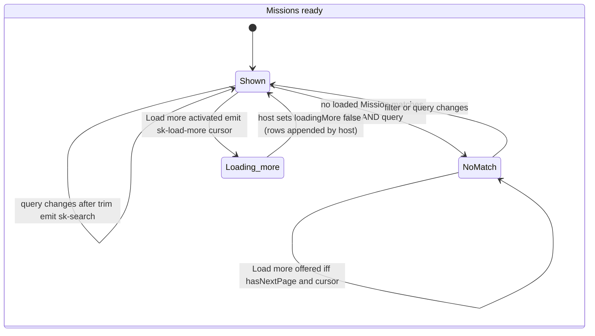
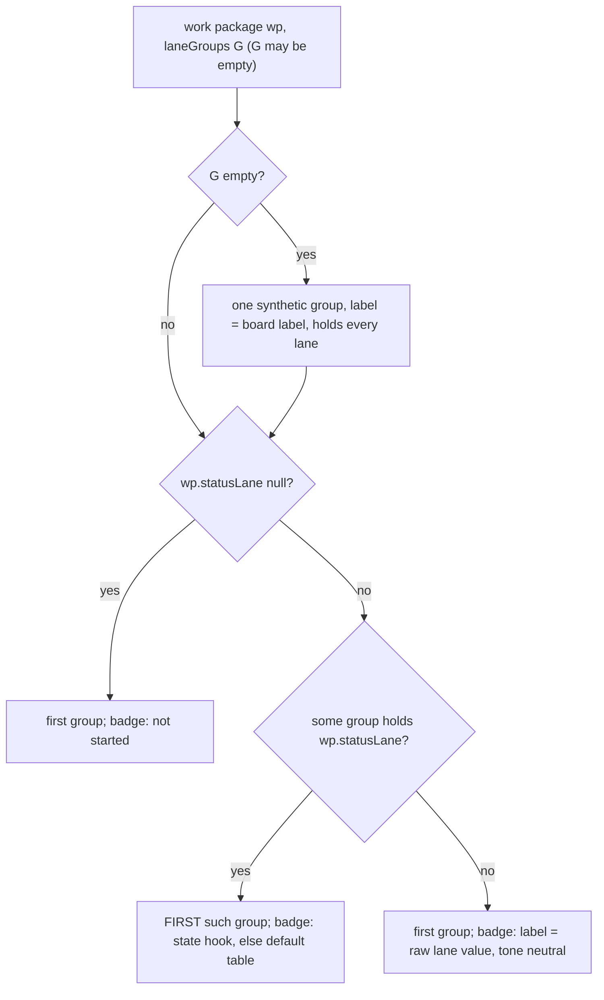
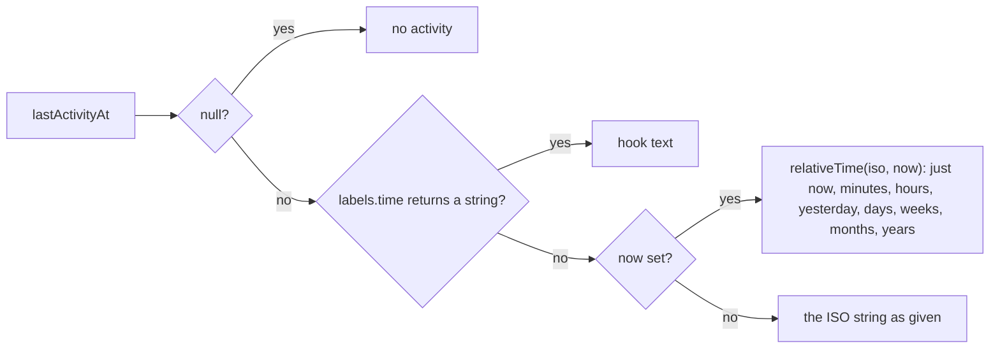

# Data model: Missions and Pipeline screens

Types live in `packages/mission-ui/src/contract/types.ts` (aliases and widened view types over the generated `types.generated.ts`), `src/defaults/*` (vocabulary) and `src/logic/*` (algorithms); public types are exported from `src/index.ts`. Synthetic fixtures only. "Contract" means `spec-kitty contracts/mission-status/...@9f41e48` (pin in `contracts/spec-kitty/PIN.json`).

## Contract types (generated; named aliases only)

| Alias | Source schema | Notes |
|---|---|---|
| `Project` | `Project` | `name`, `missionCount`; no branch |
| `MissionOverview` | `MissionOverview` (closed over `MissionHead`) | no `stale` |
| `MissionOverviewPage` | `MissionOverviewPage` | `items`, `pageInfo` |
| `PageInfo` | `_shared/schemas/PageInfo` | `hasNextPage`, `nextPageCursor: string \| null`, `pageSize` |
| `MissionDetail` | `MissionDetail` | `phases` exactly 5, closed name enum |
| `MissionProgress` | `MissionProgress` | `weightedPercentage` 0..100 (four decimals), `donePercentage`, `doneCount`, `semantics` |
| `WorkPackageSummary` | `WorkPackageSummary` | `statusLane` nine values or null; `subtaskProgress`; no actor |
| `SubtaskProgress` | `SubtaskProgress` | `done`, `total` (integers, 0 or more) |
| `LifecycleStatus`, `Topology`, `StatusLane`, `StatusLaneCounts` | same names | closed unions; consumed only through `src/defaults/` |

Not consumed (C-003, gate `contract` check C7): `StreamCursor`, `streamCursor`, `StatusTransitionEvent`, `MissionLifecycleEvent`, `LogTruncatedEvent`, `eventCount`, `lastEventId`.

## View types (hand-written, widening only; a contract object is assignable without a cast)

| Type | Definition | Why |
|---|---|---|
| `PhaseView` | `Omit<MissionPhase, 'name'> & { name: string }` | PL-07: names the screen has never seen (FR-014) |
| `WorkPackageView` | `Omit<WorkPackageSummary, 'statusLane'> & { statusLane: string \| null; actor?: string }` | unknown lane value; host actor (contract gap 2) |
| `MissionDetailView` | `Omit<MissionDetail, 'phases' \| 'workPackages'> & { phases: PhaseView[]; workPackages: WorkPackageView[] }` | the Pipeline's `mission` property |
| `MissionOverviewView` | `MissionOverview & { stale?: boolean }` | host `stale` (contract gap 1); absent means not stale |
| `MissionOverviewPageView` | `Omit<MissionOverviewPage, 'items'> & { items: MissionOverviewView[] }` | the `satisfies` target of the host-kind page fixtures (`pageMixed`, `pageFull`, `pageLast`): `satisfies` rejects the excess `stale` property against `MissionOverviewPage` (TS2353). A fixture concern only: `sk-missions-screen` takes `missions` and `pageInfo` as separate properties, so no element type uses it. Declared in `src/contract/types.ts` |

## Screen and element types

| Type | Definition | Notes |
|---|---|---|
| `ViewState` | existing `'loading' \| 'error' \| 'empty' \| 'ready'` (`src/view-state.ts`) | unknown collapses to `empty` through `normaliseViewState` |
| `LaneGroup` | `{ id: string; label: string; lanes: string[]; showsProgress?: boolean }` | a board column: label and the status lanes it holds; `showsProgress` (absent means false) marks a column whose cards show the subtask bar (DR-1, CP-1: the default In progress group only; a custom group shows none unless it declares it) |
| `FilterDefinition` | `{ id: string; label: string; matches(mission: MissionOverviewView): boolean }` | in `defaults/lifecycle.ts` only |
| `FilterOption` | `{ id: string; label: string }` | what `sk-filter-toggle-group` receives |
| `StateBadge` | `{ label: string; tone: 'neutral' \| 'info' \| 'success' \| 'attention' \| 'danger' \| 'recovery' }` | `sk-pill-tag status` |
| `LabelHooks` | `{ phase?(name: string): string \| undefined; lane?(lane: string): string \| undefined; state?(lane: string \| null): StateBadge \| undefined; time?(iso: string, now: string \| null): string \| undefined }` | every hook optional; resolution `hook ?? default ?? raw` |
| `PhaseState` | `'done' \| 'current' \| 'pending'` | output of `phaseState(status)`; DECLARED in `src/defaults/phases.ts` (it holds the literals) and only imported elsewhere with `import type`; no scanned code compares with one of its values (`defaults.md`) |
| `PlacedColumn` | `{ group: LaneGroup; cards: PlacedCard[] }` | board output |
| `PlacedCard` | `{ wp: WorkPackageView; badge: StateBadge }` | badge from `state` hook, default table, or raw lane |
| `RowView` | `{ missionId; slug; name; type: string \| null; topology: string; blockedBadge: StateBadge \| null; stale: boolean; lifecycle: StateBadge; summary: string; activity: string }` | output of `buildRowView`; all text already resolved. The field is `blockedBadge`, not `blocked`: a lane word as a key in scanned code (`src/logic/row.ts`) is a gate `data-driven` finding (S5, S7); no field of any view type here equals a lane or phase word |
| `FilterChangeDetail` | `{ filter: string }` | `sk-filter-change` |
| `OpenMissionDetail` | `{ missionId: string; slug: string }` | `sk-open-mission` |
| `SearchDetail` | `{ query: string }` | `sk-search` (trimmed) |
| `LoadMoreDetail` | `{ cursor: string }` | `sk-load-more` |
| `SelectWorkPackageDetail` | `{ missionId: string; wpId: string }` | `sk-select-work-package` |
| `ViewArtifactsDetail` | `{ missionId: string }` | `sk-view-artifacts` |
| `OpenMissionsDetail` | `Record<string, never>` | `sk-open-missions` |
| `ShellMission.progress` (changed) | `{ done: number; total: number; percentage?: number }` | D-28; additive; a `percentage` that is not a finite number (`NaN`, `Infinity`) is treated as absent |

## Invariants

- I-01 No arithmetic on contract values in rendering code: progress, lane counts, blockers and subtask progress are handed on as given. The one calculation is the instant difference in `relativeTime`.
- I-02 Rendering code contains no phase name, lane value or status word of the gate's vocabulary (the five phase names, the nine lanes, and `pending`, `complete`, `draft`, `discarded`); they live in `src/defaults/` and are reached through typed lookups (`Object.hasOwn` guarded). Enforced by gate `data-driven` for exactly those words; the lifecycle value `active` is not gated (`contracts/gates.md`, Vocabulary and blind spots).
- I-03 `phases` render in array order and number; nothing is reordered, truncated or hidden.
- I-04 A work package is never dropped: every one is placed in exactly one column (first match; null and unknown lanes in the first column).
- I-05 Missions render in input order (the service orders by creation time descending, then identity ascending); the screen does not sort.
- I-06 `loading`, `error` and `empty` show the page header and the state's own content only: no list, search, filters, phase bar, board or inspector.
- I-07 Host-set `filter` and `query` change the view and emit nothing; only user input emits.
- I-08 `pageInfo.hasNextPage` true with a null cursor means no Load more row.
- I-09 Fixtures: every document is valid against the pinned closed schema after host fields are stripped, except registry entries that use a named relaxation (and then fail the strict schema only inside the relaxation's paths); and every document is coherent under the contract's exact derivation rules, checked by gate `contract` C5 (`gates.md`): lane counts equal the tally of the work package lanes over the nine known lanes (null and unknown lanes uncounted, and not in `wpTotal`), `wpTotal` is their sum, `blockedCount`, `doneCount` and `donePercentage` follow from the counts, `lifecycleStatus`, and the `implement` and `review` phase statuses follow the contract's rule order. `weightedPercentage` is recomputed too, from the producer's lane weights (`compute_weighted_progress` at the pin; the weights are one constant in `check.mjs`, `gates.md` C5 rule e): `sum(count x weight) / wpTotal x 100` within 0.00005. Overlays declare these values, they do not compute them (`contract-pin.md`).

## Filter, search and paging

Match rule for one Mission, given `filter` (id) and `query`:

1. `def = FILTERS.find(f => f.id === filter) ?? DEFAULT_FILTER`; `byFilter = def.matches(mission)`.
2. `needle = query.trim().toLowerCase()`; `byQuery = needle === '' || [friendlyName, slug, missionType ?? '', topology].some(f => f.toLowerCase().includes(needle))`.
3. shown iff `byFilter && byQuery`. Hidden Missions stay in the DOM with `hidden` on their `li` (NFR-006, D-23); the "No Missions match" panel shows when zero `li` are visible.

Events: pressing the pressed filter emits nothing; a query whose trimmed value equals the last applied one emits nothing; Load more while `loadingMore` emits nothing.

## Result-count announcement (FR-034)

Derived from the match rule above: the count is the number of `li` rows left visible (Load more row excluded), phrased from a `src/defaults/` word; it changes only on user input or when `missions` grows, never on first render. No arithmetic on contract values (a count of shown rows, not of contract data).

## Board placement

Within a column, cards keep input order. The count shown on a column is `cards.length`. A lane listed by two groups belongs to the first. Default groups (operator decision, `defaults/lanes.ts`): Planned [planned, blocked]; In progress [claimed, in_progress]; Review [for_review, in_review]; Approved [approved]; Done [done, canceled]. State badges: blocked, reviewing (`in_review`), canceled and "not started" are distinct badges (FR-016).

## Lane summary rule (FR-006, no arithmetic)

Input `statusLaneCounts`, `laneGroups`, `labels`. Output a text of segments joined by " · " (U+00B7 MIDDLE DOT, as in the prototype): for each group in REVERSE column order, for each lane the group holds in its declared order, if `counts[lane]` is not 0 emit `<count> <label>` where `label = hook ?? defaults.LANE_LABELS[lane] ?? lane`. After the group-ordered segments, any non-zero count whose lane no group holds is appended in object key order with the raw lane as its label (never dropped). No segment merges two lanes (claimed and in progress stay separate). All counts zero gives an empty summary (nothing rendered). With the default groups and the prototype's data this yields `2 done . 1 in review . 1 in progress` and `2 done . 2 planned`.

## Phase state and current step

`phaseState(status)` is a lookup in `defaults/phases.ts` (`pending` pending, `in_progress` current, `complete` done); an unknown status is pending, read as `lookup(PHASE_STATE, status) ?? DEFAULT_PHASE_STATE` (`DEFAULT_PHASE_STATE` is exported by `defaults/phases.ts`, so `src/logic/` contains no `'pending'` literal). The bar marks every phase by its own state, reading glyph, tone, status text and the aria-current answer from the `Record<PhaseState, ...>` tables of `defaults/phases.ts` (`PHASE_GLYPH`, `PHASE_TONE`, `PHASE_STATUS_TEXT`, `PHASE_IS_CURRENT`) indexed by `phaseState(status)`; no scanned code compares a state with `'current'`, `'done'` or `'pending'`. Current step (inspector, FR-019): if `nextAction !== null` show it verbatim; else `first = phases.find(p => PHASE_IS_CURRENT[phaseState(p.status)])` (array order); if found, "Current step: " plus the phase label; else "No step in progress".

## Relative time

`relativeTime`: delta = now minus then in milliseconds; under 60 s or negative "just now"; under 60 min "<n> minute(s) ago"; under 24 h "<n> hour(s) ago"; under 48 h "yesterday"; under 14 days "<n> days ago"; under 56 days "<n> weeks ago"; under 365 days "<n> months ago" (30-day months); else "<n> years ago". Unparsable input returns the input.

## Rendering by view state

| `status` | Missions screen | Pipeline screen |
|---|---|---|
| `loading` | header; busy region with the labelled indeterminate progress "Reading local Mission index" and a paragraph | header; busy indicator |
| `error` | header; alert notice "Mission index unavailable" | header; alert notice |
| `empty` | header; "No Missions in this project"; no search, no filters | header; neutral notice (PL-10) |
| `ready` | header; search; filters; list or "No Missions match"; Load more | header; phase bar; board and inspector |
| unknown value | as `empty` (`normaliseViewState`) | as `empty` |

## Fixture inventory (derived from the pinned examples; names are the generated exports)

Full list with the overlay each needs and its registry kind is in `contracts/contract-pin.md`. Contract state coverage: the examples cover active, planned and discarded Missions, a null-lane work package (`MissionDetail.populated` WP07), implement and review both in progress, and unknown topology and null type (`MissionOverview.sparse`); overlays add done, draft, blocked, in-review, canceled, null-lane variants, host `stale` and `actor`, all-pending and all-complete phases, long names, and (relaxed) 3 and 7 unknown phases and an unknown lane. Every overlay keeps phases, lifecycle and progress consistent with its work packages (a state the contract cannot produce is not a fixture): see the declared values and the PL-01 consequence (P-8) in `contract-pin.md`.
