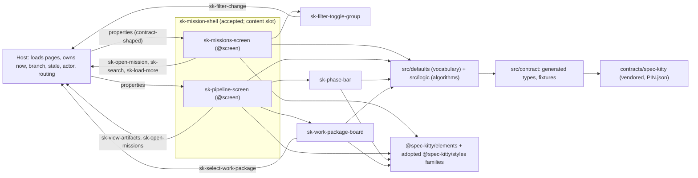
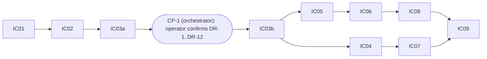

# Implementation Plan: Missions and Pipeline screens

**Branch**: `feat/missions-and-pipeline-screens-4` (current, planning base and merge target; `branch_matches_target: true`) | **Date**: 2026-10-03 | **Spec**: `kitty-specs/missions-and-pipeline-screens-01M40SKZ/spec.md`
**Input**: Mission specification (with the post-specify operator decision on the card progress bar, commit e59da7d), GitHub issue spec-kitty/spec-kitty-mission-ui#4 and its operator comments, the Mission Status contract pinned at spec-kitty `9f41e48fe0e8b00cd040690598e90c37d82ea4a2`, and the approved Kitty Desktop V2 prototype.

## Summary

Add two screen-contract elements, `sk-missions-screen` and `sk-pipeline-screen`, and three pattern elements, `sk-filter-toggle-group`, `sk-phase-bar` and `sk-work-package-board`, to `@spec-kitty/mission-ui`. Data comes in as properties typed from the Mission Status contract, which this mission VENDORS at a pinned commit (`contracts/spec-kitty/`, `PIN.json`), generates types from (`openapi-typescript`) and derives its fixtures from (the contract's own examples plus named overlays); a new gate, `contract`, keeps all of that honest. The phase bar and the board render whatever phases, lanes and groups they receive, labelled through hooks with raw-name fallback; a second new gate, `data-driven`, fails when any element source hard-codes the five phase names or nine status lanes. Every vocabulary value lives in `src/defaults/`. Library primitives are rendered with `sk-*` elements; where the library ships a primitive only as CSS (segmented choice, workflow board and lane, progress, breadcrumbs, empty state) the library's own stylesheet is adopted as the progress sheet already is, each use recorded as a gap G-nn and an exception E-nn for the operator. One additive change to the accepted shell (an optional `ShellMission.progress.percentage`) makes the shell footer and the Pipeline inspector show the same figure with all 58 existing baselines unchanged. About 60 new baselines (118 in total). Decisions and evidence: `research.md`; types and algorithms: `data-model.md`; interfaces: `contracts/`; verification: `quickstart.md`.

## Technical Context

**Language/Version**: TypeScript 5.9 strict (`exactOptionalPropertyTypes`, `noUncheckedIndexedAccess`), Lit 3.3.3, Node 22.22.2, pnpm 11.18.0 (pinned)
**Primary Dependencies**: `@spec-kitty/elements` 1.1.0-rc.10 (`sk-page-header`, `sk-pill-tag`, `sk-form-input`, `sk-notice`, `sk-status-indicator`, `sk-metric`, `sk-button`, `sk-card`, `sk-action-row`) and `@spec-kitty/styles` (adopted families `segmented-choice`, `workflow-board`, `workflow-lane`, `progress`, `breadcrumbs`, `empty-state`); new ROOT devDependencies, exact-pinned: `openapi-typescript` 7.13.0, `@apidevtools/json-schema-ref-parser` 16.0.3, `ajv-formats` 3.0.1 (nothing ships)
**Storage**: N/A (no I/O, nothing stored)
**Testing**: Vitest 4.1 browser mode (`page.viewport` first, reset after each test); `node:test` for the contract tooling; vitest node environment for the data-driven self-test; Storybook 10.6 stories; Playwright visual spec in the pinned container
**Target Platform**: evergreen browsers (dashboard) and the Kitty Desktop webview; screens render inside `sk-mission-shell`
**Project Type**: pnpm workspace: `packages/mission-ui`, `apps/storybook`, plus root `contracts/` and `scripts/`
**Performance Goals**: 500 loaded Missions, a keystroke or filter toggle updates in 200 ms or less (NFR-006); no layout jump from the screens
**Constraints**: no I/O; project CSS layout-only with `--sk-*` tokens and `%`/`fr` (Stylelint); ESLint bans raw `<button>/<input>`, `class=`, `style=` outside the recorded exceptions; visible text in slots; 0 visual failures over 5 repeats; fixtures free of real paths, usernames and e-mail addresses; screens do no arithmetic on contract values
**Scale/Scope**: 5 elements, 4 default modules (`lanes`, `phases`, `lifecycle`, `pipeline-copy`, plus `index`), 2 new gates, 60 new baselines (118 total, 590 test executions per visual run), about 225 tests (about 130 browser-mode in the `unit-tests` gate, about 55 vitest node tests in `test:data-driven`, about 40 node:test cases in `test:contract`; estimates, not requirements), 1 additive shell change

## Charter Check

| Charter rule | Status |
|---|---|
| Data in as properties, typed from the OpenAPI read contract | pass: `contract/types.generated.ts` from the vendored pinned `openapi.yaml`; widened view types are supertypes (D-05); gate `contract` proves freshness and fixture validity |
| View state in as a property | pass: `status` on both screens, shown with the page header kept (D-33) |
| Events out as `bubbles` `composed` `sk-*` CustomEvents, every payload asserted | pass: seven events (D-03), one dispatch site each, literal names, `@fires` on the screens, EV-1 to EV-7 tests plus no-event tests |
| No I/O | pass: `ResizeObserver` is the only browser API beyond the DOM (`performance.now()` in tests only); no timers, no fetch; the tooling scripts live outside `packages/*/src` |
| Elements over CSS; gap not hand-rolled | pass with recorded exceptions E-01 to E-05 and gaps G-01 to G-08 (D-15); each needs operator approval at PR review |
| Atomic design, deep modules | pass: 2 screens, 3 pattern elements with small interfaces; row, card, inspector and headers are private fragments (D-01) |
| Quality gates incl. manifest, no-io and visual | pass: all existing gates apply (gates.md), two new gates added with plants and proof wiring |
| A story per view state, synthetic fixtures; a test per event | pass: D-31 (60 stories), D-34, fixtures derived from the contract examples (D-11) |
| Visual regression against the prototype; drift is REJECT | pass with the approved drift (AD-1 to AD-3) and the plan-introduced drift register DR-1 to DR-12, PROVISIONAL until the operator confirms it at checkpoint CP-1 (owned by the orchestrator, between the approved IC-03a and the dispatch of IC-03b); reviewers audit against AD-1 to AD-3 plus the DR list as provisional, and any DR the operator does not confirm becomes a REJECT item (D-35, P-6) |
| Fixtures: no real user data, paths, usernames | pass: hygiene scans the vendored and generated files and fixtures for tokens and absolute paths; new e-mail rule; actors only from an allow-list and the current OS username scanned in fixture strings (D-13; the username leg detects only the executing machine's username, see P-2) |
| Reviewer agent per work package; squad after the plan phase only | pass: briefs below; this plan is the squad's input |
| PR into `main`, operator merges | pass: one PR after the wrap-up sequence (D-36) |

## Gates

Full table, commands, job ids, plants, timeouts and files per gate: `contracts/gates.md`. Summary: the ten existing gates keep their commands (the `visual` and `unit-tests` timeouts are raised in IC-09, from the recorded CI runs scaled by 590/290: visual job 15, proof-leg visual 35, unit-tests job 8, proof-leg unit-tests 10; derivation in `gates.md`); the new gates are `data-driven` (`pnpm lint:data-driven && pnpm test:data-driven`, plant `gates/plants/data-driven/`, matrix timeout 6, an estimate) and `contract` (`pnpm contract:check && pnpm test:contract` with `test:contract` = `node --test scripts/contract/*.test.mjs`, three plants under `gates/plants/contract/`, matrix timeout 8, an estimate); IC-01 and IC-02 replace those estimates with values derived from their own measured runs by the rule in `gates.md`; those two values are PROVISIONAL, measured on a partial tree (the `data-driven` command lints `packages/*/src`, which IC-04 to IC-08 enlarge, and `contract` runs against fixtures later stories use), and IC-09 re-records C and L for both gates on the integrated tree and raises the timeouts if the rule no longer holds. Each is a real CI job with one `id: gate` step, a plant directory, a proof-matrix entry `{ gate, timeout, image: '' }`, an `all` need, a README gates-table row and a root and package CHANGELOG line. What is MECHANICALLY enforced: job ids = matrix list = plant directories, `all.needs`, and `ciCommand` equal to the gate step (`scripts/gate-proof.mjs coverage` and hygiene `checkWorkflow`), plus the proof record schema's gate enum (a third coupling found in review: IC-01 and IC-02 each add their gate id to `kitty-specs/storybook-scaffold-01M3SYDA/contracts/gate-proof-record.schema.json` and to `GATES` in `scripts/gate-proof/gate-proof.test.mjs`; editing the earlier mission's schema is a recorded exception for the operator, `gates.md`). NOT enforced by any script, reviewer-checked: the matrix include's `timeout` and `image` values, the README row and the CHANGELOG lines. CHANGELOG ownership has one rule: IC-01 and IC-02 add their own gate's README row and CHANGELOG line; IC-09 only reconciles and adds the mission summary line.

| Gate | Command | New files or edits for this mission |
|---|---|---|
| `data-driven` | `pnpm lint:data-driven && pnpm test:data-driven` | `eslint.data-driven.config.mjs` (with `noInlineConfig`), `gates/data-driven.selftest.ts`, 36 positive fixtures and the negative, allow-list and disable-comment cases, plant, CI job, README row and limitations, CHANGELOG line, schema enum value, `gate-proof.test.mjs` |
| `contract` | `pnpm contract:check && pnpm test:contract` | `contracts/spec-kitty/**`, `scripts/contract/**` (with the negative node tests), `src/contract/**`, three plants, CI job, README row, CHANGELOG line, schema enum value, `gate-proof.test.mjs` |
| `hygiene` | `pnpm hygiene && pnpm test:scripts` (ruling P-9, exception E-06) | e-mail rule (path scoped), test, second plant; `test:scripts` = `node --test scripts/hygiene scripts/gate-proof scripts/preflight.test.mjs scripts/manifest-screen.test.mjs scripts/terminology.test.mjs` (IC-01 wires the first four paths, IC-09 adds the terminology test; the preflight and manifest-screen suites guard gates and ran nowhere, same rationale, E-06), with a plant of a failing node test |
| `eslint`, `stylelint`, `no-io`, `manifest`, `typecheck`, `storybook-build`, `unit-tests`, `visual`, `preflight` | unchanged | per-file ESLint overrides, regenerated manifest, new tests, 60 new baselines, timeouts |

Baseline: before any change IC-01 records the green baseline of every gate command on the branch head (main-equivalent: it differs from `main` only by `kitty-specs/` files), including `pnpm visual` in the pinned container (58 PNGs, 0 diffs) and `pnpm gate-proof`, with the local wall-clock of `pnpm test`, `pnpm build-storybook` and one `pnpm visual` run (the CI baseline is runs 36880654992 and 36882394060, `gates.md`). The repository has no known-red gate, so a red after that point is introduced by this mission unless the recorded baseline shows it; a red found at baseline is escalated, not absorbed (D-37).

## PR shape and wrap-up (operator standing rule, binding)

ONE pull request for the whole mission, opened only after this sequence: accept, then dev-assist test cleanup, then the aggregate review squad, then compaction of history into a few logically sliced commits, then rebase onto `main`, then a full gate re-run, THEN the DRAFT pull request. Work packages never push and never open pull requests. Each work package is reviewed by a separate reviewer agent (charter). Every work-package brief states: no sub-agents; visual baselines only inside the pinned container (`pnpm visual:update` through `scripts/visual.sh`); no absolute paths or usernames in any committed file (use `<repo>`, `<prototype>`, `<elements>`); a denied command means stop and report; the test quality rules of `research.md` D-34 (positive controls, exactly-one-event, equality counts, revert checks) and the drift register status (AD-1 to AD-3 plus the DR list, provisional until CP-1 and confirmed after) are copied into it. The PR description carries: the exception list E-01 to E-05 and the process exception X-1 (an enum value added to the earlier mission's `gate-proof-record.schema.json`), the gaps G-01 to G-08, the drift register DR-1 to DR-12 as confirmed at CP-1, the spec amendment proposals P-1 to P-10, the local baseline timings, the CI runs the timeouts were derived from (the first pull-request run's durations follow as a PR comment), the output of `pnpm contract:verify-remote` on the initial vendoring, and the contract pin (sha, `infoVersion`).

**Integrity of the wrap-up (the accept record stores commit shas and the mission baseline, which compaction and rebase rewrite; the orchestrator ledger, which lives outside this repository, records as a spec-kitty tooling issue that spec-kitty has no supported way to rebaseline an accept record).** Two trees are recorded, because the sequence changes the tree after accept (dev-assist test cleanup, then every squad fold-in are commits after accept). (a) At accept record the accepted head sha (A) and its tree `git rev-parse A^{tree}` (TA): the accept record's reference. (a2) T0 is recorded at the LAST tree-changing step before compaction: after the test cleanup and after every squad fold-in, with a clean working tree, immediately before compaction, as `git rev-parse HEAD^{tree}` (T0), together with a local, unpushed backup ref `refs/wrapup/pre-compaction` at that head; any later tree-changing commit (including a fold-in found while compacting) makes the orchestrator re-record T0 and move the ref. `git diff TA T0` is the complete list of post-accept changes (cleanup and fold-ins) and goes in the PR description. (b) Compaction slices are named in advance so the squad reviews what the PR shows: contract tooling and gates (IC-01), defaults, logic and the `data-driven` gate (IC-02), shell change, spikes and skeletons (IC-03a and IC-03b), the filter-group and Missions chain (IC-04, IC-07), the phase-bar, board and Pipeline chain (IC-05, IC-06, IC-08), documentation and integration (IC-09); compaction must be tree-neutral against T0: after it `git diff --exit-code T0 HEAD` succeeds (no output). (c) After the rebase onto `main`, `git diff <pre-rebase merge base> <compacted head>` and `git diff main <rebased head>` must be identical; any difference must be a file `main` changed meanwhile (`git diff --name-only <pre-rebase merge base> main`) and is investigated before continuing (baselines PNG, `package.json`, `pnpm-lock.yaml`, `ci.yml` are the likely conflicts). (d) The FULL gate set re-runs on the rebased head, including `pnpm visual` in the pinned container and `pnpm gate-proof`, before anything is pushed. (e) The accept record is not re-created and is compared by TREES, not by shas: the accepted sha A no longer exists on the branch after compaction and rebase, so the PR description cites A and TA as written in the accept record, T0, `git diff TA T0` and the final rebased tree, and states that the accept covered TA and that the later changes are exactly `git diff TA T0` plus the rebase's `main` changes. The one allowed commit after the draft PR opens is the timeout-only fixup of `gates.md`, if the first run shows a timeout too tight.

## Architecture



| Content tier (owned by the shell) | Missions screen | Pipeline screen |
|---|---|---|
| expanded, 1100 px and above | toolbar on one row; list | phase bar; board and inspector side by side |
| collapsed, 720 to 1099 px | toolbar wraps; rows reflow | board scrolls in its own region; inspector may drop below |
| mobile, below 720 px | toolbar stacked; rows single column | inspector below board; board scrolls in its region |

## Project Structure

### Documentation (this mission)
```
kitty-specs/missions-and-pipeline-screens-01M40SKZ/
├── spec.md  plan.md  research.md  data-model.md  quickstart.md
├── contracts/ sk-missions-screen.md  sk-pipeline-screen.md  sk-filter-toggle-group.md  sk-phase-bar.md
│              sk-work-package-board.md  defaults.md  contract-pin.md  gates.md
├── tracer-tooling-friction.md  tracer-approach.md  tracer-design-decisions.md
└── tasks.md        # NOT created here
```

### Source code (repository root)
```
contracts/spec-kitty/{mission-status,_shared}/  PIN.json          # vendored, byte for byte (98 files)
scripts/contract/{generate,check,update,verify-remote,registry,overlays,validate}.mjs  {check,overlays,registry}.test.mjs
scripts/hygiene/rules.mjs  hygiene.test.mjs                       # + e-mail rule (path scoped)
scripts/gate-proof/gate-proof.test.mjs                            # edited: GATES gain contract (IC-01), data-driven (IC-02)
scripts/terminology.mjs  scripts/terminology.test.mjs             # C-009 as a test that can fail (IC-09)
kitty-specs/storybook-scaffold-01M3SYDA/contracts/gate-proof-record.schema.json   # edited: gate enum (exception X-1)
eslint.data-driven.config.mjs                                     # with linterOptions.noInlineConfig
gates/data-driven.selftest.ts  gates/fixtures/data-driven/*.ts.txt
gates/plants/{data-driven,contract}/  gates/plants/hygiene/plant.json (second plant)   # contract: three plants
packages/mission-ui/
├── src/
│   ├── index.ts                           # guarded registration of 5 tags + type exports (IC-03b only)
│   ├── library-sheets.ts                  # adopted segmented-choice, workflow-board, workflow-lane, breadcrumbs, empty-state
│   ├── contract/  types.generated.ts  types.ts  fixtures.generated.ts  bulk.ts
│   ├── defaults/  lanes.ts  phases.ts (declares PhaseState)  lifecycle.ts  pipeline-copy.ts  index.ts
│   ├── logic/     lookup.ts  placement.ts  summary.ts  search.ts  time.ts  step.ts  row.ts  labels.ts
│   ├── story-support/shell-frame.ts       # story-only helper, not exported
│   ├── shell-types.ts                     # progress.percentage? (D-28)
│   └── elements/
│       ├── sk-missions-screen/   element, mission-row-parts, fixtures, stories
│       ├── sk-pipeline-screen/   element, pipeline-parts, fixtures, stories
│       ├── sk-filter-toggle-group/  element, fixtures, stories
│       ├── sk-phase-bar/            element, fixtures, stories
│       ├── sk-work-package-board/   element, card-parts, fixtures, stories
│       └── sk-mission-shell/shell-parts.ts   # renderFooter: optional percentage (D-28)
├── test/  one file per element and per logic module, shell percentage cases, host-composition (SC-008)
├── custom-elements.json  CHANGELOG.md
apps/storybook/tests/visual/stories.visual.spec.ts   # await updateComplete of every nested custom element
apps/storybook/tests/visual/__snapshots__/           # 60 new baselines
.github/workflows/ci.yml  .gitattributes  package.json  pnpm-lock.yaml  eslint.config.mjs  README.md  CHANGELOG.md
```
**Structure Decision**: extend the "Add an element" recipe in `README.md`; registration only through `src/index.ts`; generated files only through `pnpm contract:generate`.

## Implementation Concern Map

A serial foundation (IC-01, IC-02, IC-03a, the operator checkpoint CP-1, IC-03b), then two chains of work packages: chain A (phase bar, board, Pipeline: IC-05, IC-06, IC-08) and chain B (filter group, Missions: IC-04, IC-07). Both chains start from IC-03b and share no ancestor beyond it; IC-09 integrates after both through the orchestrator-owned procedure below. A work package depends on its parent by `depends_on`; whether the tool gives a dependent work package a lane of its own or reuses its parent's lane is the tool's choice, and the plan does not rely on either (see Lane mechanics). The tool cannot parent a lane on two lanes, which is why IC-09 needs the procedure.



CP-1 is not a work package: the orchestrator, with IC-03a approved and its spike report in hand (DR-8 depends on the S2 outcome), obtains the operator's confirmation or amendment of DR-1 to DR-12 and the copy defaults (P-6), records it in `tracer-design-decisions.md` and `spec.md` Clarifications, and only then dispatches IC-03b. No work-package agent waits for the operator.

### Lane mechanics (orchestrator-owned; WP agents never do any of this)

Three tool defects govern lane allocation. They are recorded in the orchestrator's own defect ledger, which lives outside this repository and cannot be opened by an implementer or reviewer of this repository; the ids are given only for the orchestrator's cross-reference, and the fact each time is stated here, so nothing below depends on that file: a spec-kitty tooling issue (lanes parent off the local `kitty/mission-<slug>` branch, created once at the first claim and never refreshed); a spec-kitty tooling issue (allocating a lane for a work package that depends on an approved work package starts from a stale coordination commit and then fails merging the planning commit); a spec-kitty tooling issue (allocation refuses when the derived `status.json` conflicts). The plan states the procedure so the orchestrator does not rediscover it mid-mission.

1. **Stale mission branch.** If `kitty/mission-<slug>` exists (`git branch --list 'kitty/mission-*'`), before the first claim of every lane, and again after any merge of `main` into the target branch, fast-forward it to `feat/missions-and-pipeline-screens-4` in a temporary worktree (`git merge --ff-only`).
2. **Dependent work packages, one rule.** For EVERY work package with a `depends_on` parent whose allocation creates a new lane, the orchestrator pre-creates the lane branch from the approved parent's tip before dispatching it (or, if allocation already ran, enters the lane worktree and runs `git merge --no-ff <approved parent lane>`), then runs `implement`. The work packages this covers: IC-02 (parent IC-01), IC-03a (parent IC-02), IC-03b (parent IC-03a), IC-04 and IC-05 (parent IC-03b), IC-06 (parent IC-05), IC-07 (parent IC-04) and IC-08 (parent IC-06); IC-01 has no parent, and IC-09 has two (item 3). When the tool instead places a dependent work package in its parent's lane, nothing is pre-created; the orchestrator checks that the lane's tip is the approved parent's tip before dispatching. If allocation refuses on a derived `status.json` conflict: `git merge-tree` must show that file is the only conflicting path, then `git merge -X ours <parent lane>` in the new lane (acceptable only because `status.json` is a snapshot derived from the event log), then verify the snapshot against the event log (event count and last event id), then re-run `implement`.
3. **IC-09 needs both chains (dependent-lane allocation class).** The tool gives a lane one parent, so IC-09 is parented on IC-08 (chain A). Before dispatching IC-09 the orchestrator runs `git merge --no-ff <approved IC-07 tip>` in the IC-09 lane worktree, resolves `custom-elements.json` by `pnpm manifest:generate` only (never by hand), applies the rule of item 2 to `status.json`, and verifies that both chains' work is present (the built Storybook index lists 118 stories, 60 of them new). IC-09's first step is a green full gate run on that merged tree.
4. **Decision and fallback.** The two chains stay parallel: chain B is two work packages and 28 stories of work that overlaps chain A's three, and one orchestrator merge with the item-2 pre-creation is judged lower risk than losing that overlap. If the IC-07 merge conflicts in anything beyond `custom-elements.json` and `status.json`, the orchestrator serialises instead: IC-04 and then IC-07 are created after IC-08 is approved, each from the previous approved tip, so every work package has one parent and IC-09 has one parent; the decision is recorded in `tracer-design-decisions.md`.

5. **CP-1 and approval entries reach the lanes (rc5 mechanism).** A lane worktree is created from the lane's parent tip (item 2), so a commit made later on the target branch is not in it. Two orchestrator-owned entries in `tracer-design-decisions.md` are file preconditions of work packages, and each is delivered like this. (a) "Operator approved exceptions E-06, E-07, X-1 (2026-10-03)" is committed on `feat/missions-and-pipeline-screens-4` before the first claim; item 1 then fast-forwards `kitty/mission-<slug>`, lane-a (IC-01) is created from it, and IC-02 and every later lane derive from IC-01's tip, so the entry is an ancestor of every lane; the orchestrator checks `git merge-base --is-ancestor <approval commit> HEAD` in the IC-01 and IC-02 worktrees before dispatch. (b) The `CP-1 confirmed` entry is committed on the target branch after IC-03a is approved; the orchestrator then (i) fast-forwards `kitty/mission-<slug>` (item 1), (ii) pre-creates the IC-03b lane branch (lane-d) from the approved IC-03a tip (item 2), (iii) in the lane-d worktree runs `git merge --no-ff feat/missions-and-pipeline-screens-4` (applying the `status.json` rule of item 2), (iv) verifies `git merge-base --is-ancestor <CP-1 commit> HEAD` and that the entry reads `confirmed`, and only then runs `spec-kitty agent action implement WP04`, naming the CP-1 commit hash in the dispatch. The reviewer checks "committed before the first IC-03b commit" by `git merge-base --is-ancestor <CP-1 commit> <first IC-03b commit>` on the lane branch: the orchestrator's merge commit precedes every WP commit. Later chains inherit it through their parent. The tool has no command to express either entry as a dependency; this procedure is the whole mechanism.
6. **Scope guard and out-of-map edits.** WP frontmatter `owned_files` and `lanes.json` `write_scope` are tool-owned and are not hand-edited. The tool enforces `owned_files` only when it auto-commits uncommitted lane deliverables at `move-task ... for_review` (error `OWNED_DELIVERABLE_SCOPE_REFUSED` if any changed path is outside the owned set) and requires at least one committed change matching `owned_files` for review. Hence the sanctioned path for the out-of-map edits that the "Shared files" table grants (IC-02 on `ci.yml`, `package.json`, README, CHANGELOGs and `gate-proof.test.mjs`; IC-03b on `eslint.config.mjs`; IC-09 on `ci.yml`, `package.json`, README, CHANGELOGs and `custom-elements.json`; every `kitty-specs/` edit): the work-package agent commits each such edit itself with plain `git add <path>` and `git commit` on its lane branch, leaving nothing out-of-map uncommitted when it runs `move-task`; the hand-off lists every such commit and path with its rationale. If the tool still refuses an out-of-map path, the orchestrator rules it (record in `tracer-design-decisions.md`), never a frontmatter or `lanes.json` edit.

### Shared files: who may write them

Disjoint write scopes are the guarantee between the chains, so every file either chain could touch has one writer. A work package that needs a change to a file it does not own files a change request with the orchestrator (the WP report names the file and the change) and stops that part of the work; the orchestrator applies it on the owning IC's tree and merges it into the affected work-package worktrees by the procedure above, or rules it out.

| File | Writer | Everyone else |
|---|---|---|
| `src/index.ts`, `custom-elements.json` | IC-03b (skeletons freeze the full public surface after the spikes: properties with attributes, `@fires`, `@slot`, `@csspart`, `@screen`, literal `dispatchEvent` calls); later only by `pnpm manifest:generate` | a work package must not change the public surface frozen in IC-03b; one whose change is unavoidable reports it, and IC-09 regenerates once; merge conflicts in the manifest are resolved by regeneration only |
| `src/defaults/**`, `src/logic/**` and their tests (`test/<module>.test.ts`) | IC-02 only | a work package that finds a gap (a missing label, a changed card word) files a change request, or adds only a NEW file inside its own element directory for copy that is not vocabulary; never an edit of `defaults/index.ts` |
| `scripts/contract/**`, `src/contract/**` (generated types and fixtures, `types.ts`, `bulk.ts`), `contracts/spec-kitty/**`, `.gitattributes` | IC-01 only; the 22-fixture list of `contract-pin.md` is complete and frozen: every fixture the 60 stories need is in it | a missing fixture is a change request; `fixtures.generated.ts` is a generated file whose freshness is gate `contract` C3, so no lane regenerates it |
| `eslint.config.mjs` | IC-01 (E-05: generated-types ignore and the `structuredClone` global), IC-03b (E-01 to E-03 for every new file, the `story-support` import ban) | none |
| `stylelint.config.mjs` | IC-05 only, only if spike S2 selects E-04 | none |
| `.github/workflows/ci.yml` | IC-01 (`contract` job and matrix entry), IC-02 (`data-driven`), IC-09 (timeouts only: the visual and unit-tests figures, and the final re-check of the two new gates' timeouts) | none |
| `kitty-specs/missions-and-pipeline-screens-01M40SKZ/contracts/gates.md` (the timeout figures only) | IC-01 and IC-02 each for their own gate's row, IC-09 for the visual and unit-tests rows and for any raise of the two new gates' rows; the post-PR timeout fixup updates the matching figures here | none (the rest of the file is orchestrator-owned planning text) |
| `package.json`, `pnpm-lock.yaml` | IC-01 (contract scripts and the three devDependencies), IC-02 (data-driven scripts), IC-09 (`test:terminology`) | none |
| `kitty-specs/storybook-scaffold-01M3SYDA/contracts/gate-proof-record.schema.json`, `scripts/gate-proof/gate-proof.test.mjs` | IC-01 (`contract`), IC-02 (`data-driven`); exception X-1 | none |
| `README.md` gates-table rows | the IC that adds the gate (IC-01, IC-02) | none |
| `README.md` prose and Known limitations | IC-02 for the `data-driven` limitations; IC-09 reconciles everything | none (work packages put notes in their WP report) |
| both `CHANGELOG.md` | IC-01 and IC-02 add their gate's line; IC-09 reconciles and adds the mission summary line | none (work packages put notes in their WP report) |
| `apps/storybook/tests/visual/stories.visual.spec.ts` | IC-03a | none |
| `src/shell-types.ts`, `shell-parts.ts`, shell tests | IC-03a | none |
| `tracer-*.md` | the orchestrator only, from WP reports (spike outcomes, decisions, friction) | WPs write nothing there |
| baselines (PNG) | the work package that owns the story | disjoint names, no conflict |

README and CHANGELOG rows are not enforced by any script; the reviewer of each WP checks them (`contracts/gates.md`).

### IC-01 Baseline, contract tooling and gate `contract`
- **Purpose**: record the baseline (D-37) including the local wall-clock of `pnpm test`, `pnpm build-storybook` and one `pnpm visual`; vendor the pinned contract, `PIN.json`, `.gitattributes`, then run `contract:verify-remote` once and keep its output for the PR description; add the three devDependencies (one online install, lockfile committed); `contract:generate` (types, fixtures, overlays with declared derived values, registry, bulk, `SYNTHETIC_ACTORS`), `contract:check` (C1 to C7 with the guards), `contract:update`, `contract:verify-remote`; the negative node tests; gate `contract` wired (job, three plants, matrix entry `{ gate: contract, timeout: 8, image: '' }` (timeouts replaced by the derived values, `gates.md`), `all`); the proof record schema enum value and `gate-proof.test.mjs` (`contract` added to `GATES`, count 11; exception X-1); hygiene e-mail rule, test and second plant; ESLint ignore of the generated types and the `structuredClone` global in the `.mjs` globals block (E-05); README row and CHANGELOG line for the gate. Spike S0.
- **Relevant requirements**: FR-026, FR-030, FR-031 (part), C-002, C-003, C-008, NFR-001, NFR-007, NFR-010. Also ruling P-9: package script `test:scripts` and the `hygiene` job and proof-leg command (E-06), with the failing-test plant.
- **Affected surfaces**: `contracts/spec-kitty/**`, `scripts/contract/**`, `scripts/hygiene/**`, `scripts/gate-proof/gate-proof.test.mjs`, `kitty-specs/storybook-scaffold-01M3SYDA/contracts/gate-proof-record.schema.json`, `packages/mission-ui/src/contract/**`, `gates/plants/contract/**`, `gates/plants/hygiene/plant.json`, `.github/workflows/ci.yml`, `package.json`, `pnpm-lock.yaml`, `eslint.config.mjs`, `.gitattributes`, `README.md`, both `CHANGELOG.md`, `kitty-specs/missions-and-pipeline-screens-01M40SKZ/contracts/gates.md` (its own timeout row)
- **Exit checks**: `pnpm lint` over the new `scripts/contract/*.mjs` (no `no-undef`); the wall-clock of `pnpm contract:check`, `pnpm test:contract` and `node scripts/gate-proof.mjs local --only contract` recorded in the WP report, from which the contract job and proof-leg timeouts are set (`gates.md`, Timeouts and timing record); `pnpm contract:check && pnpm test:contract` in the clean worktree with the reporter's pass count above 0 and fail 0; `node scripts/gate-proof.mjs local --only contract`; `node --test scripts/gate-proof/` and `node --test scripts/hygiene/`; `node scripts/gate-proof.mjs coverage`; an `assemble` dry run over fragments for every gate; the WP report lists the revert check per test file (D-34).
- **Sequencing/depends-on**: none (first, because every later work package needs types and fixtures)
- **Risks**: S0 (Node loads data-only `.ts`; generated types pass strict tsc and `lint:no-io`); lockfile and the offline-frozen proof legs; the relaxations must not become a blanket ignore (reverted-must-fail proof); `--frozen-lockfile` in CI; the earlier mission's schema edit needs the operator's approval (X-1).

### IC-02 Gate `data-driven`, defaults and logic
- **Purpose**: `eslint.data-driven.config.mjs` (`noInlineConfig`, 31 selector entries, one per alternative), self-test with 36 positive fixtures, negative, allow-list and disable-comment cases and the count guard, plant, job, matrix entry `{ gate: data-driven, timeout: 6, image: '' }` (timeouts replaced by the derived values, `gates.md`), `all`, README row and its Known limitations, CHANGELOG line; the proof record schema enum value and `gate-proof.test.mjs` (`data-driven` added, count 12); `src/defaults/**` (including `PhaseState`, `DEFAULT_PHASE_STATE`, `PHASE_GLYPH`, `PHASE_IS_CURRENT` in `phases.ts`) and `src/logic/**` with their unit tests (lookup, placement, summary, search, time, labels, step, row view with `blockedBadge`). Lands BEFORE any element so no element can hard-code.
- **Relevant requirements**: FR-006, FR-010, FR-013 to FR-016, FR-019, C-004, C-007, NFR-005, NFR-009. Also ruling P-10: `linterOptions: { noInlineConfig: true }` in `eslint.no-io.config.mjs` and a `no-io` plant proving an inline disable no longer silences it (E-07); the `eslint.no-io.config.mjs` and `gates/plants/no-io/**` files join this work package's surfaces.
- **Affected surfaces**: `eslint.data-driven.config.mjs`, `gates/data-driven.selftest.ts`, `gates/fixtures/data-driven/**`, `gates/plants/data-driven/**`, `scripts/gate-proof/gate-proof.test.mjs`, `kitty-specs/storybook-scaffold-01M3SYDA/contracts/gate-proof-record.schema.json`, `.github/workflows/ci.yml`, `package.json`, `README.md`, both `CHANGELOG.md`, `packages/mission-ui/src/{defaults,logic}/**`, `packages/mission-ui/test/*` for those modules, `kitty-specs/missions-and-pipeline-screens-01M40SKZ/contracts/gates.md` (its own timeout row)
- **Exit checks**: as IC-01 for `data-driven` (including `pnpm lint` over the new files and the recorded wall-clock of `pnpm lint:data-driven && pnpm test:data-driven` and of `node scripts/gate-proof.mjs local --only data-driven`, from which its job and proof-leg timeouts are set by the rule in `gates.md`); the complete selector set reports 0 problems on the existing `packages/mission-ui/src` (12 files after the allow-list, verified at plan time) and on the new logic.
- **Sequencing/depends-on**: IC-01 (types)
- **Risks**: selector false positives on new logic (rename fields, never silence; a disable comment is ignored by the config); esquery numeric comparison syntax; the plant token must be absent from the clean output.

### IC-03a Foundation: shell change and spikes
- **Purpose**: the additive shell change (D-28) with its four tests (verbatim, absent, `total` 0, non-finite) and proof that the 58 existing baselines compare identical; the visual-spec change (await every nested custom element); spikes S1 to S4 (throwaway stories, not committed) with the outcomes in the WP report for the orchestrator to write into `tracer-design-decisions.md`; `library-sheets.ts` and `story-support/shell-frame.ts` (outside the manifest globs). The work package ends with the spike report and its approval; it freezes nothing.
- **Relevant requirements**: FR-026, FR-027, FR-029, FR-031, FR-032, FR-033, NFR-002, C-005
- **Affected surfaces**: `src/shell-types.ts`, `shell-parts.ts`, `test/sk-mission-shell.test.ts`, `src/library-sheets.ts`, `src/story-support/**`, `stories.visual.spec.ts`
- **Sequencing/depends-on**: IC-02
- **Risks**: the shell change touches accepted code: `pnpm visual` must show 0 diffs on the 58 baselines before and after; a spike outcome can change an element's parts, slots or properties (S1 sheet in a shadow root, S2 candidate C, S3 `::part(trigger)`), which is why the spikes run before the surface is frozen.

### CP-1 Operator checkpoint (orchestrator-owned, not a work package)
Between the approved IC-03a and the dispatch of IC-03b: the orchestrator obtains the operator's confirmation or amendment of DR-1 to DR-12 and the copy defaults (P-6) and records it (`tracer-design-decisions.md` as a dated entry `CP-1 confirmed`, and `spec.md` Clarifications; IC-03b checks that entry as a file precondition, delivered to its lane by Lane mechanics item 5); DR-8 depends on the S2 outcome of IC-03a. An unconfirmed DR becomes a REJECT item for the work package that introduces it. IC-03b and every later work package depend on CP-1 having completed.

### IC-03b Foundation: skeletons and the surface freeze
- **Purpose**: skeleton classes for all five elements carrying the FULL public surface (properties with attributes, `@fires`, `@slot`, `@csspart`, `@screen`, literal `dispatchEvent` calls), registered in `index.ts` with type exports; the per-file ESLint overrides E-01 to E-03 for every new file (each after the spike that selects it) and the `story-support` import ban; the single manifest regeneration, which is the freeze.
- **Relevant requirements**: FR-026, FR-027, FR-029, FR-031, NFR-002
- **Affected surfaces**: `src/index.ts`, five skeleton element files, `eslint.config.mjs`, `custom-elements.json`
- **Sequencing/depends-on**: IC-03a, and CP-1 completed. FILE PRECONDITION (the tool cannot express CP-1 as a dependency): the first step of the brief and the first exit check is that `tracer-design-decisions.md` contains a dated CP-1 entry marked `confirmed`, recorded by the orchestrator from the operator's ruling, naming the confirmed or amended DR-1 to DR-12 list and the S2 outcome. The work package stops and reports if the entry is absent; the reviewer REJECTS if it is absent or was not present before the first IC-03b commit.
- **Risks**: skeletons must not drift from the final surface (a later surface change is a reported exception regenerated once in IC-09); the surface must reflect the spike outcomes recorded by IC-03a.

### IC-04 `sk-filter-toggle-group` (chain B)
- **Purpose**: the element, its 4 stories and baselines, its tests.
- **Relevant requirements**: FR-003, FR-024, FR-025, FR-031
- **Affected surfaces**: `elements/sk-filter-toggle-group/`, `test/sk-filter-toggle-group.test.ts`, its 4 baselines
- **Sequencing/depends-on**: IC-03b
- **Risks**: the adopted sheet inside a shadow root (S1); the raw-button exception stays inside this file.

### IC-05 `sk-phase-bar` (chain A)
- **Purpose**: the element, 4 stories, tests; the S2 outcome (A, B or C) implemented; `stylelint.config.mjs` only if B; glyph, tone and current-ness read from the `PHASE_*` tables, no comparison with a phase state.
- **Relevant requirements**: FR-013, FR-014, FR-025, C-007
- **Affected surfaces**: `elements/sk-phase-bar/`, `test/sk-phase-bar.test.ts`, 4 baselines, `stylelint.config.mjs` (conditional)
- **Sequencing/depends-on**: IC-03b
- **Risks**: connector and dot parity needs paint (E-04) or a drift entry; unknown phase status handling.

### IC-06 `sk-work-package-board` (chain A)
- **Purpose**: the element with the card fragment, placement, scroll-region semantics, progress bar; 6 stories, tests.
- **Relevant requirements**: FR-015 to FR-018, FR-025, C-007
- **Affected surfaces**: `elements/sk-work-package-board/`, `test/sk-work-package-board.test.ts`, 6 baselines
- **Sequencing/depends-on**: IC-05
- **Risks**: card slot order versus the prototype (S3, G-08); `ResizeObserver` flakiness at the overflow boundary (tests use fixed container widths); native `<progress>` inside the action-row button (no `<label>`, S4).

### IC-07 `sk-missions-screen` (chain B)
- **Purpose**: the screen, row fragment, header, states, paging, search and filters; 24 stories and baselines; tests incl. NFR-006 with its structural assertions (node identity, partial hide, real keystroke path).
- **Relevant requirements**: FR-001 to FR-011, FR-023 to FR-025, FR-034, NFR-003, NFR-004, NFR-006. FR-034: a visually hidden `role="status"` `aria-live="polite"` region (the same layout-hidden mechanism as the search label) announcing "<n> Missions shown" after a filter or search change and after load more, never on first render; its test is in the NFR-006 test file.
- **Affected surfaces**: `elements/sk-missions-screen/`, `test/sk-missions-screen.test.ts`, 24 baselines
- **Sequencing/depends-on**: IC-04
- **Risks**: `hidden` on the `li` and the 500-row timing (S3); `sk-notice` alert role (S3); the focused-story `tab-<n>` counts; MS-02a data must differ from MS-01.

### IC-08 `sk-pipeline-screen` (chain A)
- **Purpose**: the screen, header, inspector, states, composition inside the mission layout; 22 stories and baselines; tests incl. footer and inspector agreement (for `wpTotal` above 0; footer absent for 0) and the foreign-vocabulary behavioural test.
- **Relevant requirements**: FR-012 to FR-014, FR-019 to FR-025, NFR-003, NFR-004
- **Affected surfaces**: `elements/sk-pipeline-screen/`, `test/sk-pipeline-screen.test.ts`, 22 baselines
- **Sequencing/depends-on**: IC-06
- **Risks**: inspector composition fidelity (`sk-card`, `sk-metric`); layout without media queries.

### IC-09 Integration, baselines, timing, documentation
- **Purpose**: integrate both chains by the orchestrator procedure above; five consecutive clean `pnpm visual` runs inside the pinned container; `pnpm gate-proof`; the CI timeouts of `gates.md` written into `ci.yml` (visual and unit-tests derived from the recorded runs, not from a pull-request run that cannot exist yet; for `contract` and `data-driven`, C and L are re-recorded on the integrated tree and the provisional timeouts of IC-01 and IC-02 are confirmed against the rule or raised, in `ci.yml` and the `gates.md` rows); both CHANGELOGs reconciled with the mission summary line, README gates rows and prose reconciled, the data-driven Known limitations checked; the host-composition test (SC-008); `scripts/terminology.mjs` and its test (C-009, a node test that can fail) added to `pnpm test:scripts` (E-06); the parity check (118 stories, 118 baselines); keyboard and 200% font checks; the drift review against the prototype side by side, against the register as confirmed at CP-1; the PR description inputs.
- **Relevant requirements**: FR-027, FR-029, FR-032, NFR-001, NFR-002, NFR-008, SC-001 to SC-008
- **Affected surfaces**: `.github/workflows/ci.yml` (timeouts only) with the matching figures in `kitty-specs/missions-and-pipeline-screens-01M40SKZ/contracts/gates.md` (visual and unit-tests rows, and the two new gates' rows if the re-check raises them), both `CHANGELOG.md`, `README.md`, `package.json` (`test:terminology`, `test:scripts` extended), `scripts/terminology*.mjs`, baselines, `test/host-composition.test.ts`, `custom-elements.json` (one regeneration if a work package reported a surface change)
- **Sequencing/depends-on**: IC-08 (its lane parent) with IC-07 merged in by the orchestrator
- **Risks**: CI time (R-06); pixel stability across the new widths; a merge conflict beyond the two expected files triggers the serialising fallback.

Then the wrap-up sequence of the PR shape section (accept, dev-assist test cleanup, aggregate review squad, history compaction, rebase, full gate re-run, draft PR); it is not a work package.

## Traceability

### Requirements

| Requirement | Plan element | Proof (test, story, gate) |
|---|---|---|
| FR-001 header | header fragment (D-33) | Missions test; `Populated1280` |
| FR-002 search | `sk-form-input type="search"`, `matchesMission` (D-21, G-07) | Missions test; `SearchFocused1280` |
| FR-003 six filters | `sk-filter-toggle-group`, `FILTERS` (D-16) | filter-group tests; `Filter*1280`, `FilterAllWithDrafts1280` |
| FR-004 rows | row fragment, `buildRowView` (D-20) | Missions test, `row` logic test; `Populated1280` |
| FR-005 row badges | `LIFECYCLE_BADGES`, `STALE_BADGE`, `BLOCKED_ROW_BADGE` | logic test; `Populated1280`, `FilterAllWithDrafts1280` |
| FR-006 lane summary | `laneSummary` | `summary` test (both prototype strings) |
| FR-007 open intent | `sk-open-mission` (D-03) | EV-1 test |
| FR-008 Load more | D-22 | MS-07 tests and stories |
| FR-009 filter and search in the element | D-21 | Missions test; MS-03 stories |
| FR-010 relative time | `relativeTime`, `now`, hook (D-24) | `time` test |
| FR-011 Missions view states | screen states | MS-04 to MS-06 stories; test |
| FR-012 breadcrumb and header | Pipeline header, EV-7 | Pipeline test; PL-01 |
| FR-013 data-driven phase bar | `sk-phase-bar`, gate `data-driven` | phase-bar tests; PL-07; gate |
| FR-014 label hook | D-06 | phase-bar and `labels` tests; gate |
| FR-015 lane-group prop | board, `DEFAULT_LANE_GROUPS` | board tests; `CustomLaneGroups1280` |
| FR-016 state badges | `STATE_BADGES`, `NOT_STARTED_BADGE` | board tests; PL-09 |
| FR-017 cards and progress bar | card fragment (D-19) | board tests; PL-01, PL-11 |
| FR-018 select intent | `sk-select-work-package` | EV-5 test |
| FR-019 current step | `currentStep` | `step` test; PL-02, PL-03 |
| FR-020 progress, blockers, branch | inspector | Pipeline test; PL-01, PL-04 |
| FR-021 view artifacts | EV-6 | EV-6 test |
| FR-022 Pipeline view states | screen states, D-32 | PL-05, PL-06, PL-10; test |
| FR-023 tiers via the shell | D-30 | MS-08, PL-08 stories; Tab-walks |
| FR-024 keyboard and focus | D-29 | Tab-walk tests; focus stories |
| FR-025 accessible semantics | D-29 | structure tests per element |
| FR-026 typed properties and events declared | skeletons, `contract/types` | `manifest` gate; `contract` gate |
| FR-027 quality gates | gates.md | all gates; `gate-proof` |
| FR-028 interaction tests | D-34 | EV-1 to EV-7 tests, no-event tests |
| FR-029 matrix as stories and baselines | D-31 | 60 stories; `visual` gate |
| FR-030 contract-derived fixtures | D-11, D-12 | `contract` gate C3 to C5 (C5 recomputes the contract's derivations; PL-01 per P-8) |
| FR-031 elements over CSS, gaps | D-15, G-01 to G-08, E-01 to E-05 | ESLint and Stylelint gates; PR exception list |
| FR-032 visual fidelity | spikes S1 to S4, D-35 | side-by-side review per baseline; `visual` gate |
| FR-033 shell progress percentage | D-28 | shell tests (verbatim, absent, `total` 0, non-finite); the 58 baselines identical (IC-03a) |
| FR-034 result-count live region | amendment ruling P-5 | interaction/a11y test in `test/sk-missions-screen.test.ts` (IC-07): polite, visually hidden, text after filter, search and load more |
| NFR-001 gates green | gate table | IC-09 full run |
| NFR-002 visual stability | D-31, R-05 | `--repeat-each=5` in CI; five clean local runs (IC-09) |
| NFR-003 keyboard reachability | D-29 | Tab-walk per tier (P-4 on the scroll region) |
| NFR-004 large text | D-30 | tests at 1100 and 720 px with root font 200% |
| NFR-005 no I/O | gate `no-io` | `no-io` gate |
| NFR-006 filter and search time | D-23 | 500-Mission test: 200 ms budget plus structural proof (500 `li`, same node identities, strict-subset hidden, real button and keystroke path) |
| NFR-007 fixture hygiene | D-13, check C6 | `hygiene` gate (tokens, paths, e-mail) and `contract` C6 (actors from an allow-list, the executing machine's username scanned; no general username detector, P-2) |
| NFR-008 prototype fidelity | D-35 | reviewer side-by-side, drift register |
| NFR-009 gate `data-driven` | D-08 | gate `data-driven` (IC-02): self-test, plant, gate-proof leg |
| NFR-010 gate `contract` | D-12 | gate `contract` (IC-01): C1 to C7, three plants, gate-proof leg |
| C-001 screen contract | D-03, D-04 | `manifest` gate, tests |
| C-002 contract basis and pin | D-09 to D-14 | `contract` gate C1, C2 |
| C-003 provisional parts not consumed | D-12 C7 | `contract` gate C7 |
| C-004 no arithmetic | I-01, D-24 | `data-driven` gate (shapes), tests; the one calculation is flagged |
| C-005 elements over CSS | D-15 | ESLint, Stylelint |
| C-006 prototype authority | D-35 | visual review |
| C-007 data-driven pipeline | D-06 to D-08 | gate `data-driven`; behavioural tests |
| C-008 fixtures and risk boundaries | D-13 | `hygiene`, `contract` C6 |
| C-009 terminology | `scripts/terminology.test.mjs` (a node test with a known-positive sample, IC-09; scans `packages/*/src` and `quickstart.md`), copy in `defaults/` | reviewer-run test and review checklist; not a CI gate |
| C-010 shell dependency | D-28, D-30 | every screen story composed in the shell; 58 baselines identical |
| C-011 review and governance | D-36 | PR shape |
| C-012 no intent beyond the issue | no routing, loading, persistence | `no-io` gate; review |
| SC-001 every matrix row a story and baseline | D-31 | `visual` gate, parity test |
| SC-002 seven events asserted, none undeclared | D-03 | EV tests, `manifest` gate |
| SC-003 3 and 7 phases | `sk-phase-bar` | PL-07 stories, phase-bar tests |
| SC-004 blocked, reviewing, canceled | board | PL-09, board tests |
| SC-005 keyboard only, every tier | D-29 | Tab-walk tests |
| SC-006 all gates, 5 clean runs | IC-09 | CI and local repeats |
| SC-007 0 unapproved differences | D-35 | side-by-side review |
| SC-008 host passes only contract-shaped data | D-04 | `test/host-composition.test.ts` |

### State matrix rows to stories (export names; Storybook derives the ids; every screen story is inside the shell)

| Row | Story (title `Mission/Missions`) |
|---|---|
| MS-01 | `Populated1280` |
| MS-02 | `FilterActive1280`, `FilterPlanned1280`, `FilterDone1280`, `FilterStale1280`, `FilterDiscarded1280` |
| MS-02a | `FilterAllWithDrafts1280` |
| MS-03 | `SearchNoMatchMorePages1280`, `FilterNoMatchLastPage1280` |
| MS-04 | `Empty1280` |
| MS-05 | `Loading1280` |
| MS-06 | `Error1280` |
| MS-07 | `PagedFirstPage1280`, `PagedLastPage1280`, `PagedLongList1280`, `PagedLoadingMore1280` |
| MS-08 | `Collapsed1024`, `Collapsed800`, `Mobile680`, `Mobile390`, `Mobile320` |
| extras | `LongNames1280`, `SearchFocused1280`, `RowFocused1280` |

| Row | Story (title `Mission/Pipeline`) |
|---|---|
| PL-01 | `ImplementInProgress1280` |
| PL-02 | `AllPending1280` |
| PL-03 | `AllComplete1280` |
| PL-04 | `Blockers1280` |
| PL-05 | `Loading1280` |
| PL-06 | `Error1280` |
| PL-07 | `ThreePhases1280`, `SevenPhases1280` |
| PL-08 | `Collapsed1024`, `Collapsed800`, `Mobile680`, `Mobile390`, `Mobile320` |
| PL-09 | `BadgesBoard1280` |
| PL-10 | `Empty1280` |
| PL-11 | `SubtaskProgress1280` |
| extras | `TwoPhasesInProgress1280`, `NullAndUnknownLane1280`, `CustomLaneGroups1280`, `LongNames1280`, `CardFocused1280`, `ViewArtifactsFocused1280` |

Pattern stories: phase bar `Default`, `AllPending`, `ThreeUnknown`, `SevenUnknown`; filter group `AllPressed`, `StalePressed`, `LongLabels`, `SixOptionsNarrow`; board `FiveColumns`, `Badges`, `UnknownAndNullLane`, `CustomGroups`, `SubtaskProgress`, `LongNames`. Counts: Missions 24, Pipeline 22, patterns 14, new 60, total 118 (D-31). PL-10 (`Empty1280`) is built provisionally and removed, with its baseline, if CP-1 rejects it: without it Pipeline 21, new 59, total 117 (every figure of 22, 60 and 118 in this plan, `tasks.md` and the WP prompts then reads 21, 59 and 117; the orchestrator states the CP-1 outcome in the WP09 and WP10 dispatch).

## Deviations, exceptions, drift and risks

**Exceptions for the operator (scope, rationale and sunset in `research.md` D-15 and the gaps table)**: E-01 raw `<button>` and `class=` for `sk-segmented-choice*` in `sk-filter-toggle-group.ts`; E-02 `class=` for workflow board, lane and progress classes in the board file; E-03 `class=` for breadcrumbs, empty-state and progress classes in the two screen files; E-04 token-only paint in `sk-phase-bar.ts` (only if spike S2 selects it); E-06 (ruling P-9, operator-approved 2026-10-03; with E-07 and X-1 recorded in `tracer-design-decisions.md`) the `hygiene` gate command gains `pnpm test:scripts` (the hygiene, gate-proof, preflight, manifest-screen and, from IC-09, terminology suites) and a plant, editing an accepted gate: scope the `hygiene` job and proof-leg command, one plant and one package script; rationale the node:test suites guarding the gates ran in no CI gate; sunset when the earlier missions' gate set is rebuilt with the suites as their own gate; E-07 (ruling P-10) `linterOptions: { noInlineConfig: true }` in `eslint.no-io.config.mjs` with a plant proving an inline disable no longer silences the gate (IC-02): scope that one option and one plant; rationale an inline disable comment silences the gate today (reproduced); sunset when the configs share a base that sets it; E-05 ESLint config for the contract tooling (ignore of `types.generated.ts` by exact path; the node global `structuredClone` added to the `.mjs` globals block). Process exception X-1 (not a library gap): an enum value per new gate in `kitty-specs/storybook-scaffold-01M3SYDA/contracts/gate-proof-record.schema.json`, a file of an earlier accepted mission, scope two values, rationale the proof record schema is the contract for the gate set, sunset none (`contracts/gates.md`). Library gaps G-01 to G-08 (`research.md`) are filed as design-library issues by the orchestrator at PR time.

**Drift register** (approved AD-1 to AD-3 from the spec; DR-1 to DR-12 introduced by this plan, PROVISIONAL approved drift pending operator confirmation, which the orchestrator obtains at checkpoint CP-1 after IC-03a is approved and before IC-03b is dispatched; reviewers audit against AD-1 to AD-3 plus the DR list as provisional and any DR not confirmed becomes a REJECT item): `research.md` D-35. The most visible: the progress bar on every card with a non-zero total (DR-1), card state words for lanes the prototype lacks (DR-2), the phase bar connector per spike S2 (DR-8), full-precision Mission progress (DR-11), the empty Review and Approved columns in PL-01 (DR-12).

**Top risks** (full register in `research.md`): R-01 `nextAction` is provisional and shown as opaque text only; R-02 the contract is `1.0.0` not yet released, re-pin is one command; R-05 nested render timing in screenshots; R-06 CI time (590 test executions per visual run, timeouts scaled from recorded runs); R-08 library composition may not reproduce the prototype (spikes S1 to S4 first); R-10 `hidden` on library host elements does not hide them (`li` wrapper).

**Spec amendment proposals (for the orchestrator; nothing below was added to the spec):**
- P-1 Reword C-002: the document's `info.version` is `1.0.0` at the pin and `1.0.0-SNAPSHOT` appears nowhere in `contracts/`; record "mission-status contract `1.0.0` at spec-kitty `9f41e48`".
- P-2 Add the two operator-required gates and the hygiene extension as requirements (proposed NFR-009 gate `data-driven`, NFR-010 gate `contract`, and an e-mail rule so NFR-007 can be checked by the hygiene gate, which has none today). Also state the real reach of NFR-007's username leg: no gate detects an arbitrary login in free text; it is covered by the path rules (`/home/<name>` and the like), the `SYNTHETIC_ACTORS` allow-list for overlay-authored actors, and a scan of fixture string values for the username of the machine or runner that executes the gate. Either accept that wording or reword NFR-007 to "no absolute filesystem path, no real e-mail address, and no username of the executing account".
- P-3 Add FR-033: `ShellMission.progress` gains an optional `percentage` so the shell footer and the Pipeline inspector agree (D-28), with the 58 existing baselines unchanged.
- P-4 NFR-003 counts "controls shown": when the board overflows, its scroll region adds one tab stop (the library's own contract and WCAG 2.1.1). Count the region as a control.
- P-5 (RULED: built as FR-034) A visually hidden live region announcing the number of Missions shown after a filter or search would help assistive technology; not specified, not built.
- P-6 Confirm or amend the drift register DR-1 to DR-12 into the approved-drift list (C-006), and the copy defaults: Pipeline empty copy (PL-10), host-neutral error body, card state words for claimed, approved, done, blocked, canceled and "not started". Status until confirmed: provisional approved drift, with the orchestrator obtaining the confirmation at checkpoint CP-1 (between IC-03a and IC-03b) so work-package reviewers have a list to audit against; an unconfirmed DR becomes a REJECT item.
- P-7 Declare the public properties the spec does not name, with their defaults, so the frozen manifest surface (IC-03b) carries no unreviewed API: `missionsHref` (default `#/missions`) and `errorMessage` (default empty, overrides the default error body) on `sk-pipeline-screen`; `errorMessage` on `sk-missions-screen`; `label` on `sk-phase-bar`, `sk-work-package-board` and `sk-filter-toggle-group`; and the property names this plan gave to behaviour the spec describes without naming a property (`filter`, `query`, `loadingMore`, `pageInfo`, `project`, `laneGroups`, `labels`). Alternative: drop `missionsHref` and `errorMessage` and use the defaults only (the crumb then needs another way to keep a modified click working).
- P-8 PL-01 asks for review pending AND cards in every column. The contract's derivation of `MissionDetail.phases` makes that combination impossible: any work package for_review, in_review, approved or done forces review to in_progress, and the pinned example shows implement and review both in progress. A fixture showing it would be a document the contract cannot produce, and gate `contract` C5 now rejects such fixtures. The plan keeps review pending and builds `ImplementInProgress1280` from work packages in planned, claimed, in_progress and canceled only (Review and Approved at count 0, DR-12); `BadgesBoard1280`, `SubtaskProgress1280` and `AllComplete1280` populate the other columns from contract-consistent fixtures. Operator choice: confirm that, or amend PL-01 to the contract-true bar (done, done, done, current, current) with cards in every column, which is drift from the prototype's phase bar.
- P-9 (optional) The node:test suites of `scripts/hygiene` and `scripts/gate-proof` and `scripts/terminology.test.mjs` are not run by any CI gate; the plan runs them by hand in the IC exit checks. Wiring them into a gate changes an accepted gate's command and plant, so it is not done here.
- P-10 (optional) Add `linterOptions: { noInlineConfig: true }` to `eslint.no-io.config.mjs`: the `data-driven` config needs it (an inline disable comment otherwise silences the gate, reproduced) and the no-io gate has the same hole today. It edits an accepted gate's configuration, so it is proposed, not done.

## Complexity Tracking

| Deviation | Why needed | Simpler alternative rejected because |
|---|---|---|
| Two new gates and a vendored contract (98 files) | the operator's FUTURE CONSTRAINT and the contract basis need mechanical enforcement | review-only enforcement is what the charter's gates exist to replace; fetching at gate time makes every gate network-dependent |
| Three new root devDependencies | type generation and closed-shape validation need a resolver and a validator | hand-written types and schemas drift; the tools are exact-pinned, dev-only, nothing ships |
| Adopted library stylesheets with per-file `class=` overrides and one raw `<button>` | the library ships these primitives as CSS only | hand-written CSS is a charter failure; waiting for elements blocks the screens |
| `src/defaults/` holding all vocabulary | the data-driven gate needs one scanned boundary | vocabulary spread through elements cannot be gated |
| Three pattern elements | each isolates an exception or a future constraint and is testable alone | one big element per screen cannot be tested with 3 and 7 phases or custom groups, and widens every exception's scope |
| Additive change to the accepted shell | footer and inspector must agree | letting them disagree contradicts the prototype; the screen recomputing breaks C-004 |
| Hidden `li` instead of re-rendering the filtered list | 500 rows in 200 ms | re-creating up to 500 library elements per toggle is likely too slow |
| Raised CI timeouts (visual and unit-tests scaled from recorded runs and written in IC-09; the two new gates' timeouts written by IC-01 and IC-02, provisional, and re-checked and finally written in IC-09) | 590 test executions per visual run | removing the 5 repeats breaks NFR-002 |
| An enum value added to an earlier mission's `gate-proof-record.schema.json` and to `gate-proof.test.mjs` (X-1) | the proof record validates every gate against that enum; without the edit `Gate: proof` is red | a second schema copy would let the two drift, and the proof job reads this path |
