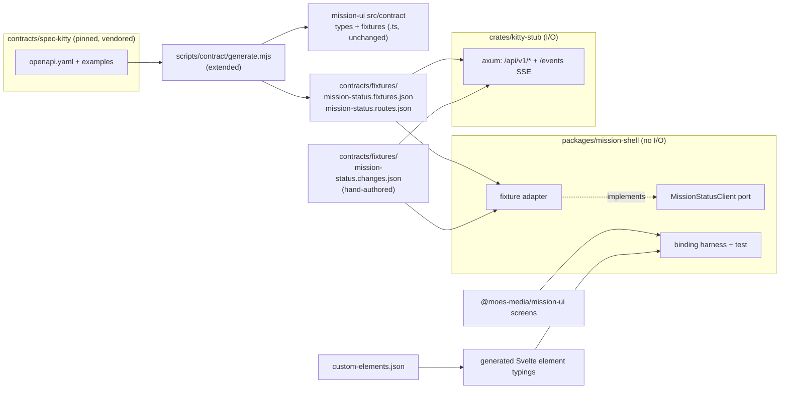

# Implementation Plan: Phase 0 bootstrap: binding check, workspace and CI, port and stub

**Branch**: `feat/phase0-bootstrap-17` | **Date**: 2026-10-13 | **Spec**: [spec.md](spec.md)
**Input**: Mission specification from `kitty-specs/phase0-bootstrap-01M4V5KK/spec.md`; issue #17; epic #16.

## Summary

This plan lays the ground for the host missions (#18 to #21). It has three parts:

1. **Binding.** A new `packages/mission-shell` (Svelte 5) hosts a real mission-ui screen. A permanent browser test proves that data arrives as values and that intents reach the shell. Element typings are generated from `custom-elements.json`, so `svelte-check` catches drift.
2. **Workspace and CI.** A Cargo workspace (`crates/kitty-core`, `crates/kitty-stub`, placeholder `apps/desktop/src-tauri` and `apps/dashboard`) joins the repository, with one new gate (`rust`). The existing gates (`typecheck`, `eslint`, `no-io`, `unit-tests`, `manifest`, `contract`) are extended to Svelte and to the shell, and every new rule gets a planted-defect proof.
3. **Data.** A transport-free client port lives in `mission-shell`, with an in-memory fixture adapter. A Rust stub serves the same data over HTTP and SSE. Both read one generated, contract-checked JSON fixture set plus a hand-authored scripted change sequence (ruling `01M4V6BWK8JXK4B8TV09MP50AB`). A scheduled, non-gate workflow reports upstream contract drift.

## Technical Context

**Language/Version**: TypeScript (strict) and Svelte 5 for the shell; Rust stable for the workspace. The exact Rust version is pinned in `rust-toolchain.toml`, and Svelte and tooling versions are pinned exactly in `package.json` (R-01). Node 22.22.2 and pnpm 11.18.0 are unchanged.
**Primary Dependencies**:
- npm: `svelte`, `@sveltejs/vite-plugin-svelte`, `svelte-check`, `eslint-plugin-svelte`, `@wc-toolkit/svelte-types`.
- Cargo: `axum`, `tokio`, `serde`, `serde_json` (stub and core); `tower` and `http-body-util` (tests only).
- Existing and reused: Vitest 4.1.11 with `@vitest/browser-playwright`, Playwright 1.62.1, openapi-typescript and Ajv (in the contract scripts).
**Storage**: none. Fixtures are committed JSON files.
**Testing**:
- Vitest browser mode (Chromium) for the binding check and shell unit tests, the same set-up as `packages/mission-ui`.
- `cargo test` for the stub. The route tests run the stub's router in-process; one smoke test binds `127.0.0.1:0`.
- Node `--test` for the generator and coverage scripts.
- The gate-proof plants prove every new rule.
**Target Platform**:
- CI: ubuntu-24.04 runners, plus the Playwright container for browser tests.
- Development: macOS and Linux.
- The stub binds `127.0.0.1` only.
**Project Type**: pnpm + Cargo monorepo (TypeScript packages, Rust crates, app placeholders).
**Performance Goals**:
- The stub answers each fixture route in under 50 ms locally.
- The `rust` gate finishes in 8 minutes or less, cold, with no cache (NFR-002).
**Constraints**: no I/O under `packages/*` (C-001); mission-ui screens untouched (C-002); pinned contract only (C-003); offline gate checks (NFR-001); exact pins (NFR-003); deterministic sequence (NFR-004).
**Scale/Scope**: 10 contract reads, 15 custom elements, about 80 vendored examples, and 1 scripted sequence of at least 3 changes.

## Charter Check

*GATE: Must pass before Phase 0 research. Re-check after Phase 1 design.*

| Charter rule | Verdict | Note |
|---|---|---|
| Screens: no I/O, data via properties, intents via `sk-*` | PASS | The shell consumes the screens unchanged (C-002). |
| Hosts: no I/O under `packages/*`; I/O only in `apps/*` and `crates/*` | PASS | The shell's fixture adapter reads imported JSON and timers, which is not I/O. The HTTP stub lives in `crates/kitty-stub`. The no-io gate is extended to `.svelte` and to the shell (FR-007). |
| Hosts read spec-kitty only through published contracts | PASS | The stub and the fixtures derive only from the pinned vendored contract. |
| Host servers bind 127.0.0.1 only | PASS | The stub binds `127.0.0.1`, and a test asserts it. The stub has no Host or Origin check: it is a test fixture, not a host server, and it is never shipped. That is recorded, not waived (R-07). |
| Quality gates: typecheck, ESLint, Stylelint, … `svelte-check`, `cargo fmt`, `clippy -D warnings`, `cargo test` | PASS | Each one is wired into an existing or new gate with a plant (IC-02, IC-03, IC-04, IC-06). |
| Elements over CSS; layout-only CSS with tokens | PASS (n/a) | The shell adds no visual CSS in this mission. The binding harness renders an existing screen only. |
| Review: separate reviewer per WP; squad after plan; operator merges | PASS | The squad record goes in `reviews/plan.squad.md`. |
| Risk boundaries: no secrets, paths or usernames in tracked files | PASS | Cargo `target/` and generated build output are gitignored, and the hygiene gate scans the new files. |
| Exact version pins | PASS | NFR-003. `rust-toolchain.toml` pins an exact version, not a channel. |

Re-checked after Phase 1 design: no new conflicts.

## Architecture



- **One source of data.** `generate.mjs` already validates the fixture set against the contract. It gains a JSON emitter, and `Gate: contract` checks that the JSON is current, exactly as it already does for the `.ts` output. Only `valid` fixtures go into the JSON. `host` and `relaxed` fixtures carry non-contract fields, so they stay TypeScript-only.
- **Routes.** `mission-status.routes.json` lists every operation in `openapi.yaml` (method, path template, operationId, success-response schema, and the default fixture name). The default fixture is the vendored example of that schema. The coverage test (FR-009) and the stub (FR-010) both read it. A route whose schema has no example gets `defaultFixture: null`, and the stub answers it with the "no example" error.
- **Change sequence.** `mission-status.changes.json` is authored by hand: an ordered list of `{ event, id?, data }` items whose `data` validates against the contract's event schemas. `Gate: contract` schema-validates it. Its order and content are fixed, so replay is byte-identical (NFR-004).
- **Port.** `MissionStatusClient` is a TypeScript interface with one async method per contract read, `subscribe(listener)` for changes, and `connection` (the state, plus a listener). A runtime `CLIENT_OPERATIONS` table maps each method to its operationId, so a test can compare the port with `routes.json`.

## Project Structure

### Documentation (this mission)

```
kitty-specs/phase0-bootstrap-01M4V5KK/
├── spec.md
├── plan.md            # this file
├── research.md
├── data-model.md
├── quickstart.md
├── contracts/
│   ├── client-port.md
│   ├── stub-http.md
│   └── fixtures-files.md
├── reviews/plan.squad.md   # after the squad
└── checklists/requirements.md
```

### Source Code (repository root)

```
Cargo.toml                         # NEW workspace: crates/*, apps/desktop/src-tauri, apps/dashboard
Cargo.lock                         # NEW, committed
rust-toolchain.toml                # NEW, exact version + rustfmt, clippy
contracts/fixtures/                # NEW, generated + authored JSON (see contracts/fixtures-files.md)
crates/
├── kitty-core/                    # NEW minimal lib (crate skeleton; real content in #19)
└── kitty-stub/                    # NEW lib + bin `kitty-stub`: axum router over contracts/fixtures
apps/
├── storybook/                     # unchanged
├── desktop/src-tauri/             # NEW placeholder bin crate, no Tauri dependency yet (#20)
└── dashboard/                     # NEW placeholder bin crate (#21)
packages/
├── mission-ui/                    # unchanged (C-002)
└── mission-shell/                 # NEW @moes-media/mission-shell
    ├── package.json               # exact pins; typecheck = svelte-check; test = vitest (browser)
    ├── svelte.config.js
    ├── vitest.config.ts
    ├── src/
    │   ├── client/port.ts         # MissionStatusClient, ConnectionState, Change, CLIENT_OPERATIONS
    │   ├── client/fixture.ts      # createFixtureClient(), reads contracts/fixtures JSON
    │   ├── generated/elements.d.ts  # generated typings (committed, staleness-checked)
    │   ├── harness/BindingHarness.svelte
    │   └── index.ts
    └── test/
        ├── binding.test.ts        # FR-001..003
        ├── port-coverage.test.ts  # FR-009
        └── fixture-client.test.ts # FR-008, FR-011, NFR-004
scripts/contract/generate.mjs      # EXTENDED: emit fixtures.json + routes.json
scripts/contract/check.mjs         # EXTENDED: staleness + change-sequence validation
scripts/contract/drift.mjs         # NEW: upstream HEAD vs PIN.json (scheduled only)
scripts/typings.mjs                # NEW: generate + --check the Svelte element typings
gates/plants/{rust,typecheck,eslint,no-io,unit-tests,manifest,contract}/  # NEW/EXTENDED plants
.github/workflows/ci.yml           # EXTENDED: Gate: rust (+ proof-leg matrix + all.needs)
.github/workflows/contract-drift.yml  # NEW scheduled, not a gate
eslint.config.mjs, eslint.no-io.config.mjs  # EXTENDED: Svelte parser, shell scope, target/ ignores
.gitignore                         # EXTENDED: target/, apps/*/src-tauri/gen
```

**Structure Decision**:
- The stub is its own crate (operator-confirmed alignment), so `kitty-core` carries no server dependencies.
- The desktop placeholder uses Tauri's `src-tauri` layout now, so #20 adds Tauri without moving anything.

## Complexity Tracking

| Violation | Why Needed | Simpler Alternative Rejected Because |
|-----------|------------|-------------------------------------|
| A new `rust` gate (a 13th gate) | Rust format, lint and tests must judge every PR (FR-006). | Folding cargo into an existing gate would mix toolchains in one proof leg and break the one-gate-one-concern rule that `gate-proof.mjs coverage` enforces. |

## Implementation Concern Map

### IC-01 — Shared fixture and change-sequence files

- **Purpose**: one contract-checked data source that both the TypeScript fixture adapter and the Rust stub read.
- **Relevant requirements**: FR-010, FR-011, C-003, NFR-004.
- **Affected surfaces**:
  - `scripts/contract/generate.mjs` and `check.mjs` (and their tests);
  - `contracts/fixtures/mission-status.{fixtures,routes,changes}.json`;
  - `gates/plants/contract/`;
  - `package.json` scripts.
- **Sequencing/depends-on**: none.
- **Risks**:
  - The routes list must come from `openapi.yaml` paths and operationIds, not from the fixture registry (R-03).
  - The authored sequence must chain plausibly (one mission id, increasing cursors). The vendored event examples do not.

### IC-02 — Rust workspace and `Gate: rust`

- **Purpose**: a Cargo workspace that builds from a clean checkout and is judged on every PR.
- **Relevant requirements**: FR-005, FR-006, NFR-001, NFR-002, NFR-003.
- **Affected surfaces**:
  - `Cargo.toml`, `Cargo.lock`, `rust-toolchain.toml`;
  - `crates/kitty-core`, and the placeholder members in `apps/`;
  - `.github/workflows/ci.yml` (the gate job, the proof-leg entry, `all.needs`);
  - `gates/plants/rust/` (three plants: format, clippy, test);
  - `.gitignore`.
- **Sequencing/depends-on**: none.
- **Risks**:
  - Cold build time (R-02).
  - `checkWorkflow` and `coverage` must accept the new gate.
  - The proof leg needs the toolchain on the runner (rustup is preinstalled on ubuntu-24.04).

### IC-03 — `mission-shell` package and Svelte tooling in the gates

- **Purpose**: the shell package exists, type-checks with `svelte-check`, lints, and falls under no-io.
- **Relevant requirements**: FR-005, FR-006, FR-007, C-001.
- **Affected surfaces**:
  - `packages/mission-shell/{package.json, svelte.config.js, vitest.config.ts, src/index.ts}`;
  - `eslint.config.mjs` and `eslint.no-io.config.mjs` (Svelte parser);
  - `gates/plants/{typecheck,eslint,no-io}/` (new entries);
  - `pnpm-lock.yaml`.
- **Sequencing/depends-on**: none.
- **Risks**:
  - The no-io rule set must apply inside `<script>` blocks of `.svelte` files (R-04).
  - The data-driven gate scope (`packages/*/src`) also catches the shell. The harness must not hard-code lane or phase words.

### IC-04 — Element typings from `custom-elements.json`

- **Purpose**: shell code is type-checked against every screen's declared properties and events.
- **Relevant requirements**: FR-004.
- **Affected surfaces**:
  - `scripts/typings.mjs`;
  - `packages/mission-shell/src/generated/elements.d.ts`;
  - the `manifest:check` script;
  - `gates/plants/manifest/` (stale typings);
  - `gates/plants/typecheck/` (a non-existent property).
- **Sequencing/depends-on**: IC-03.
- **Risks**:
  - Event detail types must be imported from `@moes-media/mission-ui`, not emitted as text (R-05).
  - Elements missing from `HTMLElementTagNameMap` must still get typings.

### IC-05 — Client port and fixture adapter

- **Purpose**: the transport-free `MissionStatusClient` port and its in-memory fixture implementation.
- **Relevant requirements**: FR-008, FR-009, FR-011, NFR-004.
- **Affected surfaces**:
  - `packages/mission-shell/src/client/{port,fixture}.ts`;
  - `test/port-coverage.test.ts` and `test/fixture-client.test.ts`.
- **Sequencing/depends-on**: IC-01, IC-03.
- **Risks**:
  - Timers in the fixture adapter must be injectable, so tests are deterministic.
  - The connection-state values are a closed set (exactly four).

### IC-06 — Permanent binding check

- **Purpose**: prove on a real screen, on every PR, that data reaches screens as values and that intents reach the shell.
- **Relevant requirements**: FR-001, FR-002, FR-003, SC-001.
- **Affected surfaces**:
  - `packages/mission-shell/src/harness/BindingHarness.svelte` and `test/binding.test.ts`;
  - `gates/plants/unit-tests/` (a planted binding break);
  - the root `pnpm test` (it must include the shell).
- **Sequencing/depends-on**: IC-03, IC-04, IC-05 (the harness feeds fixture data).
- **Risks**:
  - Registration order: the harness must import `@moes-media/mission-ui` before mount, and a test covers it.
  - Svelte 5 handles hyphenated `on…` attributes (R-06).

### IC-07 — Scheduled upstream drift alert

- **Purpose**: tell the operator when the upstream contract moves away from `PIN.json`, without touching merge gates.
- **Relevant requirements**: FR-012, NFR-001.
- **Affected surfaces**:
  - `scripts/contract/drift.mjs` (and its test);
  - `.github/workflows/contract-drift.yml`;
  - `package.json` script `contract:drift`.
- **Sequencing/depends-on**: none.
- **Risks**:
  - The hygiene `checkWorkflow` rules apply to the new workflow file: SHA pins, no job named "Gate:", and the same trigger rules.
  - "Unreachable" must be distinct from "no drift".

### IC-08 — Stub crate

- **Purpose**: a loopback HTTP and SSE stub that serves every route's default fixture and plays the scripted sequence.
- **Relevant requirements**: FR-010, FR-011, NFR-004.
- **Affected surfaces**: `crates/kitty-stub/{src/lib.rs, src/main.rs, tests/}`.
- **Sequencing/depends-on**: IC-01, IC-02.
- **Risks**:
  - The SSE framing must match the contract (`event:`, `id:`, `data:`, blank line). Unscoped streams carry no `id:`.
  - The stub reads the JSON from a path, so tests point it at the repository copy.

### IC-09 — Documentation and wrap-up

- **Purpose**: the README (workspace prerequisites: Rust toolchain, the stub, the shell), the CHANGELOG, and the issue-matrix rows.
- **Relevant requirements**: SC-004, NFR-005.
- **Affected surfaces**: `README.md`, `CHANGELOG.md`, `packages/mission-shell/README.md`.
- **Sequencing/depends-on**: all.
- **Risks**: none beyond hygiene (no local paths).

## Gates

The aggregate `Gate: all` must be green. Gates touched:

| Gate | Change | New plants |
|---|---|---|
| `rust` (new) | `cargo fmt --check && cargo clippy --workspace --all-targets -- -D warnings && cargo test --workspace` | format, clippy, test |
| `typecheck` | `svelte-check` through the `mission-shell` typecheck script | Svelte type error; use of a non-existent element property |
| `eslint` | Svelte parser and config | Svelte lint violation |
| `no-io` | scope includes `packages/mission-shell/src/**/*.{ts,svelte}` | `fetch` in a `.svelte` script block |
| `unit-tests` | includes `mission-shell` tests (binding, coverage, fixture client) | binding break (data passed as an attribute) |
| `manifest` | typings staleness check | stale typings |
| `contract` | fixtures/routes JSON staleness + change-sequence validation | stale JSON; invalid change item |

That is 11 new plants. SC-002's six named proofs are a subset: Rust format, Rust lint, Rust tests, the Svelte check, the typings and no-io over the shell.

## PR shape

One PR from `feat/phase0-bootstrap-17` into `main`. Each WP is reviewed by a separate reviewer agent, and the pre-merge R1–R3 squad runs before the PR is handed to the operator. The operator merges.

## Traceability

| Requirement | IC |
|---|---|
| FR-001, FR-002, FR-003 | IC-06 |
| FR-004 | IC-04 |
| FR-005 | IC-02, IC-03 |
| FR-006 | IC-02, IC-03, IC-04 |
| FR-007 | IC-03 |
| FR-008, FR-009 | IC-05 |
| FR-010 | IC-01, IC-08 |
| FR-011 | IC-01, IC-05, IC-08 |
| FR-012 | IC-07 |
| NFR-001 | IC-02, IC-07 |
| NFR-002 | IC-02 |
| NFR-003 | IC-02, IC-03 |
| NFR-004 | IC-01, IC-05, IC-08 |
| NFR-005 | all |
| C-001 | IC-03, IC-05 |
| C-002 | IC-06 |
| C-003 | IC-01 |
| C-004 | IC-02, IC-09 |
| C-005, C-006 | scope (no IC) |
