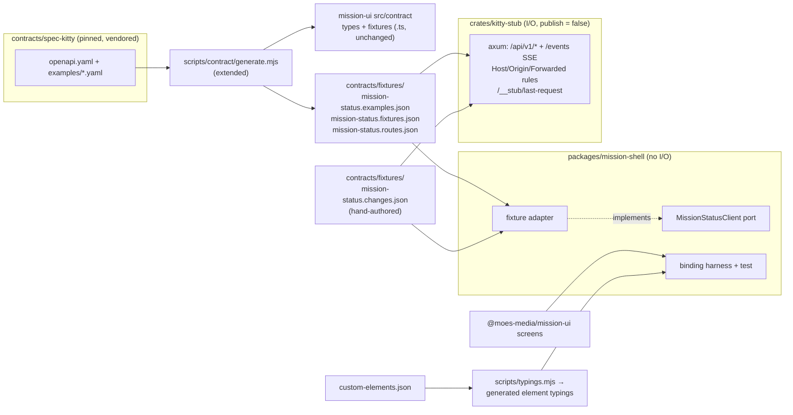

# Implementation Plan: Phase 0 bootstrap: binding check, workspace and CI, port and stub

**Branch**: `feat/phase0-bootstrap-17` | **Date**: 2026-10-13 | **Spec**: [spec.md](spec.md)
**Input**: Mission specification from `kitty-specs/phase0-bootstrap-01M4V5KK/spec.md`; issue #17; epic #16.
**Revision**: fix round 1 of the plan-phase squad applied (`reviews/plan.squad.md`, F-01 to F-48).

## Summary

This plan lays the ground for the host missions (#18 to #21). It has three parts:

1. **Binding.** A new `packages/mission-shell` (Svelte 5) hosts a real mission-ui screen. A permanent browser test proves three things: object and primitive data arrive as properties, registration happens before mount, and every declared intent reaches the shell. A repository-owned generator turns `custom-elements.json` into element typings, so `svelte-check` catches a renamed property or event.
2. **Workspace and CI.** A Cargo workspace (`crates/kitty-core`, `crates/kitty-stub`, placeholder `apps/desktop/src-tauri` and `apps/dashboard`) joins the repository, with one new gate (`rust`). The existing gates (`typecheck`, `eslint`, `no-io`, `unit-tests`, `manifest`, `contract`, `hygiene`) are extended to Svelte, Rust pins, all workflow files and the shell, and every new rule gets a planted-defect proof.
3. **Data.** A transport-free client port lives in `mission-shell`, with an in-memory fixture adapter. A Rust stub serves the same data over HTTP and SSE, applying the same loopback, Host, Origin and forwarding-header rules as the upstream service. Both read one generated, contract-checked JSON set (all vendored examples, the valid fixtures and the routes) plus a hand-authored scripted change sequence (ruling `01M4V6BWK8JXK4B8TV09MP50AB`). A scheduled workflow, with no secrets and not a gate, reports upstream contract drift.

## Technical Context

**Language/Version**: TypeScript (strict) and Svelte 5 for the shell; Rust stable for the workspace.
- The exact Rust version is pinned in `rust-toolchain.toml`.
- npm versions are pinned exactly in `package.json`.
- Cargo versions are pinned exactly (`=x.y.z`) in `[workspace.dependencies]` (R-01).
- Node 22.22.2 and pnpm 11.18.0 are unchanged.

**Primary Dependencies**:
- npm: `svelte`, `@sveltejs/vite-plugin-svelte` (the line whose peer range the pinned vite 7.3.6 satisfies), `svelte-check`, `eslint-plugin-svelte`, `svelte-eslint-parser`. There is no typings-generator dependency: `scripts/typings.mjs` is our own (R-05).
- Cargo: `axum`, `tokio`, `serde`, `serde_json` (with `preserve_order`) for the stub and core; `tower` and `http-body-util` for tests only.
- Existing and reused: Vitest 4.1.11 with `@vitest/browser-playwright`, Playwright 1.62.1, openapi-typescript, `yaml` and Ajv (in the contract scripts).

**Storage**: none. Fixtures and examples are committed JSON files.

**Testing**:
- Vitest browser mode (Chromium) for the binding check and shell unit tests, the same set-up as `packages/mission-ui`.
- `cargo test` for the stub and the workspace check. Route tests run the router in-process. The loopback test runs the real binary (`CARGO_BIN_EXE_kitty-stub`).
- Node `--test` for the scripts: `test:contract` picks up `scripts/contract/*.test.mjs` by glob, and `typings.test.mjs` and `cargo-pins.test.mjs` are added to the `test:scripts` list.
- The gate-proof plants prove every new rule.

**Target Platform**:
- CI: ubuntu-24.04 runners (rustup preinstalled), plus the Playwright container for browser tests.
- Development: macOS and Linux.
- The stub binds `127.0.0.1` only.

**Project Type**: pnpm + Cargo monorepo (TypeScript packages, Rust crates, app placeholders).

**Performance Goals**:
- The stub answers each route in under 50 ms locally.
- The `rust` gate step finishes in 8 minutes or less with no build cache, after separate toolchain and fetch steps (NFR-002).

**Constraints**: no I/O under `packages/*` (C-001); mission-ui untouched (C-002, SC-005); pinned contract only (C-003); offline gate checks (NFR-001); exact pins (NFR-003); deterministic sequence (NFR-004).

**Scale/Scope**: 9 contract reads plus `streamEvents` (10 operations), 15 custom elements, about 78 vendored examples, and 1 scripted sequence of at least 3 changes.

## Charter Check

*GATE: Must pass before Phase 0 research. Re-check after Phase 1 design.*

| Charter rule | Verdict | Note |
|---|---|---|
| Screens: no I/O, data via properties, intents via `sk-*` | PASS | The shell consumes the screens unchanged. The shell imports the contract types by deep path, so mission-ui gets no `exports` change (C-002, SC-005). |
| Hosts: no I/O under `packages/*`; I/O only in `apps/*` and `crates/*` | PASS | The shell's fixture adapter reads imported JSON and injectable timers, which is not I/O. The HTTP stub lives in `crates/kitty-stub`. The no-io gate is extended to `.svelte` and the shell (FR-007). |
| Hosts read spec-kitty only through published contracts | PASS | The stub, examples and fixtures derive only from the pinned vendored contract. |
| Host servers bind 127.0.0.1 only and enforce their own Host and Origin checks | PASS | The stub has no exemption. It binds `127.0.0.1` (proved against the real binary), accepts only Host `127.0.0.1:<port>` or `localhost:<port>`, accepts Origin only when absent or same-origin, and refuses `Forwarded` and `X-Forwarded-*` with 403, mirroring the upstream service. It also has `publish = false` (R-07). |
| Quality gates: typecheck, ESLint, Stylelint, … `svelte-check`, `cargo fmt`, `clippy -D warnings`, `cargo test` | PASS | Each one is wired into an existing or new gate with a plant (see Gates). |
| Elements over CSS; layout-only CSS with tokens | PASS (n/a) | No visual CSS in this mission. The harness renders an existing screen. |
| Review: separate reviewer per WP; squad after plan; operator merges | PASS | This squad is recorded in `reviews/plan.squad.md`. A pre-merge squad follows prior-mission practice (F-47). |
| Risk boundaries: no secrets, paths or usernames in tracked files | PASS | `target/` and `apps/*/src-tauri/gen` are gitignored, and the hygiene gate scans the new files. The drift workflow uses no secrets. |
| Exact version pins | PASS | NFR-003: npm (existing rule), Cargo (new `cargo-pins` hygiene check), toolchain (`rust-toolchain.toml`). |
| Exceptions are documented in the PR | PASS | One recorded exception: the exact-path lint ignore for the generated `elements.d.ts`, in the style of E-05 (F-45). |

Re-checked after Phase 1 design and after fix round 1: no new conflicts.

## Architecture



- **One shared source of data.**
  - `generate.mjs` gains a JSON emitter. It writes three files (see `contracts/fixtures-files.md`):
    - `examples.json`: every vendored example, keyed `<Schema>.<name>` and read straight from the YAML with no overlays;
    - `fixtures.json`: the registry's `valid` fixtures;
    - `routes.json`.
  - `Gate: contract` checks all three are current. It also checks `examples.json` against a fresh, independent parse of the YAML files, which gives the stub test an oracle that is not the file the stub serves (F-04).
  - The emitter escapes invisible and bidi characters exactly as the `.ts` emitter does (F-21).
- **Routes.** `routes.json` is derived from the `paths:` of `openapi.yaml`.
  - Each read names an explicit `defaultExample`, taken from a reviewed `DEFAULT_EXAMPLES` map in the generator (schema → example name).
  - A schema without a map entry fails generation unless the map marks it `null`. Then the stub answers that route with the "no example" error.
- **Change sequence.** `changes.json` is authored by hand and schema-validated by `Gate: contract`. It never changes at runtime, so replay is deterministic (NFR-004).
- **Port.** `MissionStatusClient` is a TypeScript interface with:
  - one method per read, taking the operation's path and query parameters from the generated `operations` types;
  - `subscribe(listener, scope?)` for `streamEvents`;
  - `connection` (the state, plus a listener).

  A runtime `CLIENT_OPERATIONS` table maps each method to its operationId. It is typed as a mapped type over the interface's keys with `satisfies`, so the table cannot drift from the interface (F-03).

## Project Structure

### Documentation (this mission)

```
kitty-specs/phase0-bootstrap-01M4V5KK/
├── spec.md
├── plan.md            # this file
├── research.md
├── data-model.md
├── quickstart.md
├── contracts/
│   ├── client-port.md
│   ├── stub-http.md
│   └── fixtures-files.md
├── reviews/plan.squad.md
└── checklists/requirements.md
```

### Source Code (repository root)

```
Cargo.toml                         # NEW workspace: crates/*, apps/desktop/src-tauri, apps/dashboard; [workspace.dependencies] with =x.y.z
Cargo.lock                         # NEW, committed
rust-toolchain.toml                # NEW, exact version + rustfmt, clippy
contracts/fixtures/                # NEW, generated + authored JSON (see contracts/fixtures-files.md)
crates/
├── kitty-core/                    # NEW minimal lib (skeleton; real content in #19); tests/workspace.rs (member check)
└── kitty-stub/                    # NEW lib + bin `kitty-stub`, publish = false
apps/
├── storybook/                     # unchanged
├── desktop/src-tauri/             # NEW placeholder bin crate, no Tauri dependency yet (#20)
└── dashboard/                     # NEW placeholder bin crate (#21)
packages/
├── mission-ui/                    # unchanged (C-002, SC-005)
└── mission-shell/                 # NEW @moes-media/mission-shell
    ├── package.json               # exact pins; typecheck = svelte-check; test = vitest (browser)
    ├── tsconfig.json              # extends ../../tsconfig.base.json (decorator settings needed for Lit sources)
    ├── svelte.config.js
    ├── vitest.config.ts
    ├── src/
    │   ├── client/port.ts         # MissionStatusClient, ConnectionState, Change, Result, CLIENT_OPERATIONS
    │   ├── client/fixture.ts      # createFixtureClient(), reads contracts/fixtures JSON
    │   ├── generated/elements.d.ts  # generated typings (committed, staleness-checked, exact-path lint exception)
    │   ├── harness/BindingHarness.svelte
    │   └── index.ts
    └── test/
        ├── binding.test.ts        # FR-001..003, SC-001
        ├── port-coverage.test.ts  # FR-009
        └── fixture-client.test.ts # FR-008, FR-011, NFR-004
scripts/contract/generate.mjs      # EXTENDED: emit examples/fixtures/routes JSON; DEFAULT_EXAMPLES map
scripts/contract/check.mjs         # EXTENDED: staleness, examples-vs-YAML oracle, change-sequence validation
scripts/contract/common.mjs        # EXTENDED: shared compare-with-pin function (builtin-only imports)
scripts/contract/verify-remote.mjs # REFACTORED to use the shared compare function
scripts/contract/drift.mjs         # NEW: upstream HEAD vs PIN.json (scheduled only; builtin-only imports)
scripts/typings.mjs                # NEW: own generator + --check
scripts/cargo-pins.mjs             # NEW: exact-pin check over Cargo.toml files (run by hygiene)
scripts/check-hygiene.mjs          # EXTENDED: action-pin/permissions/checkout-credential checks on every workflow
scripts/terminology.mjs            # EXTENDED: .svelte sources and crates/**/*.rs
gates/plants/{rust,typecheck,eslint,no-io,unit-tests,manifest,contract,hygiene}/  # NEW/EXTENDED plants
.github/workflows/ci.yml           # EXTENDED: Gate: rust (+ fetch steps, proof-leg matrix + steps, all.needs), timeouts
.github/workflows/contract-drift.yml  # NEW scheduled + workflow_dispatch, not a gate, no install, no secrets
eslint.config.mjs, eslint.no-io.config.mjs  # EXTENDED: Svelte parser, shell scope, target/ ignores
.gitignore                         # EXTENDED: target/, apps/*/src-tauri/gen
```

**Structure Decision**:
- The stub is its own crate (decision `01M4V7AC1A0KJFNQ2JS347XEGS`), so `kitty-core` carries no server dependencies.
- The desktop placeholder uses Tauri's `src-tauri` layout now, so #20 adds Tauri without moving anything.

## Complexity Tracking

| Violation | Why Needed | Simpler Alternative Rejected Because |
|-----------|------------|-------------------------------------|
| A new `rust` gate (a 13th gate) | Rust format, lint and tests must judge every PR (FR-006). | Folding cargo into an existing gate would mix toolchains in one proof leg and break the one-gate-one-concern rule that `gate-proof.mjs coverage` enforces. |

## Implementation Concern Map

### IC-01 — Shared examples, fixture, route and change-sequence files

- **Purpose**: one contract-checked data source that both the TypeScript fixture adapter and the Rust stub read.
- **Relevant requirements**: FR-010, FR-011, C-003, NFR-004.
- **Affected surfaces**:
  - `scripts/contract/generate.mjs` (JSON emitter, `DEFAULT_EXAMPLES`, escaping) and `check.mjs` (staleness, the examples-vs-YAML oracle, sequence validation), with their tests;
  - `contracts/fixtures/mission-status.{examples,fixtures,routes,changes}.json`;
  - `gates/plants/contract/`.
- **Sequencing/depends-on**: none.
- **Risks**:
  - The routes come from `openapi.yaml` paths and operationIds, not the fixture registry (R-03).
  - The authored sequence must chain (one mission id, increasing cursors). The vendored event examples do not.
  - The JSON emitter must escape U+FEFF, U+202E and the other invisible characters the `.ts` emitter escapes.

### IC-02 — Rust workspace and `Gate: rust`

- **Purpose**: a Cargo workspace that builds from a clean checkout and is judged on every PR.
- **Relevant requirements**: FR-005, FR-006, NFR-001, NFR-002, NFR-003.
- **Affected surfaces**:
  - `Cargo.toml`, `Cargo.lock`, `rust-toolchain.toml`;
  - `crates/kitty-core` (with `tests/workspace.rs`, which uses `cargo metadata --frozen --no-deps` to assert the four members), and the placeholder members in `apps/`;
  - `scripts/cargo-pins.mjs` and its test;
  - `gates/plants/rust/`.
- **Sequencing/depends-on**: none.
- **Risks**:
  - Cold build time (R-02).
  - Rust plants must be anchored `edits` to compiled files, or `tests/plant_*.rs`. An unreachable `.rs` file would make a plant vacuous (F-20).
  - The proof leg needs the same `rustup show` and `cargo fetch --locked` steps.

### IC-03 — `mission-shell` package and Svelte tooling in the gates

- **Purpose**: the shell package exists, type-checks with `svelte-check`, lints, falls under no-io, and is scanned by the terminology rule.
- **Relevant requirements**: FR-005, FR-006, FR-007, C-001.
- **Affected surfaces**:
  - `packages/mission-shell/{package.json, tsconfig.json, svelte.config.js, vitest.config.ts, src/index.ts}`;
  - `eslint.config.mjs`, `eslint.no-io.config.mjs`;
  - `scripts/terminology.mjs`;
  - `gates/plants/{typecheck,eslint,no-io}/`.
- **Sequencing/depends-on**: none.
- **Risks**:
  - The no-io rules must apply inside `.svelte` `<script>` blocks. The plant's `expectFailPattern` matches the no-io rule message, not the file name, so a parse error cannot satisfy it (F-19).
  - The data-driven scope (`packages/*/src`) also catches the shell, so the harness must not hard-code lane or phase words.

### IC-04 — Element typings from `custom-elements.json`

- **Purpose**: shell code is type-checked against every screen's declared properties and events.
- **Relevant requirements**: FR-004.
- **Affected surfaces**:
  - `scripts/typings.mjs` and `typings.test.mjs`;
  - `packages/mission-shell/src/generated/elements.d.ts`;
  - the `manifest:check` script;
  - `gates/plants/manifest/` (stale typings);
  - `gates/plants/typecheck/` (a non-existent property; a renamed event handler).
- **Sequencing/depends-on**: IC-03.
- **Risks**:
  - Event detail types are imported from `@moes-media/mission-ui`.
  - The WP first proves whether svelte-check rejects an unknown hyphenated `on…` attribute. If it does not, the generator also emits a typed `intents` action keyed by each element's manifest events, and the harness binds intents through it, so the renamed-event plant fails either way (F-02).
  - The generated file gets an exact-path lint exception, recorded in the PR (F-45).

### IC-05 — Client port and fixture adapter

- **Purpose**: the transport-free `MissionStatusClient` port and its in-memory fixture implementation.
- **Relevant requirements**: FR-008, FR-009, FR-011, NFR-004.
- **Affected surfaces**:
  - `packages/mission-shell/src/client/{port,fixture}.ts`;
  - `test/port-coverage.test.ts` and `test/fixture-client.test.ts`;
  - `gates/plants/unit-tests/` (coverage plant: delete one `CLIENT_OPERATIONS` entry together with its interface method).
- **Sequencing/depends-on**: IC-01, IC-03.
- **Risks**:
  - Timers in the fixture adapter must be injectable.
  - The connection-state strings are exactly the spec's four (with the space after `degraded:`).
  - Method parameters come from the generated `operations` types, so the port does not change when #19 to #21 use more parameters (F-25).

### IC-06 — Permanent binding check

- **Purpose**: prove on a real screen, on every PR, that data reaches screens as properties and that every declared intent reaches the shell.
- **Relevant requirements**: FR-001, FR-002, FR-003, SC-001.
- **Affected surfaces**:
  - `packages/mission-shell/src/harness/BindingHarness.svelte` and `test/binding.test.ts`;
  - `gates/plants/unit-tests/` (the registration-order plant; the intent-path plant).
- **Sequencing/depends-on**: IC-03, IC-04, IC-05.
- **Risks**:
  - Svelte sets objects as properties even before registration. So the test also asserts that primitives (a boolean `false`, the `status` string) arrive as properties. The registration-order plant mounts before the side-effect import, so the boolean arrives as the attribute `"false"` and the test fails (F-01).
  - The test enumerates every event the hosted screen declares in `custom-elements.json` and requires each to reach its handler. One is triggered through real UI, the others are dispatched from the element (F-11).

### IC-07 — Scheduled upstream drift alert and workflow hygiene

- **Purpose**: tell the operator when the upstream contract moves away from `PIN.json`, without touching merge gates, and check every workflow file's pins and permissions.
- **Relevant requirements**: FR-012, NFR-001, NFR-002.
- **Affected surfaces**:
  - `scripts/contract/common.mjs` (the shared compare-with-pin function, builtin-only imports), `verify-remote.mjs` (refactored onto it), `drift.mjs` and `drift.test.mjs` (injectable fetcher; offline cases for no-drift, drift, unreachable and error);
  - `.github/workflows/contract-drift.yml`;
  - `scripts/check-hygiene.mjs` (action-pin, permissions and checkout-credential checks on every workflow; gate-structure checks stay `ci.yml`-only);
  - `gates/plants/hygiene/` (an unpinned action in a non-ci workflow);
  - `package.json` script `contract:drift`.
- **Sequencing/depends-on**: none.
- **Risks**:
  - `drift.mjs` must import only Node built-ins, so the workflow runs `node scripts/contract/drift.mjs` with no install and no secrets. The WP verifies the import graph (F-41).
  - Exit codes: 0 in sync, 1 drift, 2 unreachable, 3 other error.
  - The workflow has `permissions: contents: read` and `persist-credentials: false`, interpolates no upstream data into `run:`, writes the summary through a file, and fails (red) on exit 1 to 3, so GitHub notifies.
  - Scheduled workflows in public repositories are disabled after 60 days without activity; the README documents this (F-39).

### IC-08 — Stub crate

- **Purpose**: a loopback HTTP and SSE stub that serves every vendored example and fixture and plays the scripted sequence, with upstream-equivalent request rules.
- **Relevant requirements**: FR-010, FR-011, NFR-004.
- **Affected surfaces**: `crates/kitty-stub/{Cargo.toml (publish = false), src/lib.rs, src/main.rs, tests/}`.
- **Sequencing/depends-on**: IC-01, IC-02.
- **Risks**:
  - The SSE framing must match the contract (`event:`, `id:`, `data:`, blank line). Unscoped streams carry no `id:`.
  - The heartbeat interval and time scale are injectable for tests.
  - No request value is ever used to build a filesystem path; a test sends a `../` traversal.
  - The loopback test runs the real binary.
  - The 501 "no example" branch is tested with a synthetic routes file.
  - The comparison oracle is `examples.json`, which the contract gate verified against the YAML. Equality is JSON-value equality.

### IC-09 — Documentation and wrap-up

- **Purpose**: the README (prerequisites: rustup and the pinned toolchain, the stub, the shell, the drift workflow and its 60-day rule), the CHANGELOG, the issue-matrix rows, the PR's exception record, and the SC-005 probe.
- **Relevant requirements**: SC-004, SC-005, NFR-005, spec edge case 5.
- **Affected surfaces**: `README.md`, `CHANGELOG.md`, `packages/mission-shell/README.md`.
- **Sequencing/depends-on**: all.
- **Risks**: the wrap-up runs `git diff --exit-code origin/main -- packages/mission-ui` and records the result. The reviewer repeats it (F-14).

## Shared-file ownership

Each shared file has exactly one owning IC. Other ICs request their changes through the owner's WP (or land after it, rebased on it).

| File | Owner | Requested by |
|---|---|---|
| root `package.json` (scripts, devDependencies, `test:scripts` list) | IC-03 | IC-01, IC-02 (`cargo-pins`), IC-04, IC-05, IC-06, IC-07 |
| `pnpm-lock.yaml` | IC-03 | IC-04 (none expected after F-30) |
| `.github/workflows/ci.yml` (all jobs, proof-leg matrix and steps, timeouts, `all.needs`) | IC-02 | IC-03, IC-06 (timeouts) |
| `eslint.config.mjs`, `eslint.no-io.config.mjs` | IC-03 | IC-04 (generated-file ignore) |
| `scripts/check-hygiene.mjs` | IC-07 | IC-02 (`cargo-pins` hook) |
| `gates/plants/rust/plant.json` | IC-02 | — |
| `gates/plants/typecheck/plant.json` | IC-03 | IC-04 |
| `gates/plants/eslint/plant.json`, `gates/plants/no-io/plant.json` | IC-03 | — |
| `gates/plants/unit-tests/plant.json` | IC-06 | IC-05 |
| `gates/plants/manifest/plant.json` | IC-04 | — |
| `gates/plants/contract/plant.json` | IC-01 | — |
| `gates/plants/hygiene/plant.json` | IC-07 | IC-02 |
| `.gitignore` | IC-02 | IC-03 |
| `README.md`, `CHANGELOG.md` | IC-09 | all |

## Gates

The aggregate `Gate: all` must be green.

The canonical `rust` gate command is used identically in `ci.yml`, `gates/plants/rust/plant.json`, research R-02 and the quickstart:

```
cargo fmt --all --check && cargo clippy --workspace --all-targets --frozen -- -D warnings && cargo test --workspace --frozen
```

It is preceded by two separate steps, in both the gate job and the proof leg when `matrix.gate == 'rust'`: `rustup show` (installs the pinned toolchain) and `cargo fetch --locked`. The gate step itself therefore downloads nothing (NFR-001).

| Gate | Change | New plants |
|---|---|---|
| `rust` (new) | the canonical command above | format; clippy; failing test (anchored edits or `tests/plant_*.rs`) |
| `typecheck` | `svelte-check` through the `mission-shell` typecheck script | Svelte type error; a non-existent element property; a renamed intent handler |
| `eslint` | Svelte parser and config | Svelte lint violation |
| `no-io` | scope includes `packages/mission-shell/src/**/*.{ts,svelte}` | `fetch` in a `.svelte` script block (pattern = the rule message) |
| `unit-tests` | includes `mission-shell` tests (binding, coverage, fixture client) | registration order (mount before import); intent-path break; a `CLIENT_OPERATIONS` entry deleted with its method |
| `manifest` | typings staleness check | stale typings |
| `contract` | examples/fixtures/routes staleness, the examples-vs-YAML oracle, change-sequence validation | stale JSON; invalid change item |
| `hygiene` | `cargo-pins`; workflow pin, permissions and credential checks on every workflow | a caret range in a Cargo.toml; an unpinned action in a non-ci workflow |

That is 17 new plants. SC-002's six named proofs are a subset: Rust format, Rust lint, Rust tests, the Svelte check, the typings, and no-io over the shell.

**Proof-leg timeouts (F-42)**: every plant is a full gate run, so the WP measures each affected proof leg on CI and sets its matrix timeout to (1 + number of plants) × the measured gate time + 2 minutes. The starting values are contract 6→10 and unit-tests 11→16, with `rust` computed from its first measured run. The measurements are recorded in the WP.

## PR shape

One PR from `feat/phase0-bootstrap-17` into `main`. Each WP is reviewed by a separate reviewer agent, and the pre-merge R1–R3 squad runs before the PR is handed to the operator. The operator merges. The PR records the exact-path lint exception (F-45) and links the follow-up issue for a repository-wide `minimumReleaseAge` (F-29).

## Traceability

| Requirement | IC |
|---|---|
| FR-001, FR-002, FR-003 | IC-06 |
| FR-004 | IC-04 |
| FR-005 | IC-02, IC-03 |
| FR-006 | IC-02, IC-03, IC-04, IC-07 |
| FR-007 | IC-03 |
| FR-008, FR-009 | IC-05 |
| FR-010 | IC-01, IC-08 |
| FR-011 | IC-01, IC-05, IC-08 |
| FR-012 | IC-07 |
| NFR-001 | IC-02, IC-07 |
| NFR-002 | IC-02, IC-07 |
| NFR-003 | IC-02, IC-03 |
| NFR-004 | IC-01, IC-05, IC-08 |
| NFR-005 | all |
| C-001 | IC-03, IC-05 |
| C-002 | IC-06, IC-09 |
| C-003 | IC-01 |
| C-004 | IC-02, IC-07, IC-09 |
| C-005, C-006 | scope (no IC) |
| SC-001 | IC-06 |
| SC-002 | IC-02, IC-03, IC-04 |
| SC-003 | IC-01, IC-05, IC-08 |
| SC-004 | IC-05, IC-09 |
| SC-005 | IC-09 |
| Edge case 5 (toolchain) | IC-09 |
