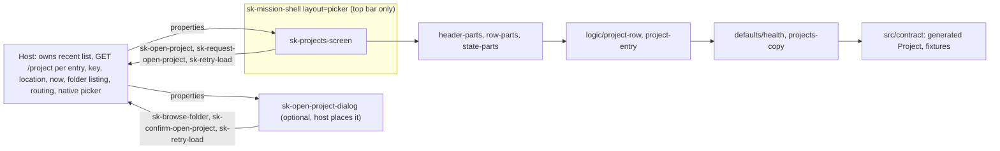
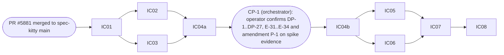

# Implementation Plan: Projects screen

**Branch**: `feat/projects-screen-9` (current branch, planning base and merge target) | **Date**: 2026-10-08 | **Spec**: `kitty-specs/projects-screen-01M4C939/spec.md`
**Input**: the specification with the operator's rulings Q1 to Q10 (2026-10-08), GitHub issue spec-kitty/spec-kitty-mission-ui#9, the Mission Status contract `GET /project` in the final, unmerged slice (spec-kitty PR #5881), the approved Kitty Desktop V2 prototype page `01-projects.html`, and the code on `main` (`ad94164`: #4 and #5 merged; #7 not yet).

## Summary

Add TWO public elements to `@spec-kitty/mission-ui`: `sk-projects-screen` (5 properties, 3 events) and the optional `sk-open-project-dialog` (5 properties, 3 events), plus ONE additive value on the shell's existing `layout` property (`picker`: top bar only, no sidebar, no rail, no hamburger). Both elements take contract-shaped and host-built data as properties, emit `sk-*` verb-noun events, read-only, no I/O. The contract is re-vendored once, first (IC-01), after spec-kitty PR #5881 has merged; the Drift and Ops missions start from `main` after that. Everything else reuses #4 and #5: `defaults/`, `logic/`, `lookup`, `relativeTime`, `missionCountText`, `ViewState`, `shellFrame`, the gates, the exception mechanism, the visual harness tags.

## Technical Context

**Language/Version**: TypeScript 5.9 strict (`exactOptionalPropertyTypes`, `noUncheckedIndexedAccess`), Lit 3.3.3, Node 22.22.2, pnpm 11.18.0, all as #4 and #5
**Primary Dependencies**: `@spec-kitty/elements` 1.1.0-rc.10 (`sk-page-header`, `sk-pill-tag`, `sk-button`, `sk-notice`, `sk-form-input`, `sk-empty-state` family if the adopted sheet exists) and `@spec-kitty/styles`; NO new dependency
**Storage**: N/A (no I/O)
**Testing**: Vitest browser mode (`page.viewport` first), `node:test` for contract tooling, vitest node env for the data-driven self-test, Storybook stories, Playwright visual spec in the pinned container
**Target Platform**: evergreen browsers and the Kitty Desktop webview; the screen renders as the shell's default slot with `layout="picker"`
**Project Type**: pnpm workspace as #4: `packages/mission-ui`, `apps/storybook`, root `contracts/` and `scripts/`
**Performance Goals**: 50 entries render and re-render in 200 ms or less (NFR-006)
**Constraints**: no I/O; project CSS layout-only with `--sk-*` tokens (numbered exceptions only); ESLint bans raw `<button>/<input>`, `class=`, `style=` outside recorded exceptions; no arithmetic on contract values; `healthy`/`schema_drift` literal only in `defaults/` and generated contract files; fixtures free of paths, usernames, e-mail addresses; baselines only inside the pinned container, committed only in IC-08
**Scale/Scope**: 2 public elements (10 properties, 6 events, the shared `sk-retry-load` declared once), 1 shell value, 4 private part files, 2 default modules, 3 logic modules (`project-entry`, `project-row`, `project-retry`), 1 gate extension (the `ProjectHealth` words), about 32 stories (24 screen, 8 dialog) and about 70 baselines (to be recounted at tasks), 8 spikes, 4 numbered exceptions (E-31..E-34), no new gate

## Build base and the re-vendor precondition

`main` at `ad94164` holds #4 and #5 (merged). Today `logic/wp-retry.ts` holds the `sk-retry-load` union; #7 moves it to `src/retry-types.ts` when it lands. The vendored contract pin is `b61d1fa336` (`provenance: main`, 1.1) and its `Project` has two members; the five new members arrive with spec-kitty PR #5881.

1. **Precondition G-0 (operator and orchestrator ruling, 2026-10-08)**: IC-01 starts only when PR #5881 is merged to spec-kitty `main`. Until then the plan phase is complete and no implementation runs. No provisional branch pin, no stacked branch. An IC-01 agent that finds #5881 unmerged reports BLOCKED.
2. **Retry union location** is decided at IC-02 dispatch by looking at `main`: if `src/retry-types.ts` exists, add the three type members there; otherwise add them to `logic/wp-retry.ts` (the type `RetryLoadDetail`). The three payload builders go in the new `logic/project-retry.ts` either way. The plan records the choice in `tracer-design-decisions.md`. The `HTMLElementEventMap['sk-retry-load']` declaration (in `sk-work-package-screen.ts`) exists once already and is not touched. Widening the union has two known knock-on edits, both made by IC-02 and named in the shared-files table: the private `retryLoad` and `retryPayload` in `sk-work-package-screen.ts` take `SkRetryLoadDetail['target']` and pass it to `retryDetail`, whose parameter is the two Work Package members only, so their parameter type is narrowed to those two members; and `test/wp-retry-union.test.ts` has an exhaustive `switch` ending in `never`, which gains one `case` per new member (the test was written for exactly this extension).
3. **Rebases**: if #7 merges between dispatches, the orchestrator merges `main` into the lane before the next WP (the standing rule). The files #7 and this mission both edit are `src/index.ts`, `src/defaults/index.ts`, the retry union, `stylelint.config.mjs`, `contracts/gates.md`; each is a one-line or one-block append and conflicts are resolved in the clone.
4. **Baseline**: IC-01's first step runs every gate command on the build base and records the result in `tracer-design-decisions.md`. A red at baseline is escalated, not absorbed.

## Charter Check

| Charter rule | Status |
|---|---|
| Data in as properties, typed from the OpenAPI read contract | pass: `Project` is the generated type; the host wrapper types are plain TypeScript in `src/project-types.ts` (data-model.md); `contract` gate proves pin, freshness and fixture validity |
| View state in as a property | pass: `status` (the four charter states) on both elements; entry `state` and `FolderEntry` are data, not view states |
| Events out as `bubbles` `composed` `sk-*`, every payload asserted | pass: EV-1 to EV-10, literal dispatch in the element file, `@fires`, positive controls |
| No I/O | pass: `now` is a property; no timers; the dialog uses native `<dialog>` APIs only (`showModal`, `close`), which are DOM, not I/O; `no-io` scans every new file |
| Elements over CSS; a gap is recorded, not hand-rolled | pass with E-31 (row chrome), E-32 (dialog chrome), E-33 (folder option paint), E-34 (class-only families); each needs the operator's approval at CP-1 and a design-library sunset issue; spikes S1, S2 and S4 prove the gap before the exception is requested |
| Atomic design, deep modules | pass: two small public surfaces; private parts |
| Quality gates incl. manifest, no-io, visual | pass: see "Gates" |
| A story per view state; a test per event | pass: stories per state-matrix row; fixtures from the contract examples; tests per event |
| Visual regression against the prototype; drift is REJECT | pass-with-condition: the register DP-1..DP-27 is PROPOSED until CP-1; CP-1 precedes every visual WP; an unconfirmed DP is a REJECT item |
| Fixtures: no real user data, paths, usernames | pass: synthetic names; locations as `~/work/<synthetic>`; hygiene and `contract` cover generated files; the prototype's sample names are not copied |
| Reviewer agent per WP; squad after the plan phase only | pass: this plan is the squad's input; the aggregate pre-PR squad is the operator's standing wrap-up rule |
| PR into `main`, operator merges; Storybook review after the last WP | pass: one PR after wrap-up; Storybook review before wrap-up |
| Amendments and exceptions need operator approval | pass: no exception is assumed; E-31..E-34 and the one spec amendment P-1 go to CP-1 |

## Gates

Existing CI jobs and their local commands apply unchanged (`pnpm preflight`, `typecheck`, `lint`, `lint:styles`, `lint:no-io` with `test:no-io`, `lint:data-driven` with `test:data-driven`, `manifest:check`, `hygiene`, `contract:check`, `build-storybook`, `test`, `visual`, `gate-proof`). Per-gate detail and the single extension: `contracts/gates.md`. Summary:

- **`data-driven`** is extended in IC-02: `eslint.data-driven.config.mjs` reads `ProjectHealth.yaml` (from the vendored schemas, after IC-01), `healthy` joins the comparison-only bare words and `schema_drift` the underscored literals. Self-test cases only, no plant.
- **`contract`** needs no new check; after the re-vendor the fixtures count floor and the pin are updated by `contract:update`; C8 provenance requires `provenance: main`.
- **`manifest`**: regenerated in IC-03 (the shell's `layout` description is recorded in `custom-elements.json`, so `manifest:check` goes red the moment the description changes), in IC-04b (both elements) and once more in IC-08.
- **`unit-tests`**: `surface-freeze.test.ts` gains both elements' surfaces and the shell `layout` value set.
- **`visual`**: new baselines committed only in IC-08; the existing baselines must be byte-identical (the shell stories file has an empty diff); timeouts re-derived in IC-08 by #4's rule.
- **`gate-proof`**: no new plant is planned. If a stylelint or ESLint exception is added, it carries its in-file proof cases (`scripts/stylelint-exceptions.test.mjs` style) and is checked by `test:scripts`.

## PR shape and wrap-up (operator standing rule, binding)

ONE pull request into `main`, opened only after: accept, test cleanup, the aggregate review squad (report-only), compaction of history into named slices, rebase onto `main`, full gate re-run, and the Storybook review by the operator; then the DRAFT pull request. Work packages never push. The contract step of the wrap-up: `pnpm contract:verify-remote` and `pnpm contract:check --require-main` green (the pin is already `main` from IC-01).

## Architecture



**Shell value (Q1)**: `ShellLayout` becomes `'project' | 'mission' | 'picker'`. In `render()` the layout resolves to `picker` only for that exact value (any other unknown value still falls back to `project`). `picker` renders the skip link and the top bar WITHOUT the hamburger at any tier, one content column (`grid-template-columns: minmax(0, 1fr)`), no sidebar, icon column, flyout, drawer or rail; the status region and content slot are as before. The `drawer-open` and `flyout-open` properties are forced false. `current`, `navItems`, `railItems`, `footerItem`, `project`, `mission` are ignored in `picker`. No new property. The tier attribute is still reflected, so `ShellTierController` works unchanged. Writer: IC-03 only. The shell's own stories file is not edited (its baselines stay identical); the picker layout is shown by this mission's screen stories in `shellFrame` (a new `layout: 'picker'` option, one line in `story-support/shell-frame.ts`, IC-03) and covered by a new shell unit test file.

**Responsive layout**: the prototype breakpoints are viewport queries (1100, 800, 620 px). In `picker` there is no sidebar, so the content cell is the viewport minus the shell's main padding (24 px; 16 px at the mobile tier, below 720 px). The screen uses container queries on its host so it works in any cell; the thresholds are derived from the shell's real content widths and proven by spike S3 (they must equal the prototype's visual breakpoints at the viewport widths 800 and 620 within the padding), not copied. The row's single-column switch and the header stack are the two container rules; the narrow column is `min(900px, 100%)` centred.

**Screen composition** (private parts return template bodies; the element draws containers and the live region): header band (`sk-page-header` with eyebrow, `h1`, muted copy, and the "Open project" `sk-button`. No existing screen puts an action inside `sk-page-header` (the slots in use are `eyebrow`, `title`, `supporting`), so spike S1 checks for one; if there is none, the band is a layout-only flex wrapper (`data-header-band`) holding the page header and the button, with no exception), toolbar (`Recent projects` eyebrow and mono count), the list (`ul` of rows, one per entry), the notice (`sk-notice`), and the whole-list states in the frame. A row is an `li` containing either one button-semantics control (the prototype's `<a href>` has no `href` source here, because the host routes on the event; the control is a library button if spike S1 shows it can carry the row, else a raw `button type="button"` under E-31; the change from link to button semantics is drift DP-26) or a plain `div` for non-openable entries.

**Dialog composition**: native `<dialog>` with `showModal()` on `open` becoming true and `close()` when false; header (eyebrow, `h2`, ghost icon `sk-button`), body (`label` + read-only `sk-form-input` for the location, a `role="listbox"` of folder options, the hint paragraph), footer (Cancel ghost `sk-button`, Open primary `sk-button`). Closing by Cancel, Escape (the native `cancel` event) or a backdrop click sets `open` false itself (semi-controlled, like the shell's `drawerOpen`; the host's next `open = true` re-opens). The dialog announces its listing state: a visually hidden polite status region inside the dialog carries "Loading folders", the empty-folder word, the error sentence or the folder count as actually shown (NFR-012). Focus: the element records the deep active element when `open` turns true, native modal behaviour traps focus, and on close focus returns to the recorded element if it is still connected. Listbox: roving tabindex, ArrowUp/ArrowDown/Home/End move the active option, Enter and Space select it (emitting `sk-browse-folder` with the option's `location`; a double activation is not specified), Open emits `sk-confirm-open-project` with the selected folder's `location` and is disabled (with a text reason, `aria-describedby`) unless that folder has `valid: true`.

## Project Structure

### Documentation (this mission)
```
kitty-specs/projects-screen-01M4C939/
├── spec.md  plan.md  research.md  data-model.md  quickstart.md  operator-questions.md  plan-forks.md (only if a fork is held)
├── contracts/ sk-projects-screen.md  sk-open-project-dialog.md  shell-picker-layout.md  defaults.md  gates.md
├── tracer-design-decisions.md        # orchestrator-owned log
├── reviews/                          # squad trail (plan phase)
└── tasks.md                          # NOT created here
```

### Source code (additions on top of `main`)
```
contracts/spec-kitty/**  PIN.json                                  # IC-01: re-vendored from spec-kitty main
packages/mission-ui/src/contract/  types.generated.ts fixtures.generated.ts (regenerated)  types.ts (+ re-export of nothing new: Project exists)
packages/mission-ui/src/project-types.ts                           # host wrapper types (ProjectEntry, FolderEntry, ProjectLabelHooks) - NOT contract types
packages/mission-ui/src/defaults/  health.ts  projects-copy.ts  index.ts (+ 2 export lines)
packages/mission-ui/src/logic/     project-entry.ts  project-row.ts  project-retry.ts  (+ index.ts export lines)
packages/mission-ui/src/logic/wp-retry.ts or src/retry-types.ts    # union gains 3 members (location decided at IC-02)
packages/mission-ui/src/elements/sk-mission-shell/  sk-mission-shell.ts  shell-parts.ts  shell-overlays.ts   # IC-03: picker value
packages/mission-ui/src/shell-types.ts                              # ShellLayout gains 'picker'
packages/mission-ui/src/story-support/shell-frame.ts                # option layout 'picker' (one line)
packages/mission-ui/src/elements/sk-projects-screen/    sk-projects-screen.ts header-parts.ts row-parts.ts state-parts.ts fixtures.ts sk-projects-screen.stories.ts
packages/mission-ui/src/elements/sk-open-project-dialog/ sk-open-project-dialog.ts folder-list-parts.ts fixtures.ts sk-open-project-dialog.stories.ts
packages/mission-ui/src/index.ts  custom-elements.json             # registration (IC-04b), manifest (IC-04b, IC-08 regenerates once)
packages/mission-ui/test/  sk-projects-screen.<area>.test.ts  sk-open-project-dialog.<area>.test.ts  sk-mission-shell.picker.test.ts  project-row.test.ts  project-entry.test.ts  project-retry.test.ts  wp-retry-union.test.ts (extended)  surface-freeze.test.ts (extended)
eslint.data-driven.config.mjs  gates/data-driven.selftest.ts  gates/fixtures/data-driven/*   # IC-02
stylelint.config.mjs  eslint.config.mjs                             # E-31..E-34 (IC-04b)
apps/storybook/tests/visual/__snapshots__/                          # IC-08 only
README.md  CHANGELOG.md (root and package)                          # IC-08
```
**Structure Decision**: follow #4's "Add an element" recipe; registration only through `src/index.ts`; generated files only through `pnpm contract:generate`; the part file is the unit of write ownership.

## Implementation Concern Map

A serial foundation (IC-01), then IC-02 and IC-03 (disjoint, parallel), IC-04a spikes, the operator checkpoint CP-1, IC-04b (skeletons and surface freeze), two region chains with disjoint write scopes (X: IC-05 screen regions; Y: IC-06 dialog), IC-07 (tiers, accessibility, edge cases) and IC-08 (integration, baselines, wrap-up inputs).



CP-1 is not a work package. After IC-04a is approved the orchestrator puts the prototype beside the spike renders (row chrome, header action slot, dialog chrome and top layer, listbox option paint, the `picker` shell at 1280, 1100, 800, 620) in front of the operator with the register, the copy defaults (`contracts/defaults.md`) and the evidence that decides E-31..E-34. IC-05 and IC-06 depend on the CP-1 confirmation entry in `tracer-design-decisions.md`.

### Lane mechanics (orchestrator-owned; WP agents never do any of this)

As #4's and #5's plans (fast-forward `kitty/mission-<slug>` to the target branch before every first claim and after any merge of `main`; serialise claims one at a time; no `git rebase`, `git stash`, pattern kills or `rm` with globs; directory guard on every repo-wide command; WP agents spawn no sub-agents; a denied command means stop and report; the orchestrator, not the WP agent, runs `move-task --force` only after a verified readiness and review PASS). Two chains (X and Y) are independent lanes; IC-07 needs both, so the orchestrator merges the second chain into the first lane before dispatch (the tool cannot give a lane two parents).

### Shared files: who may write them

| File | Writer | Everyone else |
|---|---|---|
| `contracts/spec-kitty/**`, `src/contract/**`, `scripts/contract/**`, `gates/plants/contract/**` | IC-01 only | a missing fixture is a change request |
| `src/defaults/**`, `src/logic/**`, `src/project-types.ts`, the retry union file, the private `retryLoad`/`retryPayload` parameter types in `sk-work-package-screen.ts` and `test/wp-retry-union.test.ts` (Build base item 2), and their tests | IC-02 only | a gap is a change request; a WP may add a NEW file only inside its own element directory for copy that is not vocabulary |
| `eslint.data-driven.config.mjs`, `gates/**` selftest and fixtures | IC-02 only | none |
| `sk-mission-shell.ts`, `shell-parts.ts`, `shell-overlays.ts`, `shell-types.ts`, `story-support/shell-frame.ts`, `test/sk-mission-shell.picker.test.ts` | IC-03 only; `sk-mission-shell.stories.ts` is NOT edited | none |
| `src/index.ts`, `custom-elements.json` | IC-03 (regenerates for the shell `layout` description only), IC-04b (registration of both elements, full public surface, `@fires`, literal `dispatchEvent` methods, payload builders; `sk-projects-screen` carries the `@screen` JSDoc line the manifest gate requires for a view-state property; the dialog does not); later only `pnpm manifest:generate` | a surface change is reported |
| `sk-projects-screen.ts`, `sk-open-project-dialog.ts` | IC-04b only: class, properties, layout, container queries, dispatch methods, the status switch, the `updated()` focus rule, composed `static styles`. Region WPs fill part bodies only | change request to the orchestrator |
| `stylelint.config.mjs`, `eslint.config.mjs` | IC-04b (E-31..E-34 as ruled at CP-1, each with proof cases; nothing unruled is added) | none |
| every `*-parts.ts` | created by IC-04b as a stub with its final signatures (`contracts/*.md`); the owning WP replaces bodies and keeps signatures | none |
| `header-parts.ts`, `row-parts.ts`, `state-parts.ts`, screen `fixtures.ts`, screen stories | IC-05 | none |
| `folder-list-parts.ts`, dialog `fixtures.ts`, dialog stories | IC-06 | none |
| tests `sk-projects-screen.*`, `sk-open-project-dialog.*` | the WP that draws the control; tier/a11y/perf files IC-07 | none |
| `surface-freeze.test.ts` | IC-04b | none |
| baseline PNGs | IC-08 only; each region WP hands over uncommitted side-by-side screenshots against the prototype | none |
| `spikes/ic-04a/**`, the one `stories` entry in `apps/storybook/.storybook/main.ts` and the one `ignores` entry in `eslint.config.mjs` | IC-04a only, all removed by its named final commit | none |
| `.github/workflows/ci.yml` (timeouts only), `README.md`, both `CHANGELOG.md`, `package.json` | IC-08 (IC-01 adds the one CHANGELOG line for the re-vendor; IC-02 and IC-03 run in parallel and add none, so no two lanes append to the same file) | none |
| `tracer-*.md`, `spec.md` Clarifications | the orchestrator only | WPs write nothing there |

### IC-01 Contract re-vendor (after PR #5881 merges)
- **Purpose**: record the green baseline of every gate; `pnpm contract:update` from spec-kitty `main` (the merged sha, an ancestor of upstream `main`, `provenance: main`); `contract:generate`; fix every `Project` literal the stricter type breaks (`sk-missions-screen` fixtures `project`, `projectOf`; tests in `defaults.test.ts` and `sk-missions-screen.test.ts`); add host overlays for the Project named fixtures the contract examples do not give (see `contracts/gates.md`); update fixture-count floors with the independent literals; confirm the three Project examples validate.
- **Relevant requirements**: FR-027, FR-028 (part), C-006, NFR-011.
- **Exit**: all gate commands green; every existing baseline identical (their count is recorded in the baseline step; `pnpm visual` in the pinned container); a `Project` fixture carries all seven members.

### IC-02 Defaults, logic, retry union, data-driven extension
- **Purpose**: `defaults/health.ts` (`HEALTH_BADGES`, `UNKNOWN_HEALTH_TONE`), `defaults/projects-copy.ts` (every string of the spec); `logic/project-entry.ts` (`resolveEntry`: entry `state` wins over `project`; yields a discriminated view kind), `logic/project-row.ts` (the row view-model), `logic/project-retry.ts` (the three payload builders); `src/project-types.ts`; the three retry union members; the two knock-on edits to `sk-work-package-screen.ts` and `test/wp-retry-union.test.ts` (Build base item 2); the data-driven extension, which edits the config's literal bare-word list (D-05) and self-test cases; unit tests including foreign-vocabulary tests (a health value the screen has never seen).
- **Relevant requirements**: FR-004..FR-008, FR-011, FR-019, FR-024, FR-025, NFR-009.

### IC-03 Shell `picker` layout
- **Purpose**: the additive layout value described in Architecture, with the `layout` property's JSDoc updated and `custom-elements.json` regenerated in the same commit (`pnpm manifest:generate`, `pnpm manifest:check` green); `shell-frame.ts` option; a new unit test file proving: no sidebar, rail, icon column, flyout, drawer or hamburger at 1280, 1100, 800 and 620; unknown layout values still fall back to `project`; `tier` still reflected; the existing shell tests and every existing baseline unchanged.
- **Relevant requirements**: FR-015, FR-023.

### IC-04a Foundation spikes and CP-1 evidence
- **Purpose**: eight throw-away spikes under `spikes/ic-04a/` (excluded path), each with a rendered screenshot beside the prototype, `measurements.json` and an accessibility tree where relevant; deleted by a named final commit before approval. List and decision rules: `research.md` "Spikes".
- **Exit**: evidence set for CP-1.

### CP-1 Operator checkpoint (orchestrator-owned, above)

### IC-04b Skeletons, layout and surface freeze
- **Purpose**: both element classes complete as shells (properties with attributes and run-time defaults, `@fires`, literal `dispatchEvent` methods, payload builders, container queries, the status switch, the focus rule, composed styles), stub parts with final signatures, registration, `custom-elements.json`, the exceptions E-31..E-34 as ruled at CP-1 with proof cases, `surface-freeze.test.ts` for both elements and the shell value set, skeleton tests (one test per event, exactly one event, exact payload, `bubbles`, `composed`; layout cases at 1280, 1100, 800, 620 inside `shellFrame` with `layout: 'picker'`).
- **Relevant requirements**: FR-001, FR-016 (surface), FR-020, FR-026, FR-032.

### IC-05 Screen regions (chain X)
- **Purpose**: header band and toolbar (`header-parts.ts`), rows in all entry kinds with the shared pill ellipsis rule (`row-parts.ts`), whole-list states, per-entry states and the notice (`state-parts.ts`), stories PR-01..PR-19, PR-24, PR-25 and PR-30, events EV-1..EV-5 tests with positive controls, uncommitted side-by-side screenshots.
- **Relevant requirements**: FR-002..FR-014, FR-019, FR-021 (part), FR-022 (part), FR-028, FR-030 (part).

### IC-06 Dialog (chain Y)
- **Purpose**: the dialog parts: header, field, listbox, hint, footer, states (loading, error, empty, no valid selection), focus capture and return, keyboard model; stories PR-20..PR-23; events EV-6..EV-9 tests; uncommitted screenshots.
- **Relevant requirements**: FR-016, FR-017, FR-018, FR-021 (part), FR-022 (part).

### IC-07 Tiers, accessibility and edge cases
- **Purpose**: PR-26 (keyboard order and focus ring for the screen's controls; the dialog's own focus cases are IC-06's), the tier and container-query cases PR-27..PR-29, forced-colours PR-31, 200 percent text, focus order tags, live-region accuracy (NFR-012), 50-entry performance (NFR-006), the edge-case list of the spec, a11y tree assertions, merged-lane regression.
- **Relevant requirements**: FR-020..FR-023, NFR-003, NFR-004, NFR-006, NFR-010, NFR-012.

### IC-08 Integration, baselines and wrap-up inputs
- **Purpose**: regenerate manifest once; commit all new baselines in the pinned container; verify existing baselines are byte-identical and the shell stories file diff is empty; re-derive `ci.yml` timeouts by #4's rule; README and CHANGELOG; `pnpm gate-proof`; `contract:verify-remote`; wrap-up inputs (drift register status, exception table, story and baseline counts, gate record).
- **Relevant requirements**: FR-029, FR-031, NFR-001, NFR-002, NFR-008, SC-001..SC-009.

## CP-1 outcome

(To be filled by the orchestrator after the checkpoint.)

## Spec amendments proposed (need the operator at CP-1)

- **P-1** FR-016: the dialog has no `labels` property. Its copy is `defaults/` only; the screen's `labels` carries the `time` and `health` hooks, which the dialog does not use. The spec text "and `labels`" is removed.
- **P-2** FR-001: the screen's `labels` is `ProjectLabelHooks` (the `time` hook of the shared `LabelHooks` plus a `health` hook returning a badge for a value), not the shared `LabelHooks`, so the Drift and Ops missions never collide on that type.

- **P-3** FR-002 and Q10: the entry wrapper gains an optional `name` (display name for an entry that has no `project`), because the spec requires an error or loading row to "keep name and location" and a `Project` is absent in those states. Without it the row can show only the location. Q10 fixed the other fields and is not reopened.

## Traceability

| Requirement | IC | Test or proof |
|---|---|---|
| FR-001, FR-026 | IC-04b | surface-freeze test; `manifest:check` |
| FR-002..FR-008, FR-024 | IC-02, IC-05 | `project-row.test.ts`, `project-entry.test.ts`, part tests; PR-01..PR-11 stories |
| FR-009, FR-010 | IC-04b, IC-05 | EV-1..EV-3 tests with positive controls |
| FR-011, FR-012, FR-013, FR-014 | IC-05 | PR-12..PR-19 stories; EV-4, EV-5 |
| FR-015, FR-023 | IC-03 | `sk-mission-shell.picker.test.ts`; skeleton layout tests |
| FR-016..FR-018 | IC-04b, IC-06 | EV-6..EV-9 tests; focus return test; keyboard tests |
| FR-019, NFR-009 | IC-02 | `data-driven` gate and self-test; foreign-vocabulary unit test |
| FR-020, FR-021, FR-022, NFR-003, NFR-004, NFR-010, NFR-012 | IC-07 | tier, a11y and live-region tests |
| FR-025 | IC-02 | `wp-retry`/retry-types union test |
| FR-027, C-006, NFR-011 | IC-01 | `contract:check --require-main`; pin provenance `main` |
| FR-028 | IC-01, IC-05, IC-06 | fixtures and overlays; `hygiene` |
| FR-029, NFR-001, NFR-005 | all | the gate set; `no-io` |
| FR-030 | IC-05, IC-06 | interaction tests |
| FR-031, NFR-002, NFR-008, SC-001, SC-006, SC-007 | IC-08 | baselines x5, side-by-side review |
| FR-032 | IC-04b | exception proof cases |
| FR-033 | IC-02, IC-04b | one export line each |
| NFR-006 | IC-07 | perf test (50 entries) |
| NFR-007 | IC-01, IC-05, IC-06 | `hygiene` |
