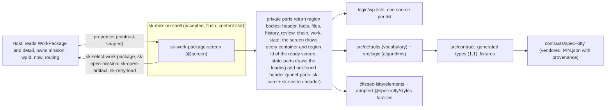
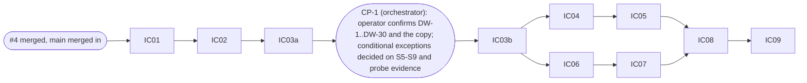

# Implementation Plan: Work Package detail screen

**Branch**: `feat/work-package-screen-5` (current branch, planning base and merge target; `branch_matches_target: true`) | **Date**: 2026-10-05 | **Spec**: `kitty-specs/work-package-screen-01M44DSJ/spec.md`
**Input**: Mission specification with the operator's rulings on Q1 to Q12 (2026-10-04, commit f25f160), GitHub issue spec-kitty/spec-kitty-mission-ui#5, the Mission Status contract 1.0 plus the 1.1 slice (spec-kitty#5625, lane `mission-status-contract-1-1-01M42XJC`, provisional), the approved Kitty Desktop V2 prototype page `04-work-package.html` (and `05-artifact.html`), and the code of mission-ui#4 (PR #6, not merged).

## Summary

Add ONE public element, `sk-work-package-screen`, to `@spec-kitty/mission-ui`, with private part files, taking the contract's `WorkPackage` (1.0) and `WorkPackageDetail` (1.1) as properties (ten in all: `status`, `detailStatus`, `detailRefusalCode`, `workPackage`, `detail`, `mission`, `wpId`, `now`, `labels`, `errorMessage`) plus two view states (`status` for the whole screen, `detailStatus` for the detail regions), emitting four `sk-*` intent events (`sk-select-work-package` and `sk-open-mission` reused from #4, `sk-open-artifact` and `sk-retry-load` new), read-only and free of I/O. It reuses #4's shell (with `flush`), defaults, logic, gates, fixture generation and event conventions; vendors contract 1.1 over #4's 1.0 pin (provisional local-lane pin, re-pinned to `main` before the PR); adds vocabulary modules for review verdicts, change states, refusals and staleness; and ships 56 stories with dark-theme baselines, committed only in IC-09. The panels are the library's `sk-card` with an `sk-section-header` title (operator ruling 2026-10-05). The visual authority is the prototype: the 30-item drift register is PROPOSED until the operator confirms it at CP-1 (DW-7, DW-24 and DW-30 are amended by the operator's rulings of 2026-10-05 and are confirmed with the rest of the register), which sits BEFORE the work packages that build visuals. No lane or phase literal enters the screen; the `data-driven` gate applies and IC-02 extends it to read the review-verdict, change-state and staleness enums. Exceptions (operator ruling 2026-10-05): E-17 approved; E-18 rejected as written and, at CP-1 (2026-10-05), approved NARROWED to five properties in `panel-parts.ts` (sunset spec-kitty-design#516); E-19 (a) DELETED (the Stylelint probe passed), E-19 (b) approved; E-20 DROPPED (dependency nodes are `sk-button`). See "CP-1 operator rulings (2026-10-05)" below. Every fork the plan-phase squad held is ruled (section "Rulings applied"); no fork stays open.

## Technical Context

**Language/Version**: TypeScript 5.9 strict (`exactOptionalPropertyTypes`, `noUncheckedIndexedAccess`), Lit 3.3.3, Node 22.22.2, pnpm 11.18.0 (pinned), all as #4
**Primary Dependencies**: `@spec-kitty/elements` 1.1.0-rc.10 (`sk-page-header` (the header band of the ready, loading and not-found states, DW-29, #4's N-1 and N-2; WP05 and WP08 use it), `sk-pill-tag`, `sk-notice`, `sk-card`, `sk-section-header`, `sk-button`; the Evidence chain is a native `ol` of `sk-pill-tag` items (CP-1 ruling, not `sk-evidence-chain`); `sk-status-indicator` is NOT used by this screen: status words are `sk-pill-tag` and the busy indicator is the adopted `progress` family, as the contracts say) and `@spec-kitty/styles` (adopted families `event-timeline`, `facts`, `breadcrumbs`, `empty-state`, `progress`); NO new dependency (the contract tooling's three devDependencies come from #4)
**Storage**: N/A (no I/O, nothing stored)
**Testing**: Vitest browser mode (`page.viewport` first), `node:test` for the contract tooling, vitest node environment for the data-driven self-test, Storybook stories, Playwright visual spec in the pinned container
**Target Platform**: evergreen browsers (dashboard) and the Kitty Desktop webview; the screen renders inside `sk-mission-shell` (mission layout, `flush`)
**Project Type**: pnpm workspace as #4: `packages/mission-ui`, `apps/storybook`, root `contracts/` and `scripts/`
**Performance Goals**: a 40-subtask list, 60-entry history and 100 owned files render and re-render in 200 ms or less (NFR-006)
**Constraints**: no I/O; project CSS layout-only with `--sk-*` tokens (Stylelint; numbered exceptions only); ESLint bans raw `<button>/<input>`, `class=`, `style=` outside recorded exceptions; no arithmetic on contract values; no lane, phase, verdict, change-state or staleness-status literal outside `defaults/`; fixtures free of paths, usernames and e-mail addresses; baselines only inside the pinned container
**Scale/Scope**: 1 public element (10 properties, 4 events), 9 private part files, 5 new default modules and about 9 logic functions, 1 new gate check (C8), WorkPackage-scoped C5 rules and 4 new relaxations (`wp-lane-open`, `detail-lane-open`, `provisional-omittable`, `detail-omittable`), 48 new fixtures (22 + 48 = 70; kinds: 59 valid, 4 host, 7 relaxed), 56 new stories and baselines (174 in total, committed in IC-09 only), 1 additive tooling option (`--from-repo`), 2 new contract test files (`update.test.mjs`, `cli.test.mjs`), no shell change (the existing `flush` option is used as is)

**FR-037 (resolved, operator ruling 2026-10-05, P-4)**: `SH-06` and `SH-07` are the shell stories `MissionWorkPackageSelected1280` and `MissionWorkPackageNoneSelected1280` of `app-shell-01M3V82X` (defined in `kitty-specs/app-shell-01M3V82X/research.md`: the sidebar Work Package tree with one selected and none selected). They stay untouched and their baselines unchanged; `sk-mission-shell.stories.ts` is not edited. FR-037's intent (the real screen as shell content, using `flush`) is met by this mission's own WP-01 (selected) and WP-43 (nothing selected), both rendered in `shellFrame`. IC-09 checks that the 118 existing baselines are identical and that the shell stories file has an empty diff.

## Build base (dependency on mission-ui#4)

Mission-ui#4 (PR #6, `feat/missions-and-pipeline-screens-4`) is MERGED into `main` (merge commit `cef2d53`), and `main` is merged into `feat/work-package-screen-5` (merge commit `9aad6ef`). The branch now holds #4's shell `flush` option (attribute and `--sk-mission-shell-content-padding`), `defaults/` (`lanes.ts`, `lifecycle.ts`, `phases.ts`, `missions-copy.ts`, `pipeline-copy.ts`, `index.ts`), `logic/`, `src/contract/`, `scripts/contract/`, the gates and the exception table E-04 to E-16 in `stylelint.config.mjs`; verified against the merged code after the fourth analyze run: every symbol in `contracts/sk-work-package-screen.md`, "Dependencies on #4", exists in the file named there, `sk-open-mission` carries `{ missionId, slug }`, and the new default modules, part files and element directory of this mission collide with no merged file. The tiers are this mission's own container thresholds (848 and 688 px of content, proven by spike S8): the shell's own viewport tiers are 1100 px (expanded) and 720 px (collapsed), and the plan assumes no other shell tier. Therefore:

1. **The build base is recorded.** `9aad6ef` (`main` merged into `feat/work-package-screen-5`, a plain merge commit; #4's `kitty-specs/` arrived as archive files and this mission's directory is untouched). IC-01 starts from "#4's final state" and, as its first step, runs the full gate set on this tree and records the green baseline (the baseline step in "Gates"); the orchestrator records the sha used at dispatch.
2. `contracts/sk-work-package-screen.md`, "Dependencies on #4", stays the checklist to re-verify if `main` moves again before dispatch; a mismatch is reported to the orchestrator, not absorbed (R-03). The list names the #4 symbols this mission imports (among them `STALE_BADGE`, `LANE_COUNT_TEXT`, `SUBTASK_PROGRESS_TEXT`, `StateBadge`, `BadgeTone`) and records that #4's `WorkPackageView` (in `src/contract/types.ts`, used by the board, `PlacedCard` and `MissionDetailView`) stays untouched: this mission's widened Work Package type is `WorkPackageRecordView`.
3. Stacking on the #4 branch is not needed any more: the base is merged `main`.
4. Planning artifacts (this phase) do not need #4 and are complete without it; only the fixtures list, the reuse list and the timeouts depend on #4's final shape.

## Charter Check

| Charter rule | Status |
|---|---|
| Data in as properties, typed from the OpenAPI read contract | pass: types generated from the vendored 1.1 pin (`contracts/contract-pin.md`); widened view types (`WorkPackageRecordView`, ...) are supertypes (`data-model.md`); gate `contract` proves freshness, fixture validity and WorkPackage coherence; provenance check C8 with ancestry and CLI-level proofs |
| View state in as a property | pass: `status` (four charter states plus the screen's own `not-found` and `nothing-selected`, FR-028) and `detailStatus` for the partial states (Q7) |
| Events out as `bubbles` `composed` `sk-*` CustomEvents, every payload asserted | pass: four events (D-04), literal dispatch in the screen file (all four written by IC-03b), `@fires`, EV-1 to EV-8 tests with positive controls, each owned by the WP that draws the control |
| No I/O | pass: no browser API beyond the DOM; `now` is a property; no timers; `no-io` gate scans every new file |
| Elements over CSS; gap not hand-rolled | pass with the exceptions as ruled on 2026-10-05 (E-17 approved; E-18 approved narrowed to five properties, sunset spec-kitty-design#516; E-19 (a) deleted, E-19 (b) approved; E-20 dropped) and gaps G-09, G-10, G-11 (narrowed E-18), G-12, G-13 and the Evidence chain gap spec-kitty-design#517; the panel is `sk-card` with `sk-section-header` |
| Atomic design, deep modules | pass: one public element, small surface, private parts |
| Quality gates incl. manifest, no-io, visual | pass: all existing gates apply; C8 added with one plant; the `data-driven` gate is extended in IC-02 for the verdict, change-state and staleness enums (its self-test cases are not plants); `surface-freeze.test.ts` extended |
| A story per view state, synthetic fixtures; a test per event | pass: 56 stories (D-15), fixtures derived from the contract examples (D-10), pairs fixed by the pairing table |
| Visual regression against the prototype; drift is REJECT | pass-with-condition: DW-10, DW-11, DW-12, DW-16, DW-17, DW-24 and DW-30 CONFIRMED at CP-1 (2026-10-05), the other 24 PROPOSED until the operator's Storybook review after the last WP (DW-7, DW-24, DW-30 amended by the 2026-10-05 rulings); CP-1 precedes every visual WP; an unconfirmed DW is a REJECT item; baselines are committed only in IC-09, each region WP handing over uncommitted side-by-side screenshots against the prototype |
| Fixtures: no real user data, paths, usernames | pass: hygiene and `contract` C6 cover vendored and generated files; `--from-repo` never records a path (node-tested with temp repositories) |
| Reviewer agent per work package; squad after the plan phase only | pass: this plan is the squad's input; WP brief rules below; the one aggregate squad before the PR is the operator's standing wrap-up rule ("PR shape and wrap-up"), not a design-phase squad |
| PR into `main`, operator merges; operator reviews Storybook after the last WP | pass: one PR after the wrap-up (D-18); Storybook review before wrap-up (C-011) |
| Amendments and exceptions need operator approval | pass: the exceptions and the spec amendments P-1 to P-4, P-6 and P-7 were ruled by the operator on 2026-10-05 (P-5 stays unused); the conditional ones were decided at CP-1 (2026-10-05) on the probe and spike evidence: E-18 narrowed and approved, E-19 (a) deleted, E-20 dropped |

Re-check after design (Phase 1): unchanged. No unjustified violation.

## Gates

Per-gate table, C8, the data-driven extension, exceptions and the plant: `contracts/gates.md`. Summary: existing gates keep their commands and plants; `pnpm visual` is NOT an exit check of IC-04 to IC-08 (their stories have no committed baseline until IC-09, so missing snapshots are the known red; their exit evidence is the uncommitted side-by-side screenshot per story, no PNG committed) and first runs green in IC-09; `visual` and `unit-tests` timeouts are re-derived in IC-09 by #4's rule (174 baselines instead of 118); gate `contract` gains C8, WorkPackage C5 rules, four relaxations and a fourth plant (the one new plant); the `data-driven` config `eslint.data-driven.config.mjs` is extended by IC-02 to read the `ReviewVerdict`, `ChangeState` and `Staleness` enums (status and reason) from the vendored schemas, with positive self-test cases that are red before the change (self-test cases, not plants, with no proof entry); no new gate id and no proof-record schema change. CHANGELOG lines (root and package) and README prose are reconciled by IC-09 only; IC-01 and IC-02 each add their one line.

Baseline: before any change IC-01 records the green baseline of every gate command on the merged build base (including `pnpm visual` in the pinned container and `pnpm gate-proof`, run by the implementation WP agent or the orchestrator, never by a plan-phase agent). A red found at baseline is escalated, not absorbed.

## PR shape and wrap-up (operator standing rule, binding; #4's wrap-up applied)

Reading of the charter (squad after plan, recorded): the charter's "adversarial squad runs after the plan phase only" (repeated in C-011) governs the DESIGN phases: no squad after specify or tasks, one squad after the plan (this mission's plan squad has run). The aggregate review squad below, before the draft PR, is the operator's standing wrap-up rule, the same step mission-ui#4 ran (its D-36); it reviews the implementation diff once, is report-only, and is not a planning-phase squad, so it is not a charter breach and is not repeated per work package.

ONE pull request, opened only after: accept, dev-assist test cleanup, aggregate review squad, compaction of history into named slices, rebase onto `main`, full gate re-run, and the Storybook review by the operator (after the last WP, before wrap-up), THEN the DRAFT pull request. Work packages never push and never open pull requests. Two contract steps are added to the wrap-up and are blocking: the re-pin to `main` (`contract:update --sha <main sha>`, `provenance: "main"`, the sha proven an ancestor of upstream `main`) and `pnpm contract:verify-remote` plus `pnpm contract:check --require-main` (`contracts/contract-pin.md`). Wrap-up proofs, all node-tested before use: the CLI exit codes of `--require-main` (branch pin non-zero with token `pin provenance`, main pin zero), the verify-remote provenance decision, and the ancestry check (a sha on a side branch only is refused). If #5625 is not on `main` when the PR is due, the orchestrator HALTS and asks the operator; the plan does not choose. Compaction slices, named in advance: contract 1.1 tooling and fixtures (IC-01), defaults, logic and gate cases (IC-02), skeleton and layout (IC-03b), header and facts (IC-04), history and review (IC-05), chains, subtasks, workspace, files and links (IC-06), states (IC-07), tiers, accessibility and edge cases (IC-08), integration, baselines and re-pin (IC-09). There is no spike slice: the IC-03a spike code is deleted by a named final commit of IC-03a, so nothing of it reaches the lane or the PR (operator ruling 2026-10-05, VISUAL-006 (b)). The integrity checks (accepted tree TA, pre-compaction tree T0, `git diff --exit-code T0 HEAD`, post-rebase comparison) are #4's procedure unchanged. Every WP brief states: no sub-agents; no push; visual baselines only inside the pinned container; `pnpm visual` is not an exit check of IC-04 to IC-08 (missing snapshots are the known red; exit evidence is the uncommitted side-by-side screenshot per story, no PNG committed; it first runs green in IC-09); no absolute paths or usernames in any committed file (use `<repo>`, `<prototype>`, `<lane-1.1>`); a denied command means stop and report; the test-quality rules of #4 D-34 and the drift register status (DW list provisional until CP-1, confirmed afterwards) are copied into it.

## Architecture



| Content width (container) | Layout (container thresholds derived from the shell's real content widths, proven by S8) |
|---|---|
| content cell `min-width: 848px` (three columns) | three columns, tracks `minmax(220px, .8fr) minmax(320px, 1.3fr) minmax(220px, .8fr)` (DW-23, proposed: col 1 Facts, Assignment, Frontmatter, Owned files; col 2 Lane history, Review; col 3 Evidence chain, Dependency chain, Subtasks, Workspace, links). The 1280 px viewport gives a content cell of about 984 px, so the 1280 stories show three columns, as the prototype does |
| content cell 689 px to 847 px (two columns) | two columns `minmax(220px, .8fr) minmax(320px, 1.2fr)`; the third stack spans all columns below as two explicit tracks `minmax(0, 1fr) minmax(0, 1fr)` (no `repeat(N, ...)` form: the data-driven gate S12.1 refuses a hard-coded track count in CSS text). The 1100 px viewport (shell expanded tier, content about 804 px) lands here; so do the browser windows of about 1101 to 1143 px (cell 805 to 847 px), where the prototype shows three columns: an intentional deviation (CP-1 ruling) that avoids the sideways scroll the prototype has there |
| content cell `max-width: 688px` (one column) | one column, third stack one column, and the header band becomes a column (wraps) at this same threshold: the prototype's `.page-header` rule is in its 800 px block (an 800 px viewport gives a content cell of about 688 px); its 620 px block has no rule for this screen |

The shell owns the viewport tiers; the screen's breakpoints are container queries (`@container (min-width: 848px)` and `@container (max-width: 688px)`; the Stylelint probe passed, so there is no E-19 (a); the track minimums are E-19 (b), approved) so it works in any content cell. Every `display: grid` column stack declares `grid-template-columns: minmax(0, 1fr)` (spike S9 lesson: without it an unbreakable word widens the whole column; the prototype's `.stack` lacks it; WP04 carries it). The two thresholds are derived from the shell's real content widths (expanded tier: viewport minus 296 px; collapsed tier: viewport minus 112 px), not copied from the viewport numbers 1100 and 800; spike S8 proves them at 1280, 1100, 800 and 620 px (operator ruling 2026-10-05, VISUAL-001 (a)). The track recipe is stated in `contracts/sk-work-package-screen.md`, "Layout".

## Project Structure

### Documentation (this mission)
```
kitty-specs/work-package-screen-01M44DSJ/
├── spec.md  plan.md  research.md  data-model.md  quickstart.md
├── contracts/ sk-work-package-screen.md  contract-pin.md  defaults.md  gates.md
├── tracer-design-decisions.md        # orchestrator-owned log (rulings Q1-Q12 recorded)
├── reviews/                          # squad trail (plan phase)
└── tasks.md                          # NOT created here
```

### Source code (repository root; additions on top of #4's tree)
```
contracts/spec-kitty/**  PIN.json                                  # replaced by 1.1 (150 files), provenance branch then main
scripts/contract/{update,check,verify-remote,overlays,registry,generate}.mjs  check.test.mjs registry.test.mjs overlays.test.mjs  update.test.mjs cli.test.mjs (new)
gates/plants/contract/plant.json                                   # + plant 4 (C8)
eslint.data-driven.config.mjs  gates/fixtures/data-driven/*  gates/data-driven.selftest.ts  # IC-02: reads the verdict, change-state and staleness enums; new positive self-test cases
packages/mission-ui/src/
├── contract/  types.ts (+ view types; #4's WorkPackageView untouched, ours is WorkPackageRecordView)  bulk.ts (+ history, subtasks, files)  fixtures.generated.ts  types.generated.ts
├── defaults/  review.ts  files.ts  refusals.ts  staleness.ts  wp-copy.ts  index.ts (re-exports)
├── logic/     wp-lists.ts  wp-actor.ts  wp-files.ts  wp-history.ts  wp-review.ts  wp-staleness.ts  wp-retry.ts
└── elements/sk-work-package-screen/
    sk-work-package-screen.ts  panel-parts.ts (panel wrapper over sk-card + sk-section-header)  header-parts.ts  facts-parts.ts  files-parts.ts
    history-parts.ts  review-parts.ts  chain-parts.ts  work-parts.ts  state-parts.ts  fixtures.ts  *.stories.ts (5 files)
packages/mission-ui/test/  sk-work-package-screen.<area>.test.ts (skeleton, events-<n>, states, a11y, perf: one writer each)  wp-<part>.test.ts  wp-<logic>.test.ts  surface-freeze.test.ts (extended)  host-composition (extended)
packages/mission-ui/src/index.ts  custom-elements.json            # one registration, one manifest regeneration (IC-03b)
packages/mission-ui/src/library-sheets.ts                          # writer: IC-03b only (event-timeline and facts sheets; the progress sheet is imported from the existing `progress-sheet.ts`)
apps/storybook/tests/visual/__snapshots__/                        # 56 new baselines
stylelint.config.mjs  eslint.config.mjs                           # exceptions E-17, E-18 (narrowed, five properties, in panel-parts.ts), E-19 (b); no E-19 (a), no E-20; IC-03b
README.md  CHANGELOG.md (root and package)                        # IC-09
```
**Structure Decision**: follow #4's "Add an element" recipe; registration only through `src/index.ts`; generated files only through `pnpm contract:generate`; the part file is the unit of write ownership.

## Implementation Concern Map

A serial foundation (IC-01, IC-02, IC-03a), the operator checkpoint CP-1, IC-03b (skeleton, layout, surface freeze), then two region chains with disjoint write scopes (chain X: IC-04, IC-05; chain Y: IC-06, IC-07), IC-08 (tiers, accessibility, edge cases) and IC-09 (integration, re-pin, wrap-up inputs). A WP depends on its parent by `depends_on`; the tool cannot give a lane two parents, so IC-08 needs the orchestrator merge below.



CP-1 is not a work package. After IC-03a is approved the orchestrator puts the prototype beside the spike renders (the hardest items: event-timeline history, dependency node, the `sk-card` with `sk-section-header` panel beside the prototype `.panel` (spike S9), the three-column grid at 1280, 1100, 800, 620) in front of the operator, with the DW list (the seven spike-rendered items were confirmed, the rest await the Storybook review; DW-7, DW-24 and DW-30 carry the amended text of the 2026-10-05 rulings), the copy defaults (`contracts/defaults.md`), and the evidence that decides the conditional exceptions (the Stylelint probe for E-19 (a), S6 for E-20, S9 for the narrowed E-18). The arbiter-recommendation items (all forks, P-1 to P-7, E-17 to E-20) were ruled on 2026-10-05 and are closed; CP-1 does not reopen them. CP-1 HELD on 2026-10-05: the operator accepted every recommendation, recorded as "CP-1 operator rulings (2026-10-05)" in `tracer-design-decisions.md` and `spec.md` (see "CP-1 outcome" below). P-7 is ruled (titled pills, plain in the Frontmatter, actionable only in the dependency chain) and DW-7 is amended to match; the operator confirms the register as a whole. The answer is recorded in `tracer-design-decisions.md` (the entry `CP-1 confirmed`, headed "CP-1 operator rulings (2026-10-05)") and `spec.md` Clarifications. No visual WP starts before it: IC-03b and every later WP (IC-04 to IC-08) check that entry as a file precondition. IC-01 and IC-02 are data and logic only and IC-03a's spikes are throwaway, so they run before CP-1.

### Lane mechanics (orchestrator-owned; WP agents never do any of this)

Facts relied on (tool defects, recorded in the orchestrator's own ledger and restated so nothing depends on it): a spec-kitty tooling issue (a lane parents off the local `kitty/mission-<slug>` branch, created at first claim and never refreshed); a spec-kitty tooling issue (allocating a lane for a WP that depends on an approved WP starts from a stale coordination commit); a spec-kitty tooling issue (allocation refuses when the derived `status.json` conflicts). Procedure, as #4's plan (items 1 to 6 of its Lane mechanics, with `feat/work-package-screen-5` as the target branch): (1) fast-forward `kitty/mission-<slug>` to the target branch before every first claim and after any merge of `main`; (2) for every dependent WP pre-create the lane from the approved parent's tip or merge the parent into the new lane, applying the `status.json` rule; (3) IC-08 is parented on IC-05 (chain X): before dispatch the orchestrator merges the approved IC-07 tip into its lane (`git merge --no-ff`), resolves `custom-elements.json` by `pnpm manifest:generate` only, applies the `status.json` rule and checks that both chains' stories are present; (4) fallback: if that merge conflicts beyond `custom-elements.json` and `status.json`, serialise IC-06 and IC-07 after IC-05 and record the decision; (5) the CP-1 entry and the exceptions approval reach the lanes the way #4's did: committed on the target branch, `kitty/mission-<slug>` fast-forwarded, IC-03b's lane created from the approved IC-03a tip with the target branch merged in, and `git merge-base --is-ancestor <CP-1 commit> HEAD` checked by the orchestrator before `implement` and by the reviewer; (6) `owned_files` and `lanes.json` `write_scope` are tool-owned and never hand-edited; out-of-map edits listed in "Shared files" are committed by the WP agent with plain `git add` and `git commit` and listed in the hand-off.

### Shared files: who may write them

| File | Writer | Everyone else |
|---|---|---|
| `src/index.ts`, `custom-elements.json` | IC-03b (full public surface: properties with attributes, `@fires`, all four literal `dispatchEvent` methods and their payload builders); later only `pnpm manifest:generate` | a surface change is reported; IC-09 regenerates once; manifest conflicts resolve by regeneration only |
| `sk-work-package-screen.ts` | IC-03b only: class, the ten properties, layout grid, placement, container queries, the four dispatch methods and payload builders, the status switch and the regional-notice switch (calls into `state-parts.ts`), the import and call of every part renderer, the composed `static styles`, the adoption of the sheets, and the focus rule (`updated()`). Region WPs fill part bodies only and never edit this file | everyone else reports the need (a change request to IC-03b's owner, the orchestrator) |
| `library-sheets.ts` (event-timeline and facts sheets; the progress sheet is imported from the existing `progress-sheet.ts`) | IC-03b only (both sheets, before the chains fork; operator ruling 2026-10-05, ARCH-003 (A)) | report the need |
| `panel-parts.ts` | IC-03b (complete: the panel wrapper over `sk-card` and `sk-section-header`, layout CSS only; the narrowed E-18: five properties with tokens) | read-only for all |
| every other `*-parts.ts` | created by IC-03b as a stub with its final export signatures (`contracts/sk-work-package-screen.md`, "Part signatures"); the owning WP below replaces stub bodies and keeps every signature; a signature change is a change request | none |
| `fixtures.ts` of the element (prop builders and the `pairDetail` helper) | IC-03b creates a builder for every fixture name of `contracts/contract-pin.md` and the pairing table, and `pairDetail(workPackage, detail, options?)` with the `cycles` option (`first`, `last`, `none`); WP04 alone: it creates a builder for EVERY fixture name and `pairDetail`; no later WP adds or edits an export (the stories of WP05 to WP09 and the tests of WP10 only import); a gap is a change request to the orchestrator, never an edit | change request |
| `test/sk-work-package-screen.skeleton.test.ts`, `test/surface-freeze.test.ts` | IC-03b (skeleton: one test per event, exactly one event, exact payload, `bubbles`, `composed`, and the layout cases: grid track count 3, 2, 1, 1 at 1280, 1100, 800 and 620 px inside `shellFrame`; surface freeze: ten properties with attributes and run-time defaults, four event names) | none |
| `test/sk-work-package-screen.events-<n>.test.ts` | the WP that draws the control (EV-3 and EV-4 with IC-04 and IC-07, EV-6 with IC-05, EV-1 and EV-5 with IC-06, EV-7 with IC-07) | none |
| `test/sk-work-package-screen.states.test.ts` | IC-07 | none |
| `test/sk-work-package-screen.a11y.test.ts`, `...perf.test.ts`, `...time.test.ts` (EV-2, EV-8 in the a11y file) | IC-08 | none |
| `header-parts.ts`, `facts-parts.ts` | IC-04 (the not-found and breadcrumb renderer in `header-parts.ts` is written complete by IC-03b; IC-04 does not edit that function) | none |
| `history-parts.ts`, `review-parts.ts` (the cancellation notice is drawn here, above the review panel) | IC-05 | none |
| `files-parts.ts`, `chain-parts.ts`, `work-parts.ts` | IC-06 | none |
| `state-parts.ts` (the one shared regional empty-form helper `renderEmptyForm` is written complete by IC-03b, with its E-17 `sk-empty-state*` override and leak plant) | IC-03b for `renderEmptyForm`; IC-07 fills the other bodies only (the not-found header calls the crumb renderer of `header-parts.ts`) | none |
| `src/defaults/**`, `src/logic/**` and their tests | IC-02 only | a gap is a change request; a WP may add a NEW file only inside its own element directory for copy that is not vocabulary |
| `src/contract/**`, `scripts/contract/**` (all five test files), `contracts/spec-kitty/**`, `gates/plants/contract/**` | IC-01 only (the IC-09 re-pin commit is the one other writer: `PIN.json`, generated files, plant 4's text) | a missing fixture is a change request |
| `stylelint.config.mjs`, `eslint.config.mjs` | IC-03b (E-17 as one `classOnly` override per file of the E-17 table of `contracts/gates.md`, stubs included, each with a leak plant; E-19 (b); E-18 narrowed to the five CP-1 properties in `panel-parts.ts`; NO E-19 (a) and NO E-20) | none |
| `eslint.data-driven.config.mjs`, `gates/fixtures/data-driven/**`, `gates/data-driven.selftest.ts` | IC-02 (operator ruling 2026-10-05, ARCH-006 (A)) | none |
| `.github/workflows/ci.yml` (timeouts only), `README.md`, both `CHANGELOG.md` | IC-09 (IC-01 and IC-02 add their one CHANGELOG line each) | none |
| `package.json` | IC-09 for everything not named here; two NAMED edits of earlier WPs: IC-01 (WP01, T008) names its two new node test files in the `test:contract` script, IC-02 (WP02, T015) names its new files in the unit-test or data-driven scripts; each is minimal and said in the hand-off | change request |
| stories | the WP that owns the story title (`contracts/sk-work-package-screen.md`); disjoint names | none |
| baseline PNGs | IC-09 only, after the chains are merged; each region WP hands over uncommitted side-by-side screenshots against the prototype (operator ruling 2026-10-05, CORRECT-012 (a)) | none |
| `spikes/ic-03a/**`, the one `stories` entry in `apps/storybook/.storybook/main.ts` and the one `ignores` entry in `eslint.config.mjs` for it | IC-03a only, all three removed by its named final commit | none |
| `tracer-*.md`, `spec.md` Clarifications | the orchestrator only | WPs write nothing there |

### IC-01 Contract 1.1 vendoring, tooling and fixtures
- **Purpose**: baseline record; `contract:update --from-repo` with node tests (`update.test.mjs`); provisional 1.1 pin (`provenance: branch`, `branch` the real lane branch name); regenerate types and fixtures; C8 with function-level and CLI-level negative tests (`cli.test.mjs`) and plant 4; the ancestry check of a `main` pin; the independent literal floors (150 vendored files, 70 fixtures) and the anchor-file presence check; WorkPackage C5 rules and extended `actorProblems`; the four relaxations `wp-lane-open`, `detail-lane-open`, `provisional-omittable` and `detail-omittable` with reverted-must-fail proofs (the last two let `wpStalenessOmitted` and `detailOmittedProvisional` validate with exactly the omitted members removed from `required`); overlays (lane-rewrite rule) and registry for the 48 new fixtures; `bulk.ts` generators; view types in `src/contract/types.ts` (`WorkPackageRecordView`); spike S0.
- **Relevant requirements**: FR-032 (part), FR-033, C-002, C-008, NFR-007, NFR-010.
- **Affected surfaces**: `contracts/spec-kitty/**`, `scripts/contract/**` (including `check.test.mjs`, `registry.test.mjs`, `overlays.test.mjs`, new `update.test.mjs`, `cli.test.mjs`), `packages/mission-ui/src/contract/**`, `gates/plants/contract/plant.json`, CHANGELOG line.
- **Literals to update**: vendored files 98 to 150, fixtures 22 to 70, the kind tally (valid 59, host 4, relaxed 7) and `kinds.length` (`registry.test.mjs`), `Object.keys(fixtures).length` (`overlays.test.mjs`), the guard texts "21 entries against 22 exports" and "97 keys against 98 files" (`contract-pin.md`, "Test files and literals").
- **Exit checks**: `pnpm contract:check && pnpm test:contract` green with reporter pass above 0; plant 4 red then green; the CLI spawns (`check.mjs --require-main` on a branch pin non-zero with token `pin provenance`, on a main pin zero, without the flag on a branch pin zero) pass; `contract:verify-remote` prints "not verifiable upstream" for the branch pin; the ancestry test (sha on a side branch refused) passes; `tsc` green for the Pipeline board and screen with #4's `WorkPackageView` unchanged; hygiene green (no path in `PIN.json`; a `git grep` of the checkout path prefix is empty, as an additional check next to the `--from-repo` node tests); revert check per test file.
- **Version strings**: `infoVersion`, `changelogTopVersion` and the generated-header version are read from the pinned commit at IC-01; `1.1.0-SNAPSHOT` is the value at plan-time tip `8cc31f44` only, no test or exit check may hard-code it, and 1.1 is the slice label, not a promised version string.
- **Depends on**: the merged build base. **Risks**: S0 (150 files, types stay strict-clean); `unevaluatedProperties` lost in the types (as #4); the lane tip moving before dispatch (the orchestrator records the sha used).

### IC-02 Defaults, logic and data-driven self-test cases
- **Purpose**: the five default modules and nine logic functions of `contracts/defaults.md` with unit tests (foreign-value inputs included); the extension of the `data-driven` gate (operator ruling 2026-10-05, ARCH-006 (A)): `eslint.data-driven.config.mjs` reads the `ReviewVerdict`, `ChangeState` and `Staleness` (status and reason) enums from the vendored schemas as it reads the lanes, with false-positive handling for the bare words (`unknown`, `changed`, `fresh`, `stale`: matched only in comparisons and case labels), `EXPECTED_WORDS` and the count guards updated in the same change, and new positive self-test cases (one per new word family) that are red before the config change. Self-test cases, not plants.
- **Relevant requirements**: FR-004, FR-011, FR-012, FR-019, FR-023, C-004, C-007, NFR-009, NFR-011.
- **Affected surfaces**: `src/defaults/**`, `src/logic/**`, their tests, `gates/data-driven.selftest.ts`, `gates/fixtures/data-driven/**`.
- **Exit checks**: `pnpm lint:data-driven && pnpm test:data-driven` green; each new self-test case red without the config change that makes it pass (shown by running it against the unchanged config; a case targeting a word the gate already catches, such as `approved` as a lane, does not count); the false-positive cases (a property named `changed`, an object key `unknown`) stay green; unit tests with positive controls; revert checks.
- **Depends on**: IC-01. **Risks**: selector false positives on new logic (rename fields, never silence); the `approved` collision (a verdict and a lane share the word, so the gate already reports it; the verdict table lives in `defaults/`). The gate does not read `ArtifactKind` or the refusal codes: `review_cycle` stays on the reviewer self-check list behind `REVIEW_CYCLE_ARTIFACT_KIND`, and the refusal codes are covered by the foreign-value tests.

### IC-03a Foundation spikes and CP-1 evidence
- **Purpose**: spikes S5 to S9 (`research.md`; S9 renders `sk-card` with `sk-section-header` beside the prototype `.panel`) as throwaway stories committed under `spikes/ic-03a/`, made renderable by exactly two additions, both removed by the named final commit: one `stories` entry for `spikes/ic-03a/**` in the Storybook main config (`apps/storybook/.storybook/main.ts`, whose glob is otherwise `packages/mission-ui/src/**/*.stories.ts`) and one ESLint `ignores` entry for the path; the path stays outside the Stylelint, manifest and test globs; the spikes are deleted by a named final commit (`chore(ic-03a): remove spike code`) before approval; no committed baseline; side-by-side captures of prototype and spike for the CP-1 packet go into the WP report, not into the tree. The evidence is captured with the pinned-container screenshot run (uncommitted), not by a `pnpm visual` pass (the spikes have no committed snapshots); a plan-phase or squad agent never runs it. Review check: no spike file on the IC-03a tip (`git ls-tree -r HEAD -- spikes/` empty, the `stories` entry and the `ignores` entry gone, the tip tree equal to its base tree). The Stylelint probe of E-19 (a) was run here too: it passed, so E-19 (a) is deleted (CP-1).
- **Relevant requirements**: FR-029, FR-030, FR-036, FR-038, NFR-008.
- **Depends on**: IC-02. **Risks**: a spike can change a part's shape or add an exception, which is why spikes precede the surface freeze.

### CP-1 Operator checkpoint (orchestrator-owned, above)

### IC-03b Skeleton, layout and surface freeze
- **Purpose**: `sk-work-package-screen` with the FULL public surface (ten properties); the real container-query layout (three, two and one column at the thresholds S8 derived) and DW-23 placement; `panel-parts.ts` written complete (the panel wrapper over `sk-card` and `sk-section-header`); EVERY other part file created as a stub with its final export signatures (`renderX(props)` returning `nothing`, `xStyles = css```), recorded in `contracts/sk-work-package-screen.md` ("Part signatures"); the screen file draws EVERY panel container and every `data-region` element of the ready screen, except the header band of the data-less loading and not-found states, which `state-parts.ts` (WP08) draws with the complete `renderBreadcrumb` (panels through `renderPanel`, titles from `wp-copy.ts`; the Review panel hosts the `review-summary` and `review-cycles` wrappers) while parts return bodies only, and it passes `detail` to `resolveLists` only when `detailStatus` is `ready` ("Panel and region ownership" and "Containers and drawn-when" of the contract); all stubs, the composed `static styles`, the status switch and the regional-notice switch wired into the screen file; the adopted facts and event-timeline sheets added to `library-sheets.ts` (the screen imports the existing `progress-sheet.ts` from #4; no second progress sheet); the not-found and breadcrumb renderer written COMPLETE in `header-parts.ts` (both chains import it; no other file carries `sk-breadcrumbs*`); `renderEmptyForm` written COMPLETE in `state-parts.ts` with its E-17 `sk-empty-state*` override and leak plant (every regional empty form of IC-04 to IC-06 calls it; no other file carries `sk-empty-state*`); the focus rule in `updated()` (when the previously focused shadow element is detached, focus moves to the `h1` with `tabindex=-1`); registration in `index.ts`; all four typed dispatch methods and payload builders (one literal site each, `@fires` declared) with a skeleton test per event and the layout cases (grid track count 3, 2, 1, 1 at 1280, 1100, 800 and 620 px inside `shellFrame`: the acceptance check that the 1280 px story has three columns); `surface-freeze.test.ts` extended with the ten properties (attributes and run-time defaults: status `loading`, detailStatus `ready`, detailRefusalCode null, workPackage null, detail null, mission null, wpId `''`, now null, labels null, errorMessage `''`) and the four event names; `fixtures.ts` prop builders and `pairDetail`; ESLint and Stylelint exceptions as ruled (one `classOnly` override per file of the E-17 table, each with a leak plant; E-18 narrowed to the five CP-1 properties; no E-19 (a), no E-20; the container-query layout with the 848 and 688 px thresholds and `grid-template-columns: minmax(0, 1fr)` on every grid stack); a `shellFrame` scratch story proving the frame at 1280 that is NOT committed (no baseline, not a 57th story: the first committed stories are IC-04's); the single manifest regeneration (the freeze). Later WPs replace stub bodies only; none edits the screen file or `library-sheets.ts`.
- **Relevant requirements**: FR-001, FR-028, FR-029, FR-030, FR-032, FR-038, C-001, C-005, C-010.
- **Depends on**: IC-03a and CP-1 (file precondition: the `CP-1 confirmed` entry ("CP-1 operator rulings (2026-10-05)") naming the seven confirmed DW items and the exception decisions; the WP stops and reports if absent; the reviewer rejects if it was not present before the first IC-03b commit).
- **Risks**: the surface must reflect spike outcomes; the layout lands here so no region WP changes the grid and re-baselines the others.

### IC-04 Header, Facts, Assignment, Frontmatter (chain X)
`header-parts.ts` (all but the crumb renderer, which IC-03b wrote complete), `facts-parts.ts`; story title `Header and facts` (10 stories: WP-01, 09, 17, 18, 19, 20, 21a, 21b, 22, 38); the crumb event test (EV-4, `test/sk-work-package-screen.events-4.test.ts`, against the IC-03b crumb renderer and dispatch method), the DOM-absence and omitted-versus-null tests of the staleness and facts regions, and the `not_applicable` text test (WP-21b: the visually hidden "Staleness: not applicable, <reason>" text is found by a DOM text query). FR-002, FR-003, FR-005 to FR-007, FR-018 (staleness), FR-019, FR-021. Exit evidence: `pnpm visual` is NOT an exit check of this WP (its stories have no committed baseline until IC-09, so missing snapshots are the known red); the exit evidence is the uncommitted side-by-side screenshot per story against the prototype, no PNG committed. Depends on IC-03b.

### IC-05 Lane history and Review (chain X)
`history-parts.ts`, `review-parts.ts` (bodies `renderReviewSummary`, `renderReviewCycles`, `renderCancellation`; the Review panel composition table is in the contract); story title `Review and history` (13: WP-02 to 08, 23, 24a, 24b, 28, 29, 30); the Open review event test (EV-6, asserting `REVIEW_CYCLE_ARTIFACT_KIND`), the array-order tests with cast inputs (non-chronological history, descending cycles, single-entry and empty history), and the reviewCycles omitted-versus-empty pair. FR-011 to FR-014, FR-020. Exit evidence: `pnpm visual` is NOT an exit check of this WP (its stories have no committed baseline until IC-09, so missing snapshots are the known red); the exit evidence is the uncommitted side-by-side screenshot per story against the prototype, no PNG committed. Depends on IC-04.

### IC-06 Owned files, chains, subtasks, workspace, links (chain Y)
`files-parts.ts`, `chain-parts.ts`, `work-parts.ts`; story title `Chains, subtasks, workspace and links` (19: WP-10 to 16, 25 to 27, 31, 32, 33a, 33b, 34, 35a, 35b, 35c, 50); the dependency-node and artifact-link event tests (EV-1, EV-5), the workspace omitted-versus-all-null pair, and the WP-32 test (no word implying removal). The Evidence chain is a native `ol` of `sk-pill-tag` items with `aria-hidden` arrows and a layout-only `flex-wrap` (CP-1 ruling, spike variant D; library gap spec-kitty-design#517); the Dependency chain is a semantic list of ghost `sk-button` nodes in `chain-parts.ts` (three texts in ONE slot element, stacked vertically, layout-only `::part(button)` rules for long titles). FR-004, FR-008 to FR-010, FR-015 to FR-018. Depends on IC-03b. Risks: none left from S5 and S6 (decided at CP-1; E-20 dropped); a very long node title in the narrow column. Exit evidence: `pnpm visual` is NOT an exit check of this WP (its stories have no committed baseline until IC-09, so missing snapshots are the known red); the exit evidence is the uncommitted side-by-side screenshot per story against the prototype, no PNG committed.

### IC-07 States (chain Y)
`state-parts.ts` bodies other than `renderEmptyForm` (the whole-screen and regional states; the shared regional empty-form helper was written complete by IC-03b; the status and regional-notice switches in the screen file were wired by IC-03b); story title `States` (8: WP-36a, 36b, 37, 39, 40, 41, 42, 43; WP-40 is status `empty`; WP-42 draws its crumb with the IC-03b renderer); the retry and return event tests (EV-3, EV-7), the region-set test, the empty-panel line, the unknown-refusal-code test (a foreign `detailRefusalCode` shows its raw text), the payload-rule tests (one per branch of the `wpId` fallback chain, the mismatched-detail case and the inert controls when `mission` is null), focus-order assertions for the retry and return states, the focus-restoration test for the whole-screen retry trigger (error to loading; the detail-retry trigger needs WP05's real header h1, so IC-08 owns it on the merged lane), the detail input rule tests (the detail input rule: a stale `detail` with `detailStatus` `loading`, `error` or `not-found` still gives bare 1.0 lists) and the `detail` null with `ready` element test. The region-set test runs against the ids the IC-03b screen file draws (panel ownership), with every part still a stub. FR-024 to FR-028, EV-3, EV-7. Exit evidence: `pnpm visual` is NOT an exit check of this WP (its stories have no committed baseline until IC-09, so missing snapshots are the known red); the exit evidence is the uncommitted side-by-side screenshot per story against the prototype, no PNG committed. Depends on IC-06.

### IC-08 Tiers, accessibility and edge cases
Story title `Tiers and edge cases` (6: WP-44, 45, 46, 47, 48, 49); responsive stories at the 1100, 800 and 620 px viewports (the shell's content cell, not the viewport, drives the column switch); focus-order and `tab-<n>` tests; the focus-restoration tests for the detail-retry trigger (`detailStatus` error to loading, focus lands on the real `h1`) and the dependency-node trigger (the host swaps `wpId`, the focused node is gone, focus lands on the `h1`); the NFR-004 test (root font size 200 percent at 1100 px and 720 px viewports, no horizontal overflow, `test/sk-work-package-screen.a11y.test.ts`) and, in the same file, the 100 percent text assertions of US6 AC3 and WP-44 (no horizontal overflow and no mid-word wrap at 1280, 1100, 800 and 620 px with the long fixtures); the FR-022 relative-time tests (`test/sk-work-package-screen.time.test.ts`); the NFR-006 test (`...perf.test.ts`, structural: altered row text, same node identity elsewhere, counts 40/60/100, coarse 200 ms median); the unknown-lane story; the semantics, announcement and unique-control-name tests (the announcement table, one test per row); EV-2 and EV-8; keyboard operation of every control. Edits only its stories and tests; a part change is a change request to the owning IC. Exit evidence: `pnpm visual` is NOT an exit check of this WP (its stories have no committed baseline until IC-09, so missing snapshots are the known red); the exit evidence is the uncommitted side-by-side screenshot per story against the prototype, no PNG committed. FR-022, FR-029 to FR-031, NFR-003, NFR-004, NFR-006. Depends on IC-05 with IC-07 merged in by the orchestrator.

### IC-09 Integration, re-pin and wrap-up inputs
Integrate; the BASELINES: the only WP that commits baseline PNGs (after the chains are merged, from the stories as the region WPs left them), each checked side by side against the prototype and the CP-1 entry by the reviewer, using the uncommitted screenshots the region WPs handed over as the cross-check (operator ruling 2026-10-05, CORRECT-012 (a)); the row-to-story node test (exactly 50 rows and 56 stories discovered, trailing-letter normalisation, the six extras asserted, run against a temp copy with a row deleted to prove it fails; `contracts/sk-work-package-screen.md`); the pairing test (the pairing table of `contract-pin.md`, with the review-state agreement assertion and a negative case); the shell check for FR-037 (the 118 existing baselines identical, `sk-mission-shell.stories.ts` with an empty diff); the host-composition test (SC-008); five consecutive clean `pnpm visual` runs in the pinned container; `pnpm gate-proof`; timeouts re-derived and written to `ci.yml`; README and CHANGELOG reconciled; the contract re-pin to `main` and its two proofs when #5625 is on `main` (else HALT to the operator), AFTER WHICH the fixtures freshness check (`pnpm contract:check && pnpm test:contract`), the five consecutive clean `pnpm visual` runs and the baseline check run again on the re-pinned tree (the re-pin regenerates `fixtures.generated.ts`, so the runs before it are not the exit evidence; if a re-pin changes a rendered image, the image is reviewed against the prototype and the CP-1 entry again and re-baselined only inside the container after that review); the drift review against the register as confirmed at CP-1; PR description inputs (exceptions as ruled, gaps G-09 to G-13, DW as confirmed, amendments P-1 to P-4, P-6 and P-7, timing). Depends on IC-08.

## CP-1 outcome (operator, 2026-10-05)

Source: `tracer-design-decisions.md`, "CP-1 operator rulings (2026-10-05)" (the `CP-1 confirmed` entry). The operator accepted every recommendation: (1) DW-30 and E-18: panels stay `sk-card` plus `sk-section-header` with a narrowed E-18 in `panel-parts.ts` only, five properties (border width 1px `--sk-border-width-1`, radius `--sk-radius-md`, padding `--sk-space-5`, title 18px/700, title-to-body gap `--sk-space-4`), sunset spec-kitty-design#516; (2) DW-16: native `ol` of `sk-pill-tag` with `aria-hidden` arrows and layout-only `flex-wrap`, no style exception, library gap spec-kitty-design#517; (3) DW-24: three columns from `min-width: 848px`, one at `max-width: 688px`, two between; deliberately two columns instead of three in the browser-window band of about 1101 to 1143 px; (4) DW-17: ghost `sk-button` nodes with three texts in ONE slot element, stacked vertically, E-20 dropped; (5) DW-10, DW-11, DW-12: event-timeline sheet with the "from -> to" summary, wording tunable at the Storybook review; (6) E-19 (a) deleted, E-19 (b) approved, E-17 stands; (7) the other 24 DW items are confirmed at the operator's Storybook review after the last WP, as on #4; (8) every `display: grid` stack needs `grid-template-columns: minmax(0, 1fr)` (WP04 carries it).

## Spec amendments (ruled by the operator on 2026-10-05)

All seven were proposed by the plan phase and are RULED; `spec.md`, Clarifications, "Operator rulings, 2026-10-05" carries the requirement text, and the affected rows of `spec.md` are amended to match (FR-001, FR-003, FR-026, FR-029, FR-037, EV-3, EV-4, WP-40, WP-42, WP-46 to WP-48; DW-7, DW-24, DW-30).

- **P-1** (accepted) EV-3, FR-003, FR-026 and the event list: "Return to Pipeline" and the crumb emit the single #4 event `sk-open-mission` `{ missionId, slug }`; `sk-open-pipeline` is not created (Q5's collapse clause, `research.md` D-04).
- **P-2** (accepted) FR-001: no `laneGroups` property (no consumer; Q12 ruled out the only candidate).
- **P-3** (accepted, with the payload rule and `detailRefusalCode`) FR-001 and FR-026: the public surface gains `wpId` (`wp-id`) and `detailRefusalCode` (string or null, no attribute). Payload rule: the one payload builder takes `wpId`, then `workPackage.wpId`, then `detail.wpId`; a detail whose `wpId` differs from the shown Work Package is treated as omitted; controls that need `missionId` are drawn inert when `mission` is null; one test per branch. Together with the `detailRefusalCode` mechanism this is ONE surface amendment made before the IC-03b freeze (ten properties).
- **P-4** (accepted as rewritten) FR-037: SH-06 and SH-07 are `app-shell-01M3V82X` stories; they stay untouched (existing shell baselines unchanged); the intent is met by WP-01 and WP-43 in `shellFrame`. The earlier premise that the ids are undefined was false and is removed everywhere.
- **P-5** unused (it was reserved for the refusal-code option that was not chosen).
- **P-6** (accepted) DW-24 and FR-029: the header wraps at the one-column threshold (the prototype's 800 px block), not at 620 px, stated in container terms (688 px of content); WP-40 reads "status `empty`: no Work Package to show"; WP-46 to WP-48 name viewport widths of 1100, 800 and 620 px and drop the "collapsed tier" wording (at 1100 px the shell is in its expanded tier); the column switch uses container thresholds of 848 and 688 px (CP-1 ruling: 848, not 805) derived from the shell's real content widths and proven by S8.
- **P-7** (ruled, with DW-7) Frontmatter dependencies are titled pills, plain (not actionable); a dependency is a control only as a node of the Dependency chain, so no two controls share an accessible name (WCAG 2.4.4). DW-7 is amended accordingly and is still confirmed at CP-1 with the register.

## Traceability

| Requirement | Plan element | Proof |
|---|---|---|
| FR-001, FR-028, FR-032 | IC-03b surface freeze (ten properties); D-03, D-05 | manifest gate; skeleton test; `surface-freeze.test.ts` |
| FR-002, FR-003 | IC-04 header; D-04 | WP-01; EV-4 test (IC-04, against the IC-03b dispatch method) |
| FR-004 | `resolveLists` (D-06) | `wp-lists` test with both payloads |
| FR-005 to FR-007, FR-021 | IC-04 | WP-01, 09, 17 to 19, 38 |
| FR-008 to FR-010 | IC-06 | WP-10 to 16, 25 to 27; EV-1 test |
| FR-011, FR-012 | IC-05, `historyView` (D-08) | WP-07, 08, 45; data-driven fixture |
| FR-013, FR-014, FR-020 | IC-05 | WP-02 to 06, 23, 24, 28 to 30; EV-6 test |
| FR-015 to FR-017 | IC-06 | WP-31 to 35; EV-5 test |
| FR-018, FR-019 | optional regions (D-03, D-08), IC-04, IC-05, IC-06 | WP-20 to 22, 32; paired omitted-versus-empty-versus-null DOM tests per region; element-level test of `detail` null with `detailStatus` ready (owner IC-07, `states.test.ts`); the visually hidden `not_applicable` text found by a DOM text query (WP-21b) |
| FR-022 | `resolveActivity` reuse; IC-08 | `test/sk-work-package-screen.time.test.ts` (WP09 T054): relative text from `now`, ISO fallback with `now` null, the label hook, an unparsable timestamp shown raw, through the Facts row and the lane history |
| FR-023 | `defaults/` modules (D-07) | foreign-value element tests (verdict, change state, staleness status and reason, refusal, kind pass-through); the extended `data-driven` gate (IC-02); WP-45 |
| FR-024 to FR-027 | IC-07 | WP-36 to 43; EV-7 test; the unknown refusal code test; the payload-rule tests; the detail input rule tests (a stale `detail` with `detailStatus` `loading`, `error` or `not-found` still gives bare 1.0 lists; WP08 T050) |
| FR-029 | IC-03b layout (container thresholds from S8), IC-08 | layout cases of the skeleton test (3, 2, 1, 1 columns at 1280, 1100, 800, 620); WP-46 to 48 |
| FR-030, FR-031 | D-14, IC-03b focus rule, IC-07, IC-08 | WP-49; a11y tests (semantics table, announcement table, unique control names); focus-restoration tests, one per trigger |
| FR-033 | D-10, IC-01 | gate `contract` |
| FR-034 | `contracts/gates.md` | all gates, gate-proof |
| FR-035 | D-17 | interaction tests; skeleton test per event (IC-03b); event tests by the drawing WP |
| FR-036 | D-15 | 56 baselines committed in IC-09; IC-09 row-to-story test (exact counts) |
| FR-037 | WP-01 and WP-43 in `shellFrame` (IC-04, IC-07); IC-09 shell check | SH-06 and SH-07 untouched: 118 existing baselines identical, `sk-mission-shell.stories.ts` empty diff |
| FR-038 | D-12 | exception table tests |
| NFR-004 | IC-08 | `test/sk-work-package-screen.a11y.test.ts` (200 percent text, 1100 px and 720 px, no horizontal overflow); the same file asserts US6 AC3 and WP-44 at 100 percent (no horizontal overflow, no mid-word wrap, at 1280, 1100, 800 and 620 px with the long fixtures) |
| NFR-006 | IC-08 | `test/sk-work-package-screen.perf.test.ts` (structural, coarse 200 ms) |
| NFR-001 to NFR-003, NFR-005, NFR-007 to NFR-011, SC-001 to SC-009 | gates, IC-08, IC-09 | `contracts/gates.md`, IC-09 exit checks; SC-004 by the region-set test (IC-07) |

## Rulings applied (operator, 2026-10-05)

No fork stays open. The operator accepted every recommendation of the arbiter (`reviews/plan.forks.yaml`, `reviews/plan.forks2.yaml`) and the text above and in the other artifacts is the ruled text. "Where applied" lists the files that carry it.

| Fork | Ruling | Where applied |
|---|---|---|
| PLAN-CORRECT-003 | (a) named omit relaxations `provisional-omittable` and `detail-omittable`, each with an `allowedPath` and a reverted-must-fail proof | `contracts/contract-pin.md`, `research.md` D-10, `data-model.md`, IC-01 |
| PLAN-CORRECT-004 | (a) shell stories SH-06 and SH-07 untouched; intent met by WP-01 and WP-43; P-4 rewritten | `plan.md` (FR-037 note, IC-09, Traceability), `research.md`, `spec.md` FR-037 |
| PLAN-CORRECT-008 | (a) optional property `detailRefusalCode`; one surface amendment with P-3 and ARCH-013 (ten properties) | `contracts/sk-work-package-screen.md`, `contracts/defaults.md`, `data-model.md`, `research.md` D-05, IC-03b |
| PLAN-CORRECT-012 | (a) baselines committed only in IC-09; region WPs hand over uncommitted side-by-side screenshots | `plan.md` Shared files, IC-04 to IC-09, `research.md` D-15, `contracts/sk-work-package-screen.md` |
| PLAN-ARCH-003 | (A) IC-03b creates every part file as a stub (`renderBreadcrumb` and `renderEmptyForm` complete), wires all stubs, composed styles and the two new sheets (event-timeline, facts) | `plan.md` Shared files and IC-03b, `contracts/sk-work-package-screen.md` ("Part signatures"), `research.md` G-09/G-10 |
| PLAN-ARCH-006 | (A) `eslint.data-driven.config.mjs` reads the verdict, change-state and staleness enums; positive self-test cases red before; IC-02 owns it | `contracts/gates.md`, `research.md` D-07, D-11, R-04, IC-02 |
| PLAN-ARCH-010 | (A) panels are `sk-card` plus `sk-section-header`; DW-30 keep via the narrowed E-18 (CP-1); spike S9; E-18 rejected as written, then approved narrowed | `research.md` D-12, G-11, spikes, `contracts/gates.md`, `spec.md` DW-30 |
| PLAN-ARCH-013 | (a') fallback chain `wpId`, `workPackage.wpId`, `detail.wpId`; mismatched detail treated as omitted; inert controls without `mission` | P-3, `contracts/sk-work-package-screen.md`, `contracts/defaults.md` `retryDetail`, `data-model.md` |
| PLAN-VISUAL-001 | (a) container thresholds from the shell's real content widths (848 and 688 px after CP-1), proven by S8 | `plan.md` Architecture, `research.md` D-13, S8, `contracts/gates.md` E-19, `contracts/sk-work-package-screen.md` Layout, `spec.md` DW-24, FR-029, WP-46 to WP-48 |
| PLAN-VISUAL-006 | (b) spikes committed under `spikes/ic-03a/`, deleted by a named final commit; slice list drops spikes | `plan.md` IC-03a and PR shape, `research.md` Spikes |
| PLAN-VISUAL-011 | (a) focus moves to the `h1` when the focused element is detached; one test per trigger | `contracts/sk-work-package-screen.md` Focus order, IC-03b, IC-07, IC-08, `quickstart.md` |
| PLAN-VISUAL-014 | (a) visually hidden text for `not_applicable`, asserted by a DOM text query | `contracts/defaults.md`, `data-model.md`, `research.md` D-08, `contracts/sk-work-package-screen.md`, IC-04, `spec.md` WP-21 |
| PLAN-FRESH-001 | (b) forced by FRESH-002 (a): WP-29 is `wpApproved` + `detailNoCycles` | `contracts/contract-pin.md` Pairing, `contracts/sk-work-package-screen.md` |
| PLAN-FRESH-002 | (a) WP-01 paired with an empty-cycles derivative plus a review-state agreement assertion | `contracts/contract-pin.md` Pairing, `contracts/sk-work-package-screen.md`, IC-09 |
| PLAN-FRESH-003 | (a) IC-03b writes the not-found and breadcrumb renderer complete in `header-parts.ts`; no `sk-breadcrumbs*` row for `state-parts.ts` | `contracts/gates.md` E-17, `contracts/sk-work-package-screen.md`, IC-03b, IC-04, IC-07 |
| P-1, P-2, P-3, P-4, P-6 | accepted as recommended | "Spec amendments" above, `spec.md` |
| P-7 / DW-7 | titled pills, plain in the Frontmatter, actionable only in the dependency chain | "Spec amendments" above, `spec.md` DW-7, `contracts/sk-work-package-screen.md` |
| E-17 | approved; per-file `classOnly`, each with a leak plant; no `sk-breadcrumbs*` row for `state-parts.ts` | `contracts/gates.md` |
| E-18 | rejected as written; APPROVED NARROWED at CP-1 (five properties as tokens, `panel-parts.ts`, sunset spec-kitty-design#516) | `contracts/gates.md` |
| E-19 (a) | DELETED at CP-1 (the probe passed); lengths 848 and 688 px | `contracts/gates.md` |
| E-19 (b) | approved | `contracts/gates.md` |
| E-20 | DROPPED at CP-1 (nodes are `sk-button`) | `contracts/gates.md` |

### Rulings and findings applied (by name)

Earlier analysis findings are cited in the artifacts by their content, never by a label. The rules they produced, each stated in full where it applies:

- **Panel ownership**: the screen file draws every element that carries a `data-region` id; the one exception is the data-less header band of `loading` and `not-found` (drawn by `state-parts.ts`). Region WPs return bodies only. (`contracts/sk-work-package-screen.md`, "Panel and region ownership".)
- **Review composition**: the table "Containers and drawn-when" fixes which review elements draw for a latest result, an override and the cycles list, including the summary alone for a present result with `[]` cycles.
- **Detail input rule**: the screen passes `detail` to `resolveLists` only when `detailStatus` is `ready` and the detail's `wpId` matches; otherwise bare lists, no detail-only region.
- **Committed-state rule**: Facts "Committed state" shows the status lane word and tone of the header badge.
- **FR-022 time test**: relative text from `now`, or a `labels` time hook, with an ISO fallback; the hook arm is verified at WP02 (see WP02 first step).
- **Gate grant table**: `contracts/gates.md` lists the files that receive a `classOnly` override; IC-03b grants exactly that table, so region WPs never edit a lint config.
- **Re-pin rule**: a later re-pin of the contract regenerates `fixtures.generated.ts`, so the visual runs and the baseline check run again on the re-pinned tree.
- **Squad after plan**: the charter's squad runs after the plan phase only; the aggregate review squad before the draft PR is the operator's standing wrap-up rule.
- **Dispatch visibility**: the screen's dispatch methods are `protected` or `private` TypeScript members, so tests drive them through the screen's handlers.
- **100 percent text-size test**: no horizontal overflow and no mid-word wrap at the default root font size at every viewport.
- **Provisional and prompt-leak cases**: named tests in WP05, WP06 and WP07 for a provisional staleness status, an omitted workspace or cycles list, and a `workPackage` carrying a prompt body.
- **History order**: the screen sorts, filters and compares nothing; arrays render in the order given.
