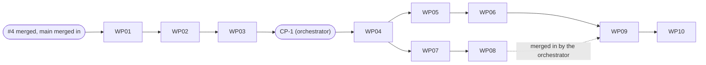

# Tasks: Work Package detail screen

> **create_intent note.** At tasks time the checkout held none of mission-ui#4's code, so literal `owned_files` paths that #4 creates (for example `eslint.data-driven.config.mjs`, `packages/mission-ui/src/library-sheets.ts`, `scripts/stylelint-exceptions.test.mjs`) are declared in `create_intent` to satisfy finalize-tasks. #4 has merged and those files exist: such a WP edits the file, it does not create a duplicate (checked after the merge: no `create_intent` path of any work package already exists in the tree).
>
> The part files in the `create_intent` of WP05 to WP08 (`header-parts.ts`, `facts-parts.ts`, `history-parts.ts`, `review-parts.ts`, `files-parts.ts`, `chain-parts.ts`, `work-parts.ts`, `state-parts.ts`) are literally listed only so finalize-tasks finds them: each is "created as a stub by WP04, replaced here". After WP04 they exist; WP05 to WP08 replace stub bodies and keep every signature, they do not create a second file.

Mission `work-package-screen-01M44DSJ`, target branch `feat/work-package-screen-5`. Ten work packages follow the plan's implementation concerns IC-01 to IC-09 (IC-03 split into 03a and 03b: WP03 and WP04); one operator checkpoint CP-1 sits between WP03 and WP04 and is NOT a work package. Prompts live in `tasks/`. Work packages never push and never open pull requests: the mission lands as ONE pull request after accept, dev-assist test cleanup, the aggregate review squad, history compaction into named slices, a rebase and the operator's Storybook review (orchestrator-owned).

## Dependency graph

```
build base (mission-ui#4 merged into main, main merged into feat/work-package-screen-5; orchestrator-owned, recorded before any claim)
WP01 -> WP02 -> WP03 -> [CP-1: HELD 2026-10-05, operator rulings recorded; seven DW items confirmed, 24 left to the Storybook review; E-18 narrowed, E-19 (a) deleted, E-20 dropped] -> WP04
WP04 -> WP05 -> WP06 -> WP09      (chain X: header and facts, history and review, tiers and accessibility)
WP04 -> WP07 -> WP08              (chain Y: files, chains, workspace and links; states)
WP09 -> WP10                      (WP10 depends on WP09 only; WP08 reaches WP09 and so WP10 by the orchestrator's merge into WP09's lane before WP09 is dispatched, plan.md "Lane mechanics" item 3)
```



The tool records ONE parent per work package (`dependencies` in each prompt's frontmatter): WP09 lists WP06 only; the second chain (WP08) is merged into WP09's lane by the orchestrator (`git merge --no-ff`; `custom-elements.json` resolved by `pnpm manifest:generate` only; the `status.json` rule applied; both chains' stories checked present). Fallback (plan, item 4): if that merge conflicts beyond `custom-elements.json` and `status.json`, the orchestrator serialises WP07 and WP08 after WP06 and records the decision. WP09 and WP10 each stop and report if the other chain is absent. Dependencies are tool-owned and not hand-edited.

**Build base** (`plan.md`, "Build base"): mission-ui#4 is merged into `main` and `main` is merged into `feat/work-package-screen-5` (merge commit `9aad6ef`, the recorded build base). If `main` moves before dispatch, `contracts/sk-work-package-screen.md` "Dependencies on #4" is the checklist to re-verify; a mismatch is reported, not absorbed (R-03).

**CP-1** (checkpoint, not a work package): after WP03 is approved and its spike report (S5 to S9, the Stylelint probe, the derived container thresholds) is recorded, the orchestrator puts the prototype beside the spike renders (event-timeline history, dependency node, the `sk-card` panel beside the prototype `.panel`, the three-column grid at 1280, 1100, 800, 620) in front of the operator with the DW list (DW-7, DW-24 and DW-30 carry the amended text of the 2026-10-05 rulings), the copy defaults and the evidence that decides the conditional exceptions (E-19 (a) by the probe, E-20 by S6, the narrowed E-18 by S9), and records a dated entry `CP-1 confirmed` in `tracer-design-decisions.md` and in `spec.md` Clarifications. CP-1 HELD on 2026-10-05 ("CP-1 operator rulings (2026-10-05)"): the operator accepted every recommendation; DW-10, DW-11, DW-12, DW-16, DW-17, DW-24 and DW-30 are confirmed, the other 24 DW items are confirmed at the Storybook review after the last WP; E-18 is narrowed to five properties (sunset spec-kitty-design#516), E-19 (a) is deleted, E-20 is dropped; the thresholds are 848 and 688 px. The arbiter-ruled items (all forks, P-1 to P-7, E-17 to E-20) are closed and CP-1 does not reopen them. The tool cannot express CP-1 as a dependency, so WP04's first step and first exit check is a FILE PRECONDITION: that entry exists and was committed before WP04's first commit. WP04 stops and reports if it is absent; its reviewer REJECTS if it is absent. The entry reaches WP04's lane through the orchestrator (`plan.md`, "Lane mechanics" item 5: committed on the target branch, `kitty/mission-<slug>` fast-forwarded, WP04's lane created from the approved WP03 tip with the target branch merged in, `git merge-base --is-ancestor <CP-1 commit> HEAD` checked before `implement WP04`, the dispatch naming the CP-1 commit). WP05 to WP10 depend on WP04 and carry the same precondition as their first step. WP01 to WP03 run before CP-1 (data, logic and throwaway spikes).

**Drift register**: after CP-1, DW-10, DW-11, DW-12, DW-16, DW-17, DW-24 and DW-30 are CONFIRMED; the other 24 are built as the register states them and confirmed at the operator's Storybook review after the last WP (as on #4); a difference in neither the register nor the CP-1 entry is a REJECT item for the work package that introduces it. Every prompt carries this rule.

**Baselines** (operator ruling 2026-10-05, CORRECT-012 (a)): baseline PNGs are committed ONLY in WP10, after the chains are merged. WP05 to WP09 hand over uncommitted side-by-side screenshots against the prototype per story; `pnpm visual` is not an exit check of WP05 to WP09 (missing snapshots are the known red) and first runs green in WP10. Baselines are generated only inside the pinned container.

**Parallelism**: chains X (WP05, WP06, WP09) and Y (WP07, WP08) share no ancestor beyond WP04 and have disjoint owned files (part files, stories files, test files); WP09 consumes both; WP10 integrates. Shared files are written only by the single work package the plan's "Shared files" table names, as in "Out-of-map edits" below.

**Out-of-map edits** (the tool bans `kitty-specs/` paths in a code work package's `owned_files`; shared files named by the plan for another writer are recorded edits, committed by the WP itself with plain `git add` and `git commit` and listed in its hand-off): see each work package below. `src/index.ts`, `custom-elements.json`, `sk-work-package-screen.ts`, `library-sheets.ts`, `panel-parts.ts`, `fixtures.ts`, `stylelint.config.mjs` and `eslint.config.mjs` are WP04's alone (fixtures rule: WP04 creates a prop builder for EVERY fixture name and `pairDetail`; WP05 to WP10 add nothing and only import; a gap is a change request to the orchestrator); `src/defaults/**`, `src/logic/**`, `eslint.data-driven.config.mjs`, `gates/data-driven.selftest.ts` and `gates/fixtures/data-driven/**` are WP02's alone; `src/contract/**`, `scripts/contract/**`, `contracts/spec-kitty/**`, `gates/plants/contract/**` are WP01's (WP10's re-pin commit is the one other writer); `.github/workflows/ci.yml` (timeouts only), `README.md`, both `CHANGELOG.md` files and `package.json` are WP10's (WP01 and WP02 add one CHANGELOG line each). Baseline PNGs: WP10 only. `tracer-*.md` and the `spec.md` Clarifications: the orchestrator only.

**PR size**: one pull request for the mission. Squad reading (squad after plan): the charter's "squad after the plan phase only" governs the design phases; the one aggregate review squad before the pull request is the operator's standing wrap-up rule, as in #4 (`plan.md`, "PR shape and wrap-up"). The compaction slices, named in advance (plan, "PR shape"): contract 1.1 tooling and fixtures (WP01), defaults, logic and gate cases (WP02), skeleton and layout (WP04), header and facts (WP05), history and review (WP06), chains, subtasks, workspace, files and links (WP07), states (WP08), tiers, accessibility and edge cases (WP09), integration, baselines and re-pin (WP10). There is NO spike slice: WP03's spike code is deleted by its named final commit (`chore(ic-03a): remove spike code`), so nothing of it reaches the lane or the PR.

**Re-pin and HALT**: WP10 re-pins the contract to `main` when spec-kitty#5625 is on `main`; if it is not, WP10 HALTS and the orchestrator asks the operator; the plan does not choose.

## Subtask Index

| ID | Description | WP | Parallel |
|----|-------------|----|----------|
| T001 | Baseline record of every gate on the merged build base; verify #4 symbols (WP01) | WP01 | No |
| T002 | `contract:update --from-repo` (git objects only) with `update.test.mjs` (WP01) | WP01 | No |
| T003 | Provisional 1.1 pin: vendor 150 files, regenerate, record provenance (WP01) | WP01 | No |
| T004 | C8, `--require-main`, CLI tests (`cli.test.mjs`), ancestry check, plant 4 (WP01) | WP01 | No |
| T005 | Independent literal floors (150 files, 70 fixtures) and anchor-file presence check (WP01) | WP01 | No |
| T006 | C5 WorkPackage rules and extended `actorProblems` (WP01) | WP01 | No |
| T007 | Four relaxations, overlays, registry, 48 new fixtures, bulk generators (WP01) | WP01 | No |
| T008 | Widened view types, literals, `tsc`, hygiene, CHANGELOG line (WP01) | WP01 | No |
| T009 | Five default modules and the one `defaults/index.ts` edit (WP02) | WP02 | No |
| T010 | Seven logic files, nine functions (WP02) | WP02 | No |
| T011 | Unit tests with foreign values and positive controls (eight test files) (WP02) | WP02 | No |
| T012 | Extend the data-driven gate config (verdict, change-state, staleness enums) (WP02) | WP02 | No |
| T013 | New self-test cases, shown red against the unchanged config (WP02) | WP02 | No |
| T014 | False-positive cases, `EXPECTED_WORDS` and count guards (WP02) | WP02 | No |
| T015 | CHANGELOG line, hand-off with red-before/green-after record (WP02) | WP02 | No |
| T016 | Spike scaffolding: two permitted config additions, pinned container (WP03) | WP03 | No |
| T017 | Spikes S5 (evidence chain) and S6 (dependency node) (WP03) | WP03 | No |
| T018 | Spike S7 (event-timeline sheet in a shadow root) (WP03) | WP03 | No |
| T019 | Spike S8 (container-query grid, derived thresholds, Stylelint probe) (WP03) | WP03 | No |
| T020 | Spike S9 (`sk-card` with `sk-section-header` as the panel) (WP03) | WP03 | No |
| T021 | CP-1 packet, named final commit `chore(ic-03a): remove spike code`, tip-tree check (WP03) | WP03 | No |
| T022 | FILE PRECONDITION: `CP-1 confirmed` entry and ancestry (first step, first exit check) (WP04) | WP04 | No |
| T023 | The screen element: ten properties, status switches, layout, four dispatch methods, focus rule (WP04) | WP04 | No |
| T024 | `panel-parts.ts` complete, stubs for the other parts, breadcrumb and empty-form renderers complete, two sheets (WP04) | WP04 | No |
| T025 | `fixtures.ts`: prop builders for every fixture and `pairDetail` (WP04) | WP04 | No |
| T026 | Registration, skeleton tests (events, 3-2-1-1 layout), surface-freeze test (WP04) | WP04 | No |
| T027 | Exceptions as ruled (E-17, E-19 (b), E-18 narrowed to five properties; no E-19 (a), no E-20) with leak plants (WP04) | WP04 | No |
| T028 | Scratch shellFrame story (uncommitted) and the single manifest regeneration (the freeze) (WP04) | WP04 | No |
| T029 | Header: crumb call, `h1`, status, actor and staleness badges (WP05) | WP05 | Yes |
| T030 | Facts, Assignment, Frontmatter (WP05) | WP05 | Yes |
| T031 | The ten `Header and facts` stories (WP05) | WP05 | Yes |
| T032 | Tests: EV-4, DOM absence with presence controls, omitted vs null, hidden `not_applicable` text (WP05) | WP05 | Yes |
| T033 | Layout CSS, exception check, data-driven self-check (WP05) | WP05 | Yes |
| T034 | Side-by-side hand-over (uncommitted, no PNG) (WP05) | WP05 | Yes |
| T035 | Lane history on the event-timeline sheet ("Current" by position) (WP06) | WP06 | Yes |
| T036 | Review panel: summary, override, cycles, "Open review", cancellation notice (WP06) | WP06 | Yes |
| T037 | The thirteen `Review and history` stories (WP06) | WP06 | Yes |
| T038 | Tests: order with cast inputs, EV-6, omitted vs empty cycles, foreign values (WP06) | WP06 | Yes |
| T039 | Side-by-side hand-over (uncommitted, no PNG) (WP06) | WP06 | Yes |
| T040 | Owned files (WP07) | WP07 | Yes |
| T041 | Evidence chain (native `ol` of `sk-pill-tag`) (WP07) | WP07 | Yes |
| T042 | Dependency chain (ghost `sk-button` nodes; E-20 dropped) (WP07) | WP07 | Yes |
| T043 | Subtasks, Workspace, artifact links (WP07) | WP07 | Yes |
| T044 | The nineteen `Chains, subtasks, workspace and links` stories (WP07) | WP07 | Yes |
| T045 | Tests: EV-1, EV-5, workspace omitted vs all-null, WP-32 no-removal word (WP07) | WP07 | Yes |
| T046 | Side-by-side hand-over (uncommitted, no PNG) (WP07) | WP07 | Yes |
| T047 | Whole-screen states (loading, error, empty, not-found, nothing-selected) (WP08) | WP08 | Yes |
| T048 | Regional detail notice and busy indicator (WP08) | WP08 | Yes |
| T049 | The eight `States` stories (WP08) | WP08 | Yes |
| T050 | Tests: EV-3, EV-7, region-set, payload rule per branch, refusal code, focus order and restoration (WP08) | WP08 | Yes |
| T051 | Side-by-side hand-over (uncommitted, no PNG) (WP08) | WP08 | Yes |
| T052 | The six `Tiers and edge cases` stories (WP09) | WP09 | Yes |
| T053 | Accessibility tests: semantics, announcements, unique names, tab order, keyboard (WP09) | WP09 | Yes |
| T054 | EV-2, EV-8, the NFR-004 large-text test, the 100 percent text assertions and the FR-022 time tests (WP09) | WP09 | Yes |
| T055 | NFR-006 structural render test (identity and exact counts) (WP09) | WP09 | Yes |
| T056 | Focus-restoration tests for the detail-retry and dependency-node triggers (WP09) | WP09 | Yes |
| T057 | Side-by-side hand-over (uncommitted, no PNG) (WP09) | WP09 | Yes |
| T058 | First step: confirm the merged tree, run the full gate set (WP10) | WP10 | No |
| T059 | Manifest regeneration, shell check (FR-037), host-composition test (SC-008) (WP10) | WP10 | No |
| T060 | Row-to-story node test and pairing test (WP10) | WP10 | No |
| T061 | Commit 56 baselines, side-by-side review, five clean runs, gate-proof (WP10) | WP10 | No |
| T062 | CI timeouts re-derived and timing record (WP10) | WP10 | No |
| T063 | README, CHANGELOGs, terminology (WP10) | WP10 | No |
| T064 | Contract re-pin to `main` and its proofs (HALT if #5625 is not on `main`) (WP10) | WP10 | No |
| T065 | Drift review and pull-request inputs (WP10) | WP10 | No |

## WP01: Contract 1.1 vendoring, tooling and fixtures (IC-01)

- Prompt: `tasks/WP01-contract-1-1-vendoring-tooling-fixtures.md`
- Depends on: none
- Requirements: FR-032, FR-033, FR-034, C-002, C-008, NFR-001, NFR-007, NFR-010
- Subtasks: T001-T008
- Owned files: `contracts/spec-kitty/**`, `scripts/contract/**`, `packages/mission-ui/src/contract/**`, `gates/plants/contract/**`
- Out-of-map edits permitted (not owned; committed by the WP itself): both `CHANGELOG.md` files (one line each; WP10 reconciles); `package.json` only if the `test:contract` script must name `update.test.mjs` and `cli.test.mjs` (a NAMED edit of WP01, listed in the plan's Shared files table; IC-09 owns every other `package.json` edit)
- Estimated prompt size: about 248 lines

T001 Baseline record of every gate on the merged build base; verify #4 symbols (WP01)
T002 `contract:update --from-repo` (git objects only) with `update.test.mjs` (WP01)
T003 Provisional 1.1 pin: vendor 150 files, regenerate, record provenance (WP01)
T004 C8, `--require-main`, CLI tests (`cli.test.mjs`), ancestry check, plant 4 (WP01)
T005 Independent literal floors (150 files, 70 fixtures) and anchor-file presence check (WP01)
T006 C5 WorkPackage rules and extended `actorProblems` (WP01)
T007 Four relaxations, overlays, registry, 48 new fixtures, bulk generators (WP01)
T008 Widened view types, literals, `tsc`, hygiene, CHANGELOG line (WP01)

## WP02: Defaults, logic and data-driven gate extension (IC-02)

- Prompt: `tasks/WP02-defaults-logic-data-driven-gate.md`
- Depends on: WP01
- Requirements: FR-004, FR-011, FR-012, FR-019, FR-023, FR-034, C-004, C-007, NFR-009, NFR-011
- Subtasks: T009-T015
- Owned files: `packages/mission-ui/src/defaults/**`, `packages/mission-ui/src/logic/**`, `packages/mission-ui/test/wp-defaults.test.ts`, `packages/mission-ui/test/wp-lists.test.ts`, `packages/mission-ui/test/wp-actor.test.ts`, `packages/mission-ui/test/wp-files.test.ts`, `packages/mission-ui/test/wp-history.test.ts`, `packages/mission-ui/test/wp-review.test.ts`, `packages/mission-ui/test/wp-staleness.test.ts`, `packages/mission-ui/test/wp-retry.test.ts`, `eslint.data-driven.config.mjs`, `gates/data-driven.selftest.ts`, `gates/fixtures/data-driven/**`
- Out-of-map edits permitted (not owned; committed by the WP itself): both `CHANGELOG.md` files (one line; WP10 reconciles); `package.json` only if the unit-test or data-driven scripts need a file name (a NAMED edit of WP02, listed in the plan's Shared files table; IC-09 owns every other `package.json` edit)
- Estimated prompt size: about 249 lines

T009 Five default modules and the one `defaults/index.ts` edit (WP02)
T010 Seven logic files, nine functions (WP02)
T011 Unit tests with foreign values and positive controls (eight test files) (WP02)
T012 Extend the data-driven gate config (verdict, change-state, staleness enums) (WP02)
T013 New self-test cases, shown red against the unchanged config (WP02)
T014 False-positive cases, `EXPECTED_WORDS` and count guards (WP02)
T015 CHANGELOG line, hand-off with red-before/green-after record (WP02)

## WP03: Foundation spikes S5 to S9 and CP-1 evidence (IC-03a)

- Prompt: `tasks/WP03-spikes-s5-s9-and-cp1-evidence.md`
- Depends on: WP02
- Requirements: FR-029, FR-030, FR-036, FR-038, NFR-008, C-005, C-006
- Subtasks: T016-T021
- Owned files: `spikes/ic-03a/**`, `apps/storybook/.storybook/main.ts`
- Out-of-map edits permitted (not owned; committed by the WP itself): `eslint.config.mjs` (the one `ignores` entry for `spikes/ic-03a/**`, removed by the final commit; the file is WP04's otherwise)
- Estimated prompt size: about 210 lines

T016 Spike scaffolding: two permitted config additions, pinned container (WP03)
T017 Spikes S5 (evidence chain) and S6 (dependency node) (WP03)
T018 Spike S7 (event-timeline sheet in a shadow root) (WP03)
T019 Spike S8 (container-query grid, derived thresholds, Stylelint probe) (WP03)
T020 Spike S9 (`sk-card` with `sk-section-header` as the panel) (WP03)
T021 CP-1 packet, named final commit `chore(ic-03a): remove spike code`, tip-tree check (WP03)

## WP04: Foundation: skeleton, layout and surface freeze (IC-03b)

- Prompt: `tasks/WP04-skeleton-layout-and-surface-freeze.md`
- Depends on: WP03
- Precondition: the `CP-1 confirmed` entry (file precondition, T022)
- Requirements: FR-001, FR-028, FR-029, FR-030, FR-032, FR-035, FR-038, C-001, C-003, C-005, C-010, NFR-005
- Subtasks: T022-T028
- Owned files: `packages/mission-ui/src/index.ts`, `packages/mission-ui/custom-elements.json`, `packages/mission-ui/src/library-sheets.ts`, `packages/mission-ui/src/elements/sk-work-package-screen/sk-work-package-screen.ts`, `packages/mission-ui/src/elements/sk-work-package-screen/panel-parts.ts`, `packages/mission-ui/src/elements/sk-work-package-screen/fixtures.ts`, `packages/mission-ui/test/sk-work-package-screen.skeleton.test.ts`, `packages/mission-ui/test/surface-freeze.test.ts`, `stylelint.config.mjs`, `eslint.config.mjs`, `scripts/stylelint-exceptions.test.mjs`
- Out-of-map edits permitted (not owned; committed by the WP itself): the eight stub part files it creates under `packages/mission-ui/src/elements/sk-work-package-screen/` (`header-parts.ts`, `facts-parts.ts`, `files-parts.ts`, `history-parts.ts`, `review-parts.ts`, `chain-parts.ts`, `work-parts.ts`, `state-parts.ts`; owned by WP05 to WP08 afterwards); the ESLint override leak-plant test file of #4's E-01 to E-03 if it is not `scripts/stylelint-exceptions.test.mjs`
- Estimated prompt size: about 238 lines

T022 FILE PRECONDITION: `CP-1 confirmed` entry and ancestry (first step, first exit check) (WP04)
T023 The screen element: ten properties, status switches, layout, four dispatch methods, focus rule (WP04)
T024 `panel-parts.ts` complete, stubs for the other parts, breadcrumb and empty-form renderers complete, two sheets (WP04)
T025 `fixtures.ts`: prop builders for every fixture and `pairDetail` (WP04)
T026 Registration, skeleton tests (events, 3-2-1-1 layout), surface-freeze test (WP04)
T027 Exceptions as ruled (E-17, E-19 (b), E-18 narrowed to five properties; no E-19 (a), no E-20) with leak plants (WP04)
T028 Scratch shellFrame story (uncommitted) and the single manifest regeneration (the freeze) (WP04)

## WP05: Header, Facts, Assignment and Frontmatter (chain X) (IC-04)

- Prompt: `tasks/WP05-header-facts-assignment-frontmatter.md`
- Depends on: WP04
- Precondition: the `CP-1 confirmed` entry is an ancestor of the lane (first step)
- Requirements: FR-002, FR-003, FR-005, FR-006, FR-007, FR-018, FR-019, FR-021, FR-035, FR-036, FR-037, NFR-011
- Subtasks: T029-T034
- Owned files: `packages/mission-ui/src/elements/sk-work-package-screen/header-parts.ts`, `packages/mission-ui/src/elements/sk-work-package-screen/facts-parts.ts`, `packages/mission-ui/src/elements/sk-work-package-screen/sk-work-package-screen.header-facts.stories.ts`, `packages/mission-ui/test/sk-work-package-screen.events-4.test.ts`, `packages/mission-ui/test/wp-header-parts.test.ts`, `packages/mission-ui/test/wp-facts-parts.test.ts`
- Out-of-map edits permitted (not owned; committed by the WP itself): none expected
- Estimated prompt size: about 217 lines

T029 Header: crumb call, `h1`, status, actor and staleness badges (WP05)
T030 Facts, Assignment, Frontmatter (WP05)
T031 The ten `Header and facts` stories (WP05)
T032 Tests: EV-4, DOM absence with presence controls, omitted vs null, hidden `not_applicable` text (WP05)
T033 Layout CSS, exception check, data-driven self-check (WP05)
T034 Side-by-side hand-over (uncommitted, no PNG) (WP05)

## WP06: Lane history and Review (chain X) (IC-05)

- Prompt: `tasks/WP06-lane-history-and-review.md`
- Depends on: WP05
- Precondition: the `CP-1 confirmed` entry is an ancestor of the lane (first step)
- Requirements: FR-011, FR-012, FR-013, FR-014, FR-018, FR-020, FR-023, FR-035, FR-036, NFR-011
- Subtasks: T035-T039
- Owned files: `packages/mission-ui/src/elements/sk-work-package-screen/history-parts.ts`, `packages/mission-ui/src/elements/sk-work-package-screen/review-parts.ts`, `packages/mission-ui/src/elements/sk-work-package-screen/sk-work-package-screen.review-history.stories.ts`, `packages/mission-ui/test/sk-work-package-screen.events-6.test.ts`, `packages/mission-ui/test/wp-history-parts.test.ts`, `packages/mission-ui/test/wp-review-parts.test.ts`
- Out-of-map edits permitted (not owned; committed by the WP itself): none expected
- Estimated prompt size: about 203 lines

T035 Lane history on the event-timeline sheet ("Current" by position) (WP06)
T036 Review panel: summary, override, cycles, "Open review", cancellation notice (WP06)
T037 The thirteen `Review and history` stories (WP06)
T038 Tests: order with cast inputs, EV-6, omitted vs empty cycles, foreign values (WP06)
T039 Side-by-side hand-over (uncommitted, no PNG) (WP06)

## WP07: Owned files, chains, subtasks, workspace and links (chain Y) (IC-06)

- Prompt: `tasks/WP07-files-chains-subtasks-workspace-links.md`
- Depends on: WP04
- Precondition: the `CP-1 confirmed` entry is an ancestor of the lane (first step)
- Requirements: FR-004, FR-008, FR-009, FR-010, FR-015, FR-016, FR-017, FR-018, FR-023, FR-035, FR-036, NFR-011
- Subtasks: T040-T046
- Owned files: `packages/mission-ui/src/elements/sk-work-package-screen/files-parts.ts`, `packages/mission-ui/src/elements/sk-work-package-screen/chain-parts.ts`, `packages/mission-ui/src/elements/sk-work-package-screen/work-parts.ts`, `packages/mission-ui/src/elements/sk-work-package-screen/sk-work-package-screen.chains-work.stories.ts`, `packages/mission-ui/test/sk-work-package-screen.events-1.test.ts`, `packages/mission-ui/test/sk-work-package-screen.events-5.test.ts`, `packages/mission-ui/test/wp-files-parts.test.ts`, `packages/mission-ui/test/wp-chain-parts.test.ts`, `packages/mission-ui/test/wp-work-parts.test.ts`
- Out-of-map edits permitted (not owned; committed by the WP itself): none expected
- Estimated prompt size: about 221 lines

T040 Owned files (WP07)
T041 Evidence chain (native `ol` of `sk-pill-tag`) (WP07)
T042 Dependency chain (ghost `sk-button` nodes; E-20 dropped) (WP07)
T043 Subtasks, Workspace, artifact links (WP07)
T044 The nineteen `Chains, subtasks, workspace and links` stories (WP07)
T045 Tests: EV-1, EV-5, workspace omitted vs all-null, WP-32 no-removal word (WP07)
T046 Side-by-side hand-over (uncommitted, no PNG) (WP07)

## WP08: States (chain Y) (IC-07)

- Prompt: `tasks/WP08-states.md`
- Depends on: WP07
- Precondition: the `CP-1 confirmed` entry is an ancestor of the lane (first step)
- Requirements: FR-024, FR-025, FR-026, FR-027, FR-028, FR-031, FR-035, FR-036, FR-037, NFR-011, SC-004
- Subtasks: T047-T051
- Owned files: `packages/mission-ui/src/elements/sk-work-package-screen/state-parts.ts`, `packages/mission-ui/src/elements/sk-work-package-screen/sk-work-package-screen.states.stories.ts`, `packages/mission-ui/test/sk-work-package-screen.states.test.ts`, `packages/mission-ui/test/sk-work-package-screen.events-3.test.ts`, `packages/mission-ui/test/sk-work-package-screen.events-7.test.ts`, `packages/mission-ui/test/wp-state-parts.test.ts`
- Out-of-map edits permitted (not owned; committed by the WP itself): none expected
- Estimated prompt size: about 214 lines

T047 Whole-screen states (loading, error, empty, not-found, nothing-selected) (WP08)
T048 Regional detail notice and busy indicator (WP08)
T049 The eight `States` stories (WP08)
T050 Tests: EV-3, EV-7, region-set, payload rule per branch, refusal code, focus order and restoration (WP08)
T051 Side-by-side hand-over (uncommitted, no PNG) (WP08)

## WP09: Tiers, accessibility and edge cases (IC-08)

- Prompt: `tasks/WP09-tiers-accessibility-edge-cases.md`
- Depends on: WP06
- Precondition: the `CP-1 confirmed` entry is an ancestor of the lane (first step)
- Dependency note: the tool-recorded dependency is WP06 only; WP08 (chain Y) is merged into the lane by the orchestrator before dispatch (`plan.md` Lane mechanics item 3); the WP stops if chain Y is absent.
- Requirements: FR-022, FR-029, FR-030, FR-031, FR-035, FR-036, NFR-003, NFR-004, NFR-006, NFR-011, SC-005, SC-009
- Subtasks: T052-T057
- Owned files: `packages/mission-ui/src/elements/sk-work-package-screen/sk-work-package-screen.tiers.stories.ts`, `packages/mission-ui/test/sk-work-package-screen.a11y.test.ts`, `packages/mission-ui/test/sk-work-package-screen.perf.test.ts`, `packages/mission-ui/test/sk-work-package-screen.time.test.ts`
- Out-of-map edits permitted (not owned; committed by the WP itself): none expected
- Estimated prompt size: about 203 lines

T052 The six `Tiers and edge cases` stories (WP09)
T053 Accessibility tests: semantics, announcements, unique names, tab order, keyboard (WP09)
T054 EV-2, EV-8, the NFR-004 large-text test, the 100 percent text assertions and the FR-022 time tests (WP09)
T055 NFR-006 structural render test (identity and exact counts) (WP09)
T056 Focus-restoration tests for the detail-retry and dependency-node triggers (WP09)
T057 Side-by-side hand-over (uncommitted, no PNG) (WP09)

## WP10: Integration, baselines, re-pin, timings and documentation (IC-09)

- Prompt: `tasks/WP10-integration-baselines-repin-timings-docs.md`
- Depends on: WP09
- Precondition: the `CP-1 confirmed` entry is an ancestor of the lane (first step)
- Dependency note: WP09's lane already contains both chains; WP10 stops if a part file is still a stub.
- Requirements: FR-032, FR-033, FR-034, FR-036, FR-037, FR-038, NFR-001, NFR-002, NFR-007, NFR-008, NFR-010, C-006, C-009, C-011, C-012, SC-001, SC-002, SC-003, SC-004, SC-005, SC-006, SC-007, SC-008, SC-009
- Subtasks: T058-T065
- Owned files: `apps/storybook/tests/visual/__snapshots__/**`, `packages/mission-ui/test/host-composition.test.ts`, `packages/mission-ui/test/wp-pairing.test.ts`, `scripts/wp-story-catalogue.test.mjs`, `.github/workflows/ci.yml`, `package.json`, `README.md`, `CHANGELOG.md`, `packages/mission-ui/CHANGELOG.md`
- Out-of-map edits permitted (not owned; committed by the WP itself): `packages/mission-ui/custom-elements.json` (one regeneration only); the re-pin commit: `contracts/spec-kitty/PIN.json`, `packages/mission-ui/src/contract/types.generated.ts`, `packages/mission-ui/src/contract/fixtures.generated.ts`, `gates/plants/contract/plant.json` (plant 4 text), and `scripts/contract/check.test.mjs` only if a literal floor must change
- Estimated prompt size: about 242 lines

T058 First step: confirm the merged tree, run the full gate set (WP10)
T059 Manifest regeneration, shell check (FR-037), host-composition test (SC-008) (WP10)
T060 Row-to-story node test and pairing test (WP10)
T061 Commit 56 baselines, side-by-side review, five clean runs, gate-proof (WP10)
T062 CI timeouts re-derived and timing record (WP10)
T063 README, CHANGELOGs, terminology (WP10)
T064 Contract re-pin to `main` and its proofs (HALT if #5625 is not on `main`) (WP10)
T065 Drift review and pull-request inputs (WP10)

## Estimated prompt sizes

| WP | Lines |
|---|---|
| WP01 | 248 |
| WP02 | 249 |
| WP03 | 210 |
| WP04 | 238 |
| WP05 | 217 |
| WP06 | 203 |
| WP07 | 221 |
| WP08 | 214 |
| WP09 | 203 |
| WP10 | 242 |

## MVP note

The smallest shippable slice that shows the screen is WP01 to WP04 plus WP05 (the foundation, then header and facts): a framed screen with the frame, the header band and the left column. It is not independently mergeable (the plan ships ONE pull request, and baselines are committed only in WP10), so there is no per-work-package release; the first end-to-end review point is WP09's merged lane, and the operator's Storybook review happens after WP10's last commit and before the wrap-up.

## Coverage table

### Requirements, constraints and success criteria

| ID | Work packages |
|---|---|
| C-001 | WP04 |
| C-003 | WP04 |
| C-002 | WP01 |
| C-004 | WP02 |
| C-005 | WP03, WP04 |
| C-006 | WP03, WP10 |
| C-007 | WP02 |
| C-008 | WP01 |
| C-009 | WP10 |
| C-010 | WP04 |
| C-011 | WP10 |
| C-012 | WP10 |
| FR-001 | WP04 |
| FR-002 | WP05 |
| FR-003 | WP05 |
| FR-004 | WP02, WP07 |
| FR-005 | WP05 |
| FR-006 | WP05 |
| FR-007 | WP05 |
| FR-008 | WP07 |
| FR-009 | WP07 |
| FR-010 | WP07 |
| FR-011 | WP02, WP06 |
| FR-012 | WP02, WP06 |
| FR-013 | WP06 |
| FR-014 | WP06 |
| FR-015 | WP07 |
| FR-016 | WP07 |
| FR-017 | WP07 |
| FR-018 | WP05, WP06, WP07 |
| FR-019 | WP02, WP05 |
| FR-020 | WP06 |
| FR-021 | WP05 |
| FR-022 | WP09 |
| FR-023 | WP02, WP06, WP07 |
| FR-024 | WP08 |
| FR-025 | WP08 |
| FR-026 | WP08 |
| FR-027 | WP08 |
| FR-028 | WP04, WP08 |
| FR-029 | WP03, WP04, WP09 |
| FR-030 | WP03, WP04, WP09 |
| FR-031 | WP08, WP09 |
| FR-032 | WP01, WP04, WP10 |
| FR-033 | WP01, WP10 |
| FR-034 | WP01, WP02, WP10 |
| FR-035 | WP04, WP05, WP06, WP07, WP08, WP09 |
| FR-036 | WP03, WP05, WP06, WP07, WP08, WP09, WP10 |
| FR-037 | WP05, WP08, WP10 |
| FR-038 | WP03, WP04, WP10 |
| NFR-001 | WP01, WP10 |
| NFR-002 | WP10 |
| NFR-003 | WP09 |
| NFR-004 | WP09 |
| NFR-005 | WP04 |
| NFR-006 | WP09 |
| NFR-007 | WP01, WP10 |
| NFR-008 | WP03, WP10 |
| NFR-009 | WP02 |
| NFR-010 | WP01, WP10 |
| NFR-011 | WP02, WP05, WP06, WP07, WP08, WP09 |
| SC-001 | WP10 |
| SC-002 | WP10 |
| SC-003 | WP10 |
| SC-004 | WP08, WP10 |
| SC-005 | WP09, WP10 |
| SC-006 | WP10 |
| SC-007 | WP10 |
| SC-008 | WP10 |
| SC-009 | WP09, WP10 |

Every FR, NFR, C and SC id of the specification appears in at least one work package's `requirement_refs`; the rules C-001, C-003, C-005, C-007 and NFR-005 are additionally copied into every prompt and enforced by the gates each work package passes (`no-io`, extended `data-driven`, Stylelint, manifest), and NFR-005 is checked mission-wide in WP10's self-check list (T065).

### State matrix and event checks

| Row | Story or check | Built by | Verified in |
|---|---|---|---|
| WP-01, 09, 17, 18, 19, 20, 21 (a, b), 22, 38 | `Header and facts` (10 stories) | WP05 | WP05, WP10 (catalogue test, baselines) |
| WP-02 to 08, 23, 24 (a, b), 28, 29, 30 | `Review and history` (13 stories) | WP06 | WP06, WP10 |
| WP-10 to 16, 25 to 27, 31, 32, 33 (a, b), 34, 35 (a, b, c), 50 | `Chains, subtasks, workspace and links` (19 stories) | WP07 | WP07, WP10 |
| WP-36 (a, b), 37, 39 to 43 | `States` (8 stories) | WP08 | WP08, WP10 |
| WP-44 to 49 | `Tiers and edge cases` (6 stories) | WP09 | WP09, WP10 |
| EV-1 | `sk-select-work-package` (dependency node) | WP07 (test), WP04 (dispatch method, skeleton test) | WP07, WP09 (names, tab order), WP10 (host composition) |
| EV-2 | incoming selection not re-emitted | WP09 | WP09 |
| EV-3 | "Return to Pipeline" emits `sk-open-mission` | WP08 (test), WP04 (dispatch) | WP08, WP10 |
| EV-4 | Mission crumb emits `sk-open-mission` | WP05 (test), WP04 (renderer, dispatch) | WP05, WP10 |
| EV-5 | `sk-open-artifact` (spec, prompt) | WP07 | WP07, WP10 |
| EV-6 | `sk-open-artifact` (Open review, `REVIEW_CYCLE_ARTIFACT_KIND`) | WP06 | WP06, WP10 |
| EV-7 | `sk-retry-load` | WP08 | WP08, WP10 |
| EV-8 | state-only interactions emit nothing | WP09 | WP09 |

Story counts: 10 + 13 + 19 + 8 + 6 = 56 stories for the 50 rows (six extras: WP-21b, WP-24b, WP-33b, WP-35b, WP-35c, WP-36b); 118 existing baselines plus 56 new = 174 (committed in WP10 only). Spec amendments P-1 to P-4, P-6 and P-7 are spec text already ruled; they map to work as: P-1 to WP04 (dispatch), WP05, WP08; P-2 and P-3 to WP04 (surface); P-4 to WP05 (WP-01), WP08 (WP-43), WP10 (shell check); P-6 to WP04 and WP09 (container thresholds, WP-40, WP-46 to WP-48); P-7 to WP05 (Frontmatter pills) and WP07 (the one control).

Exceptions: E-17 (WP04 writes the per-file overrides; WP05 to WP08 use them); E-18 narrowed (five properties) and E-19 (b) applied by WP04; E-19 (a) deleted and E-20 dropped at CP-1. Gaps G-09 to G-13: reported by WP10 for the PR.

Mission-level requirements reached by every work package through the gates and the drift rule: NFR-001, NFR-008, C-005, C-006, C-011.
